# SFX FORGE – the manual

**A synthesizer for game audio.** Design sound effects and instruments, write music with them, mix it – and the game
plays the result with the same engine, so what you hear here is what the player hears.

Everything is synthesized. There are no samples and no recordings in it.

> **In the Unity package.** This is the manual of the instrument, as it is in the repository the package is
> generated from. The built instrument (firmware 1.3.1) is in the package's `Firmware~` folder:
> `sfx-forge.zip`, with `sfx-forge.wasm` inside it. The game's side is [the Unity manual](UNITY.md). The
> instrument's and the engine's C source (`sfx-forge/`, `core/`) and the scripts under `tests/` and `docs/` are
> in that repository, not in the package; here the engine is the compiled `Runtime/Plugins/x86_64/sfxforge.dll`.

| I want to … | Go to |
|---|---|
| try it right now | [1. Five minutes](#1-five-minutes) |
| know what each control is | [2. The device](#2-the-device) · [3. The display](#3-the-display) |
| make a sound effect | [5. Tutorial: a sound effect](#5-tutorial-a-sound-effect) |
| understand the knobs | [6. How a sound is built](#6-how-a-sound-is-built) · [7. The five engines](#7-the-five-engines) |
| write a beat and a tune | [9. Tutorial: a beat](#9-tutorial-a-beat) |
| make music that follows the game | [11. Layers](#11-layers-music-that-follows-the-game) |
| move a knob by itself | [12. Automation](#12-automation) |
| mix | [13. The mixer](#13-the-mixer-and-the-master-effects) |
| work with the mouse | [14. The stage](#14-the-stage) |
| get it into my game | [15. Into the game](#15-into-the-game) |
| look something up | [19. Every control](#19-every-control-page-by-page) |
| see everything on one picture | [the cheat sheet](#the-cheat-sheet) |

---

## 1. Five minutes

| | Do this | What happens |
|---|---|---|
| **1** | Drop `sfx-forge.wasm` onto the [Playground](https://play.thefirmwarehub.com/) (or `sfx-forge.zip` onto the VIBE FM plugin) | SFX FORGE starts |
| **2** | Press **MENU** | the tour: it plays and names what it can do, about 40 seconds. Any key ends it |
| **3** | Hit the **pads** | 16 sound effects. The display shows the one you hit |
| **4** | Press **F2 MUTATE** a few times | each press is a new variation. **F3 UNDO** takes one back |
| **5** | Press **PLAY** | the demo song |
| **6** | Press **K5** twice, turn **encoder 3** | INTENSITY: the band comes in instrument by instrument |
| **7** | Press **HOME** on any page | what every control does on that page |

---

## 2. The device

| | Control | What it does |
|---|---|---|
| **1** | the display | the selected sound, the page you are on, the four knobs' values, six soft keys |
| **2** | **F1 – F6** | the six soft keys shown along the bottom of the display. They change with the page |
| **3** | **encoders 1 – 4** | the four values the display shows. Hold SHIFT to turn fast |
| **4** | **DATA** | selects a sound |
| **5** | **the 16 pads** | play the kit's sounds. On the song pages they are steps, patterns or mutes – and the display draws them as 16 tiles |
| **6** | **SHIFT** | the second meaning of a key, and fast encoders |
| **7** | **K1 – K6** | the pages. Press a K key again for its next page |
| **8** | **A · B** | A: the output volume (on SEQ and AUTO, the tempo). B: the scale, or the bar's length |
| **9** | **LEFT · MENU · RIGHT** | the page (or pattern) before and after · the tour |
| **10** | **REC · STOP · PLAY** | the song |
| **11** | **the keys** | play the selected sound as an instrument, in tune |
| **12** | **RETURN · HOME** | back to the first page · the controls of this page |

### The pages

Six K keys, thirteen pages. Pressing a K key again walks to its next page.

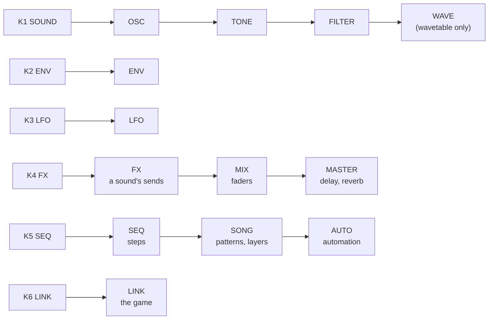

The top four rows shape **one sound**. The K4 and K5 rows after their first page are about **the song**.

---

## 3. The display

**A page is one of two kinds, and nothing else.**

| Kind | Pages | What you see |
|---|---|---|
| **A picture** | the seven sound pages, MASTER | one picture of what the knobs shape, with their four values in its four corners |
| **The pads** | SEQ, SONG, AUTO, MIX | the 16 pads drawn as 16 tiles, laid out as the pads are – with the four values in a column beside them |

### A picture page

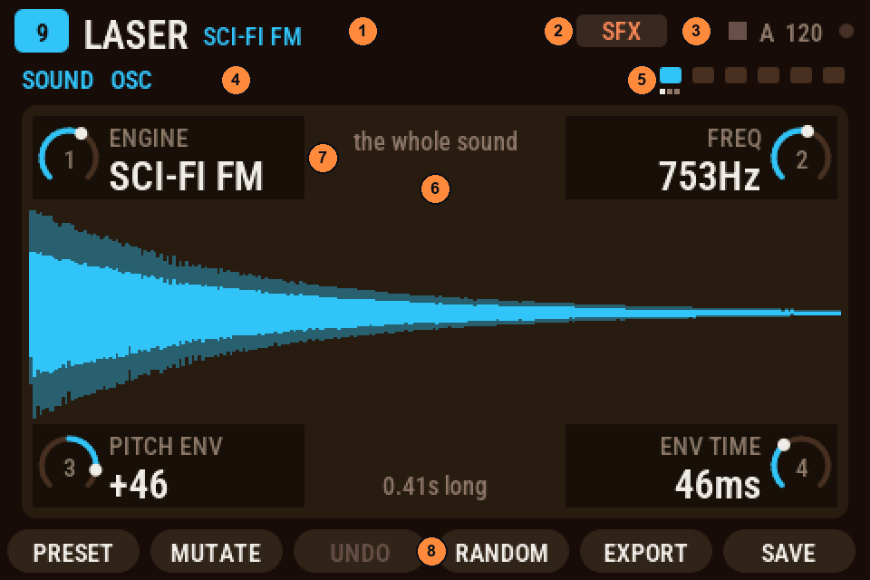

| | What it is |
|---|---|
| **1** | the selected sound: its pad number, its name, its engine |
| **2** | the kit it belongs to: SFX or MUSIC |
| **3** | the song: playing or stopped, its pattern, its tempo – and a dot that is green while a game is linked |
| **4** | the page's name |
| **5** | six marks for K1 – K6. The bright one is the key you are on; the dots under it are that key's pages |
| **6** | the picture: the sound's whole shape – and over it, in white, what this page's knobs shape (the wave, the envelope, the filter, the LFO) |
| **7** | a value in each corner: its name, its value in its unit, and a ring that stands where the knob stands. The number in the ring is the encoder: 1 top left, 2 top right, 3 bottom left, 4 bottom right |
| **8** | the soft keys = F1 – F6 |

**Turn a knob and its value is written large across the middle for a moment** – so you never have to look for it:

The picture redraws as you turn. That is the quickest way to learn what a knob does.

### A pad page

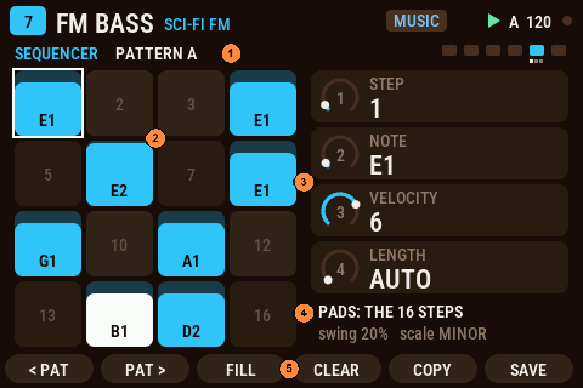

The tiles are the pads. Whatever a pad does on this page, its tile shows – here, the 16 steps of the selected sound.
The four values are in the column on the right, numbered like the encoders, with two lines under them that say what
the pads do here.

---

## 4. Two kits

SFX FORGE holds two sets of 16 sounds.

| | **SFX kit** | **MUSIC kit** |
|---|---|---|
| What is in it | the game's sound effects | the band the song plays |
| At the start | explosion, punch, coin, laser, footstep, wind … | kick, snare, hi-hat, FM bass, FM keys, brass, strings … |
| Where it goes | straight to the output, beside the song | through the mixer: fader, pan, mute |
| F1 PRESET offers | 16 sound effects | 23 instruments |

**SHIFT + K1** changes kit. The top line says which one you are in. Going to a song page chooses MUSIC by itself.

Nothing stops you from sequencing a laser or playing a footstep on the keys. The kits only keep the two jobs apart.

---

## 5. Tutorial: a sound effect

**1. Hit a pad** in the SFX kit. Press **F1 PRESET** until you have something close – here, LASER.

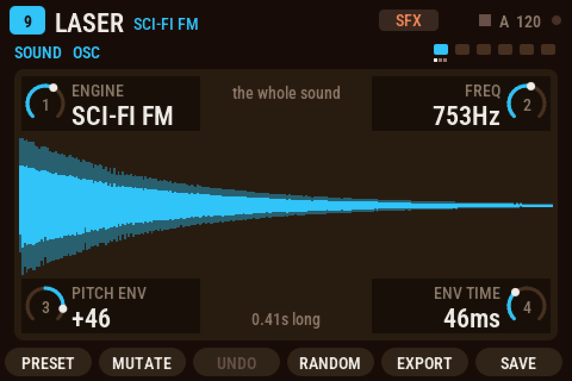

**2. Press F2 MUTATE.** Every value moves by up to 15 %. The picture changes; so does the sound. Press again for
another; **F3 UNDO** takes one back.

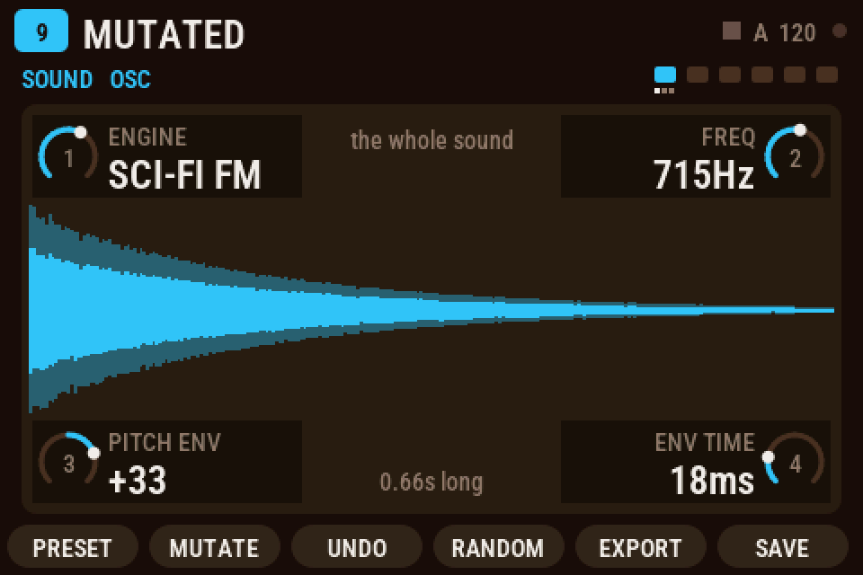

**3. Shape it by hand.** Press **K1** until FILTER is lit, and turn **encoder 1**, CUTOFF. The filter's curve moves in
white over the picture, and the sound's shape behind it gets duller.

**4. Give it a tail.** Press **K2** for the envelope and turn **encoder 2**, DECAY.

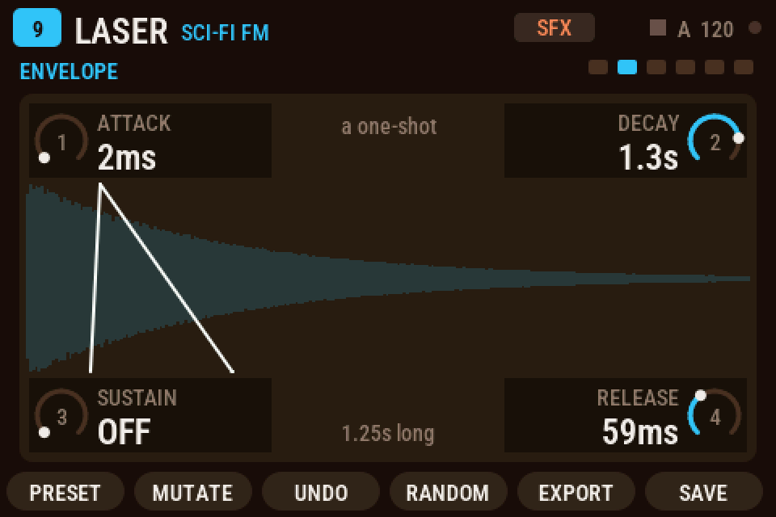

**5. Keep it.** **F6 SAVE** stores both kits and the song. **F5 EXPORT** sends this sound to the game
([section 15](#15-into-the-game)).

> **Lost?** **F4 RANDOM** is a completely new sound. **SHIFT + MENU, twice** puts everything back as it came from the
> factory – both kits and the song. What you saved is gone then.

---

## 6. How a sound is built

Every sound follows the same path. Each box is one page of four knobs.

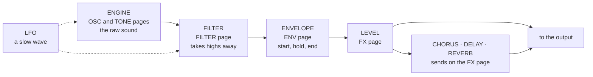

### Every value

| Page | Value | What it does | Range |
|---|---|---|---|
| **OSC** | ENGINE | which of the five engines makes the sound | |
| | FREQ | the pitch (the keys override it) | 20 Hz – 14.5 kHz |
| | PITCH ENV | how far the pitch starts above (+) or below (−) and falls back | ±4 octaves; 0 = none |
| | ENV TIME | how long that takes | 5 ms – 2.6 s |
| **TONE** | A · B | the engine's own two controls ([section 7](#7-the-five-engines)) | |
| | NOISE | how much of it is noise | 0 – 100 % |
| | CRUSH | fewer bits and samples: grit | OFF – 100 % |
| **FILTER** | CUTOFF | where the filter closes | 40 Hz – 15.5 kHz |
| | RESO | a peak at the cutoff | 0 – 100 % |
| | FILTER ENV | how far the cutoff starts above or below and returns | ±5 octaves; 0 = none |
| | F.ENV TIME | how long that takes | 5 ms – 2.6 s |
| **WAVE** | TABLE | which wavetable | six |
| | SPREAD | two detuned copies, for width | up to 30 cents |
| **ENV** | ATTACK | time to reach full level | 1.5 ms – 4 s |
| | DECAY | how fast it falls after that | 10 ms – 3.9 s |
| | SUSTAIN | the level it holds at | OFF, or up to 100 % |
| | RELEASE | how long it rings after the pad is let go | 5 ms – 3.9 s |
| **LFO** | LFO RATE | the slow wave's speed | 0.1 – 29 Hz |
| | > PITCH | vibrato | up to an octave |
| | > FILTER | wah | up to 3 octaves |
| | > TIMBRE | moves FM depth or wavetable position | |
| **FX** | CHORUS · DELAY · REVERB | how much goes to each effect | 0 – 100 % |
| | LEVEL | the sound's own loudness | 100 = as designed |

### One-shot or held: SUSTAIN decides

| SUSTAIN | The sound is | Use it for |
|---|---|---|
| **OFF** | a **one-shot**: it plays to its end however short you hit the pad | drums, coins, explosions |
| **above OFF** | **held**: it sounds while the pad or key is down, then rings out over RELEASE | strings, organs, an engine hum |

The ENV page draws which one you have:

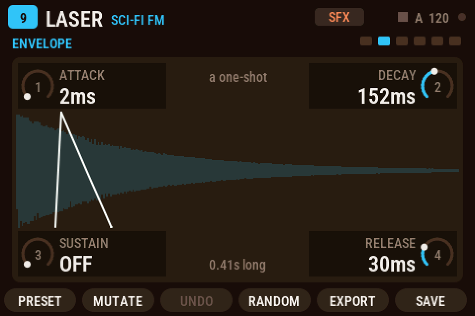

The LFO page draws the slow wave, and the FX page shows the three sends and the level:

| LFO | FX |
|---|---|
|  | 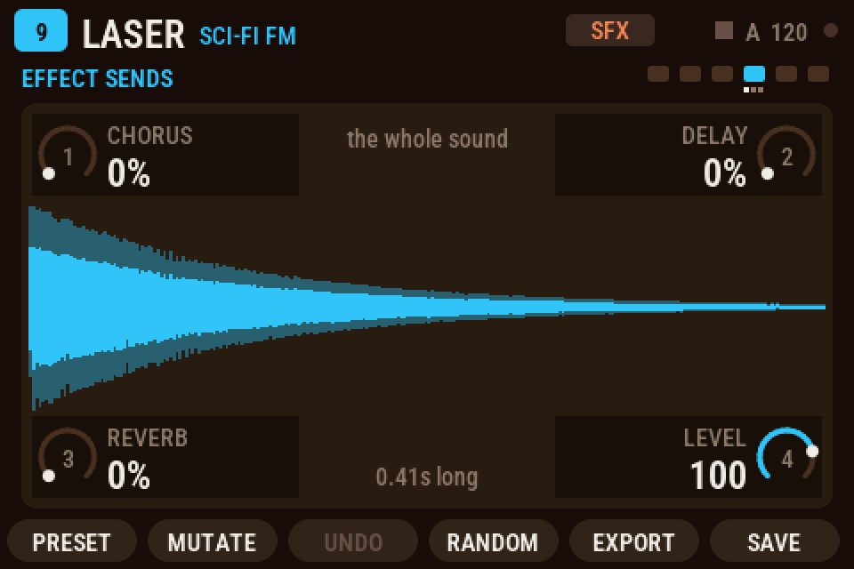 |

---

## 7. The five engines

ENGINE is the first knob of the OSC page. The two knobs **A** and **B** on the TONE page change meaning with it.

| Engine | What it is | A | B | Good for |
|---|---|---|---|---|
| **IMPACT** | a sine whose pitch falls, with FM and noise, driven hard | FM RATIO | FM DEPTH | hits, kicks, explosions |
| **UI BLIP** | a square wave that can step upwards | ARP STEP | ARP SPEED | coins, menus, chiptune |
| **SCI-FI FM** | two sines, one bending the other | FM RATIO | FM DEPTH | lasers, engines, FM bass and keys |
| **FOLEY** | noise through a band, in grains | GRAIN RATE | GRAIN AMT | steps, wind, fire, hi-hats |
| **WAVETABLE** | a wave that morphs through a table | POSITION | WARP | pads, strings, brass, organs |

**A tip for each:**

| Engine | Try this |
|---|---|
| IMPACT | PITCH ENV high with a short ENV TIME is a kick. A small fall over a long time is a tom. NOISE adds the crack |
| UI BLIP | ARP STEP 7 (a fifth) at a high ARP SPEED is the classic coin. At 0 it is a plain square wave |
| SCI-FI FM | FM RATIO around 42 is round (a bass, an electric piano); higher is bells and metal. Its brightness falls over ENV TIME – that is the pluck |
| FOLEY | CUTOFF is called BAND: it is where the noise sits. PITCH ENV sweeps the band – a whoosh. GRAIN AMT chops it: crackle, gravel, rain |
| WAVETABLE | Turn POSITION and watch the wave morph. `> TIMBRE` on the LFO page moves it by itself. SPREAD makes it wide |

A wavetable sound has a fourth SOUND page, WAVE, with its table – SAW-SQ, PULSE, PEAK, VOWEL, ORGAN or GLASS:

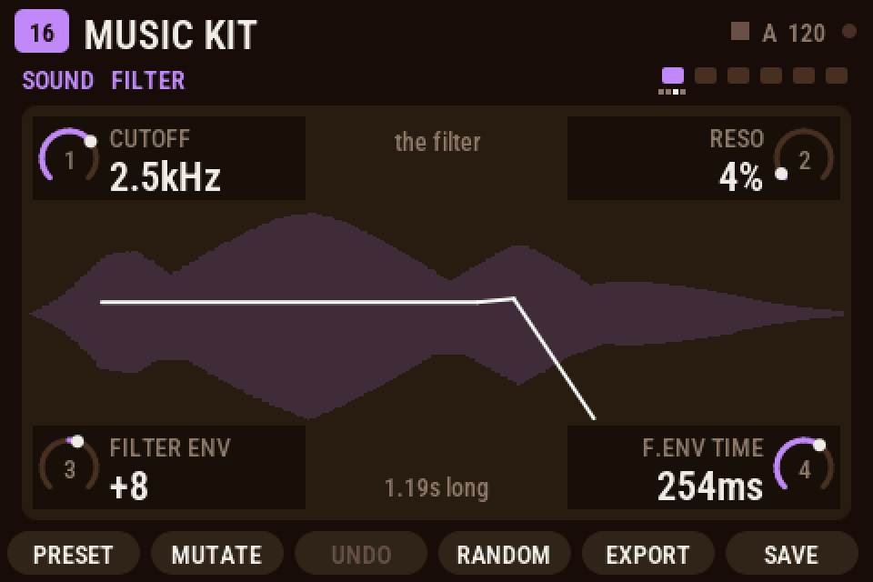

---

## 8. Instruments

**Any sound is an instrument.** The keys play the selected sound in tune (A4 = 440 Hz), up to 16 notes at once.

The MUSIC kit starts with a band on its pads:

| | | | |
|---|---|---|---|
| **1** TIMPANI | **2** SNARE | **3** KICK | **4** COWBELL |
| **5** PIZZICATO | **6** BRASS | **7** FM BASS | **8** FM KEYS |
| **9** HARP | **10** CELESTA | **11** ORGAN | **12** WT SWEEP |
| **13** HI-HAT | **14** BELLS | **15** CHOIR | **16** STRINGS |

F1 PRESET in the MUSIC kit also offers OPEN HAT, FLUTE, WT VOWEL, WT BASS, PAD, SQ BASS and SQ LEAD.

These are synthesizer instruments in the style of their names – STRINGS is a slow, detuned wavetable with chorus and
reverb, not a recording of a string section.

---

## 9. Tutorial: a beat

A **pattern** is one bar: 16 steps for each of the MUSIC kit's 16 sounds. Press **K5** for the SEQ page, and **F2**
until you reach an empty pattern.

**1. The kick.** Turn **DATA** to KICK. Press **F3 FILL** once: a kick on every 4th step.

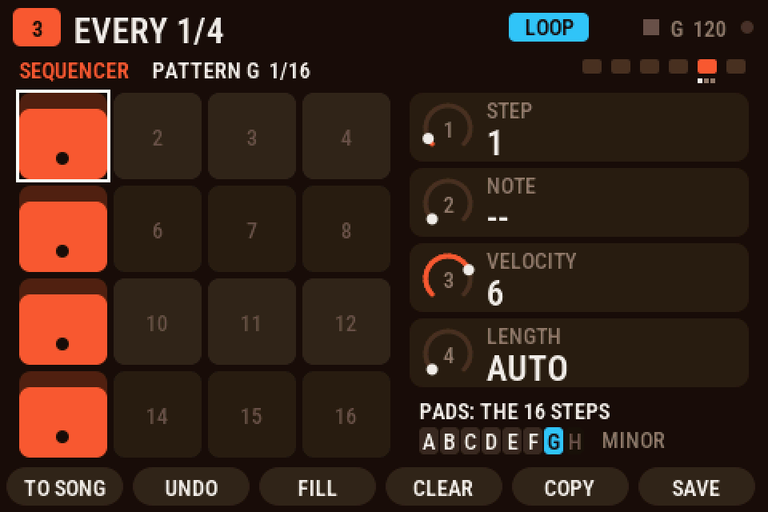

**2. The snare.** DATA to SNARE. Hit **pads 5 and 13**: the pads are the 16 steps.

**3. The hi-hat.** DATA to HI-HAT. Press **F3 FILL** twice: every 2nd step.

**4. A bass line.** DATA to FM BASS. **Hold a step's pad and play a key**: that step plays that note.

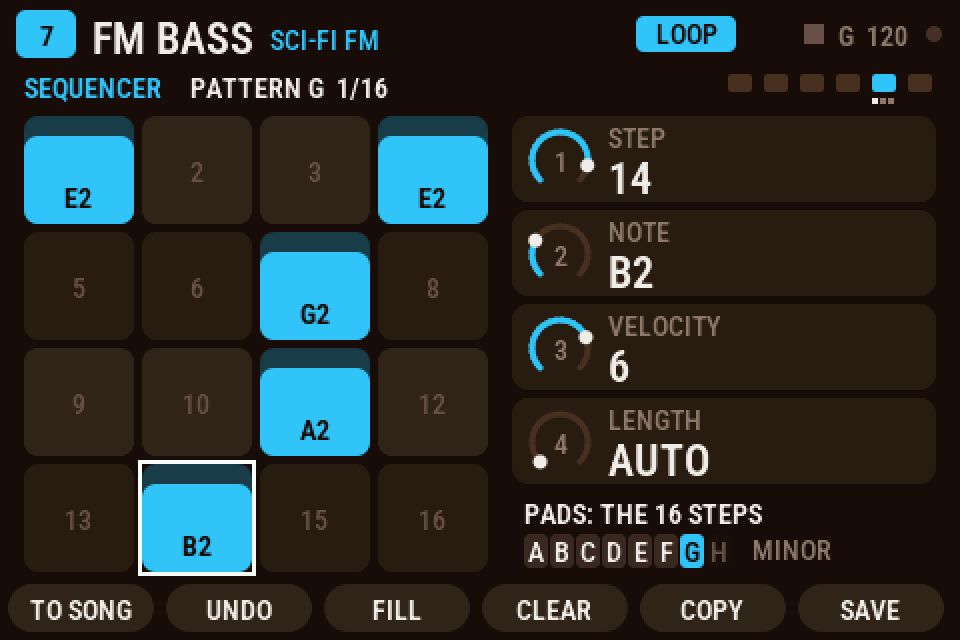

**5. Press PLAY.**

### Reading the SEQ page

| | What it is |
|---|---|
| **1** | the page and the pattern you edit |
| **2** | the 16 steps of the selected sound, as the 16 pads: **a row is a beat**. A step that is on shows its **note**; its **height** is how hard it plays; `>3` in its corner means it holds 3 steps. The frame is the step the encoders edit; the white tile is the step playing now |
| **3** | STEP · NOTE · VELOCITY · LENGTH of the framed step |
| **4** | what the pads do here, and the swing and the scale. It warns when the sound's layer is silent at the current intensity |
| **5** | pattern before / after · FILL · CLEAR the row · COPY the pattern to the next · SAVE |

The page shows one sound at a time. To see every sound's steps at once, open the stage ([section 14](#14-the-stage)).

### Everything a step can do

| To do this | Do this |
|---|---|
| switch a step on or off | hit its pad |
| choose another sound | turn DATA, or SHIFT + its pad (you hear it) |
| give a step a note | hold its pad and play a key – or turn encoder 2 NOTE (it stays in the scale) |
| make it louder or softer | encoder 3 VELOCITY, 1 – 8 |
| make a held note shorter | encoder 4 LENGTH: AUTO, or 1 – 15 steps |
| play a part in, live | **REC, then PLAY**: the pattern loops and what you play is recorded – see below |
| change the tempo | A. SHIFT + A is the swing |

### Playing it in, like on a groovebox

Press **REC**, then **PLAY**. The pattern loops, and on the SEQ page:

| | |
|---|---|
| **the pads are the drum kit** | hit a pad in time and its sound is recorded on the step nearest to your hit, as hard as you hit it. Kick, snare and hat can be played in together |
| **the keys are the notes** | SHIFT + a pad selects an instrument (without recording it); then every key you play is recorded on its step, at its pitch – a bass line or a melody in one pass |
| **the tiles follow you** | they show the steps of the sound you played last, so you see each hit land |
| **a metronome keeps time** | a click on every beat, higher on the bar line, for as long as REC is on. The red REC dot in the top line beats with it. **SHIFT + REC** turns the click off and on. It is the device's own: it is not recorded and a game never hears it |

Press **REC** again and the pads are the sixteen steps once more, to add a hit by hand or fix a note.

A step **without a note** plays the sound as designed – right for drums. **LENGTH AUTO** holds a note until the sound
plays again or the bar ends; LENGTH is for held sounds, a one-shot always plays to its own end.

---

## 10. The song

Press **K5 again** for the SONG page.

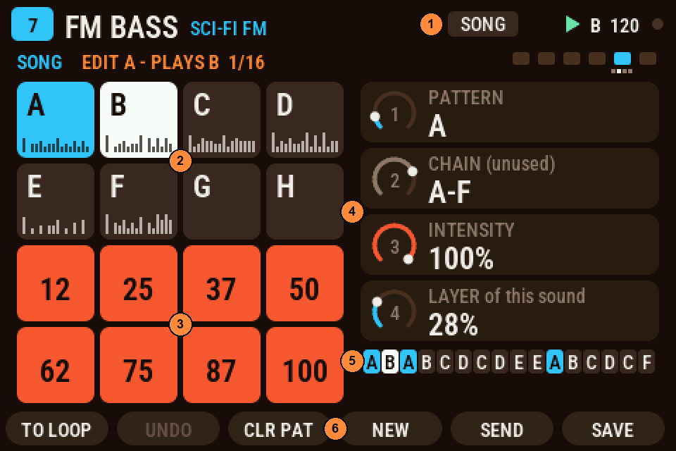

| | What it is |
|---|---|
| **1** | the eight patterns on pads 1 – 8, each with a sketch of what is in it. White: playing. Blue: the one you edit |
| **2** | INTENSITY on pads 9 – 16: the tiles light up to the current level |
| **3** | PATTERN · CHAIN · INTENSITY · the selected sound's LAYER |
| **4** | the arrangement: a pattern for each bar. The white one is playing |
| **5** | PLAY · COPY · CLR PAT · DEMO · SEND to the game · SAVE |

### How a song is put together

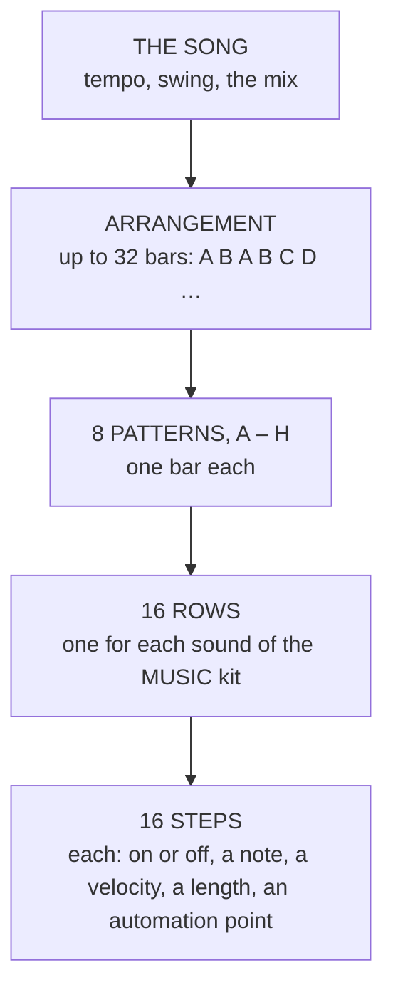

### Which pattern plays

| You want | Do this |
|---|---|
| one pattern, round and round | CHAIN (encoder 2) at 1 |
| A, B, C, D in a row, a bar each | CHAIN at A – D |
| your own order | the arrangement: **SHIFT + pad 1 – 8** adds that pattern as a bar |
| to take the last bar away | SHIFT + any of pads 9 – 15 |
| no arrangement (the chain plays again) | SHIFT + pad 16 |
| to jump to a pattern while it plays | pads 1 – 8: it changes on the next bar line |
| a bar of fewer than 16 steps | encoder B |

---

## 11. Layers: music that follows the game

This is what makes it game music.

> **Every sound has a LAYER mark. The song has one INTENSITY. A sound plays only while INTENSITY is at or above its mark.**

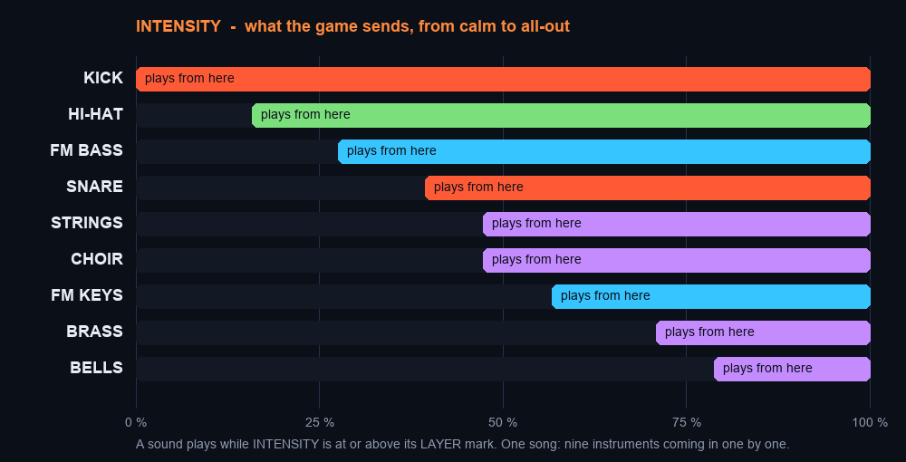

So one song is many. At 0 % only the kick plays; as the game heats up, hat, bass, snare, strings, keys, brass and
bells join in that order.

| | On the SONG page |
|---|---|
| set INTENSITY | encoder 3, or pads 9 – 16 (eight steps). A game sends it |
| set a sound's LAYER mark | select the sound (DATA), turn encoder 4 |

On the page the eight intensity tiles light up as the level rises; LAYER is the selected sound's own mark.

---

## 12. Automation

Automation moves a knob by itself while the pattern plays. **Any knob can have a lane** – and a sound can have as many
lanes as it has knobs that should move. Press **K5 a third time** for the AUTO page.

| | What it is |
|---|---|
| **1** | the pattern, and the knob this lane moves |
| **2** | the lane, as the 16 pads: a bar for each step. Bright with a white edge: a point. Dim: the value still held from the last point. The dot in a corner: the sound plays on that step |
| **3** | STEP · VALUE (in the knob's own unit) · TARGET (which knob). The orange dot says this knob has a lane |
| **4** | how many lanes this sound has, and how many of the song's 24 are in use |
| **5** | RAMP joins the points with straight lines · CLEAR empties the lane |

### What a lane can move

| | Targets |
|---|---|
| **the sound's own** | any of its 25 values: CUTOFF, FM DEPTH, POSITION, a send … |
| **its place in the mix** | VOLUME, PAN |
| **the master** | DELAY TIME, FEEDBACK, ROOM SIZE, DAMPING, DRIVE |

### The quick way: turn the knob, then press K5

**AUTO opens on the knob you turned last.** So: on any page of the MUSIC kit turn the knob you want to move – CUTOFF
on the FILTER page, a fader on MIX, ROOM SIZE on MASTER – then go to AUTO. Its lane is ready.

| | Do this |
|---|---|
| **1** | turn the knob you want to automate, on its own page |
| **2** | press **K5** until AUTO. TARGET already names that knob (or turn **encoder 3** to choose another) |
| **3** | hit **pad 1**. A point appears where the knob stands. Turn **encoder 2** down |
| **4** | hit **pad 16**. Turn encoder 2 up |
| **5** | press **F3 RAMP** – the picture above |

For a second lane on the same sound, turn TARGET to another knob and put points on it. Both play.

On a sound page, an orange dot beside a value says a lane moves that knob:

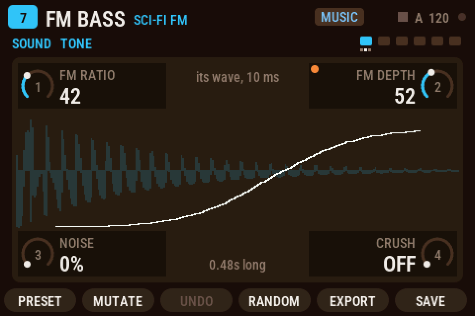

### Four rules

| | |
|---|---|
| **A point holds** | until the next point, or the end of the bar |
| **Nothing is written** | at every bar line each knob is back where you set it by hand |
| **It moves in steps** | a 16th note at a time. Use RAMP for a sweep that sounds smooth |
| **24 lanes a song** | the first point of a knob takes a lane; clearing its last point gives it back |

---

## 13. The mixer and the master effects

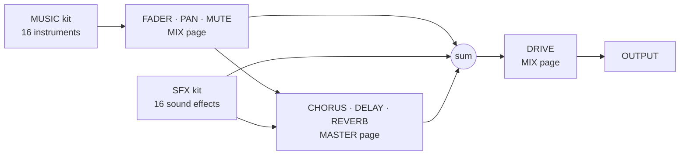

Sound effects skip the faders: a muted bass never mutes an explosion.

### MIX – press K4 twice

| | What it is |
|---|---|
| **1** | every sound of the MUSIC kit as a tile, where its pad is: its name, its fader (the small mark is 100, as designed), its pan under it. **M**: muted. **S**: solo. The frame is the selected sound |
| **2** | VOLUME and PAN of the selected sound · DRIVE: saturation on the whole mix · OUTPUT volume |
| **3** | what the pads do here |
| **4** | MUTE · SOLO · RESET the fader · ALL ON · PLAY · SAVE |

**The pads mute. SHIFT + a pad solos** – only soloed sounds play.

### MASTER – press K4 a third time

| | What it is |
|---|---|
| **1** | the delay, drawn as its echoes: left and right in turn |
| **2** | the reverb, drawn as its fading |
| **3** | the delay's values, in its corners: DELAY TIME (a 16th to a half note – it follows the tempo) and FEEDBACK |
| **4** | the reverb's: ROOM SIZE and DAMPING (low: a bright hall, high: a dark room) |

Each sound's own FX page decides how much of it goes into these.

**The mix belongs to the song.** It is saved with it and it is the mix in the game.

---

## 14. The stage

In the Playground and the plugin, **Stage** opens a bigger picture of the whole instrument, for the mouse.

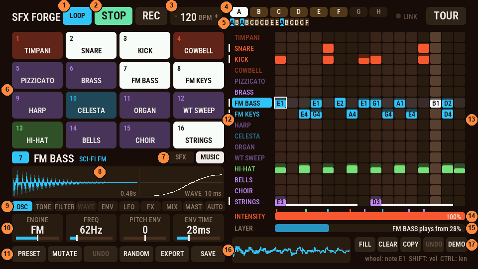

| | What it is | With the mouse |
|---|---|---|
| **1** | messages appear here | |
| **2** | PLAY / STOP · REC | click |
| **3** | the tempo | click its left or right half, or the wheel |
| **4** | the patterns A – H | click: go there · **right-click: add a bar of it to the arrangement** |
| **5** | the arrangement | click a bar: its pattern · right-click: end the arrangement before it |
| **6** | the kit's 16 pads | click to play and select |
| **7** | SFX / MUSIC | choose the kit |
| **8** | the selected sound's picture | |
| **9** | the ten tabs | click |
| **10** | the tab's four values | **drag**, or the wheel (SHIFT: bigger steps) |
| **11** | PRESET · MUTATE · UNDO · RANDOM · EXPORT · SAVE | click (right-click PRESET: the one before) |
| **12** | the rows' names | click: hear and select · right-click: mute |
| **13** | the pattern | click a step · **wheel: its note** · SHIFT + wheel: velocity · CTRL + wheel: length |
| **14** | INTENSITY, with each sound's mark above | drag |
| **15** | the selected sound's LAYER mark | drag |
| **16** | what plays now | |
| **17** | FILL · CLEAR · COPY · DEMO | click |

SHIFT-click does the same as right-click everywhere.

### Automation on the stage

| | Do this |
|---|---|
| **1** | click the **AUTO** tab: the 16 rows become the sounds' lanes |
| **2** | choose the **TARGET** (drag the cell, or the wheel). Drag **VALUE** to set one point exactly |
| **3** | **click or drag in the sound's row to draw.** The height is the value; drag across to paint a curve. Right-click removes a point |
| **4** | FILL has become **RAMP** |

---

## 15. Into the game

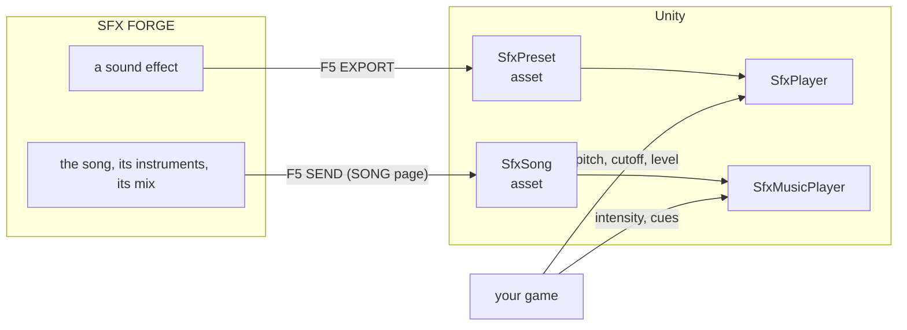

The game runs the same engine as the device (`core/`, plain C, built as a native library), so nothing is converted
and nothing sounds different.

### What the game controls

| The game wants to … | It uses |
|---|---|
| play a sound effect | `SfxPlayer` – live, or baked to an ordinary WAV |
| bend a sound while it plays (an engine that follows speed) | `SfxPlayer`'s pitch, cutoff, timbre and level |
| bring the band in and out | `SfxMusicPlayer.intensity`, 0 – 1 |
| change the music on the next bar | `SfxMusicPlayer.CuePattern(0 … 7)` |
| play one of the song's instruments by hand | `SfxMusicPlayer.PlaySound(sound, velocity, note)` |
| move the mix | `SetTrackVolume` · `SetTrackPan` · `SetTrackMute` · `SetMaster` |

### Cues and the arrangement

| The cued pattern is … | What happens |
|---|---|
| **in** the arrangement | the song carries on from that bar |
| **not in** it (keep one aside for the boss, the menu) | it takes over on the bar line and stays until the next cue |

### Tuning live

Linked over MIDI, the game drives the device while you listen and adjust. The **LINK page** (K6) shows it:

| | What it is |
|---|---|
| **1** | what the game sends: pitch, cutoff, timbre, level, intensity, pattern |
| **2** | encoders 1 – 4 send CC 20 – 23 to the game: tune a game value from here |
| **3** | green while a game is linked, with any text it sent |

The protocol, byte by byte, is in [LINK-PROTOCOL.md](LINK-PROTOCOL.md). The Unity side is this package:
[the Unity manual](UNITY.md) explains it, and its sample, the showcase game, shows all of it in one level.

---

## 16. Saving and resetting

| | |
|---|---|
| **F6 SAVE** | keeps both kits and the song – patterns, arrangement, layers, mix, automation. A DAW project keeps them too |
| **F4 DEMO** (SONG page) | the demo song again. It replaces your song, not your sounds |
| **SHIFT + MENU, twice** | factory reset: both kits and the song as they came, and saved so. Press it once and it asks; twice within three seconds does it |

The game and the device read songs from every earlier version of the format. A kit or song *stored on the device* by
an earlier version is not read; the factory kits and the demo appear instead.

---

## 17. Recipes

| I want … | Do this |
|---|---|
| **a laser in ten seconds** | SFX kit, F1 until LASER, F2 MUTATE until you like it |
| **a footstep that is never the same** | in the game, play FOOTSTEP at a slightly different pitch each time – or EXPORT four mutations and pick one at random |
| **an engine that follows speed** | ENGINE HUM (a held sound) on an `SfxPlayer`, with an `SfxTelemetrySender` feeding speed to pitch and cutoff |
| **a chord that swells** | STRINGS: one step with a note, LENGTH 12. AUTO page: TARGET VOLUME, a low point on step 1, a high one on step 12, RAMP |
| **a filter sweep into the drop** | AUTO page, the bass, TARGET CUTOFF, points on steps 1 and 16, RAMP |
| **echoes on the snare only** | SNARE's FX page: DELAY up. MASTER page: DELAY TIME 3/16, FEEDBACK to taste |
| **music that reacts to danger** | low LAYER marks for the calm instruments, high for the tense ones. The game sets `intensity` from how close the enemy is |
| **a boss theme** | write it in pattern H and leave H out of the arrangement. `CuePattern(7)` when the boss appears, `CuePattern(0)` after |
| **a variation of a pattern** | F5 COPY on the SEQ page: the next pattern is a copy, and you are on it |
| **to start over** | SHIFT + MENU, twice |

---

## 18. What it does not do

| | |
|---|---|
| **Samples** | it cannot play recorded audio: no voice lines, no recorded foley, no real orchestra |
| **Timing** | a bar is 16 steps. No triplets inside a bar, no notes between steps; swing is the only timing change |
| **Size** | 8 patterns, 32 bars of arrangement, 16 voices – with long reverberant sounds the oldest note is cut to make room |
| **Automation** | 24 lanes a song, moving in steps, not glides |
| **Chords** | one note per step for each sound. A chord needs several sounds, or the keys |
| **Platforms** | the Unity package runs on Windows x64 so far. Its MIDI link is tested against the emulator over a virtual cable, not against the hardware |
| **The stage** | has no control for the swing; it is SHIFT + A on the device |

---

## 19. Every control, page by page

### The cheat sheet

For those who know their way around: every page and every shortcut on one picture.

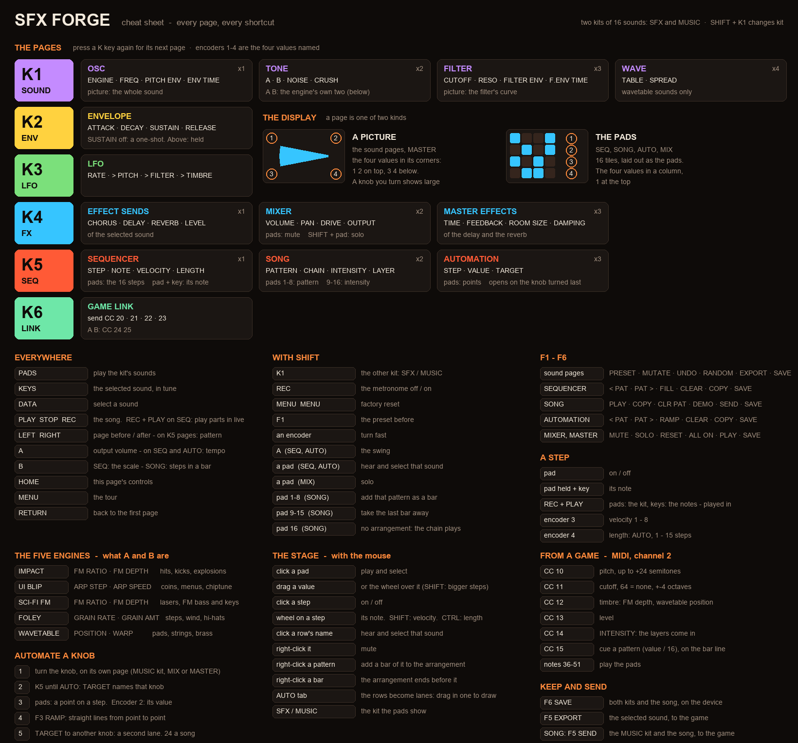

### The same, as tables

**Everywhere:** pads play · keys play the selected sound in tune · DATA selects · SHIFT + K1 the other kit ·
PLAY STOP REC the song · MENU the tour · HOME this page's controls · A the output volume · SHIFT + MENU twice: reset.

| Page | Key | Pads | Encoders 1 – 4 | F1 – F6 |
|---|---|---|---|---|
| **OSC** | K1 | play | ENGINE · FREQ · PITCH ENV · ENV TIME | PRESET · MUTATE · UNDO · RANDOM · EXPORT · SAVE |
| **TONE** | K1 ×2 | play | A · B · NOISE · CRUSH | the same |
| **FILTER** | K1 ×3 | play | CUTOFF · RESO · FILTER ENV · F.ENV TIME | the same |
| **WAVE** | K1 ×4 | play | TABLE · SPREAD | the same |
| **ENV** | K2 | play | ATTACK · DECAY · SUSTAIN · RELEASE | the same |
| **LFO** | K3 | play | LFO RATE · > PITCH · > FILTER · > TIMBRE | the same |
| **FX** | K4 | play | CHORUS · DELAY · REVERB · LEVEL | the same |
| **MIX** | K4 ×2 | mute · SHIFT: solo | VOLUME · PAN · DRIVE · OUTPUT | MUTE · SOLO · RESET · ALL ON · PLAY · SAVE |
| **MASTER** | K4 ×3 | play | DELAY TIME · FEEDBACK · ROOM SIZE · DAMPING | as MIX |
| **SEQ** | K5 | steps · SHIFT: select a sound | STEP · NOTE · VELOCITY · LENGTH | < PAT · PAT > · FILL · CLEAR · COPY · SAVE |
| **SONG** | K5 ×2 | 1 – 8 pattern · 9 – 16 intensity · SHIFT: arrangement | PATTERN · CHAIN · INTENSITY · LAYER | PLAY · COPY · CLR PAT · DEMO · SEND · SAVE |
| **AUTO** | K5 ×3 | a point on / off · SHIFT: select a sound | STEP · VALUE · TARGET (it opens on the knob turned last) | < PAT · PAT > · RAMP · CLEAR · COPY · SAVE |
| **LINK** | K6 | play | send CC 20 – 23 | as the sound pages |

| Other encoder | Where | What it does |
|---|---|---|
| **A** | SEQ, AUTO | the tempo. SHIFT + A: the swing |
| **A · B** | LINK | send CC 24 and 25 |
| **B** | SEQ | the scale NOTE moves in |
| **B** | SONG | the number of steps in a bar |
