# SFX FORGE – the manual

**A synthesizer for game audio.** Design sound effects and instruments, write music with them, mix it – and the game
plays the result with the same engine, so what you hear here is what the player hears.

Everything is synthesized. There are no samples and no recordings in it.

> **In the Unity package.** This is the manual of the instrument, as it is in the repository the package is
> generated from. The built instrument (firmware 1.7.2) is in the package's `Firmware~` folder:
> `sfx-forge.zip`, with `sfx-forge.wasm` inside it. The game's side is [the Unity manual](UNITY.md). The
> instrument's and the engine's C source (`sfx-forge/`, `core/`) and the scripts under `tests/` and `docs/` are
> in that repository, not in the package; here the engine is the compiled `Runtime/Plugins/x86_64/sfxforge.dll`.

This manual describes firmware 1.7.2.

| I want to … | Go to |
|---|---|
| try it right now | [1. Five minutes](#1-five-minutes) |
| know what each control is | [2. The device](#2-the-device) · [3. The display](#3-the-display) |
| make a sound effect | [5. Tutorial: a sound effect](#5-tutorial-a-sound-effect) |
| understand the knobs | [6. How a sound is built](#6-how-a-sound-is-built) · [7. The five engines](#7-the-five-engines) |
| keep a pattern playing and play into it | [Loop a pattern and play into it](#loop-a-pattern-and-play-into-it) |
| write a beat and a tune | [9. Tutorial: a beat](#9-tutorial-a-beat) |
| play faster than a sixteenth: a roll, a fill | [A finer grid](#a-finer-grid-132-and-164) |
| write in 3/4, 6/8 or 7/8 | [The bar and the beat](#the-bar-and-the-beat-34-68-78) |
| take something back | [UNDO](#undo) |
| make music that follows the game | [11. Layers](#11-layers-music-that-follows-the-game) |
| move a knob by itself | [12. Automation](#12-automation) |
| see the whole pattern, and play a set from one page | [13. Perform](#13-perform-the-whole-pattern-and-the-pads-four-ways) |
| mix | [14. The mixer](#14-the-mixer-and-the-master-effects) |
| work with the mouse | [15. The stage](#15-the-stage) |
| get it into my game | [16. Into the game](#16-into-the-game) |
| look something up | [20. Every control](#20-every-control-page-by-page) |
| see everything on one picture | [the cheat sheet](#the-cheat-sheet) |

---

## 1. Five minutes

| | Do this | What happens |
|---|---|---|
| **1** | Drop `sfx-forge.wasm` onto the [Playground](https://play.thefirmwarehub.com/) (or `sfx-forge.zip` onto the VIBE FM plugin) | SFX FORGE starts |
| **2** | Press **MENU** | the tour: it plays and names what it can do, about 40 seconds. Any key ends it |
| **3** | Hit the **pads** | 16 sound effects. The display shows the one you hit |
| **4** | Press **F2 MUTATE** a few times | each press is a new variation. **F3 UNDO** takes one back |
| **5** | Press **PLAY** | the demo song, bar after bar |
| **6** | Press **K5** twice, turn **encoder 3** down and up again | INTENSITY: it starts at 100 %. Down, the band thins out to the kick; up, it comes in instrument by instrument |
| **7** | Press **STOP**, then **K5** until the page is SEQUENCER, then **PLAY** | one pattern, round and round: the top line says LOOP. **REC**, and what you play on the pads is recorded into it ([section 9](#loop-a-pattern-and-play-into-it)) |
| **8** | Press **K5** until the page is PERFORM | the whole pattern as a grid, a row a sound. **F1 – F4** choose what the pads are: steps, the kit, mutes, patterns ([section 13](#13-perform-the-whole-pattern-and-the-pads-four-ways)) |
| **9** | Press **HOME** on any page | what every control does on that page |

---

## 2. The device

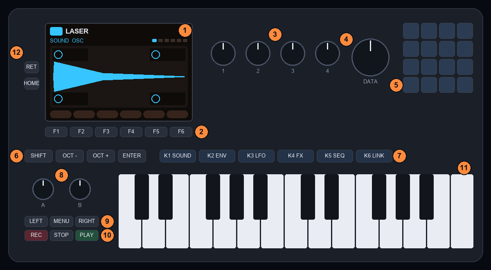

| | Control | What it does |
|---|---|---|
| **1** | the display | the selected sound, the page you are on, the four knobs' values, six soft keys |
| **2** | **F1 – F6** | the six soft keys shown along the bottom of the display. They change with the page |
| **3** | **encoders 1 – 4** | the four values the display shows. Hold SHIFT to turn fast |
| **4** | **DATA** | selects a sound |
| **5** | **the 16 pads** | play the kit's sounds. On the song pages they are steps, patterns or mutes – and the display draws them as 16 tiles. On PERFORM, F1 – F4 choose which of these they are |
| **6** | **SHIFT** | the second meaning of a key, and fast encoders |
| **7** | **K1 – K6** | the pages. Press a K key again for its next page |
| **8** | **A · B** | A: the output volume (on SEQ, SONG, AUTO and PERFORM, the tempo). B: the scale on SEQ, the bar's length on SONG and PERFORM – and with SHIFT, on these three pages, the beat ([section 9](#the-bar-and-the-beat-34-68-78)). On LINK both send a controller to the game |
| **9** | **LEFT · MENU · RIGHT** | the page before and after – on SEQ, SONG, AUTO and PERFORM the pattern (with SHIFT on SEQ, AUTO and PERFORM: the 16 steps the pads show) · the tour |
| **10** | **REC · STOP · PLAY** | PLAY plays one pattern round and round (LOOP) or the song in its order (SONG): the top line of the song's pages says which. With REC lit, what you play is recorded |
| **11** | **the keys** | play the selected sound as an instrument, in tune |
| **12** | **RETURN · HOME** | back to the first page · the controls of this page |

**ENTER** has no number in the picture; it is the key right of OCT +. **SHIFT + ENTER**, a short press, changes kit
([section 4](#4-two-kits)). DATA pressed counts as ENTER. ENTER held for a good half second is FOCUS, as in other
VIBE firmwares whose DATA has a job of its own: a frame appears on the display, DATA moves it from control to
control, ENTER presses or edits the one it is on, and RETURN ends it. With the frame on F1 – F6, SHIFT + ENTER is
SHIFT + that key, not the kit key; anywhere else it changes kit.

**SHIFT held and DATA turned** is the VIBE's, in every firmware: a frame appears over F1 – F6, DATA moves it, and
ENTER or DATA pressed then presses the framed key. So do not turn DATA on the way to SHIFT + ENTER: ENTER would press
a soft key (F1 PRESET, or MUTATE, RANDOM, SAVE …) and the kit stays. If it happened, let SHIFT go and start again;
F3 UNDO takes back a sound that changed.

**On the VIBE itself, SHIFT + K1 – K6 play notes.** The VIBE does this, in every firmware: the six keys play the
first six notes of the VIBE's key and scale (SETTINGS → KEYS), here into the selected sound, as the keys do, and
SHIFT + RETURN keeps them playing without SHIFT until it is pressed again. SFX FORGE never gets these presses and has
no job of its own on them. In the emulator and the plugin the keys on the screen play instead, and SHIFT + K1 – K6
are simply K1 – K6. The SDK also says that a firmware sees SHIFT let go before the first of these notes. So after
a note played this way, SHIFT + ENTER may need SHIFT let go and held again. All this is read from the VIBE FM SDK,
version 28; it was not tried on hardware.

### The pages

Six K keys, fourteen pages. Pressing a K key again walks to its next page.

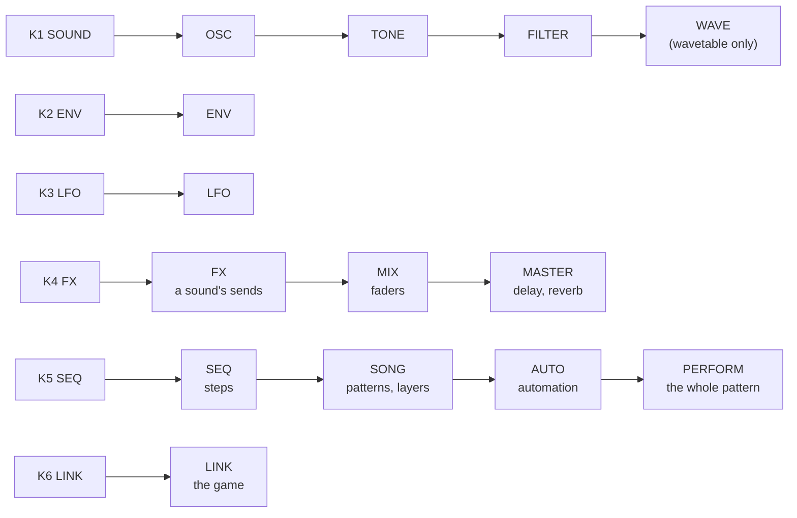

The top four rows shape **one sound**. The K4 and K5 rows after their first page are about **the song**.

---

## 3. The display

**A page is one of three kinds.** (LINK alone has a list where the others have a picture or tiles: what the game
sends.)

| Kind | Pages | What you see |
|---|---|---|
| **A picture** | the seven sound pages, MASTER | one picture of what the knobs shape, with their four values in its four corners |
| **The pads** | SEQ, SONG, AUTO, MIX | the 16 pads drawn as 16 tiles, laid out as the pads are – with the four values in a column beside them |
| **A grid** | PERFORM | the whole pattern: a row for each sound, a cell for each step – with the four values in one line under it |

### A picture page

| | What it is |
|---|---|
| **1** | the selected sound: its pad number, its name, its engine |
| **2** | the kit it belongs to: SFX or MUSIC. On SEQ, SONG, AUTO, PERFORM, MIX and MASTER this place says **LOOP** or **SONG** instead: what PLAY plays |
| **3** | the song: playing or stopped – or a red dot while REC is lit, playing or not – the pattern that plays, the tempo – `A>C` while pattern C waits for the bar line – and the link dot: green once a game has sent telemetry or a SysEx message, and green from then on. It says that a game was there, not that it still is: it goes dark again only when the device is switched off |
| **4** | the page's name |
| **5** | six marks for K1 – K6. The bright one is the key you are on; the dots under it are that key's pages |
| **6** | the picture: the sound's whole shape – and over it, in white, what this page's knobs shape (the wave, the envelope, the filter, the LFO) |
| **7** | a value in each corner: its name, its value in its unit, and a ring that stands where the knob stands. The number in the ring is the encoder: 1 top left, 2 top right, 3 bottom left, 4 bottom right |
| **8** | the soft keys = F1 – F6 |

**Turn a knob and its value is written large across the middle for a moment** – so you never have to look for it:

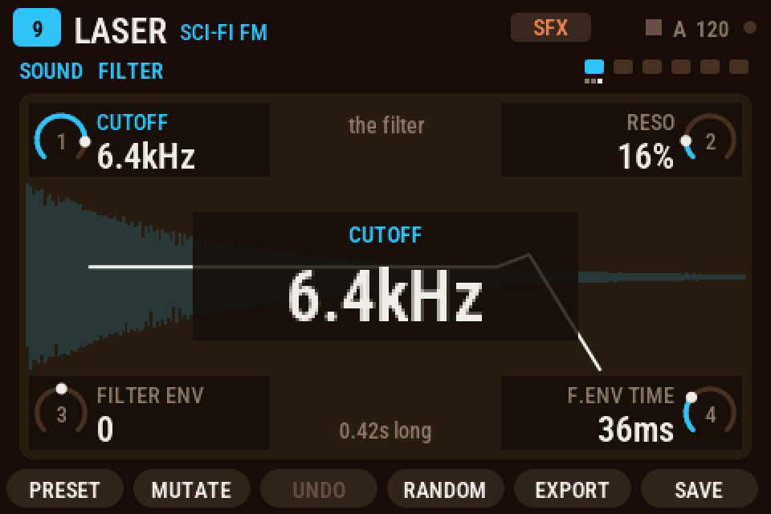

The picture redraws as you turn. That is the quickest way to learn what a knob does.

### A pad page

The tiles are the pads. Whatever a pad does on this page, its tile shows – here, the 16 steps of the selected sound.
The four values are in the column on the right, numbered like the encoders. Under them a line says what the pads do
here, and on SEQ and AUTO the eight patterns stand under that. The numbers in this picture are explained in
[section 9](#reading-the-seq-page).

A pattern can have more than 16 steps. Then the tiles are 16 of them, and a strip under the values shows where
they are in the bar ([A finer grid](#a-finer-grid-132-and-164)).

### The grid page

PERFORM is the one page of the third kind. It shows all 16 sounds of the pattern at once, a row each, and the pads are
what F1 – F4 choose. Its picture, with numbers, is in
[section 13](#13-perform-the-whole-pattern-and-the-pads-four-ways).

---

## 4. Two kits

SFX FORGE holds two sets of 16 sounds.

| | **SFX kit** | **MUSIC kit** |
|---|---|---|
| What is in it | the game's sound effects | the band the song plays |
| At the start | explosion, punch, coin, laser, footstep, wind … | kick, snare, hi-hat, FM bass, FM keys, brass, strings … |
| Where it goes | straight to the output, beside the song | through the mixer: fader, pan, mute |
| F1 PRESET offers | 16 sound effects | 23 instruments |

**SHIFT + ENTER** changes kit: hold SHIFT and press ENTER shortly. Let ENTER go first: the press counts when ENTER
comes up, and SHIFT must still be down then. It works on every page. On a sound page you stay on that page; from the
mixer, a song page or LINK it goes to the first sound page. Do not turn DATA while SHIFT is down
([section 2](#2-the-device) says why). The top line says which kit you are in. Going to a song page chooses MUSIC by
itself.

With the mouse, in the Playground and the plugin: double-click SHIFT, so that it stays down, then click ENTER, and
click SHIFT again to let it go. Or use the stage's SFX / MUSIC buttons ([section 15](#15-the-stage)). In the
Playground the computer's Shift + Enter does it too; the plugin does not pass those keys on.

Nothing stops you from sequencing a laser or playing a footstep on the keys. The kits only keep the two jobs apart.

---

## 5. Tutorial: a sound effect

**1. Hit a pad** in the SFX kit. Press **F1 PRESET** until you have something close – here, LASER.

**2. Press F2 MUTATE.** Every value moves by up to 15 %. The picture changes; so does the sound. Press again for
another; **F3 UNDO** takes one back.

**3. Shape it by hand.** Press **K1** until FILTER is lit, and turn **encoder 1**, CUTOFF. The filter's curve moves in
white over the picture, and the sound's shape behind it gets duller.

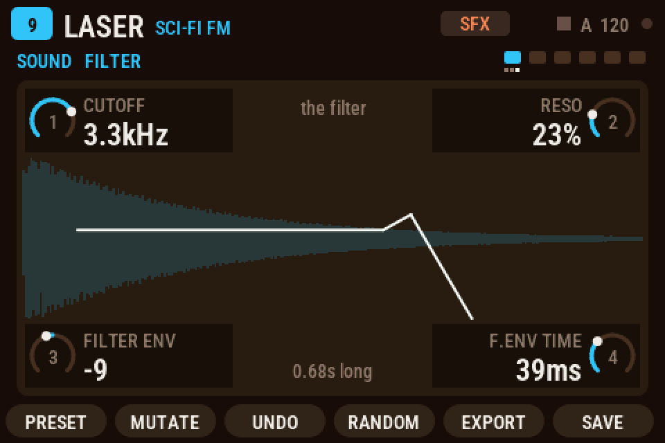

**4. Give it a tail.** Press **K2** for the envelope and turn **encoder 2**, DECAY.

**5. Keep it.** **F6 SAVE** stores both kits and the song. **F5 EXPORT** sends this sound to the game
([section 16](#16-into-the-game)).

> **Lost?** **F4 RANDOM** is a completely new sound. **SHIFT + MENU, twice** puts everything back as it came from the
> factory – both kits and the song. What you saved is gone then.

---

## 6. How a sound is built

Every sound follows the same path. Each box is one page of four knobs.

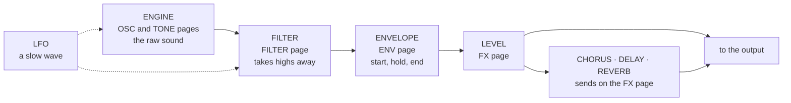

### Every value

| Page | Value | What it does | Range |
|---|---|---|---|
| **OSC** | ENGINE | which of the five engines makes the sound | |
| | FREQ | the pitch (the keys override it) | 20 Hz – 14.5 kHz |
| | PITCH ENV | how far the pitch starts above (+) or below (−) and falls back | ±4 octaves; 0 = none |
| | ENV TIME | how long that takes | 5 ms – 2.6 s |
| **TONE** | A · B | the engine's own two controls ([section 7](#7-the-five-engines)) | |
| | NOISE | how much of it is noise | 0 – 100 % |
| | CRUSH | fewer bits and samples: grit | OFF – 100 % |
| **FILTER** | CUTOFF | where the filter closes | 40 Hz – 15.5 kHz |
| | RESO | a peak at the cutoff | 0 – 100 % |
| | FILTER ENV | how far the cutoff starts above or below and returns | ±5 octaves; 0 = none |
| | F.ENV TIME | how long that takes | 5 ms – 2.6 s |
| **WAVE** | TABLE | which wavetable | six |
| | SPREAD | two detuned copies, for width | up to 30 cents |
| **ENV** | ATTACK | time to reach full level | 1.5 ms – 4 s |
| | DECAY | how fast it falls after that | 10 ms – 3.9 s |
| | SUSTAIN | the level it holds at | OFF, or up to 100 % |
| | RELEASE | how long it rings after the pad is let go | 5 ms – 3.9 s |
| **LFO** | LFO RATE | the slow wave's speed | 0.1 – 29 Hz |
| | > PITCH | vibrato | up to an octave |
| | > FILTER | wah | up to 3 octaves |
| | > TIMBRE | moves FM depth or wavetable position | |
| **FX** | CHORUS · DELAY · REVERB | how much goes to each effect | 0 – 100 % |
| | LEVEL | the sound's own loudness | 100 = as designed |

### One-shot or held: SUSTAIN decides

| SUSTAIN | The sound is | Use it for |
|---|---|---|
| **OFF** | a **one-shot**: it plays to its end however short you hit the pad | drums, coins, explosions |
| **above OFF** | **held**: it sounds while the pad or key is down, then rings out over RELEASE | strings, organs, an engine hum |

The ENV page draws which one you have:

The LFO page draws the slow wave, and the FX page shows the three sends and the level:

| LFO | FX |
|---|---|
| 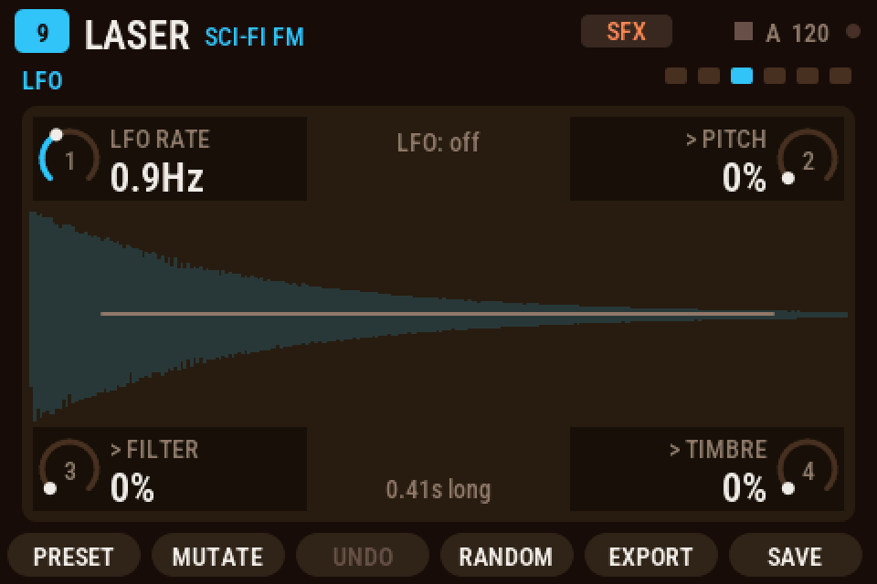 |  |

---

## 7. The five engines

ENGINE is the first knob of the OSC page. The two knobs **A** and **B** on the TONE page change meaning with it.

| Engine | What it is | A | B | Good for |
|---|---|---|---|---|
| **IMPACT** | a sine whose pitch falls, with FM and noise, driven hard | FM RATIO | FM DEPTH | hits, kicks, explosions |
| **UI BLIP** | a square wave that can step upwards | ARP STEP | ARP SPEED | coins, menus, chiptune |
| **SCI-FI FM** | two sines, one bending the other | FM RATIO | FM DEPTH | lasers, engines, FM bass and keys |
| **FOLEY** | noise through a band, in grains | GRAIN RATE | GRAIN AMT | steps, wind, fire, hi-hats |
| **WAVETABLE** | a wave that morphs through a table | POSITION | WARP | pads, strings, brass, organs |

**A tip for each:**

| Engine | Try this |
|---|---|
| IMPACT | PITCH ENV high with a short ENV TIME is a kick. A small fall over a long time is a tom. NOISE adds the crack |
| UI BLIP | ARP STEP 37 (a fifth) at a high ARP SPEED is the classic coin. The display shows the knob's value, 0 – 127, not semitones: 35 – 39 is a fifth, 64 an octave, 127 two octaves. The arpeggio plays four notes – the note itself, then three steps up – and stays on the last. At 0 it is a plain square wave |
| SCI-FI FM | FM RATIO around 42 is round (a bass, an electric piano); higher is bells and metal. Its brightness falls over ENV TIME – that is the pluck |
| FOLEY | CUTOFF is called BAND: it is where the noise sits. PITCH ENV sweeps the band – a whoosh. GRAIN AMT chops it: crackle, gravel, rain |
| WAVETABLE | Turn POSITION and watch the wave morph. `> TIMBRE` on the LFO page moves it by itself. SPREAD makes it wide |

A wavetable sound has a fourth SOUND page, WAVE, with its table – SAW-SQ, PULSE, PEAK, VOWEL, ORGAN or GLASS:

---

## 8. Instruments

**Any sound is an instrument.** The keys play the selected sound in tune (A4 = 440 Hz), up to 16 notes at once.

The MUSIC kit starts with a band on its pads:

| | | | |
|---|---|---|---|
| **1** TIMPANI | **2** SNARE | **3** KICK | **4** COWBELL |
| **5** PIZZICATO | **6** BRASS | **7** FM BASS | **8** FM KEYS |
| **9** HARP | **10** CELESTA | **11** ORGAN | **12** WT SWEEP |
| **13** HI-HAT | **14** BELLS | **15** CHOIR | **16** STRINGS |

F1 PRESET in the MUSIC kit also offers OPEN HAT, FLUTE, WT VOWEL, WT BASS, PAD, SQ BASS and SQ LEAD.

These are synthesizer instruments in the style of their names – STRINGS is a slow, detuned wavetable with chorus and
reverb, not a recording of a string section.

---

## 9. Tutorial: a beat

A **pattern** is one bar, for each of the MUSIC kit's 16 sounds. As it comes, the bar has 16 steps: sixteenth notes,
four to a beat – four quarters. A pattern that needs faster notes gets 32 or 64 steps ([A finer
grid](#a-finer-grid-132-and-164)). A bar can be shorter and its beat another one: 3/4, 6/8, 7/8 ([The bar and the
beat](#the-bar-and-the-beat-34-68-78)). There are eight patterns, A – H. The SEQ page (**K5**) is where a pattern is
made.

### Loop a pattern and play into it

**On the SEQ page, PLAY keeps one pattern playing, round and round.** The top line says so: **LOOP**. That is all
there is to it – no chain to set, no arrangement to clear. (From firmware 1.5.0.)

**1. Press K5** while nothing plays. The page is SEQUENCER, and the top line says LOOP. (If the song is playing,
press STOP first – or press F1.) DATA chooses the sound whose steps you see. A device as it comes shows pad 1,
TIMPANI, with no steps; turn DATA two clicks to the right for the kick, as in the picture.

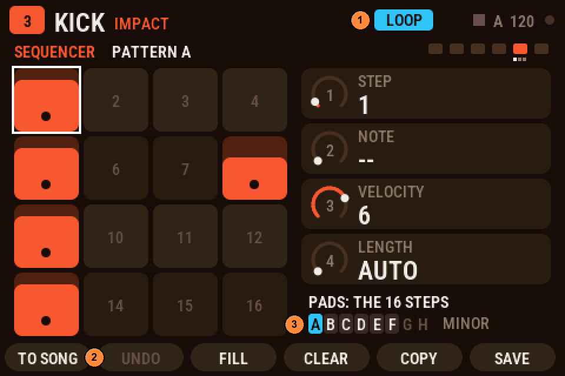

| | What it is |
|---|---|
| **1** | **LOOP**: PLAY will repeat the pattern. (The other word here is SONG: PLAY will play the song in its order) |
| **2** | **F1** changes between the two. It says what it will do: TO SONG |
| **3** | the eight patterns. The blue one is the one you see |

**2. Press PLAY.** Pattern A repeats until you press STOP. Nothing moves on to B.

**3. Another pattern: LEFT or RIGHT.** One press goes to the pattern before or after: RIGHT from A to B, LEFT
from A round to H. It does not cut in. It starts on the next bar line, and then it is the one that repeats. For
the picture RIGHT was pressed six times within the bar, from A to G. While a pattern waits, the display says so in
three places:

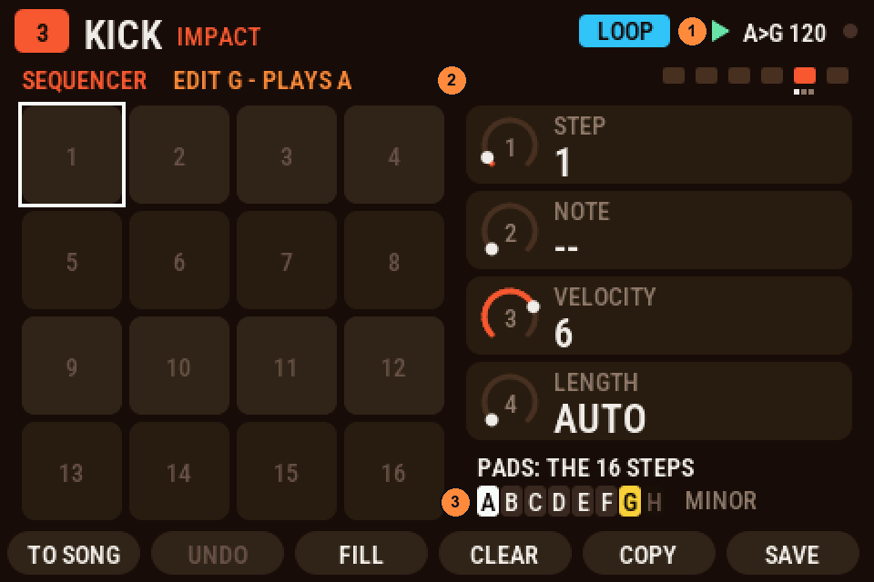

| | What it is |
|---|---|
| **1** | `A>G`: A plays, G comes next |
| **2** | `EDIT G - PLAYS A`, in orange: what you see is not yet what you hear |
| **3** | G blinks yellow until it starts. White is the pattern that plays |

Here G is the first empty pattern of the demo song: a place to try things.

**4. Press REC.** Now the pads are the drum kit and the keys are the notes. Play in time: every hit is written onto
the step nearest to it, and you hear it again on the next round. A click keeps time.

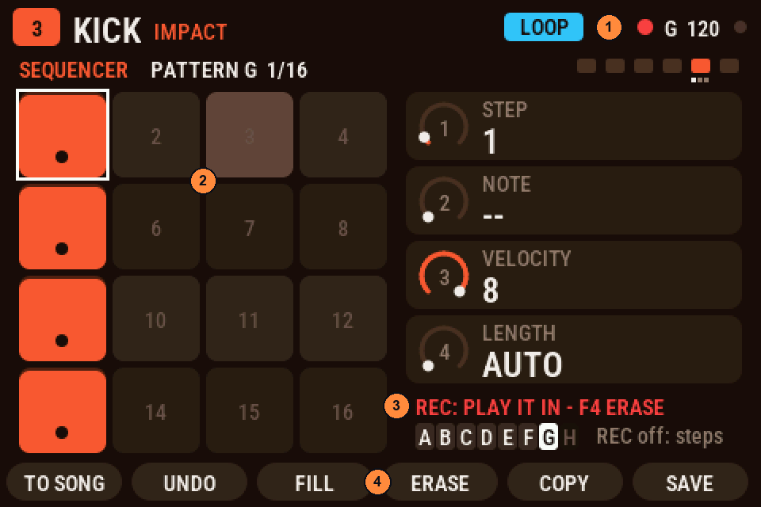

| | What it is |
|---|---|
| **1** | the red dot: REC is lit. It beats with the click |
| **2** | the hits, as they land. The tiles show the sound you played last |
| **3** | what the pads do now |
| **4** | **F4** is **ERASE** while REC plays |

**5. A wrong note?** Hold **F4 ERASE**: the selected sound's steps are erased as the bar passes them; a tap erases
only the step under the playhead. Or press **F2 UNDO**: everything you played since the first hit is gone in one
press. F2 again brings it back.

| | What it is |
|---|---|
| **1** | what was taken back: `TAKE`, all you played in |
| **2** | **F2 UNDO**. Pressed again it is redo |

**6. Press REC again** and the pads are the 16 steps once more, to add a hit by hand or fix a note. **STOP** stops
the pattern. (STOP does not put REC out: pressed while REC is lit, it leaves REC lit, and PLAY starts a take again.)

**7. The song in its order again?** Press **F1 TO SONG** – or go to the SONG page while it is stopped and REC is
off ([section 10](#what-play-plays-loop-or-song)).

### Step by step: a beat from nothing

Press **K5** for the SEQ page, and **RIGHT** until you are on an empty pattern – in the row of eight letters under
the values an empty one is dim. In the demo song that is G. While the song is stopped, LEFT and RIGHT change the
pattern at once.

**1. The kick.** Turn **DATA** to KICK. Press **F3 FILL** once: a kick on every beat (`EVERY 1/4`).

**2. The snare.** DATA to SNARE. Hit **pads 5 and 13**: the pads are the 16 steps.

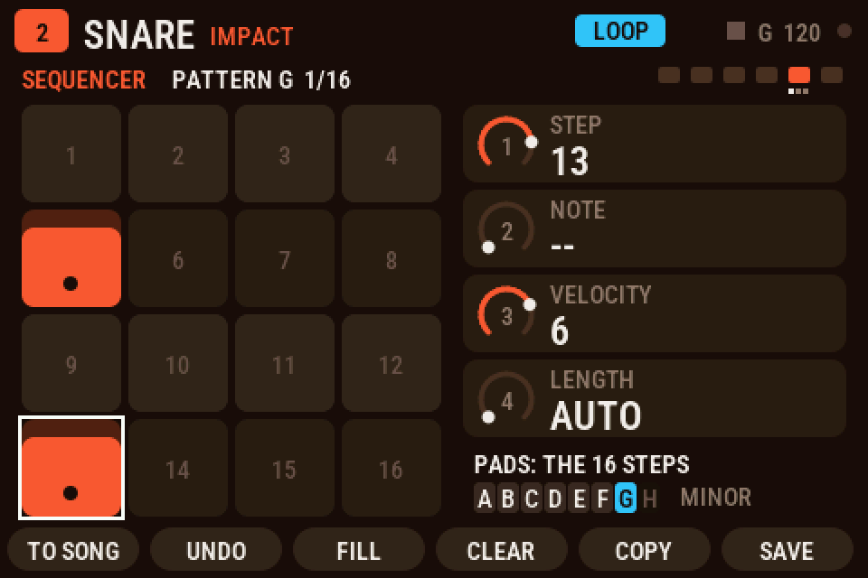

**3. The hi-hat.** DATA to HI-HAT. Press **F3 FILL** twice: every eighth note (`EVERY 1/8`).

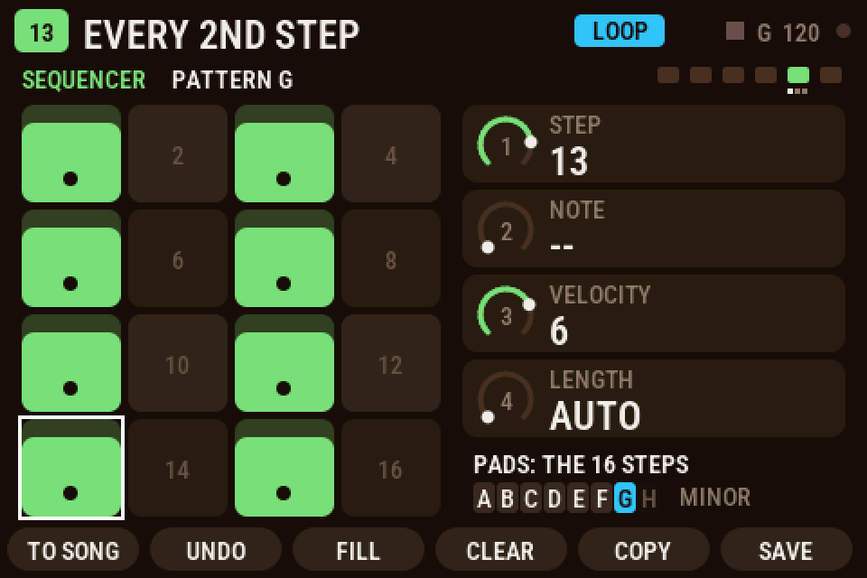

**4. A bass line.** DATA to FM BASS. **Hold a step's pad and play a key**: that step plays that note.

**5. Press PLAY.** The pattern repeats: the top line says LOOP. Go on changing it while it plays.

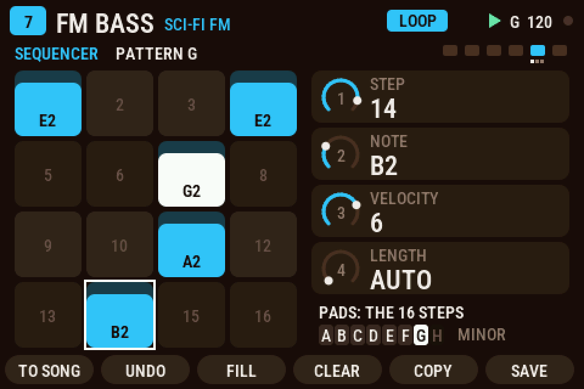

Anything you do here **F2 UNDO** takes back ([below](#undo)).

### Reading the SEQ page

| | What it is |
|---|---|
| **1** | what PLAY plays: **LOOP** (this pattern, round and round) or **SONG** (the song in its order) |
| **2** | playing (a green triangle) or stopped (a square) – or, while REC is lit, a red dot in their place, playing or not · the pattern that plays · the tempo. `A>C` while C waits for the bar line |
| **3** | the page, the pattern you see and its grid: `PATTERN A  1/16` – or `EDIT B - PLAYS A  1/16`, in orange, while another one plays. When the bar is not four quarters, its name follows the grid: `PATTERN A  1/16  BAR 3/4` ([The bar and the beat](#the-bar-and-the-beat-34-68-78)). `layer off` beside it: the selected sound is silent at the current intensity |
| **4** | the 16 steps of the selected sound, as the 16 pads: **a row is a quarter note** – a beat, as the device comes (at 1/32 a row is an eighth note, at 1/64 a sixteenth). The empty tiles have two shades, beat by beat: with a beat of a quarter that is row by row; with another beat (SHIFT + B) it is not. A step that is on shows its **note**; its **height** is how hard it plays; `>3` in its corner means it holds 3 steps. The frame is the step the encoders edit; the white tile is the step playing now |
| **5** | STEP · NOTE · VELOCITY · LENGTH of the framed step. At a finer grid STEP reads `17/32`: the step, and how many the pattern has |
| **6** | what the pads do: `PADS: THE 16 STEPS`. With REC lit: `REC READY: PRESS PLAY`, then `REC: PLAY IT IN - F4 ERASE`. `ITS LAYER IS OFF NOW` warns that you will not hear the selected sound. At 1/32 and 1/64 the bar strip stands here instead |
| **7** | the eight patterns, and the scale NOTE moves in (with REC lit: `REC off: steps`) |
| **8** | TO SONG (or TO LOOP) · UNDO · FILL · CLEAR the sound's steps · COPY the pattern · SAVE |

The eight letters, on SEQ, on AUTO and on PERFORM:

| A letter is | It means |
|---|---|
| **yellow, blinking** | chosen: it starts on the next bar line |
| **white** | it plays |
| **blue** | it is the one you see and edit |
| **light on dark** | something is in it |
| **dim** | empty |

The page shows one sound at a time. To see every sound's steps at once, press K5 three times more for PERFORM
([section 13](#13-perform-the-whole-pattern-and-the-pads-four-ways)) – or open the stage ([section 15](#15-the-stage)).

### Everything a step can do

| To do this | Do this |
|---|---|
| switch a step on or off | hit its pad (REC not lit) |
| choose another sound | turn DATA, or SHIFT + its pad (you hear it) |
| give a step a note | hold its pad and play a key – or turn encoder 2 NOTE (it stays in the scale, which B chooses) |
| make it louder or softer | encoder 3 VELOCITY, 1 – 8 |
| make a held note shorter | encoder 4 LENGTH: AUTO, or 1 – 15 steps (at 1/32 up to 31, at 1/64 up to 63) |
| the sound on every beat, every eighth, every sixteenth, none | F3 FILL, again and again: `EVERY 1/4`, `EVERY 1/8`, `EVERY 1/16`, `SOUND CLEARED`. With another beat than a quarter the first press is that beat: `EVERY 3/8`, `EVERY 3/16` or `EVERY 1/8` ([The bar and the beat](#the-bar-and-the-beat-34-68-78)). It fills the bar, not what lies beyond a short one |
| notes faster than a sixteenth | SHIFT + F6: a finer grid for this pattern – see [A finer grid](#a-finer-grid-132-and-164) |
| take the selected sound out of the pattern | F4 CLEAR. `NOTHING TO CLEAR` if it has no steps |
| try a variation | F5 COPY: the pattern is copied into the next empty one, with its grid, and you are on the copy (`COPIED A > G`). While it plays the copy starts on the bar line. `NO EMPTY PATTERN` if all eight hold something |
| play a part in, live | **REC, then PLAY** – see below |
| change the tempo | A. SHIFT + A is the swing (the top line says it: `SWING 20%`) |
| another beat: 6/8 where it was 3/4 | SHIFT + B: `BEAT 3/8: BAR 6/8` ([The bar and the beat](#the-bar-and-the-beat-34-68-78)). B without SHIFT is the scale here; the bar's length is B on SONG and PERFORM |

A step **without a note** plays the sound as designed – right for drums. **LENGTH AUTO** holds a note until the sound
plays again or the bar ends; LENGTH is for held sounds, a one-shot always plays to its own end.

### Playing it in

Press **REC**, then **PLAY** – or PLAY first and REC when you are ready. On the SEQ page, while REC is lit:

| | |
|---|---|
| **the pads are the drum kit** | hit a pad in time and its sound is recorded on the step nearest to your hit – a step of the pattern's own grid – as hard as you hit it. Kick, snare and hat can be played in together |
| **the keys are the notes** | SHIFT + a pad selects an instrument (without recording it); then every key you play is recorded on its step, at its pitch – a bass line or a melody in one pass |
| **the tiles follow you** | they show the steps of the sound you played last, so you see each hit land |
| **the pattern repeats** | switching REC on sets LOOP (`REC ON: PATTERN LOOPS` if it was SONG). What you play is laid on top of what is there, round after round |
| **the display stays with the sound** | LEFT and RIGHT still choose another pattern, on the bar line. Until then the display stays on the pattern that plays, so every hit lands in what you see |
| **a metronome keeps time** | a click on every beat – a quarter note, unless SHIFT + B chose another beat –, higher on the bar line, while REC is lit and it plays. The red dot in the top line beats with it. **SHIFT + REC** turns the click off and on (`CLICK OFF`, `CLICK ON`). It is the device's own: it is not recorded and a game never hears it. There is no count-in: the first round of the loop is one |
| **F4 is ERASE** | held, it erases the selected sound's steps as the bar passes them, in the pattern that plays. A tap erases the step under the playhead |
| **F2 takes the take back** | all of it, from the first hit to STOP, PLAY or REC – with whatever you erased, filled or turned in between |

While it is stopped with REC lit the pads only sound; nothing is recorded (`REC READY: PRESS PLAY`).

Press **REC** again and the pads are steps once more.

Two things to know. Only the **MUSIC kit** is recorded: with the SFX kit selected (on a sound page) a hit says
`MUSIC KIT ONLY: K5 SEQ` and nothing is written. And if you press **F1 TO SONG** while REC plays, the take goes along
the song: each hit lands in the pattern that plays in that bar.

### A finer grid: 1/32 and 1/64

**A bar stays a bar. A finer grid cuts each sixteenth in 2 or in 4** – for a roll, a fill, a fast run.
(From firmware 1.6.0.)

| Grid | Steps in a full bar | A step is |
|---|---|---|
| **1/16** | 16 | a sixteenth note. Every pattern starts so |
| **1/32** | 32 | half a sixteenth |
| **1/64** | 64 | a quarter of a sixteenth |

**Each pattern has its own grid.** A can stay at 1/16 while G is at 1/32. The title line names the grid of the
pattern you see: `PATTERN G  1/32`. The tempo, the swing, the click, the bar's length and the arrangement do not
change with it: they count in sixteenths, beats and bars, as before.

#### A hi-hat roll, step by step

**1. Kick and hats.** Press **K5**, and **RIGHT** until you are on an empty pattern – G in the demo song. DATA to
KICK, **F3 FILL** once. DATA to HI-HAT, F3 FILL twice: a hat on every eighth note.

**2. Press SHIFT + F6.** The top line says `GRID 1/32`. Nothing sounds different: every step has moved to the step
that begins at the same moment. The hats stood on steps 1, 3, 5 …; now they stand on 1, 5, 9 … of 32.

| | What it is |
|---|---|
| **1** | the grid of the pattern you see |
| **2** | the pads are 16 of the 32 steps now: here steps 1 – 16, the first half of the bar. The brighter numbers are the steps that begin a sixteenth |
| **3** | STEP: the framed step, and how many the pattern has |
| **4** | **the bar strip**: the whole bar, a column a step. It shows the selected sound's steps, a line at each beat, and a white frame round the 16 steps the pads show. Beside it: which they are, `1-16/32` |

**3. Press SHIFT + RIGHT.** `STEPS 17-32`: the pads are the second half of the bar. The hats are on pads 1, 5, 9
and 13. Hit **pads 10, 11, 12, 14, 15 and 16**: the last beat is full, eight notes where four sixteenths were.

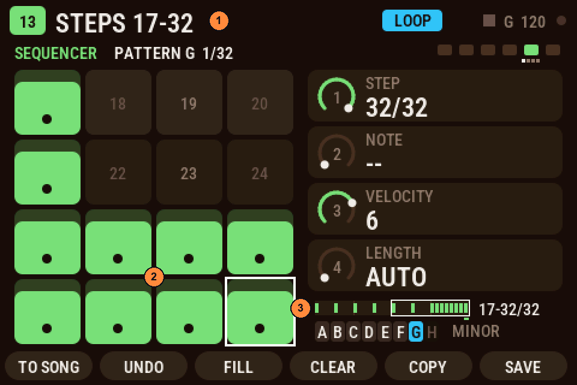

| | What it is |
|---|---|
| **1** | what SHIFT + RIGHT said: the steps the pads show now |
| **2** | the roll: steps 25 – 32 |
| **3** | the frame has moved to the second half of the bar, and the roll stands in it |

**4. Press PLAY.** The bar is as long as it was; the roll is twice as fast as sixteenths. While it plays, the white
tiles are the sixteenth that plays: at a finer grid the playhead lights its 2 or 4 steps together, because one of
them alone is over before you can see it.

**5. Finer still: SHIFT + F6 again.** `GRID 1/64`. Now the pads are 16 of 64 steps, and SHIFT + LEFT and RIGHT go
through four sets of them. The roll stands on every other step of 49 – 64 – it still sounds the same.

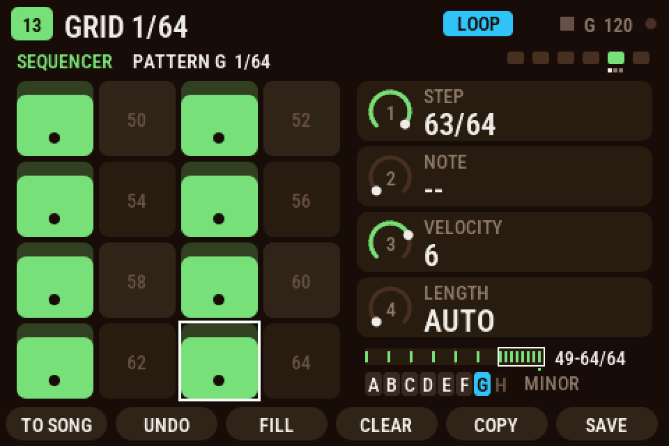

**6. Back again: SHIFT + F5.** From 1/64 to 1/32 nothing stands between the steps that stay, so it is done at once:
`GRID 1/32 - F2: UNDO`. Press SHIFT + F5 once more, for 1/16. Now four hits of the roll stand between the
sixteenths, and a grid of sixteenths has no place for them. The device asks first:

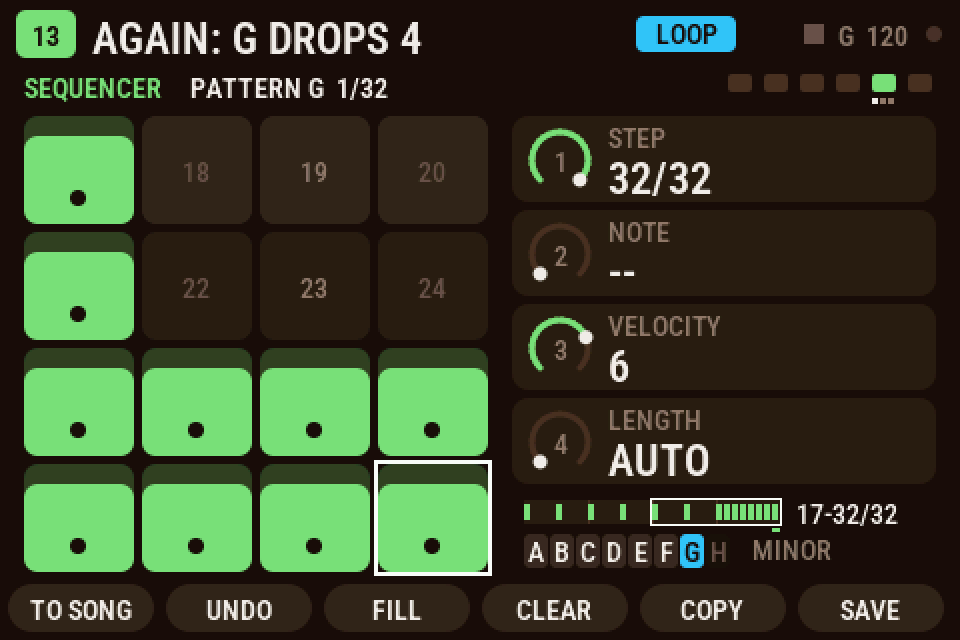

`AGAIN: G DROPS 4`. Press **SHIFT + F5 again** while the question stands – about two seconds – and it is done:
`GRID 1/16 - F2: UNDO`. Leave it, and nothing happens. **F2** brings the roll back (`UNDO: GRID`).

#### The keys of the grid

They are the same on SEQ, on AUTO and on PERFORM. On PERFORM the key that takes a change back is F6, not F2, and the
top line says so: `GRID 1/16 - F6: UNDO`.

| Key | What it does |
|---|---|
| **SHIFT + F6** | the pattern's grid one level finer: 1/16, 1/32, 1/64. `GRID 1/32`, `GRID 1/64`; at the end `FINEST: 1/64`. Every step and every automation point moves to the step that begins at the same moment, a LENGTH is doubled: it sounds the same |
| **SHIFT + F5** | one level coarser. If nothing stands between the steps that stay: at once, `GRID 1/16 - F2: UNDO` or `GRID 1/32 - F2: UNDO`. If something does: it asks. At the end `COARSEST: 1/16` |
| **SHIFT held** | F5 and F6 on the display say what they will do: `TO 1/16`, `TO 1/32`, `TO 1/64` – or `IS 1/16`, `IS 1/64` at the two ends |
| **SHIFT + RIGHT · SHIFT + LEFT** | the 16 steps after and before, round and round: `STEPS 17-32`. The frame stays on the same pad. At 1/16 there is nothing to move: `1/16: ALL STEPS SHOWN` |
| **encoder 1 STEP** | goes through all 16, 32 or 64 steps one by one. The pads follow the frame |
| **F2** | takes a change of grid back, with everything it dropped: `UNDO: GRID`. Again: `REDO: GRID` |

Plain LEFT and RIGHT choose the pattern, as before.

**What a coarser grid drops.** Everything that stands between the steps that stay: steps of **every sound** in the
pattern and points of every automation lane, not only what you see. The number in the question counts them all.
What stays keeps its note and velocity; a LENGTH is halved, rounded up.

**The question.** The second press counts only while the question is in the top line, on the same pattern, towards
the same grid, and with the same number. If you add or take away a step in between, it asks again with the number
that is true now. F2 works while it plays and during a take; in a take the change of grid is part of what `TAKE`
takes back.

#### Reading the page at 1/32 and 1/64

| On the display | What it means |
|---|---|
| a tile's number | the step, 1 – 32 or 1 – 64. Brighter: it begins a sixteenth |
| a dark tile without a number | an empty step beyond the end of a short bar. A step that is on there is as bright as the others, and does not play |
| `>6` in a tile's corner | the note holds 6 steps of this grid |
| STEP `17/32` | the framed step, of how many |
| LENGTH `6 = 3/16` | 6 steps, and what that is of a whole bar: at 1/32 as long as three sixteenth notes. At 1/64 the same 6 steps read `6 = 3/32` |
| the bar strip | the whole bar, with the frame round the 16 steps shown. A white column: the playhead. A small mark under it: the framed step. On AUTO it shows the lane's points |
| `17-32/64` beside it | the pads are steps 17 – 32 of 64 |
| the pads' lights | an empty step that begins a sixteenth is lit a little brighter than the others |

`ITS LAYER IS OFF NOW` still takes the strip's place on SEQ, and `TURN TARGET FIRST` on AUTO.

**LENGTH** is in steps of the pattern's grid: AUTO, or up to 31 at 1/32 and up to 63 at 1/64. At a finer grid the
knob has further to go, so SHIFT turns it 8 steps a click there.

**FILL** has one more press at a finer grid: `EVERY 1/4`, `EVERY 1/8`, `EVERY 1/16`, `EVERY 1/32`, then
`SOUND CLEARED`. It never fills every 1/64 – put those in by hand, or play them in. With another beat than a
quarter the first press is that beat, here too.

**The two shades** of the empty tiles stay the rows of pads at 1/32 and 1/64, whatever the beat: a row is an
eighth or a sixteenth there. The beat is in the bar strip: its lines stand at each beat.

**COPY** copies the pattern with its grid. **CLR PAT** on the SONG page empties a pattern and keeps its grid.
**NEW** sets every pattern to 1/16.

#### A short bar

Encoder B on the SONG page – and on PERFORM – sets the bar's length in sixteenths (`BAR: 12/16 = 3/4`), for the whole
song. A pattern at 1/32 then plays 24 steps, one at 1/64 plays 48. The empty tiles beyond the bar are dark and the
strip is dark there. What such a bar is as a time signature, and the beat that goes with it: [The bar and the
beat](#the-bar-and-the-beat-34-68-78).

SHIFT + LEFT and RIGHT go only through the sets of 16 that hold a step of the bar: three of them for a bar of 12/16
at 1/64. If the whole bar fits on the pads there is nothing to move, and it says so: `BAR ENDS AT STEP 8`. Encoder 1
still reaches the steps beyond the bar. What stands on them is kept, is shown as bright as any step, and does not
play; the strip leaves it out.

#### Recording at a finer grid

Recording is as in [Playing it in](#playing-it-in): REC, PLAY, the pads and the keys. **A hit lands on the nearest
step of the grid of the pattern that plays** – at 1/64 that is nearly where you played it. A hit just before the bar
line lands on step 1. A hit can land a few milliseconds early. The click stays on the beat, whatever the grid: with a
beat of a quarter, four in a whole bar, three in a bar of 12/16.

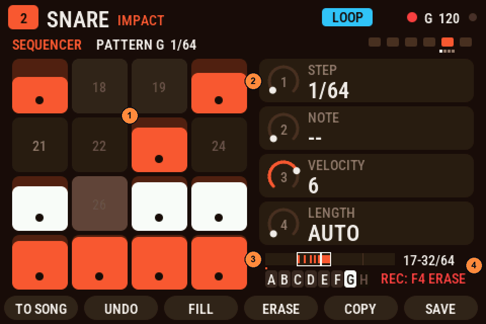

| | What it is |
|---|---|
| **1** | the tiles go with the bar: they show the 16 steps that play now, with the sound you played last. Here a snare roll that was played in a round before; the white tiles are the sixteenth that plays |
| **2** | STEP does not go with them. The framed step stays where it was, and encoders 1 – 4 still edit that step |
| **3** | the bar strip stays while REC is lit: the frame shows where the tiles are, the small mark under the strip shows the framed step |
| **4** | in red, where the scale stands otherwise: `REC: F4 ERASE` while it plays, `REC: PRESS PLAY` while it is stopped |

After STOP, or REC off, the tiles stay on the 16 steps where the take ended. If the framed step is not among them,
it goes to the first of those 16: STEP `1/64` during the take can read `17/64` after it.

At 1/16 nothing has changed: the line under the values says `REC: PLAY IT IN - F4 ERASE`, as in the pictures
further up.

#### On the SONG page

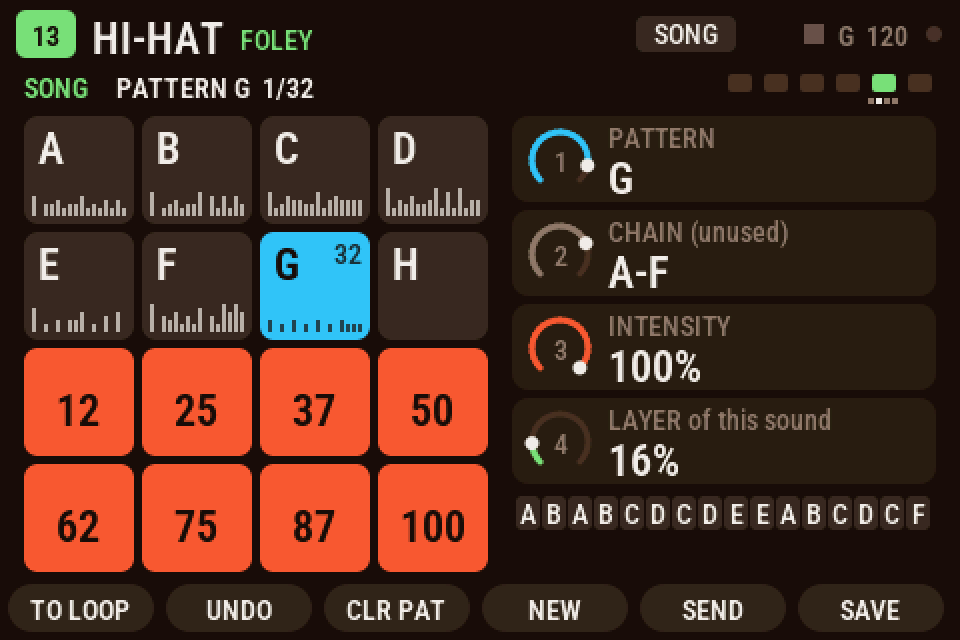

A pattern with a finer grid has a small `32` or `64` in the corner of its tile: here G. The sketch in a tile still
has 16 columns, one for each sixteenth. The title line names the grid of the pattern you see here too.

#### Three things to know

| | |
|---|---|
| **A grid is a pattern's, not a sound's** | all 16 sounds of a pattern, and its automation, share it |
| **You can change it while the song plays** | a change of grid, a COPY or an UNDO rewrites a whole pattern at once. The player takes the pattern whole, between two moments of sound: it plays the pattern as it was or as it is now, never half of each. The playhead stays where it is, no step sounds twice or is missed for it, and a held note ends where it would have – on a coarser grid, on the next step that grid has |
| **An older firmware does not take such a song** | a song from firmware 1.6.0 is in a new format, whether a pattern has a finer grid or not ([section 16](#songs-formats-and-older-firmware)) |

### The bar and the beat: 3/4, 6/8, 7/8

**Two knobs make a time signature: B is how long the bar is, SHIFT + B is what a beat is.** The bar's length was
always there. The beat is new with firmware 1.7.0.

| | Turn | On | It is | It belongs to |
|---|---|---|---|---|
| **the bar** | B | SONG, PERFORM | 1 – 16 sixteenths. As it comes: 16 | the song |
| **the beat** | SHIFT + B | SEQ, SONG, PERFORM | an eighth (1/8), three sixteenths (3/16), a quarter (1/4) or a dotted quarter (3/8). As it comes: a quarter | the device |

One click of B with SHIFT held is one beat further: 1/8, 3/16, 1/4, 3/8. It stops at both ends. On SEQ, B without
SHIFT is the scale: for the bar's length go to SONG or PERFORM. AUTO shows the bar and the beat and has no knob for
them.

As the device comes – 16 sixteenths, a beat of a quarter: four quarters – nothing looks, sounds or is stored
differently than before.

#### Common time signatures

| For | B | SHIFT + B | The click counts | The title says |
|---|---|---|---|---|
| **4/4** | 16, as it comes | 1/4, as it comes | four quarters | nothing |
| **3/4** | 12 | 1/4 | three quarters | `BAR 3/4` |
| **2/4** | 8 | 1/4 | two quarters | `BAR 2/4` |
| **6/8** | 12 | one click up: 3/8 | two dotted quarters | `BAR 6/8` |
| **3/8** | 6 | 3/8 | one dotted quarter | `BAR 3/8` |
| **7/8** | 14 | 1/4 | three quarters and an eighth | `BAR 7/8` |
| **5/8** | 10 | 1/4 | two quarters and an eighth | `BAR 5/8` |
| **7/8, every eighth counted** | 14 | two clicks down: 1/8 | seven eighths | `BAR 7/8 IN 1/8` |
| **12/16** | 12 | one click down: 3/16 | four times three sixteenths | `BAR 12/16` |
| **7/16** | 7 | 1/4 | a quarter and three sixteenths | `BAR 7/16` |

"Up" is a click to the right, "down" a click to the left.

#### A bar of 3/4, and the same bar as 6/8

**1. Press K5 twice**, for the SONG page, and turn **B** four clicks to the left. The top line says
`BAR: 12/16 = 3/4`: the bar has 12 sixteenths now, and with a beat of a quarter that is three quarters.

**2. Press K5 three times more**, for SEQ, and **RIGHT** until you are on an empty pattern – G in the demo song.
Turn **DATA** to KICK and press **F3 FILL** once.

| | What it is |
|---|---|
| **1** | what FILL said: a kick on every beat, and the beat is a quarter |
| **2** | the title names the bar: `BAR 3/4` |
| **3** | the 16 tiles: the kick stands on steps 1, 5 and 9, the first tile of each of the three rows – the three beats |
| **4** | the fourth row lies beyond the bar: its tiles are dark, and nothing there plays |

**3. Hold SHIFT and turn B one click to the right.** The beat is a dotted quarter now, and the same 12 sixteenths
are two of them: 6/8.

| | What it is |
|---|---|
| **1** | what SHIFT + B said: the beat, and what the bar is called with it |
| **2** | the title: `BAR 6/8` |
| **3** | the second beat begins at step 7: the empty tiles 1 – 6 have one shade, 7 – 12 the other. A moment ago the rows had them |

The kick still stands on steps 1, 5 and 9: **the beat changes no note.** Press **F3 FILL** once more. The row is
none of FILL's own now, so FILL begins again, with the beat: `EVERY 3/8`, a kick on steps 1 and 7.

**4. On PERFORM** the whole bar is on one page. Here it is in 6/8 while it plays: the kick on the two beats (F5
FILL once), the hi-hat on every eighth (F5 FILL twice: `EVERY 1/8`).

| | What it is |
|---|---|
| **1** | the title: `BAR 6/8` |
| **2** | where the second beat begins: the empty cells change their shade here, after six sixteenths |
| **3** | the bar ends after step 12. The cells beyond it are dark |

**5. A bar of 7/8.** Turn the beat back to a quarter (SHIFT + B one click to the left), and turn B to 14. Here the
kick was filled on every quarter while the bar was still whole: steps 1, 5, 9 and 13.

| | What it is |
|---|---|
| **1** | what B said: 14 sixteenths, and that is seven eighths |
| **2** | the title: `BAR 7/8` |
| **3** | the fourth beat is a short one: two sixteenths, then the bar line. The click on it is the last of the bar |
| **4** | beyond the bar |

#### What follows the beat

| | With a quarter, as it comes | With another beat |
|---|---|---|
| **the click** (REC lit, playing) | on every quarter, higher on the bar line | on every beat, higher on the bar line. A bar that is not a whole number of beats ends with a short beat |
| **the red REC dot** | beats with the click | the same |
| **the empty cells on PERFORM** and in the stage's rows | change their shade every quarter | every beat |
| **the empty tiles on SEQ and AUTO**, at 1/16 | row by row: a row is a quarter | beat by beat. At 1/32 and 1/64 they stay row by row |
| **the lines in the bar strip**, at 1/32 and 1/64 | at each quarter | at each beat |
| **FILL** | `EVERY 1/4` first | the beat first |
| **the bar's name** | `BAR 3/4`, `BAR 7/8` | `BAR 6/8`, `BAR 12/16` |

Nothing else follows it: no note, not the tempo, not the swing, not the song, not what a game plays.

**FILL** begins with the beat, then goes to the eighth where the beat is made of eighths, then to the sixteenth:

| Beat | F3 FILL (on PERFORM: F5), press after press |
|---|---|
| **1/8** | `EVERY 1/8` · `EVERY 1/16` · `SOUND CLEARED` |
| **3/16** | `EVERY 3/16` · `EVERY 1/16` · `SOUND CLEARED` |
| **1/4** | `EVERY 1/4` · `EVERY 1/8` · `EVERY 1/16` · `SOUND CLEARED` |
| **3/8** | `EVERY 3/8` · `EVERY 1/8` · `EVERY 1/16` · `SOUND CLEARED` |

At 1/32 and 1/64, `EVERY 1/32` comes before `SOUND CLEARED`. A fill counts from the bar line and stays in the bar.

#### What the display says

| It says | When | It means |
|---|---|---|
| `BAR: 12/16 = 3/4` | B is turned | the bar in sixteenths, and its name with the beat the device has. With a dotted quarter the same turn says `BAR: 12/16 = 6/8` |
| `BAR: 7/16` | B is turned | a bar that is counted in sixteenths anyway is said once |
| `BEAT 3/8: BAR 6/8` | SHIFT + B is turned | the beat, and what the bar is called with it. Also `BEAT 1/8: BAR 6/8`, `BEAT 3/16: BAR 12/16`, `BEAT 1/4: BAR 3/4` |
| `PATTERN A  1/16  BAR 6/8` | always, in the second line of SEQ, SONG, AUTO and PERFORM | the bar is not four quarters. With four quarters the line does not name the bar |
| `PATTERN A  1/16  BAR 6/8 IN 1/8` | the same, with a beat of an eighth | the beat is said after the name: `BAR 6/8` alone would be read as two dotted quarters |

If the line has no room before the six marks of the K keys, `IN 1/8` is left out, and then the bar's name.

**How the bar gets its name.** The bar is counted in the beat's kind of note. If that does not come out whole, in
the next finer one.

| Beat | Counted in | 12 sixteenths | 14 | 7 | 16 |
|---|---|---|---|---|---|
| **1/4** | quarters, else eighths, else sixteenths | 3/4 | 7/8 | 7/16 | 4/4: not shown |
| **1/8** or **3/8** | eighths, else sixteenths | 6/8 | 7/8 | 7/16 | 8/8 |
| **3/16** | sixteenths | 12/16 | 14/16 | 7/16 | 16/16 |

#### The beat is the device's, not the song's

The bar's length is part of the song. The beat is not: it is a setting of this device, as the click is.

| | |
|---|---|
| **SAVE keeps it** | F6 SAVE keeps the beat beside the kits and the song, in a file of its own ([section 17](#the-files)). Without a SAVE, the next start has the beat that was saved last |
| **NEW, DEMO and a song from a game leave it** | another song, the same beat |
| **F2 does not take it back** | nor F6 on PERFORM. Turn SHIFT + B back |
| **Only the factory reset puts the quarter back** | SHIFT + MENU, twice |
| **A game never gets it** | it is not in the song that SEND sends, and the Unity package has no beat. A game does not need one: the beat changes no note. A song with a bar of 12 sixteenths sounds the same in the game, whether the device called it 3/4 or 6/8 |
| **Two devices can name one song differently** | the same song reads `BAR 3/4` on a device whose beat is a quarter and `BAR 6/8` on one whose beat is a dotted quarter. It plays the same on both; only the click and the shades differ |

#### Swing and a beat of 3/16

Swing holds back every other sixteenth. A quarter, an eighth and a dotted quarter always begin on a sixteenth that
swing leaves alone. A beat of three sixteenths does not: every second beat begins on one that is held back, and its
click comes late, with the notes of that step. So with swing a beat of 3/16 gives an uneven click. This is read from
the code; nobody has measured or heard it.

#### What it does not do

| | |
|---|---|
| **Longer bars** | a bar is 16 sixteenths at most: no 5/4, no 6/4, no 9/8, no 12/8 |
| **Triplets** | a step is a sixteenth, or a half or a quarter of one |
| **A bar or a beat for each pattern** | one bar's length for the whole song, one beat for the device |
| **Groupings like 2+2+3** | the beats are all the same length; only the last of a bar may be short. For 7/8 as 2+2+3 use a beat of an eighth and place the accents yourself |

What is tested of all this, and what is not: [section 19](#19-what-it-does-not-do).

### UNDO

**F2** on SEQ, SONG and AUTO takes back the last thing you did to the song. Pressed again, it brings it back. On
PERFORM the same key is **F6**: F2 has another job there. The top line says what: `UNDO: TAKE`, `REDO: TAKE`. With
nothing to take back the key is dim and says `NOTHING TO UNDO`.

| It says | One step is |
|---|---|
| `EDITS` | steps, notes, velocities, lengths and automation points changed in a row. The row ends when you change the page or the pattern, or press PLAY, STOP or REC |
| `TAKE` | everything played in, from the first hit to STOP, PLAY or REC |
| `BARS` | bars added to the arrangement and taken away in a row |
| `FILL` · `CLEAR` · `RAMP` · `CLR PAT` · `COPY` · `ARR` · `GRID` | that one key press (`ARR`: the arrangement cleared; `GRID`: the pattern's grid changed, with all that a coarser grid dropped). After COPY, F2 also takes you back to the pattern you copied |
| `NEW` · `DEMO` · `LOAD` | the whole song that was replaced – by NEW, by DEMO, or by a song a game sent |
| `OLDER SONG` | after switching on with `OLDER FIRMWARE'S SONG` in the top line: the song this firmware saved ([section 17](#the-song-and-older-firmware)) |

| | |
|---|---|
| **One step only** | the next thing you do replaces what F2 holds |
| **The notes** | F2 brings back patterns, automation and the arrangement. After NEW, DEMO and LOAD it brings back the whole song, with tempo and mix |
| **Not the knobs** | tempo, swing, the scale, CHAIN, the bar's length, the beat, layers and the mixer are not taken back by F2. A pattern's grid is |
| **Not the sounds** | a sound has its own UNDO, F3 on the sound pages. After a game's LOAD, F2 brings back the song, not the sounds that came with it |
| **Not kept** | switching off, or a factory reset, forgets it |

---

## 10. The song

Press **K5 again** for the SONG page.

| | What it is |
|---|---|
| **1** | what PLAY plays: **SONG** here, or LOOP. On this page too the line under it says `EDIT A - PLAYS B` while you look at one pattern and another plays, and names a bar that is not four quarters: `BAR 3/4` |
| **2** | the eight patterns on pads 1 – 8, each with a sketch of what is in it – and a small `32` or `64` in the corner of one with a finer grid. White: playing. Blue: the one you edit. Blinking yellow: chosen, it starts on the next bar line |
| **3** | INTENSITY on pads 9 – 16: the tiles light up to the current level |
| **4** | PATTERN · CHAIN · INTENSITY · the selected sound's LAYER |
| **5** | the arrangement: a pattern for each bar. The white one is playing (no bar is white while a pattern loops) |
| **6** | TO LOOP (or TO SONG) · UNDO · CLR PAT · NEW · SEND to the game · SAVE |

### How a song is put together

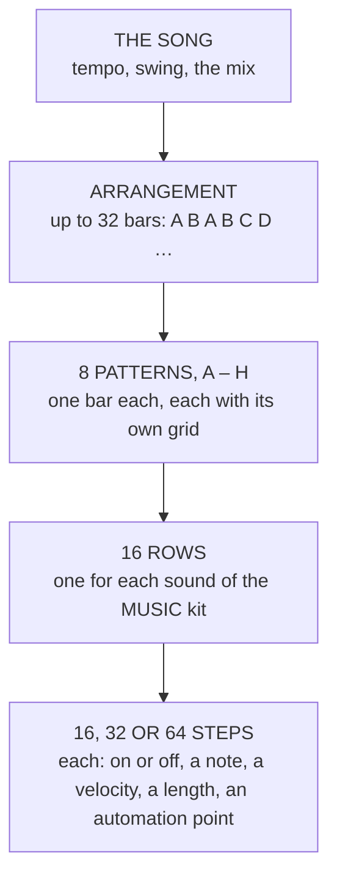

### What PLAY plays: LOOP or SONG

| The top line says | PLAY plays |
|---|---|
| **LOOP** | the pattern, round and round. A pattern you choose takes over on the next bar line, and then that one repeats |
| **SONG** | the arrangement, bar after bar, from the first bar that has the pattern you see. If no bar has it: that pattern once, then the arrangement from the top. Without an arrangement: the chain |

The word stands in the top line of SEQ, SONG, AUTO, PERFORM, MIX and MASTER. On the sound pages and LINK the kit stands
there instead; PLAY plays what was set last.

| This happens | The mode is |
|---|---|
| you go to **SEQ**, **AUTO** or **PERFORM**, while it is stopped and REC is not lit | LOOP |
| you go to **SONG**, while it is stopped and REC is not lit | SONG |
| you go to any page while it plays, or with REC lit | as it was |
| **F1** on SEQ, SONG or AUTO, **SHIFT + F1** on PERFORM – at any time, also while it plays | the other one (`LOOP: PATTERN REPEATS`, `SONG: PLAYS IN ORDER`). The key says what it will do: TO SONG, TO LOOP |
| you switch **REC** on | LOOP |
| you press PLAY or STOP | as it was: the top line said what PLAY will do |
| the device is switched on | SONG: PLAY plays the song |

From LOOP to SONG while it plays, the song goes on behind the first bar of the arrangement that has the pattern
you hear – from the top if no bar has it. Without an arrangement the chain goes on from the pattern you hear.

### Choosing a pattern

| | |
|---|---|
| **with** | LEFT / RIGHT on SEQ, SONG, AUTO and PERFORM · pads 1 – 8 and encoder 1 on SONG · pads 1 – 8 on PERFORM after F4 PATTERN · a click on the stage · a cue from a game |
| **stopped** | it is there at once |
| **playing** | it starts on the next bar line. Until then its letter blinks yellow and the top line reads `A>C` |
| **STOP before the bar line** | the pattern you chose is the one you see, and the one the next PLAY starts with |

In **LOOP** the chosen pattern repeats. In **SONG** it depends on the arrangement:

| The chosen pattern is … | What happens |
|---|---|
| **in** the arrangement | the song carries on from its next bar with that pattern |
| **not in** it | it takes over on the bar line and stays until you choose another |
| (no arrangement) | the chain goes on from it |

### The order of the song

| You want | Do this |
|---|---|
| your own order | the arrangement: **SHIFT + pad 1 – 8** adds that pattern as a bar (`BAR ADDED`; `32 BARS: FULL` at the end) |
| to take the last bar away | SHIFT + any of pads 9 – 15 |
| no arrangement (the chain plays again) | SHIFT + pad 16, **twice**: it asks `PRESS AGAIN: CLEAR ARR` |
| A, B, C, D in a row, a bar each, without an arrangement | CHAIN (encoder 2) at A – D. While there is an arrangement the chain is not used, and the knob says `ARRANGEMENT IN USE` |
| one pattern, round and round | LOOP – F1 |
| a shorter bar | encoder B (`BAR: 12/16 = 3/4`). It is the bar's length in sixteenths, 1 – 16, for the whole song. A pattern at 1/32 plays 2 steps for each of them, one at 1/64 plays 4 |
| another beat: 6/8 where it was 3/4 | SHIFT + B (`BEAT 3/8: BAR 6/8`). The beat is the device's, not the song's: [The bar and the beat](#the-bar-and-the-beat-34-68-78) |
| to empty the pattern you see | F3 CLR PAT. It keeps its grid |
| an empty song | F4 NEW, **twice**: it asks `PRESS AGAIN: NEW SONG`. Tempo 120, no swing, no arrangement, a bar of 16 sixteenths, every fader at 100, every layer at 0, every pattern at 1/16. Your sounds stay, and so does the beat |
| the demo song again | SHIFT + F4, **twice**: `PRESS AGAIN: DEMO` |

A key that asks twice counts the second press while its question is in the top line, about two seconds. All of
these F2 takes back, except what a knob set: CHAIN and the two turns of B.

---

## 11. Layers: music that follows the game

This is what makes it game music.

> **Every sound has a LAYER mark. The song has one INTENSITY. A sound plays only while INTENSITY is at or above its mark.**

So one song is many. At 0 % only the kick plays; as the game heats up, hat, bass, snare, strings, keys, brass and
bells join in that order.

| | On the SONG page |
|---|---|
| set INTENSITY | encoder 3, or pads 9 – 16 (eight steps). A game sends it |
| set a sound's LAYER mark | select the sound (DATA), turn encoder 4 |

On the page the eight intensity tiles light up as the level rises; LAYER is the selected sound's own mark.

PERFORM has the same two knobs, encoder 3 and encoder 4, and after F4 PATTERN its pads 9 – 16 are the intensity too.
There a sound whose layer is off is grey, name and steps
([section 13](#13-perform-the-whole-pattern-and-the-pads-four-ways)).

---

## 12. Automation

Automation moves a knob by itself while the pattern plays. **Any knob can have a lane** – and a sound can have as many
lanes as it has knobs that should move. Press **K5 a third time** for the AUTO page. As on SEQ, PLAY repeats the
pattern here (LOOP) – so a lane can be drawn while it goes round.

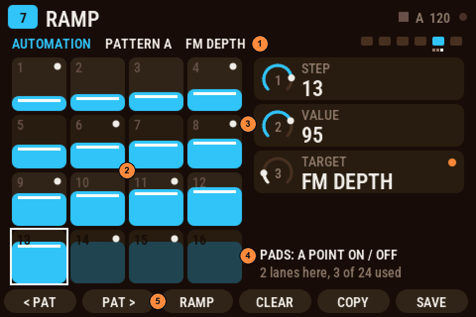

| | What it is |
|---|---|
| **1** | the pattern, and the knob this lane moves. Between them, the bar's name when it is not four quarters: `BAR 6/8` |
| **2** | the lane, as the 16 pads: a bar for each step (at 1/32 and 1/64: for each of the 16 steps shown). The empty tiles have two shades, beat by beat, as on SEQ. Bright with a white edge: a point. Dim: the value still held from the last point. The dot in a corner: the sound plays on that step |
| **3** | STEP · VALUE (in the knob's own unit) · TARGET (which knob). The orange dot says this knob has a lane |
| **4** | the eight patterns, as on SEQ, and how many of the song's 24 lanes are in use |
| **5** | TO SONG (or TO LOOP) · UNDO · RAMP joins the points with straight lines · CLEAR empties the lane · COPY the pattern · SAVE |

### What a lane can move

| | Targets |
|---|---|
| **the sound's own** | any of its 25 values: CUTOFF, FM DEPTH, POSITION, a send … |
| **its place in the mix** | VOLUME, PAN |
| **the master** | DELAY TIME, FEEDBACK, ROOM SIZE, DAMPING, DRIVE |

### The quick way: turn the knob, then press K5

**AUTO opens on the knob you turned last.** So: on any page of the MUSIC kit turn the knob you want to move – CUTOFF
on the FILTER page, a fader on MIX, ROOM SIZE on MASTER – then go to AUTO. Its lane is ready.

| | Do this |
|---|---|
| **1** | turn the knob you want to automate, on its own page |
| **2** | press **K5** until AUTO. TARGET already names that knob (or turn **encoder 3** to choose another) |
| **3** | hit **pad 1**. A point appears where the knob stands. Turn **encoder 2** down |
| **4** | hit **pad 16**. Turn encoder 2 up |
| **5** | press **F3 RAMP** – the picture above |

For a second lane on the same sound, turn TARGET to another knob and put points on it. Both play.

LEFT and RIGHT choose the pattern, as on SEQ. **F2 UNDO** takes back points, a RAMP or a CLEAR
([section 9](#undo)). The grid's keys are here too: SHIFT + F5 and F6 change the pattern's grid, SHIFT + LEFT and
RIGHT move the 16 steps the pads show, and the bar strip shows the lane's points
([A finer grid](#a-finer-grid-132-and-164)). CLEAR on a lane without points says `NOTHING TO CLEAR`. B has no job
on AUTO: the bar's length is B on SONG and PERFORM, the beat is SHIFT + B on SEQ, SONG and PERFORM.

On a sound page, an orange dot beside a value says a lane moves that knob:

### Four rules

| | |
|---|---|
| **A point holds** | until the next point, or the end of the bar |
| **Nothing is written** | at every bar line each knob is back where you set it by hand |
| **It moves in steps** | a step at a time: a 16th note, or a 32nd or a 64th in a pattern with a finer grid. Use RAMP for a sweep that sounds smooth |
| **24 lanes a song** | the first point of a knob takes a lane; clearing its last point gives it back |

---

## 13. Perform: the whole pattern, and the pads four ways

**One page to make a beat on, and to play a set from.** PERFORM shows the whole pattern at once – every sound, every
step – as a grid, the way a drum machine shows it. And the 16 pads can be four things there, a key for each: steps,
the kit, mutes, patterns. Everything it does is also on SEQ, MIX or SONG; here you do not have to leave the page.
(From firmware 1.7.0.)

Press **K5 four times** – from SEQ, three times more. K5 walks SEQ, SONG, AUTO, PERFORM, and then SEQ again; the
fourth dot under the K5 mark is lit. Opened while the song is stopped and REC is off, the page sets LOOP, as SEQ does:
PLAY repeats the pattern.

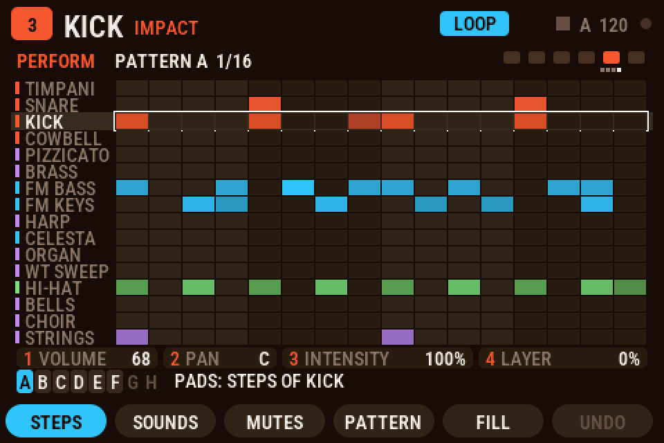

Here it is as it opens on the demo song, pattern A. DATA was turned two clicks to the right, for the kick.

### Reading the PERFORM page

The same, after PLAY: pattern A repeats.

| | What it is |
|---|---|
| **1** | what PLAY plays: **LOOP** or **SONG**. SHIFT + F1 changes it |
| **2** | the page, the pattern you see and its grid: `PATTERN A  1/16` – or `EDIT B - PLAYS A  1/16`, in orange, while another one plays. When the bar is not four quarters, its name follows: `PATTERN A  1/16  BAR 6/8` |
| **3** | the 16 sounds of the MUSIC kit, a row each, pad 1 at the top. A name is white while its sound plays. It is **grey when the sound is not heard**: muted, another one solo, or its layer off at the current intensity. A red **M** or a yellow **S** beside it: muted, solo |
| **4** | the pattern: **a row is a sound, a cell is a step** – 16, 32 or 64 cells across, by the pattern's grid. A step that is on has the colour of its sound, brighter the harder it plays, and is grey when the sound is not heard. The empty cells change their shade beat by beat – every quarter note, or the beat SHIFT + B chose; beyond the end of a short bar they are dark |
| **5** | the selected sound: its row is lit. While the pads are STEPS a white frame stands round the 16 steps they are |
| **6** | the playhead: the column that plays now. It is there while the pattern you see is the one that plays |
| **7** | encoders 1 – 4, in one line: VOLUME and PAN of the selected sound, INTENSITY, the selected sound's LAYER |
| **8** | the eight patterns, lit as on SEQ ([section 9](#reading-the-seq-page)), and a line that says what the pads are now |
| **9** | **F1 – F4: what the pads are.** The blue one is chosen. F5 FILL · F6 UNDO, dim while there is nothing to take back |

### The pads, four ways

**F1 – F4 choose what the 16 pads are.** The chosen key is blue, the line under the grid says it in words, and the
pads' own lights change with it.

| Key | The pads are | A pad | SHIFT + a pad |
|---|---|---|---|
| **F1 STEPS** | 16 steps of the selected sound, as on SEQ. The page starts so | the step, on or off. Held while a key is played: the step gets the key's note | hear that pad's sound and select it. No step is set |
| **F2 SOUNDS** | the kit | plays its sound and selects it. With REC lit while it plays, the hit is recorded into the pattern, as on SEQ with REC | the same |
| **F3 MUTES** | the mixer's mutes, as on MIX | mutes its sound, and selects it. Again: it is heard again | solo: only soloed sounds play |
| **F4 PATTERN** | patterns and intensity, as on SONG | pads 1 – 8: pattern A – H, at once while stopped, on the next bar line while it plays. Pads 9 – 16: the intensity, in eight levels | the same. No bar is added: the arrangement is made on SONG |

The page keeps what you chose when you leave it and come back.

| The line under the grid | The pads are |
|---|---|
| `PADS: STEPS OF KICK` | STEPS, of the selected sound. At 1/32 and 1/64 it names them: `PADS: STEPS 17-32 OF KICK` |
| `PADS: PLAY THE KIT` | SOUNDS |
| `PADS: THE KIT - REC READY: PLAY` · `PADS: THE KIT - RECORDING`, in red | SOUNDS with REC lit: stopped · playing |
| `PADS: MUTE - SHIFT + PAD: SOLO` | MUTES |
| `PADS: 1-8 PATTERN - 9-16 INTENSITY` | PATTERN |

**F3 MUTES**, while pattern A plays. Pads 7 and 16 were hit:

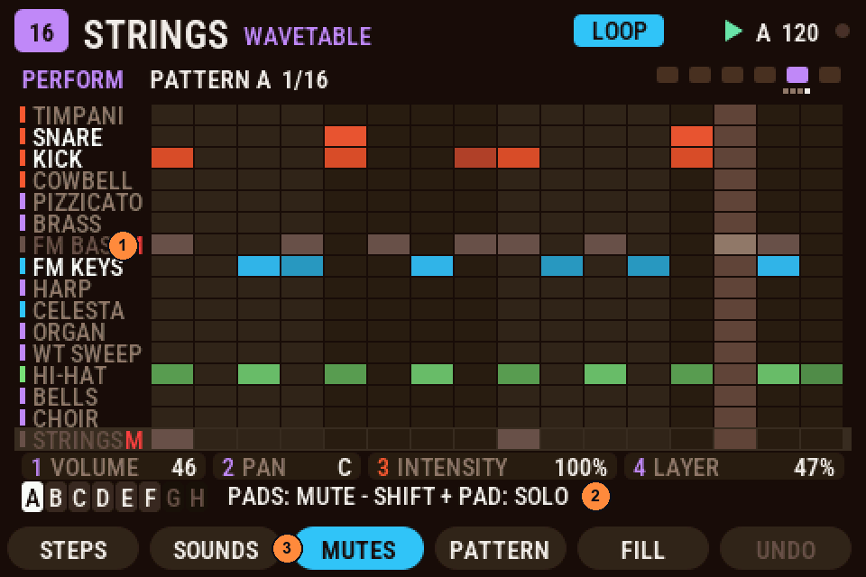

| | What it is |
|---|---|
| **1** | **M**: FM BASS is muted. Its name and its steps are grey – as are those of STRINGS, in the last row |
| **2** | what the pads are |
| **3** | F3 is blue |

A mute stays when the pads become something else and when you leave the page: it is the mixer's own. The same pad
again lifts it; **SHIFT + F3 ALL ON** lifts every mute and every solo.

**F4 PATTERN**, while pattern A plays. Pad 2 was hit:

| | What it is |
|---|---|
| **1** | `A>B`: A plays, B comes on the bar line |
| **2** | `EDIT B - PLAYS A`: the grid shows B already. The playhead is back when B starts |
| **3** | B blinks yellow until it starts. White is the pattern that plays |

**F2 SOUNDS with REC**, while pattern B plays. The cowbell was played in on pad 4, a round before:

| | What it is |
|---|---|
| **1** | the red dot: REC is lit. It beats with the click |
| **2** | the hits, where they landed |
| **3** | in red: what the pads play now is recorded |
| **4** | F2 is blue. REC chose it: pressing REC on this page makes the pads SOUNDS |

**At 1/32 and 1/64** the grid still shows the whole bar, in narrower cells. The pads are 16 of its steps, and the
frame says which:

| | What it is |
|---|---|
| **1** | the grid of the pattern you see |
| **2** | the frame: the 16 steps the pads are. Here steps 17 – 32, with a hi-hat roll in the last beat |
| **3** | the line names them too |

**SHIFT + RIGHT** and **SHIFT + LEFT** move the frame to the 16 steps after and before, as on SEQ
([A finer grid](#a-finer-grid-132-and-164)). The top line says which for a moment, as in the picture:
`STEPS 17-32`.

### F5, F6 and the keys with SHIFT

While SHIFT is held, the six keys on the display show their second names.

| Key | What it does |
|---|---|
| **F5 FILL** | the selected sound on every beat, every eighth, every sixteenth (at a finer grid also every thirty-second), then cleared: `EVERY 1/4` … `SOUND CLEARED`. With another beat than a quarter it begins with that beat: `EVERY 3/8`, `EVERY 3/16` or `EVERY 1/8`. It is F3 of SEQ |
| **F6 UNDO** | takes back the last thing done to the song. Again: redo. It is F2 of SEQ, and holds the same one step ([UNDO](#undo)) |
| **SHIFT + F1** | TO SONG or TO LOOP: what PLAY plays (`SONG: PLAYS IN ORDER`, `LOOP: PATTERN REPEATS`) |
| **SHIFT + F2 CLEAR** | takes the selected sound out of this pattern: `CLEARED - F6: UNDO`. `NOTHING TO CLEAR` if it has no steps |
| **SHIFT + F3 ALL ON** | no mute, no solo |
| **SHIFT + F4 COPY** | copies the pattern into the next empty one, with its grid, and you are on the copy (`COPIED A > G`). While it plays the copy starts on the bar line. `NO EMPTY PATTERN` if all eight hold something |
| **SHIFT + F5 · F6** | the pattern's grid one level coarser · finer, as on SEQ. The keys read `TO 1/16`, `TO 1/32`, `TO 1/64`. Coarser says `GRID 1/16 - F6: UNDO`, or asks first when it would drop something |
| **LEFT · RIGHT** | the pattern before / after: at once while stopped, on the bar line while it plays |
| **SHIFT + LEFT · RIGHT** | at 1/32 and 1/64: the 16 steps before / after |
| **DATA** | selects a sound: its row is lit |
| **REC** | lights REC, and makes the pads SOUNDS |
| **HOME** | the controls of this page |

### The encoders

| Encoder | Value | What it is |
|---|---|---|
| **1** | VOLUME | the selected sound's fader, the one on MIX |
| **2** | PAN | its place between left and right, the one on MIX |
| **3** | INTENSITY | the song's intensity: which layers play ([section 11](#11-layers-music-that-follows-the-game)) |
| **4** | LAYER | the selected sound's mark. It plays while INTENSITY is at or above it |
| **A** | | the tempo. SHIFT + A: the swing |
| **B** | | the bar's length in sixteenths, 1 – 16 (`BAR: 12/16 = 3/4`) |
| **SHIFT + B** | | the beat: 1/8, 3/16, 1/4 or 3/8 (`BEAT 3/8: BAR 6/8`). The click, the grid's shades and FILL follow it ([The bar and the beat](#the-bar-and-the-beat-34-68-78)) |

A step's velocity and length are not on this page: they are encoders 3 and 4 of SEQ.

### A beat from nothing, and playing it

Press **K5** until the page is PERFORM, and **RIGHT** until you are on an empty pattern: its letter is dim. In the
demo song that is G. Nothing plays yet, and the pads are STEPS.

**1. The kick.** Turn **DATA** to KICK: its row is lit. Press **F5 FILL** once: a kick on every beat (`EVERY 1/4`).

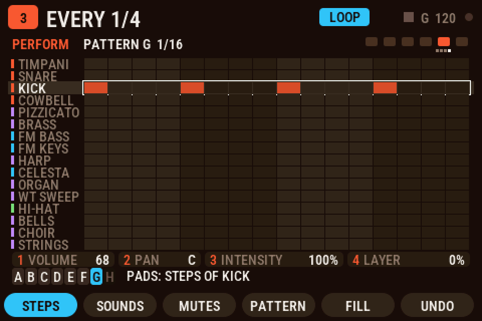

**2. The snare.** Hold **SHIFT** and hit **pad 2**: you hear the snare, and its row is lit. Let SHIFT go and hit
**pads 5 and 13**: the pads are the snare's 16 steps now.

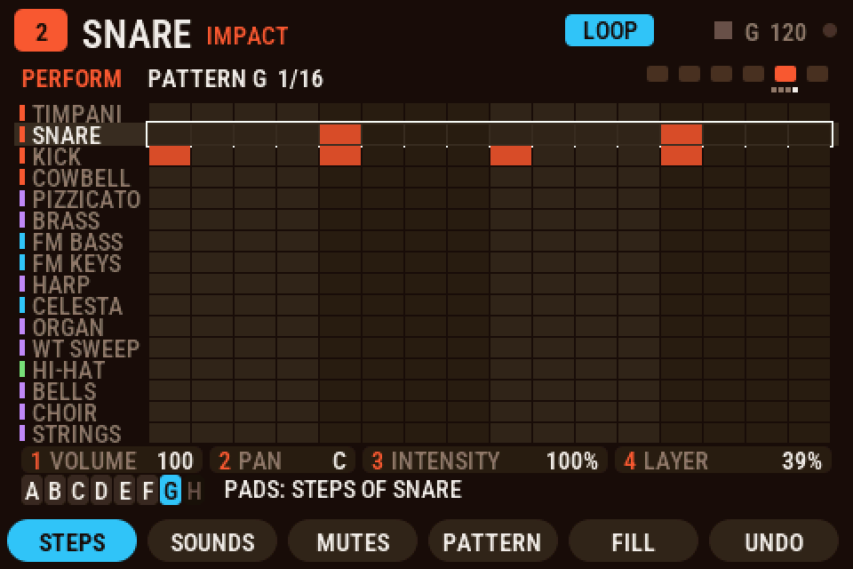

**3. The hi-hat.** **SHIFT + pad 13** selects it. Press **F5 FILL** twice: every eighth note (`EVERY 1/8`).

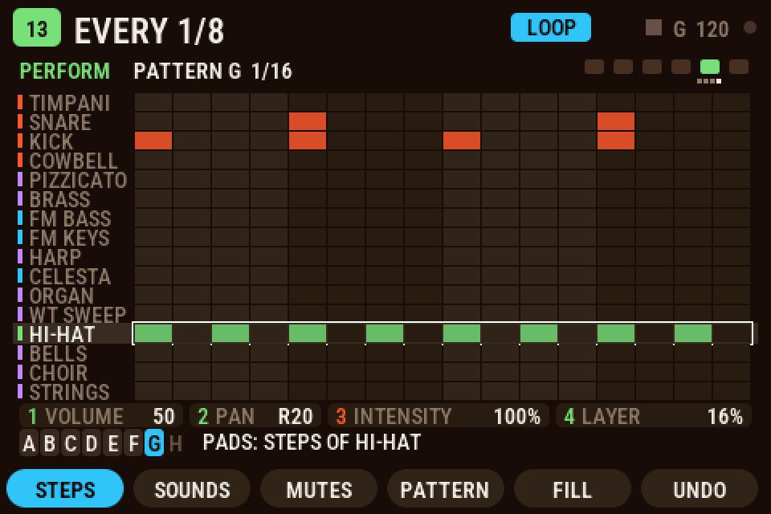

**4. Press PLAY.** The pattern repeats: the top line says LOOP. The playhead goes through the grid.

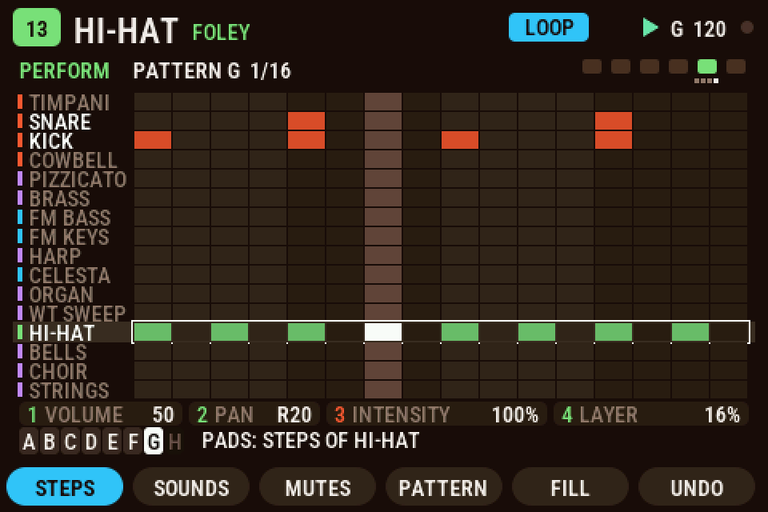

**5. The hats out, and in again.** Press **F3 MUTES** and hit **pad 13**. An M stands beside HI-HAT and its steps
are grey. Hit pad 13 again and the hats are back.

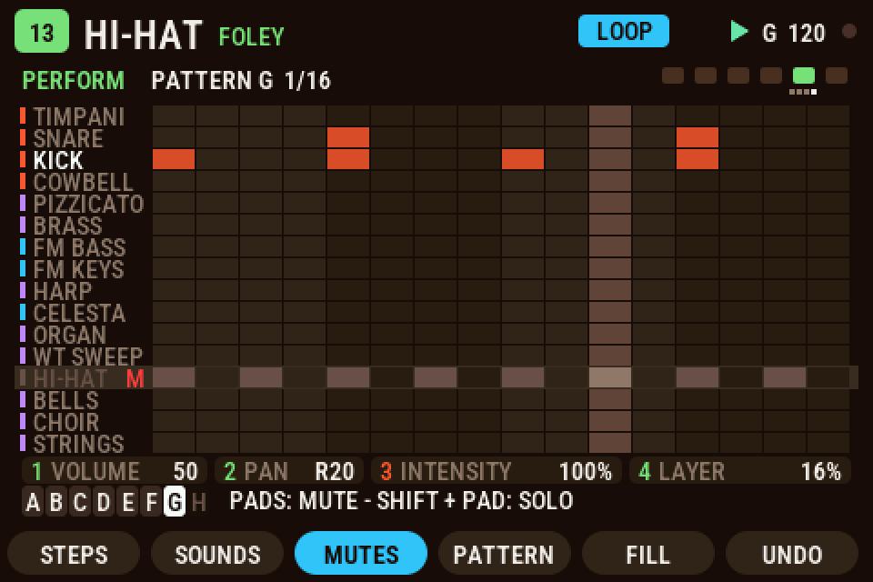

**6. A variation.** Press **SHIFT + F4 COPY**: `COPIED G > H`. H is the pattern you see now, and it starts on the
next bar line. Press **F1 STEPS**, then **SHIFT + pad 3** for the kick, and hit **pads 11 and 16**: two kicks more,
in H only.

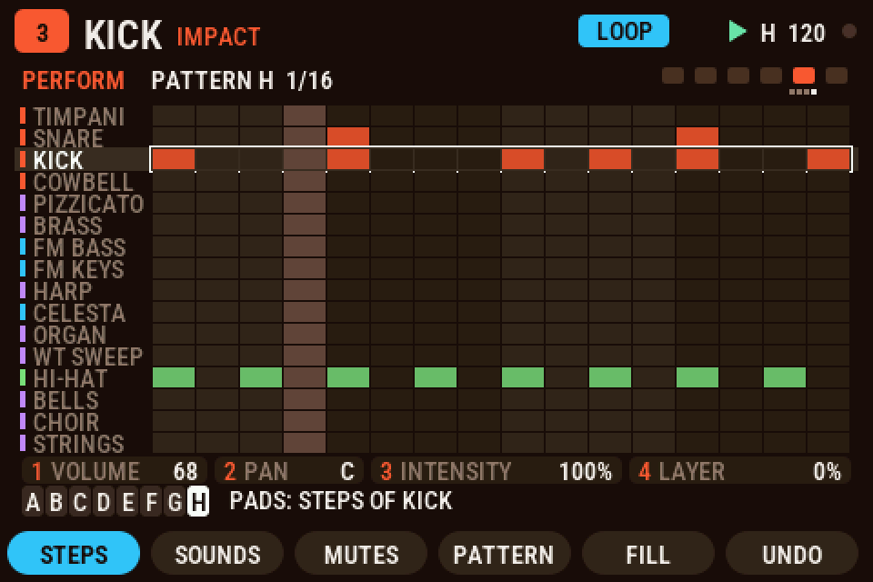

**7. From one to the other.** Press **F4 PATTERN** and hit **pad 7**, for G. It does not cut in: G blinks yellow and
the top line reads `H>G` until the bar line. Pad 8 goes back to H the same way.

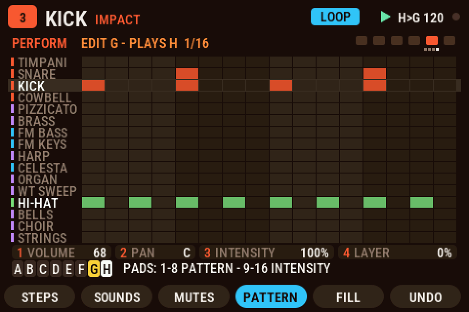

**8. Play a part in.** Press **REC**. F2 SOUNDS turns blue: the pads are the kit now, and a click keeps time. Hit
**pad 4**, the cowbell, in time. Each hit lands on the step nearest to it, and you hear it again on the next round.
**F6 UNDO** takes the whole take back. Press REC again when you are done.

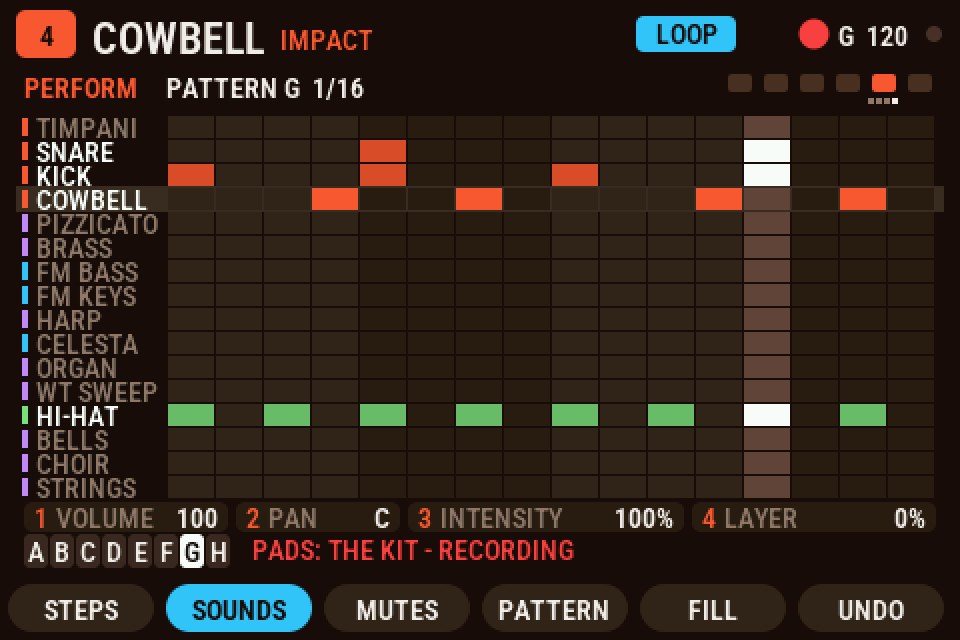

**9. Keep it.** Press **K5** once more, for SEQ, and **F6 SAVE** there.

### Three things to know about PERFORM

| | |
|---|---|
| **No ERASE and no SAVE on this page** | F4 is PATTERN here, so nothing erases a take as the bar passes: use F6 UNDO, or go to SEQ, where F4 held is ERASE while REC plays. SAVE is F6 on SEQ – K5 once more |
| **REC makes the pads the kit** | pressing REC on this page – the key, or REC on the stage – makes the pads SOUNDS. Opening the page with REC already lit does too. F1 makes them steps again, with REC still lit. Switching REC off leaves the pads as they are |
| **The pads' lights follow what the pads are** | as STEPS they are lit as on SEQ, as SOUNDS they show the kit, as MUTES they are lit as on MIX, as PATTERN as on SONG |

---

## 14. The mixer and the master effects

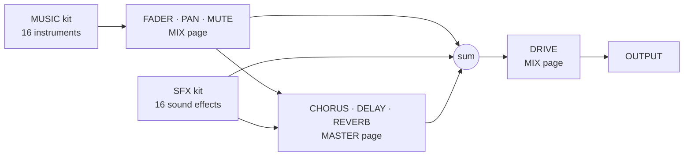

Sound effects skip the faders: a muted bass never mutes an explosion.

### MIX – press K4 twice

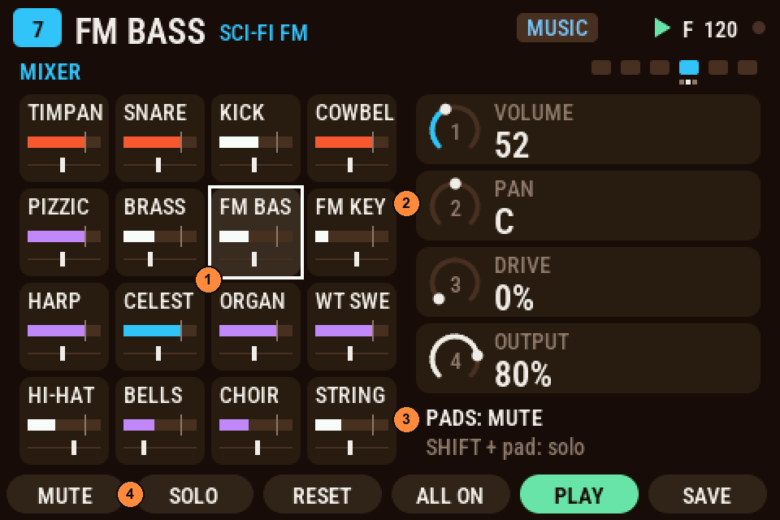

| | What it is |
|---|---|
| **1** | every sound of the MUSIC kit as a tile, where its pad is: its name, its fader (the small mark is 100, as designed), its pan under it. **M**: muted. **S**: solo. The frame is the selected sound |
| **2** | VOLUME and PAN of the selected sound · DRIVE: saturation on the whole mix · OUTPUT volume |
| **3** | what the pads do here |
| **4** | MUTE · SOLO · RESET the fader · ALL ON · PLAY · SAVE |

**The pads mute. SHIFT + a pad solos** – only soloed sounds play. The same mutes and solos are on PERFORM, after F3
MUTES there ([section 13](#13-perform-the-whole-pattern-and-the-pads-four-ways)).

The top line says LOOP or SONG here too, and **F5 PLAY** plays that: the pattern you were on, round and round, or
the song. F1 on SEQ, SONG or AUTO changes it, or SHIFT + F1 on PERFORM.

#### The mixer for a host: a mixer controller, a DAW

(From firmware 1.7.1.)

The firmware reports this mixer to its host – the plugin in a DAW, the Playground – as parameters, the way the
VIBE FM SDK's mixer convention asks. A mixer controller's faders and keys, and a DAW's automation, can then work
the mix and show it. They come after the six parameters the firmware had before (`volume`, `mod_pitch`,
`mod_cutoff`, `mod_fm`, `mod_level`, `intensity`), which are as they were: 71 parameters in all.

| Parameter | Range | What it is |
|---|---|---|
| `mix_1_level` … `mix_16_level` | 0 … 1 | the sound's fader. The song keeps it as 0 – 127, so 1 is 127 and the mark at 100 is 100/127 |
| `mix_1_pan` … `mix_16_pan` | −1 … +1 | its pan: −1 all left, 0 the middle, +1 all right (the song's 0, 64 and 127) |
| `mix_1_mute` … `mix_16_mute` | 0 or 1 | muted: what a pad does on MIX |
| `mix_1_solo` … `mix_16_solo` | 0 or 1 | solo: what SHIFT + a pad does on MIX |
| `mix_select` | 1 … 16 | the selected sound: the frame on MIX |

The number in the name is the sound's pad, 1 – 16. The host has them in groups: `MIX 1` … `MIX 16` for the sounds
and `MIX` for `mix_select`.

- **Nothing new is kept for it.** The values are the song's own and the selected sound, as the MIX page shows
  them. They are saved with the song and travel with it as before; the song's format did not change.
- **The host follows the device.** Whatever changes the mix is told to the host, and only what changed: a fader
  or a pan turned on MIX, a pad that mutes or solos, ALL ON, UNDO, NEW, another sound selected, a song that came
  from a game. At the start the host is told all 65. A pad played, or a note 36 – 51 from outside, selects its
  sound, so `mix_select` is told with it.
- **The device follows the host.** A value the host sets goes into the song, or selects the sound, and the MIX
  page shows it. It is not said back to the host. It is rounded to what the song holds: a fader set to 0.5 is 64
  of 127. So the host and the device can differ by up to half a step of 127.
- **What is not taken.** A value that is no number is not taken. While the tour runs (MENU), `mix_select` from the
  host is not taken, and the sounds the tour selects are not told to the host. In both cases the host is then told
  what the value really is; in the tour's case, when the tour is over.
- **`mix_select` follows the kit, the rest does not.** `mix_select` is the selected pad's number in whichever kit
  is chosen. Levels, pans, mutes and solos are always the song's sounds, the MUSIC kit. The MIX page works the same
  way.
- **No undo step** is made for a value from the host. The page's own faders and mutes make none either.
- **There is no arm.** The convention also has a record-arm key for each track; this firmware has no
  `mix_<n>_arm`, because REC is one key for the whole song and not one for each sound.
- OUTPUT of this page is the parameter `volume`, as it was. DRIVE and the MASTER page's values are not among the
  parameters.

**Not tried with a controller.** A scripted check sets and reads these parameters through the SDK's own host
functions ([section 19](#19-what-it-does-not-do), What is tested). Nobody has tried them with a real mixer
controller, in the VIBE FM plugin, in a DAW or in the Playground. In the plugin's Editor view the mixer is 17 more
groups, and mute and solo are plain two-step values there: that is read from the SDK, and nobody has seen it on a
screen.

**The tour, fixed with 1.7.1.** If DATA was turned while the tour ran and selected another sound,
older firmware let the tour change that sound and did not put it back. Now the tour changes only the sound it
selected itself, and puts it back.

### MASTER – press K4 a third time

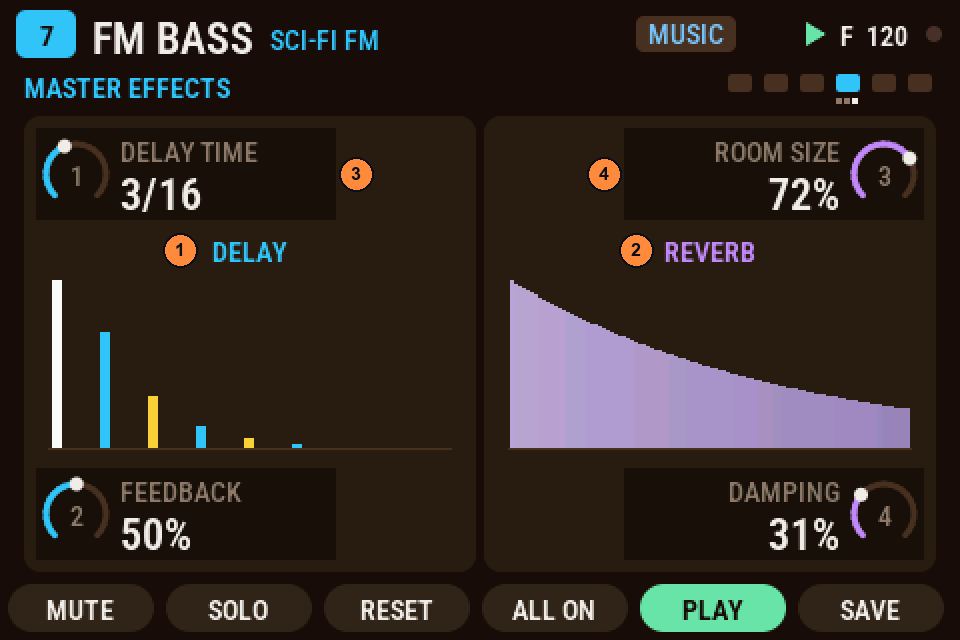

| | What it is |
|---|---|
| **1** | the delay, drawn as its echoes: left and right in turn |
| **2** | the reverb, drawn as its fading |
| **3** | the delay's values, in its corners: DELAY TIME (a 16th to a half note – it follows the tempo) and FEEDBACK |
| **4** | the reverb's: ROOM SIZE and DAMPING (low: a bright hall, high: a dark room) |

Each sound's own FX page decides how much of it goes into these.

**The mix belongs to the song.** It is saved with it and it is the mix in the game.

---

## 15. The stage

In the Playground and the plugin, **Stage** opens a bigger picture of the whole instrument, for the mouse.

| | What it is | With the mouse |
|---|---|---|
| **1** | LOOP / SONG: what PLAY plays | click: the other one |
| **2** | PLAY / STOP · REC | click |
| **3** | the tempo | click its left or right half, or the wheel |
| **4** | the patterns A – H. White: playing. Blue: the one shown. Blinking yellow: it starts on the next bar line | click: go there – on the bar line while it plays · **right-click: add a bar of it to the arrangement** |
| **5** | the arrangement | click a bar: its pattern · right-click: end the arrangement before it (UNDO brings it back) |
| **6** | the kit's 16 pads | click to play and select |
| **7** | SFX / MUSIC | choose the kit |
| **8** | the selected sound's picture | |
| **9** | the ten tabs | click |
| **10** | the tab's four values | **drag**, or the wheel (SHIFT: bigger steps) |
| **11** | PRESET · MUTATE · UNDO · RANDOM · EXPORT · SAVE | click (right-click PRESET: the one before) |
| **12** | the rows' names | click: hear and select · right-click: mute |
| **13** | the pattern: every sound's steps over the whole bar, in 16, 32 or 64 cells | click a step · **wheel: its note** · SHIFT + wheel: velocity · CTRL + wheel: length |
| **14** | INTENSITY, with each sound's mark above | drag |
| **15** | the selected sound's LAYER mark | drag |
| **16** | what plays now. Messages appear over it: what a key did, or what it asks | |
| **17** | FILL · CLEAR · COPY · UNDO · DEMO | click. DEMO asks twice. UNDO is dim while there is nothing to take back |
| **18** | GRID: the grid of the pattern shown | click: finer · right-click: coarser ([A finer grid](#the-grid-on-the-stage)) |

SHIFT-click does the same as right-click everywhere.

The picture shows pattern A repeating: LOOP is lit, and no bar of the arrangement moves. ERASE, the click's switch,
the swing, the bar's length and the beat are on the device only. The empty cells of the stage's rows change their
shade beat by beat, by the beat the device has; beyond the end of a short bar they are dark. The stage has no tab for
PERFORM: its right half already shows every sound's steps. While PERFORM is open on the device, the stage's REC makes
the pads the kit, as the REC key does.

### Automation on the stage

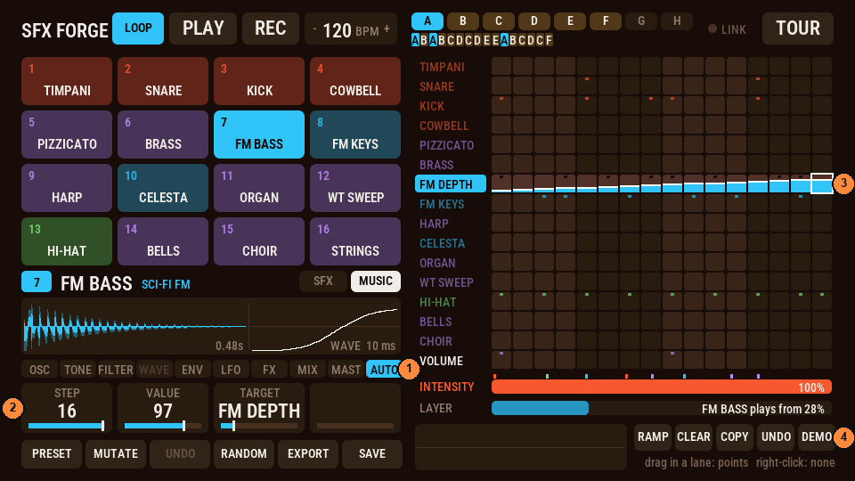

| | Do this |
|---|---|
| **1** | click the **AUTO** tab: the 16 rows become the sounds' lanes |
| **2** | choose the **TARGET** (drag the cell, or the wheel). Drag **VALUE** to set one point exactly |
| **3** | **click or drag in the sound's row to draw.** The height is the value; drag across to paint a curve. Right-click removes a point |
| **4** | FILL has become **RAMP** |

### The grid on the stage

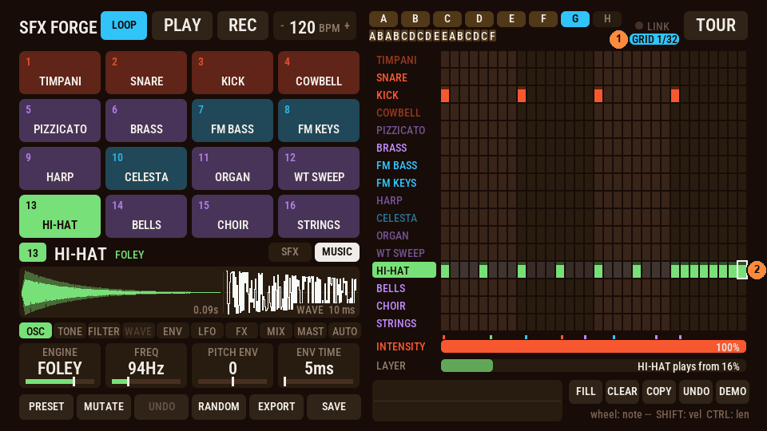

| | What it is | With the mouse |
|---|---|---|
| **1** | GRID: the grid of the pattern shown. It is blue when the grid is finer than 1/16 | click: finer · right-click or SHIFT-click: coarser. It asks as SHIFT + F5 does: click it the same way again |
| **2** | a row is the whole bar, in 16, 32 or 64 cells. Here the hats with the roll at the end | click a cell: that step, on or off |

The stage always shows the whole bar, so it has nothing like SHIFT + LEFT and RIGHT.

---

## 16. Into the game

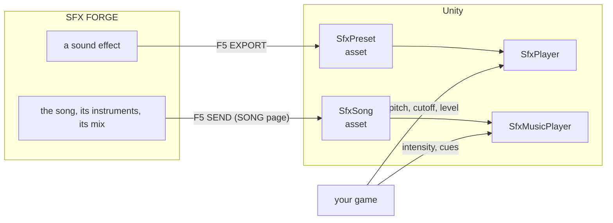

The game runs the same engine as the device (`core/`, plain C, built as a native library), so nothing is converted
and nothing sounds different.

### What the game controls

| The game wants to … | It uses |
|---|---|
| play a sound effect | `SfxPlayer` – live, or baked to an ordinary WAV |
| bend a sound while it plays (an engine that follows speed) | `SfxPlayer`'s pitch, cutoff, timbre and level |
| bring the band in and out | `SfxMusicPlayer.intensity`, 0 – 1 |
| change the music on the next bar | `SfxMusicPlayer.CuePattern(0 … 7)` |
| keep one pattern playing until the next cue | `SfxMusicPlayer.loopPattern` – the device's LOOP |
| play one of the song's instruments by hand | `SfxMusicPlayer.PlaySound(sound, velocity, note)` |
| move the mix | `SetTrackVolume` · `SetTrackPan` · `SetTrackMute` · `SetMaster` |

### Cues and the arrangement

| The cued pattern is … | What happens |
|---|---|
| **in** the arrangement | the song carries on from that bar |
| **not in** it (keep one aside for the boss, the menu) | it takes over on the bar line and stays until the next cue |

That is with the song playing in its order. With `loopPattern` on – or LOOP on the device – every cued pattern
takes over on the bar line and repeats until the next cue, wherever it stands in the arrangement.

`loopPattern` is new with firmware 1.5.0. The package holds the native library with the loop flag, and the
library's own test (`tests/dotnet`) passes with it: a looped pattern stays bar after bar, and a cue changes it on
the bar line. Inside Unity one Play mode test runs it, headless and muted: with `loopPattern` on, the demo song
stays on its pattern for more than three bars; with it off, the arrangement goes on. Nobody has listened to it.

### Songs, formats and older firmware

**F5 SEND** on the SONG page sends the MUSIC kit's 16 sounds and then the song, in pieces, as MIDI SysEx.

From firmware 1.6.0 the song is packed in **format 6**. A pattern writes only its grid and the rows that hold
something, so a song is as long as what is in it:

| | Bytes | Messages SEND sends (16 sounds + the song's pieces) |
|---|---|---|
| an empty song | 211 | 17 |
| the demo song | 2 487 | 27 |
| the largest song at 1/16 | | 57 |
| the largest song there can be | 38 355 | 176 |

Before, in format 5, every song was 7 699 bytes and SEND was 55 messages. A song piece now holds up to 240 bytes
and says which format the song has.

The bar's length is in the song, as it always was. **The beat is not**: SHIFT + B changes no byte of the song,
and a game never gets it. It does not need it: the beat moves the click and the display's shades, and no note
([The bar and the beat](#the-bar-and-the-beat-34-68-78)).

| Who meets what | What happens |
|---|---|
| firmware 1.6.0 or later gets a song in an older format, or in the older message shape | it is taken, with every pattern at 1/16: `SONG LOADED` |
| firmware 1.6.0 or later gets a song from a format after 6 | nothing of it is kept: `NEWER SONG: UPDATE` |
| firmware 1.6.0 or later gets a damaged song | `BAD SONG`, and its own song stays |
| **firmware 1.5.0 or older gets a song from 1.6.0 or later** | **it drops it without a word.** Nothing shows on its display and its song stays as it was. It does not know the new message |

"Later" is 1.7.0, 1.7.1 and 1.7.2: all pack and send a song as 1.6.0 does, and the format is still 6. So update the
device before a game, or anything else, sends it songs from 1.6.0 or later. The Unity package asks the device
what it is and refuses in words before it sends ([UNITY.md](UNITY.md)); a tool that just sends gets silence.
The same song sent a second time within two seconds loads nothing; another song that follows it at once is taken
as the next one. Later than two seconds the same song loads again, and it replaces what you changed since.

**A known limit: a song's pieces do not say which song they belong to.** A song crosses in pieces, in any order. If
a transfer breaks or two get mixed, so that one stray piece of another song with the same count of pieces arrives
and a whole song follows within two seconds, the device can take a song made of both. A whole transfer on its own
is not affected. Send the song again, two seconds or more after the last piece of the broken one.

### Tuning live

Linked over MIDI, the game drives the device while you listen and adjust. The **LINK page** (K6) shows it:

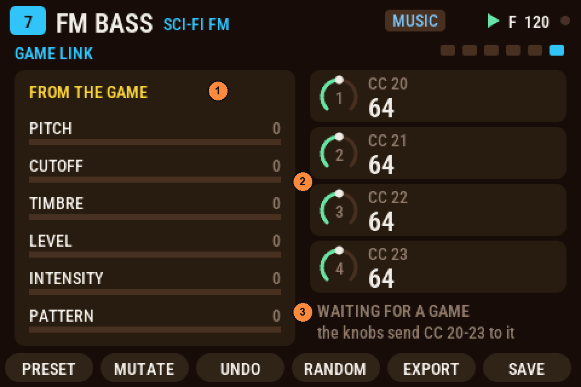

| | What it is |
|---|---|
| **1** | what the game sends: pitch, cutoff, timbre, level, intensity, pattern |
| **2** | encoders 1 – 4 send CC 20 – 23 to the game: tune a game value from here. On this page A and B send too: CC 24 and 25 |
| **3** | `WAITING FOR A GAME` until something comes from a game – telemetry (CC 10 – 17 on channel 2) or one of the SysEx messages; notes alone do not count. Then `LINKED`, in green, and it stays so until the device is switched off, also when the game has gone. Under it `the knobs send CC 20-25 to it` – or the text a game sent: up to 24 characters, shown here and nowhere else, so only while this page is open |

From firmware 1.4.0 a game can also ask the device what it is. The device answers with its **identity**: the
hardware, the firmware's version, the formats of its sounds and songs, and what it holds – 16 sounds in each of 2
kits, 8 patterns of up to 64 steps, 24 automation lanes, 32 bars, 16 voices, 5 engines, 6 wavetables. Firmware 1.7.2
answers version 1.7.2, song format 6 and 64 steps; 1.7.1, 1.7.0 and 1.6.0 answered the same with their own versions;
1.4.0 and 1.5.0 answered song format 5 and 16 steps. Every VIBE FM
with the same firmware answers the same; the question is there so that later firmwares for other hardware, and a Unity side that can do
more than a device, can be told apart without breaking what is made now. An older firmware does not answer, and the
game takes that for a VIBE FM with a firmware before 1.4. Nothing shows on the device when it is asked, except that
the LINK light comes on as for any SysEx message or telemetry from a game (notes alone do not light it).

The protocol, byte by byte, is in [LINK-PROTOCOL.md](LINK-PROTOCOL.md). The Unity side is this package:
[the Unity manual](UNITY.md) explains it, and its sample, the showcase game, shows all of it in one level.

---

## 17. Saving and resetting

| | |
|---|---|
| **F6 SAVE** | keeps both kits and the song – patterns with their grids, arrangement, layers, mix, automation – and the device's beat. A DAW project keeps them too. It says `SAVED` – or `NOT SAVED: STORE FULL` when the device's store did not take it: then do not count on it. The kits and the song are two files, and the next start finds of each what was last written whole – it can be the new sounds with the song from before |
| **F4 NEW** (SONG page), twice | an empty song. It replaces your song, not your sounds. F2 UNDO brings the song back |
| **SHIFT + F4** (SONG page), twice | the demo song again. It replaces your song, not your sounds. F2 UNDO brings the song back |
| **SHIFT + MENU, twice** | factory reset: both kits and the song as they came, the beat a quarter again, and saved so (`FACTORY RESET`; `RESET - NOT SAVED` if the store did not take it). Press it once and it asks; twice within three seconds does it |

The game and the device read songs from every earlier version of the format, at 1/16. The same does not hold the
other way: a sound or song from a *newer* version is not taken by this firmware (it keeps what it has), and a kit or
song stored by a newer firmware is not read. The next SAVE then writes over it. A kit stored in an older format of
the sounds is not read either; the factory kits appear instead.

Switching off forgets a few things that are not part of the song: after switching on, PLAY plays the song (SONG),
the click is on, REC is off and F2 has nothing to take back. The beat is not forgotten, if it was saved: the next
start has the beat of the last SAVE.

### The files

| File | What is in it |
|---|---|
| `kits.bin` | both kits |
| `song6.bin` | the song, in format 6 |
| `meter.bin` | the beat: one byte. It is there only while the beat is not a quarter. SAVE with a beat of a quarter takes the file away, and so does the factory reset. (From firmware 1.7.0) |
| `song.bin` | the song of the firmwares up to 1.5.0: read, never written ([below](#the-song-and-older-firmware)) |

### The song and older firmware

Firmware 1.6.0 stores the kits as 1.4.0 and 1.5.0 did, in `kits.bin`. The song has a new file, `song6.bin`.
`song.bin`, the song's file up to firmware 1.5.0, is still read and never written again. Firmware 1.7.0, 1.7.1
and 1.7.2 store both as 1.6.0 does: in the table, 1.6.0 stands for them too, and between those four nothing of it
applies.

`meter.bin`, the beat's file, is new with 1.7.0. Firmware 1.6.0 and older do not know the file: they do not read
it, do not write it and do not remove it, and their beat is always a quarter. Back on 1.7.0 or later the beat is
the one last saved there. This is read from the code, not tried.

| This happens | What you find |
|---|---|
| **you update to 1.6.0** | the song the older firmware saved. The first SAVE writes it to `song6.bin` |
| **you put an older firmware back** | its own `song.bin`, as it left it: the song from before the update. The song you made and saved with 1.6.0 it does not see. The sounds it does: `kits.bin` is one file for both, in a format that did not change |
| **the older firmware saves, and you come forward to 1.6.0 again** | the song the older firmware saved: it is the later one, and it wins. The top line says `OLDER FIRMWARE'S SONG` for two seconds |
| **you want the song 1.6.0 had saved instead** | **F2** on SEQ, SONG or AUTO (F6 on PERFORM), before you change anything: `UNDO: OLDER SONG`. F2 again goes back to the other (`REDO: OLDER SONG`) |
| **you press SAVE** | the song you have then is the one kept. Until that SAVE, `song6.bin` still holds the song 1.6.0 saved |
| **a factory reset** | deletes `song.bin` too |

F2 holds one step only: the first edit after switching on takes the other song's place there.

---

## 18. Recipes

| I want … | Do this |
|---|---|
| **a laser in ten seconds** | SFX kit, F1 until LASER, F2 MUTATE until you like it |
| **a footstep that is never the same** | in the game, play FOOTSTEP at a slightly different pitch each time – or EXPORT four mutations and pick one at random |
| **an engine that follows speed** | ENGINE HUM (a held sound) on an `SfxPlayer`, with an `SfxTelemetrySender` feeding speed to pitch and cutoff |
| **a chord that swells** | STRINGS: one step with a note, LENGTH 12. AUTO page: TARGET VOLUME, a low point on step 1, a high one on step 12, RAMP |
| **a filter sweep into the drop** | AUTO page, the bass, TARGET CUTOFF, points on steps 1 and 16, RAMP |
| **echoes on the snare only** | SNARE's FX page: DELAY up. MASTER page: DELAY TIME 3/16, FEEDBACK to taste |
| **music that reacts to danger** | low LAYER marks for the calm instruments, high for the tense ones. The game sets `intensity` from how close the enemy is |
| **a boss theme** | write it in pattern H and leave H out of the arrangement. `CuePattern(7)` when the boss appears, `CuePattern(0)` after |
| **a hi-hat roll** | SEQ page, SHIFT + F6 for 1/32, SHIFT + RIGHT for the second half of the bar, HI-HAT on pads 9 – 16 |
| **a fill only every fourth bar** | F5 COPY the pattern, SHIFT + F6 on the copy, write the fill there. Put the copy in the arrangement as every fourth bar |
| **a snare rush that gets louder** | at 1/32 or 1/64: FILL the snare to `EVERY 1/32`, then encoder 1 from step to step and encoder 3 VELOCITY up |
| **a waltz** | SONG or PERFORM: B to 12 (`BAR: 12/16 = 3/4`). KICK: FILL once, a kick on the three beats – or pad 1 only, and the snare on pads 5 and 9 |
| **a 6/8 loop** | B to 12, then SHIFT + B one click up (`BEAT 3/8: BAR 6/8`). KICK: FILL once (`EVERY 3/8`: steps 1 and 7). HI-HAT: FILL twice (`EVERY 1/8`) |
| **a bar of 7/8** | B to 14 (`BAR: 14/16 = 7/8`). The click counts three quarters and a short beat |
| **one pattern, round and round, while I work on it** | K5 for the SEQ page, PLAY. The top line says LOOP |
| **to play a part in** | SEQ page, REC, PLAY, then the pads or the keys. A bad take: F2 |
| **one wrong sound out of a take** | SHIFT + its pad selects it. Hold F4 ERASE for one round |
| **a variation of a pattern** | F5 COPY on the SEQ page: the next empty pattern is a copy, and you are on it. F2 takes it back |
| **the whole song again, after looping** | F1 TO SONG, PLAY |
| **every sound's steps on one page** | K5 until PERFORM |
| **the drums out for a bar, and in again** | PERFORM, F3 MUTES: the pads of kick, snare and hi-hat. The same pads again bring them back; SHIFT + F3 brings everything back |
| **another pattern from the pads, on the bar line** | PERFORM, F4 PATTERN, pads 1 – 8 |
| **to start over** | SHIFT + MENU, twice |

---

## 19. What it does not do

| | |
|---|---|
| **Samples** | it cannot play recorded audio: no voice lines, no recorded foley, no real orchestra |
| **Timing** | a bar is 16 sixteenths at most, each cut in 1, 2 or 4: 1/64 is the finest. No triplets, no notes between steps; swing is the only timing change, and it moves sixteenths |
| **Time signatures** | whatever fits in 16 sixteenths: 4/4, 3/4, 2/4, 6/8, 7/8, 5/8, 12/16 … No longer bar: no 5/4, 6/4, 9/8 or 12/8. One bar's length for the whole song and one beat for the device: none for a pattern. The beats are all the same length, and the last may be short: no groupings like 2+2+3. The beat is not in the song, and a game does not get it |
| **The grid** | one for a pattern, not one for each sound. The pads show 16 steps at a time. FILL goes to 1/32, not to 1/64 |
| **Size** | 8 patterns, 32 bars of arrangement, 16 voices – with long reverberant sounds the oldest note is cut to make room |
| **Automation** | 24 lanes a song, moving in steps, not glides |
| **Chords** | one note per step for each sound. A chord needs several sounds, or the keys |
| **Recording** | onto the pattern's steps: a hit is moved to the step of its grid nearest to it, and can land a few milliseconds early. No count-in. The MUSIC kit only |
| **Undo** | one step back for the song, and forth again. Not for tempo, swing, the bar's length, the beat or the mixer; a sound has its own |
| **The mixer for a host** | level, pan, mute, solo and the selected sound, and no arm for a sound: REC is one key for the song. Not tried with a mixer controller, in the plugin or in a DAW ([section 14](#the-mixer-for-a-host-a-mixer-controller-a-daw)) |
| **Older firmware** | 1.5.0 and before drop a song from 1.6.0 or later without a word, and do not see what those saved on the device ([section 16](#songs-formats-and-older-firmware), [section 17](#the-song-and-older-firmware)) |
| **Platforms** | the Unity package runs on Windows x64 so far. Its MIDI link is tested against the emulator over a virtual cable, not against the hardware |
| **PERFORM** | has no ERASE and no SAVE: both are on SEQ. It shows that a step is on and how hard it plays, not its note or its length; a pad held and a key gives a step its note, the velocity and the length are set on SEQ |
| **The stage** | has no control for the swing, the click, the bar's length, the beat or ERASE, and no tab for PERFORM; they are on the device |
| **SHIFT + K1 – K6, SHIFT + RETURN** | have no job in SFX FORGE. On the VIBE itself they are the VIBE's: SHIFT + K1 – K6 play notes and SHIFT + RETURN locks that ([section 2](#2-the-device)). That is read from the SDK, not tried on hardware |
| **What is tested** | firmware 1.7.2 passes all 25 scripted checks and, new with 1.7.2, a short run of a fuzzer (`sh build.sh`, 26 lines `PASSED`): scripts press its keys and the checks look at what it then plays, sends, stores and holds – the loop, a take over several bars, ERASE, UNDO, the keys that ask twice, COPY, and for the grid: a pattern raised and lowered, a take at 1/64, the keys of the grid, the song's messages in both shapes, the two song files. The 23rd check is PERFORM's: a script presses the page's keys, pads and encoders, and the check reads the song and measures how loud it plays. It does not look at the display; the pictures of the page in this manual are taken from the firmware. Nobody has played PERFORM by hand or listened to it, and the stage's REC on PERFORM is read from the code, not tried. The 24th check is the beat's: a script turns B and SHIFT + B, and the check reads which steps FILL wrote with each beat, measures when the click sounds in a bar of 12 sixteenths with a quarter and with a dotted quarter, compares the song byte by byte before and after SHIFT + B, looks at `meter.bin` after SAVE with a dotted quarter and with a quarter, and reads the beat – by what FILL writes – after the device is switched on again, after NEW and after the factory reset. It sees that the display changes with the beat, not what it writes: the words and the shades in this manual are taken from pictures of the firmware. It does not look at the stage, and not at what swing does to the click: that is read from the code. Nobody has listened to the click with another beat or set a time signature by hand. The 25th check is the mixer's, new with 1.7.1: it reads the list of the 71 parameters, sets the mixer's through the SDK's own host functions and reads what the firmware tells the host – all 65 at the start; a fader, a pan, a mute, a solo and the selected sound set from the host, which the page's encoders and pads then go on from and which are not said back; a pad, SHIFT + a pad, the encoders, ALL ON, NEW and UNDO on the device, of which the host is told what moved; and it measures that the song is silent with every sound muted from the host, sounds again unmuted, and is silent with every fader down; that a value from the host that is no number is not taken and the host is told the real one; and that after the tour, with `mix_select` from the host and DATA turned while it ran, every sound is as it was and the sound of before is selected. It does not look at the display. Nobody has tried the mixer with a real mixer controller, in the VIBE FM plugin, in a DAW or in the Playground. The fuzzer plays the host of the built firmware from a row of random numbers: every control, the host's parameters and clock, SysEx whole and broken, the store, restarts, and values that are no numbers (NaN, an infinity). After every block it checks that nothing crashed and that every sample is a number within full scale; it does not hear whether the sound is right. What it found is fixed in 1.7.2: a host's tempo or song position that was an infinity crashed the firmware while the song played, a host parameter that was no number left the sound broken until a restart, a velocity that was an infinity broke the sound too, and single samples of a loud mix were a hair over full scale. Longer runs of it, and a second stress test, the firmware built for a computer with the audio and the controls in two real threads, passed on 25 Nov 2026; neither is the plugin. A third tool, which sends hard MIDI to the real plugin, has not yet sent a byte. A song mixed from two broken transfers can be taken as one ([section 16](#songs-formats-and-older-firmware)). Firmware 1.7.2 has not been run on the hardware, in the plugin, in a DAW or in the Playground, and 1.7.1 and 1.7.0 were not either. The link was last tested against the emulator on 24 Nov 2026, with the 1.7.0 build before the LINK page's footer was corrected to `CC 20-25`. The build of now differs from it in that text, in what 1.7.1 brought (the mixer's parameters, the tour's fix), in the hardening of 1.7.2 and in the version the identity says; 1.7.1 and 1.7.2 changed no message and no format, and the link was not run again (so not with 1.7.1 or 1.7.2): the six link tests of the Unity manual passed, in one run, with songs of sixteenths only and the beat a quarter. The recorded session with SEND and EXPORT pressed on the device was run once, on 23 Nov 2026, with the 1.7.0 build of that day, which had PERFORM and not yet the beat, and not again; with four quarters the display is the same. PERFORM was not open in those runs. A DAW's clock with a finer grid is not tested. What an older firmware does with a song from 1.6.0 or later is read from its code, not tried. `NOT SAVED: STORE FULL` was only seen in a test that makes the store fail. Nobody has listened to the new features yet |

---

## 20. Every control, page by page

### The cheat sheet

For those who know their way around: every page and every shortcut on one picture.

### The same, as tables

**Everywhere:** pads play · keys play the selected sound in tune · DATA selects · SHIFT + ENTER the other kit ·
PLAY STOP: a pattern round and round (LOOP) or the song (SONG) · REC: what is played is recorded · SHIFT + REC the
click · MENU the tour · HOME this page's controls · A the output volume (not on SEQ, SONG, AUTO, PERFORM and LINK: see below) · SHIFT + MENU twice: reset.

| Page | Key | Pads | Encoders 1 – 4 | F1 – F6 |
|---|---|---|---|---|
| **OSC** | K1 | play | ENGINE · FREQ · PITCH ENV · ENV TIME | PRESET · MUTATE · UNDO · RANDOM · EXPORT · SAVE |
| **TONE** | K1 ×2 | play | A · B · NOISE · CRUSH | the same |
| **FILTER** | K1 ×3 | play | CUTOFF · RESO · FILTER ENV · F.ENV TIME | the same |
| **WAVE** | K1 ×4 | play | TABLE · SPREAD | the same |
| **ENV** | K2 | play | ATTACK · DECAY · SUSTAIN · RELEASE | the same |
| **LFO** | K3 | play | LFO RATE · > PITCH · > FILTER · > TIMBRE | the same |
| **FX** | K4 | play | CHORUS · DELAY · REVERB · LEVEL | the same |
| **MIX** | K4 ×2 | mute · SHIFT: solo | VOLUME · PAN · DRIVE · OUTPUT | MUTE · SOLO · RESET · ALL ON · PLAY · SAVE |
| **MASTER** | K4 ×3 | play | DELAY TIME · FEEDBACK · ROOM SIZE · DAMPING | as MIX |
| **SEQ** | K5 | 16 steps of the bar (REC lit: the kit) · SHIFT: select a sound | STEP · NOTE · VELOCITY · LENGTH | TO SONG / TO LOOP · UNDO · FILL · CLEAR (REC playing: ERASE, held) · COPY · SAVE · SHIFT + F5 / F6: the grid coarser / finer |
| **SONG** | K5 ×2 | 1 – 8 pattern · 9 – 16 intensity · SHIFT: arrangement | PATTERN · CHAIN · INTENSITY · LAYER | TO SONG / TO LOOP · UNDO · CLR PAT · NEW (SHIFT: DEMO), both twice · SEND · SAVE |
| **AUTO** | K5 ×3 | a point on / off, on 16 steps of the bar · SHIFT: select a sound | STEP · VALUE · TARGET (it opens on the knob turned last) | TO SONG / TO LOOP · UNDO · RAMP · CLEAR · COPY · SAVE · SHIFT + F5 / F6: the grid coarser / finer |
| **PERFORM** | K5 ×4 | what F1 – F4 choose. STEPS: 16 steps of the selected sound (SHIFT: select a sound) · SOUNDS: the kit (REC playing: recorded) · MUTES: mute (SHIFT: solo) · PATTERN: 1 – 8 pattern, 9 – 16 intensity | VOLUME · PAN · INTENSITY · LAYER | STEPS · SOUNDS · MUTES · PATTERN · FILL · UNDO · with SHIFT: TO SONG / TO LOOP · CLEAR · ALL ON · COPY · the grid coarser / finer |
| **LINK** | K6 | play | send CC 20 – 23 (A and B: CC 24 and 25, below) | as the sound pages |

| Other encoder | Where | What it does |
|---|---|---|
| **A** | SEQ, SONG, AUTO, PERFORM | the tempo. SHIFT + A: the swing |
| **A · B** | LINK | send CC 24 and 25 |
| **B** | SEQ | the scale NOTE moves in |
| **B** | SONG, PERFORM | the bar's length in sixteenths, 1 – 16 |
| **SHIFT + B** | SEQ, SONG, PERFORM | the beat: 1/8, 3/16, 1/4 (as it comes) or 3/8. One click, one beat further; it stops at both ends |

| Other key | Where | What it does |
|---|---|---|
| **LEFT · RIGHT** | SEQ, SONG, AUTO, PERFORM | the pattern before / after: at once while stopped, on the bar line while it plays |
| **SHIFT + LEFT · RIGHT** | SEQ, AUTO, PERFORM | at 1/32 and 1/64: the 16 steps before / after |
| **SHIFT + F5 · F6** | SEQ, AUTO, PERFORM | the pattern's grid one level coarser · finer. Coarser asks twice when it would drop something |
| **REC** | everywhere | lit: PLAY repeats the pattern, and the keys and the pads are recorded into it – the pads on every page where they play the MUSIC kit: SEQ, PERFORM with the pads as SOUNDS, the sound pages, MASTER and LINK. Pressed on PERFORM it makes the pads SOUNDS |
| **SHIFT + REC** | everywhere | the click on / off |
| **SHIFT + pad 1 – 8** | SONG | add that pattern to the arrangement as a bar |
| **SHIFT + pad 9 – 15** | SONG | take the last bar away |
| **SHIFT + pad 16**, twice | SONG | no arrangement |

| The top line says | It means |
|---|---|
| `LOOP: PATTERN REPEATS` · `SONG: PLAYS IN ORDER` | F1 – on PERFORM SHIFT + F1: what PLAY plays now |
| `REC ON: PATTERN LOOPS` | REC changed SONG to LOOP |
| `ERASE: HOLD F4` | F4 while REC plays: held, it erases the selected sound |
| `MUSIC KIT ONLY: K5 SEQ` | a hit of the SFX kit was not recorded |
| `UNDO: …` · `REDO: …` · `NOTHING TO UNDO` | F2 – on PERFORM F6 |
| `PRESS AGAIN: NEW SONG` · `PRESS AGAIN: DEMO` · `PRESS AGAIN: CLEAR ARR` | a key that asks twice – F4 NEW and SHIFT + F4 DEMO on SONG, SHIFT + pad 16 on SONG: press it again while this stands |
| `NEW SONG - F2: UNDO` · `DEMO SONG - F2: UNDO` | the second press of NEW · of DEMO: the song is replaced, and F2 brings the one before back |
| `AGAIN: FACTORY RESET` | SHIFT + MENU: press it again within three seconds |
| `FACTORY RESET` · `RESET - NOT SAVED` | the second SHIFT + MENU: everything as it came, and saved so · as it came, but the store did not take it |
| `CLEARED - F2: UNDO` · `CLEARED - F6: UNDO` | CLEAR took the selected sound's steps out of the pattern: F4 on SEQ, SHIFT + F2 on PERFORM. The key it names takes that back |
| `NOTHING TO CLEAR` | CLEAR or CLR PAT with nothing there. What F2 holds is kept |
| `PAT CLEARED - F2: UNDO` | F3 CLR PAT on SONG: the pattern shown is empty |
| `LANE CLEARED` | F4 CLEAR on AUTO: the points of the lane shown are gone from this pattern. F2 brings them back |
| `ALL ON` | F4 on MIX and MASTER, SHIFT + F3 on PERFORM: no mute, no solo |
| `MUTED` · `UNMUTED` · `SOLO` · `SOLO OFF` | F1 MUTE · F2 SOLO on MIX and MASTER: the selected sound |
| `FADER RESET` · `MASTER RESET` | F3 RESET: on MIX the selected sound's volume and pan · on MASTER the master's values – faders, pans, mutes and solos stay |
| `COPIED A > G` · `NO EMPTY PATTERN` | F5 COPY |
| `EVERY 1/4` · `EVERY 1/8` · `EVERY 1/16` · `EVERY 1/32` · `SOUND CLEARED` | F3 FILL – on PERFORM F5: where the sound stands now |
| `EVERY 3/8` · `EVERY 3/16` | FILL's first press with a beat of a dotted quarter · of three sixteenths |
| `GRID 1/32` · `GRID 1/64` | SHIFT + F6: the pattern's grid is finer |
| `GRID 1/16 - F2: UNDO` · `GRID 1/32 - F2: UNDO` | SHIFT + F5: the grid is coarser. On PERFORM they name F6: `GRID 1/16 - F6: UNDO`, `GRID 1/32 - F6: UNDO` |
| `AGAIN: G DROPS 4` | SHIFT + F5 would drop 4 steps or points of pattern G: press it again while this stands |
| `FINEST: 1/64` · `COARSEST: 1/16` | the grid cannot go further |
| `STEPS 17-32` | SHIFT + LEFT or RIGHT: the steps the pads show now |
| `1/16: ALL STEPS SHOWN` · `BAR ENDS AT STEP 8` | SHIFT + LEFT or RIGHT with nothing to move to |
| `BAR: 12/16 = 3/4` · `BAR: 7/16` | B on SONG and PERFORM: the bar's length in sixteenths, and the time signature it makes with the beat. A bar that is counted in sixteenths anyway is said once |
| `BEAT 3/8: BAR 6/8` | SHIFT + B on SEQ, SONG and PERFORM: the beat, and what the bar is called with it. The four: `BEAT 1/8`, `BEAT 3/16`, `BEAT 1/4`, `BEAT 3/8` |
| `SWING 20%` | SHIFT + A on SEQ, SONG, AUTO and PERFORM |
| `CHROMATIC` · `MAJOR` · `MINOR` · `PENTATONIC` | B on SEQ: the scale NOTE moves in |
| `CLICK ON` · `CLICK OFF` | SHIFT + REC |
| `TURN TARGET FIRST` | AUTO: a pad or VALUE while the lane has no target yet. On the stage a click in the lane says `CHOOSE A TARGET FIRST` |
| `SET TWO POINTS FIRST` · `RAMP` | F3 RAMP on AUTO: fewer than two points in the lane · done |
| `ALL 24 LANES IN USE` | AUTO: a first point for a new target, with every lane of the song taken |
| `BAR ADDED` · `32 BARS: FULL` | SHIFT + pad 1 – 8 on SONG: a bar more · the arrangement holds no more |
| `BAR REMOVED` | SHIFT + pad 9 – 15 on SONG: the last bar is gone |
| `NO ARRANGEMENT` | SHIFT + pad 16 on SONG with no bars to clear |
| `ARR CLEARED - F2: UNDO` | the second SHIFT + pad 16: no arrangement. Also on the stage, when the arrangement is cut before its first bar |
| `BARS REMOVED` | on the stage: SHIFT + click or a right-click on a bar of the arrangement – it ends before that bar |
| `SAVED` · `NOT SAVED: STORE FULL` | F6 SAVE |
| `SFX KIT` · `MUSIC KIT` | SHIFT + ENTER: the other kit |
| a sound's name, such as `EXPLOSION` | F1 PRESET on a sound page: the sound the pad holds now |
| `MUTATED` · `RANDOM` · `UNDO` | F2 MUTATE · F4 RANDOM · F3 UNDO on a sound page. F3 with nothing to take back: `NOTHING TO UNDO` |
| `EXPORTED` | F5 EXPORT on a sound page: the sound went out as SysEx |
| `SENDING` · `SENDING - NO GAME SEEN` · `SONG SENT` | F5 SEND on SONG: the 16 sounds and the song go out · the same, and nothing has come from a game yet · the last piece has gone |
| `OLDER FIRMWARE'S SONG` | at the start: an older firmware saved a song later than this one did. F2 brings this one's back |
| `PATCH LOADED` · `SOUND LOADED` · `BAD PATCH` | a sound came from a game: onto a pad of the kit shown, which becomes the selected sound · onto a pad of the MUSIC kit, as a song's sound · damaged, not taken |
| `SONG LOADED` · `BAD SONG` · `NEWER SONG: UPDATE` | a song came from a game: taken · damaged · from a later format |
| `ARRANGEMENT IN USE` | CHAIN is not used while there is an arrangement |

The pictures in this manual are made from the firmware itself: `node docs/shots.mjs` takes the screenshots,
`python docs/figures.py` puts the marks on them.

**Licence.** SFX FORGE is free software under the GNU General Public License, version 3 or any later version:
`LICENSE.md` at the top of the package, with the additional permissions of `ADDITIONAL-PERMISSIONS.md` beside it
(one of them is for the hosts that load VIBE FM firmwares). See the package's README, "License".
