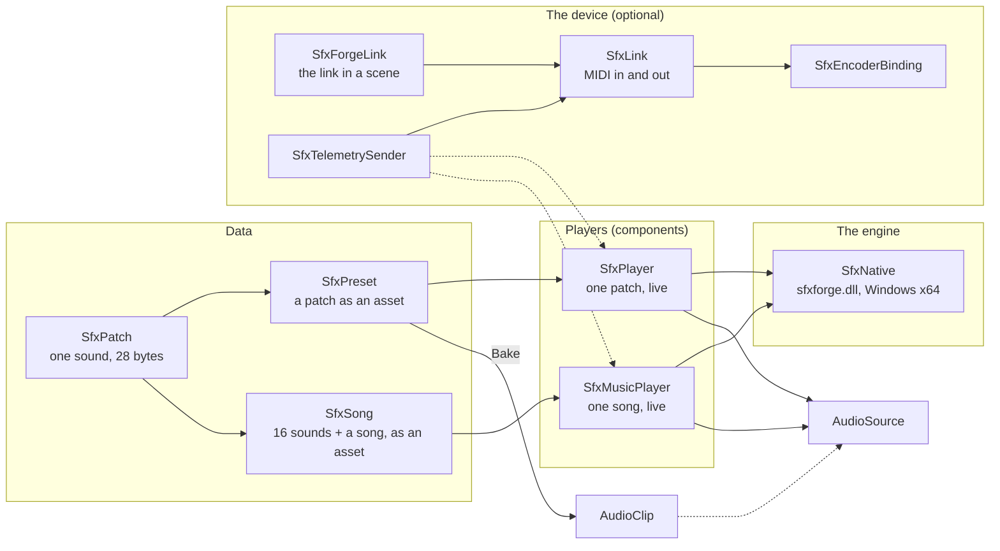
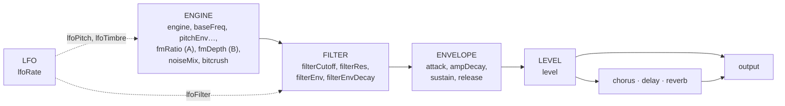
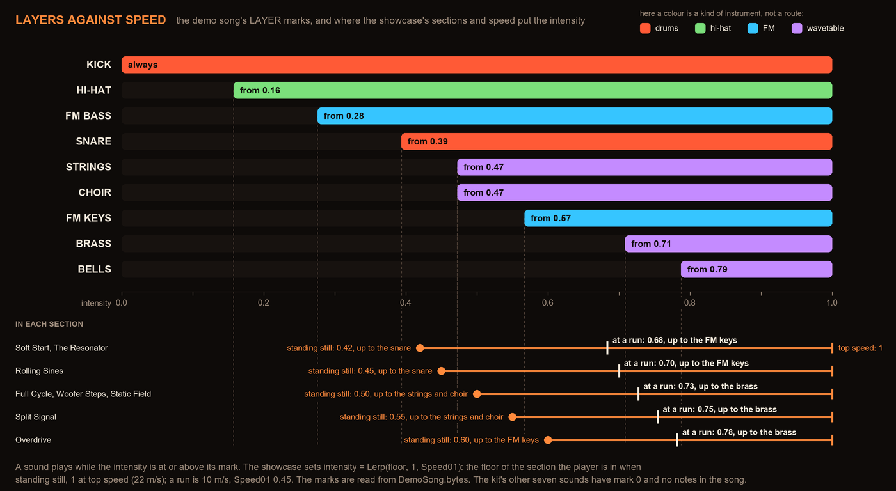
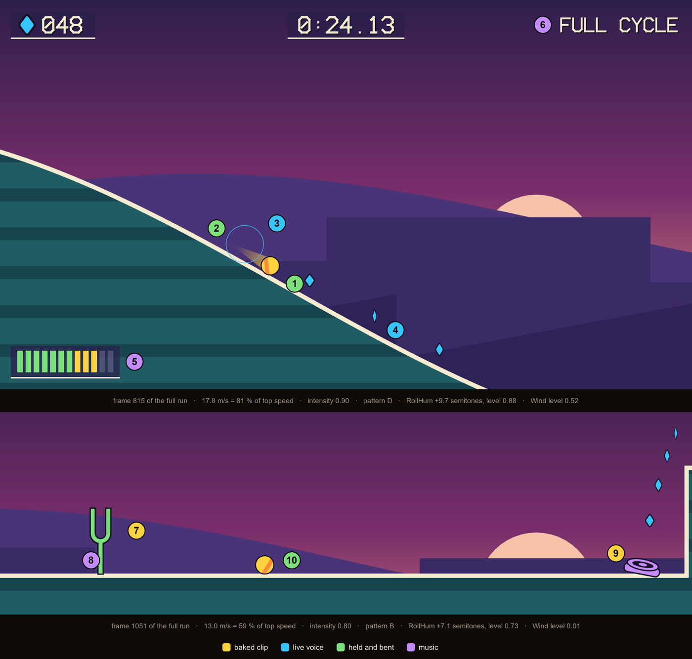
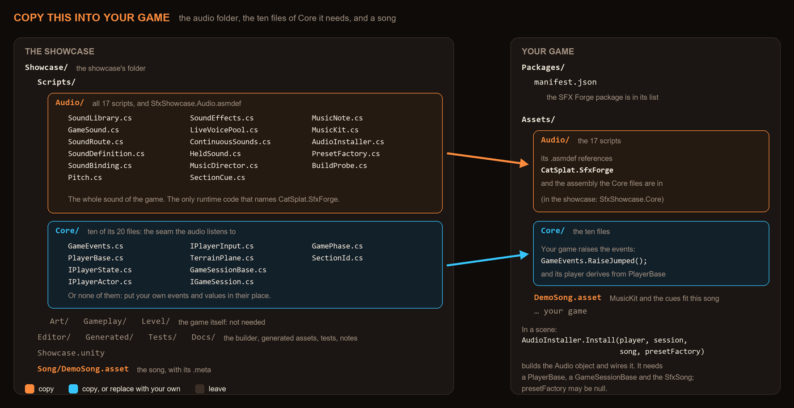

# SFX FORGE in Unity – the manual

**The same synthesizer, inside your game.** The Unity package plays SFX FORGE's sounds and songs with the device's own
engine, at runtime. You write a sound as 25 numbers, or take it from the device, and the game synthesizes it when it
is needed.

There are no audio files in it. A sound is a patch; a patch is 28 bytes.

This is the sibling of [the device's manual](MANUAL.md). That one explains the instrument. This one explains the
package `com.catsplatstudios.sfxforge` and the example game built with it.

> **Where things are.** This manual is written in the repository the package is generated from, and a few of
> its lines name things there. In the package:
>
> - the showcase game is the sample "Showcase" (`Samples~/Showcase`; imported, it is a folder
>   under `Assets/Samples`). Paths such as `Scripts/Audio` are inside that folder;
> - the firmware is `Firmware~/sfx-forge.zip`, the videos are in [`video/`](video), the MIDI protocol is in
>   [LINK-PROTOCOL.md](LINK-PROTOCOL.md);
> - **not in the package:** the older demo scene the manual mentions (a hovercraft, `SfxDemo`, with its tests
>   `SfxDemoTests`), and the scripts under `docs/`, `tests/`, `core/` and `out/`: the engine's C source, the
>   emulator script of the link tests, and the scripts that draw the figures and cut the videos.

| I want to … | Go to |
|---|---|
| hear something right now | [1. Five minutes](#1-five-minutes) |
| know what is in the package | [2. What is in the package](#2-what-is-in-the-package) |
| write a sound in code | [3. A sound](#3-a-sound-sfxpatch) |
| choose how to play it | [4. Playing sounds](#4-playing-sounds-three-routes) |
| play music that follows the game | [5. Music](#5-music) |
| connect the device | [6. From the device to the game](#6-from-the-device-to-the-game) |
| see it all in a real game | [7. The showcase](#7-the-showcase-a-worked-example) |
| copy a snippet | [8. Recipes](#8-recipes) |
| test sound without ears | [9. Testing, limits, troubleshooting](#9-testing-limits-troubleshooting) |
| look something up | [10. API at a glance](#10-api-at-a-glance) |

**Three videos** show the Unity side running. They are in the package, in `Documentation~/video`:

| File | What it shows |
|---|---|
| [`sfx-forge-unity-showcase.mp4`](video/sfx-forge-unity-showcase.mp4) | the showcase game played from start to goal, with captions naming what you hear |
| [`sfx-forge-unity-how-it-works.mp4`](video/sfx-forge-unity-how-it-works.mp4) | the three routes and the adaptive music, one at a time. Its pages of code are silent; the game plays between them |
| [`sfx-forge-unity-link.mp4`](video/sfx-forge-unity-link.mp4) | the device (in the emulator) and the game, linked: the song and a patch arrive in the running game ([section 6](#6-from-the-device-to-the-game)) |

All sound in them is what SFX FORGE produces in Unity. There is no voice-over.

**The pictures** in this manual are built by a script in the source repository (`docs/unity_figures.py`). The charts are drawn from recordings of the
showcase game, not by hand: where a picture says "as recorded", its curves are the game's own values, frame by frame.

---

## 1. Five minutes

You need Windows x64 and Unity 6000.3. The package is developed and tested with Unity 6.3 (6000.3.8f1) only; its
manifest asks for 6000.3 for that reason, not because an older version is known to fail.

| | Do this | What happens |
|---|---|---|
| **1** | Add the package: **Window > Package Manager > + > Add package from disk…** and pick the `package.json` in this package's folder | "SFX Forge" appears in the list |
| **2** | Or add one line to the `dependencies` in your project's `Packages/manifest.json` (below) | the same |
| **3** | Make a new script `FirstSound.cs` (below) and put it on any GameObject | |
| **4** | Make sure the scene has an **AudioListener** (the default camera has one) | |
| **5** | Press Play, click the **Laser** button | a laser, synthesized as you click |

The line for `Packages/manifest.json`. Add it to the dependencies that are already there, with a comma after the
line before it; do not replace the file.

```json
{
  "dependencies": {
    "com.catsplatstudios.sfxforge": "file:<path to the package's folder>"
  }
}
```

The path is where this package's folder (the one with `package.json`) is on your disk. Write it as an absolute
path, or relative to your project's `Packages` folder. Once the package's repository is published, its git URL
can stand there instead (the package's README, "Install").

The first sound:

```csharp
using CatSplat.SfxForge;
using UnityEngine;

public class FirstSound : MonoBehaviour
{
    SfxPlayer player;

    void Start()
    {
        player = gameObject.AddComponent<SfxPlayer>();      // adds the AudioSource it needs
    }

    void OnGUI()
    {
        if (GUI.Button(new Rect(20, 20, 160, 40), "Laser")) player.Play(SfxPatch.Default);
        if (GUI.Button(new Rect(20, 70, 160, 40), "Coin"))
            player.Play(SfxPatch.Create(SfxEngine.UiBlip, 86, 64, 0, 26, 60, 0, 127, 0, 62, 0));
    }
}
```

`SfxPatch.Default` is a laser. The second button plays a patch written on the spot: an engine and ten numbers.

**Your scripts see the package without any setup** if they are in `Assets` with no assembly definition. If your code
has its own `.asmdef`, add `CatSplat.SfxForge` to its references. Editor scripts that use the package's editor helpers
need an `.asmdef` that references `CatSplat.SfxForge.Editor`: that assembly is not referenced automatically.

> **No sound?** Go to the [silence checklist](#the-silence-checklist). The two most common causes: you are not on
> Windows x64, or you started from `new SfxPatch()`, which is silent.

---

## 2. What is in the package



| Piece | Kind | What it is |
|---|---|---|
| `SfxPatch` | struct | one sound: an engine and 25 values, each 0 – 127. The same 28 bytes the device keeps |
| `SfxPreset` | asset | a patch you can click, hear and tune in the Inspector. `Bake` turns it into an `AudioClip` |
| `SfxSong` | asset | a piece of music: 16 sounds and the packed song (patterns, arrangement, layers, mix, automation) |
| `SfxPlayer` | component | synthesizes a patch as it plays. Its four live values bend the sound while it sounds |
| `SfxMusicPlayer` | component | plays an `SfxSong`. The game sets its intensity, cues patterns, moves its mix |
| `SfxNative` | static class | the engine: a native library, `Runtime/Plugins/x86_64/sfxforge.dll`. Also `Bake` to raw samples |
| `SfxWav` | static class | writes samples as a 16-bit WAV file |
| `SfxLink` | class | the MIDI connection to the device: `SfxLink.Shared`. Windows only |
| `SfxForgeLink` | component | opens the link in a scene, polls it, hands out pad and encoder events |
| `SfxTelemetrySender` | component | one game value → the device, and to local players |
| `SfxEncoderBinding` | component | one of the device's encoders → an AudioMixer parameter or an event |
| `SfxProtocol` | static class | the MIDI messages, byte by byte. You rarely call it yourself |
| **Editor** | | `Window > SFX Forge`, the Inspectors of `SfxPreset` and `SfxSong`, and `SfxForgeEditorLink` (preview, bake a WAV, make assets) |

Everything is in the namespace `CatSplat.SfxForge`; the editor code in `CatSplat.SfxForge.Editor`.

**No device is needed.** Patches, presets, both players and baking work on their own. The link is for tuning live.

---

## 3. A sound: SfxPatch

A patch is the whole sound. It follows the same path as on the device ([MANUAL section 6](MANUAL.md#6-how-a-sound-is-built)):



### Make one

```csharp
// FREQ, PITCH ENV, ENV TIME, A, B, NOISE, CUTOFF, RESO, DECAY, CRUSH, then ATTACK, SUSTAIN, RELEASE …
SfxPatch coin = SfxPatch.Create(SfxEngine.UiBlip, 86, 64, 0, 26, 60, 0, 127, 0, 62, 0);
SfxPatch hum = SfxPatch.Create(SfxEngine.SciFiFm, 22, 64, 0, 21, 55, 8, 78, 45, 60, 0, 0, 127);   // sustain 127: held
coin.reverb = 25;                                    // every value is also a field
coin[SfxParam.FilterCutoff] = 110;                   // … and reachable by index
```

`SfxPatch.Create(engine, values…)` takes the values in the order of the table below. You give as many as you want;
the rest come from a plain patch: a short one-shot, nothing modulated, no effects, level 100.

> **A bare `new SfxPatch()` is silent.** All its values are 0, and that includes `level`. Always start from
> `SfxPatch.Create` or `SfxPatch.Default`.

### Every value

Every value is a `byte`, 0 – 127. Setting more than 127 through the indexer clamps it. The column "Plain" is what
`Create` uses for a value you leave out. The ranges are the device's ([MANUAL, "Every value"](MANUAL.md#every-value)).

| # | Field | `SfxParam` | On the device | What it does | Range | Plain |
|---|---|---|---|---|---|---|
| | `engine` | | ENGINE | which of the five engines makes the sound | `SfxEngine` | |
| 0 | `baseFreq` | `BaseFreq` | FREQ | the pitch. Ignored when you play the sound as a MIDI note | 20 Hz – 14.5 kHz | 60 |
| 1 | `pitchEnvAmount` | `PitchEnvAmount` | PITCH ENV | above 64 the pitch starts higher and falls back; below 64 it starts lower and rises | ±4 octaves; **64 = none** | 64 |
| 2 | `pitchEnvDecay` | `PitchEnvDecay` | ENV TIME | how long that takes | 5 ms – 2.6 s | 40 |
| 3 | `fmRatio` | `FmRatio` | **A** | the engine's first own control (below) | | 40 |
| 4 | `fmDepth` | `FmDepth` | **B** | the engine's second own control (below) | | 40 |
| 5 | `noiseMix` | `NoiseMix` | NOISE | how much of it is noise | 0 – 100 % | 0 |
| 6 | `filterCutoff` | `FilterCutoff` | CUTOFF | where the filter closes. FOLEY: the band the noise sits in | 40 Hz – 15.5 kHz | 110 |
| 7 | `filterRes` | `FilterRes` | RESO | a peak at the cutoff | 0 – 100 % | 10 |
| 8 | `ampDecay` | `AmpDecay` | DECAY | how fast it falls after the attack | 10 ms – 3.9 s | 60 |
| 9 | `bitcrush` | `Bitcrush` | CRUSH | fewer bits and samples: grit | off – 100 % | 0 |
| 10 | `attack` | `Attack` | ATTACK | time to reach full level | 1.5 ms – 4 s | 0 |
| 11 | `sustain` | `Sustain` | SUSTAIN | the level it holds at. **0 = a one-shot** | off, or up to 100 % | 0 |
| 12 | `release` | `Release` | RELEASE | how long it rings after it is let go | 5 ms – 3.9 s | 34 |
| 13 | `filterEnv` | `FilterEnv` | FILTER ENV | how far the cutoff starts above or below and returns | ±5 octaves; **64 = none** | 64 |
| 14 | `filterEnvDecay` | `FilterEnvDecay` | F.ENV TIME | how long that takes | 5 ms – 2.6 s | 40 |
| 15 | `lfoRate` | `LfoRate` | LFO RATE | the slow wave's speed | 0.1 – 29 Hz | 50 |
| 16 | `lfoPitch` | `LfoPitch` | > PITCH | vibrato | up to an octave | 0 |
| 17 | `lfoFilter` | `LfoFilter` | > FILTER | wah | up to 3 octaves | 0 |
| 18 | `lfoTimbre` | `LfoTimbre` | > TIMBRE | moves FM depth or wavetable position | | 0 |
| 19 | `spread` | `Spread` | SPREAD | wavetable only: two detuned copies, for width | up to 30 cents | 0 |
| 20 | `chorus` | `Chorus` | CHORUS | send to the chorus | 0 – 100 % | 0 |
| 21 | `delay` | `Delay` | DELAY | send to the delay | 0 – 100 % | 0 |
| 22 | `reverb` | `Reverb` | REVERB | send to the reverb | 0 – 100 % | 0 |
| 23 | `level` | `Level` | LEVEL | the sound's own loudness | **100 = as designed** | 100 |
| 24 | `table` | `Table` | TABLE | wavetable only: which table, 0 – 5 | `SfxPatch.TableNames` | 0 |

A few landmarks, from the showcase's sound library: ENV TIME 25 ≈ 17 ms, 45 ≈ 45 ms, 60 ≈ 95 ms, 75 ≈ 200 ms,
90 ≈ 420 ms. CUTOFF 62 ≈ 0.7 kHz, 90 ≈ 2.7 kHz, 110 ≈ 7 kHz. DECAY 22 is a tick, 50 is medium, 105 rings for seconds.
LFO RATE 50 ≈ 1 Hz, 105 ≈ 11 Hz.

### The five engines, and what A and B mean

`fmRatio` and `fmDepth` are named after their job in the FM engines. In the other engines they do something else.
`SfxPatch.Label(param, engine)` gives the right name; the Inspector uses it.

| `SfxEngine` | On the device | What it is | A = `fmRatio` | B = `fmDepth` | Good for |
|---|---|---|---|---|---|
| `Impact` | IMPACT | a sine whose pitch falls, with FM and noise, driven hard | FM Ratio | FM Depth | hits, kicks, explosions |
| `UiBlip` | UI BLIP | a square wave that can step upwards | Arp Step | Arp Speed | coins, menus, chiptune |
| `SciFiFm` | SCI-FI FM | two sines, one bending the other | FM Ratio | FM Depth | lasers, engines, FM bass and keys |
| `Foley` | FOLEY | noise through a band, in grains | Grain Rate | Grain Amount | steps, wind, fire, hi-hats |
| `Wavetable` | WAVETABLE | a wave that morphs through a table | Position | Warp | pads, strings, brass, organs |

| Engine | Useful numbers |
|---|---|
| `Impact`, `SciFiFm` | FM Ratio 21 = 1:2 (a growl), 42 = 1:1 (round), 64 = 2:1; higher is bells and metal |
| `UiBlip` | Arp Step 0 is a plain square wave, 37 = a fifth, 64 = an octave. The arpeggio takes three steps and stays on the last |
| `Foley` | set `noiseMix` to 127. `filterCutoff` is the band. `pitchEnvAmount` sweeps the band: a whoosh |
| `Wavetable` | `table` picks one of `SfxPatch.TableNames`: Saw to Square, Pulse, Peak, Vowel, Organ, Glass |

### One-shot or held: `sustain` decides

| `sustain` | The sound is | `IsSustained` | You must |
|---|---|---|---|
| **0** | a **one-shot**: it plays to its end | `false` | nothing. It ends by itself |
| **above 0** | **held**: it sounds until it is let go, then rings out over `release` | `true` | call `Release()`, or it never stops |

### Variations

`patch.Mutate(rng)` moves every value by up to 15 % of its range, as MUTATE does on the device. It keeps what kind of
sound it is: the engine, the table, the level, and whether it is a one-shot.

```csharp
var rng = new System.Random(7);
SfxPatch variation = SfxPatch.Default;       // a struct: this is a copy
variation.Mutate(rng);
```

### The patch as an asset: SfxPreset

**Assets > Create > SFX Forge > Preset** makes an `SfxPreset`. Its Inspector has the engine, a slider for every value
(named for the engine), and:

| Control | What it does |
|---|---|
| **Play** | plays it through the editor's speakers, with the engine and its effects |
| **Mutate** | a variation. Undo takes it back |
| **Bake WAV** | writes a stereo 16-bit `.wav` next to the asset |
| **Play when a value changes** | you hear every slider move |
| **Hold Seconds** | shown for a held sound: how long a baked clip or a preview holds it (`holdSeconds`, default 1.5) |
| **Send to pad** · **Play on device** | shown while a device is connected ([section 6](#6-from-the-device-to-the-game)) |

A preset edited in Play mode is heard at once on an `SfxPlayer` that is sounding it. A baked clip does not change.

---

## 4. Playing sounds: three routes


*The three routes. Read each column from the top: what you start with, what you call, what plays. In every picture
of this manual that shows routes, yellow is baked, blue is a live voice, green is held and bent, purple is music.
(The pictures of layers and of patterns use colours for other things, and say so.)*

| Route | You call | Cost | Use it for |
|---|---|---|---|
| **Baked clip** | `preset.Bake(…)` once, then `AudioSource.PlayOneShot(clip)` | the cheapest: an ordinary clip after the bake | short sounds that fire often and are always the same: jump, footstep, UI click |
| **Live voice** | `SfxPlayer.Play(velocity, semitones, midiNote)` | synthesized while it sounds | a sound decided at the moment it plays: a pickup that climbs a scale, a hit that varies |
| **Held and bent** | `SfxPlayer.Play(…)` on a held patch, then write `pitchSemitones`, `cutoffOctaves`, `fm`, `level` every frame, then `Release()` | one player per sound, running while held | a sound that follows the game while it plays: an engine, wind, a charge |

### Which one?

| Question | Baked | Live voice | Held and bent |
|---|---|---|---|
| Can each trigger have its own pitch? | only by the AudioSource's pitch (it changes the length too) | **yes**, by semitones or MIDI note | yes, and while it sounds |
| Can it change while it sounds? | no | the four live values, for all notes of that player | **yes** |
| Does it work in 3D? | **yes**: it is a clip on any AudioSource | no: a player is not spatialized | no |
| Can it sustain as long as the game wants? | no: it holds for `holdSeconds`, then lets go | yes | **yes** |
| Does it need the native library at play time? | no, only for the bake | yes | yes |
| Can many overlap? | yes (`PlayOneShot`) | up to 16 notes of **one** patch per player | one sound per player |

### Route 1: baked

```csharp
AudioClip clip = preset.Bake(AudioSettings.outputSampleRate, midiNote: 76);   // once; null without the native library
source.PlayOneShot(clip, 0.7f);                                              // every time
```

`SfxPreset.Bake(sampleRate = 48000, semitones = 0, velocity = 1, midiNote = 0)` renders the whole sound with its
chorus, delay and reverb into a stereo clip. `midiNote` above 0 plays it as that note (69 = A 440 Hz) and overrides
the patch's FREQ. That is how you tune an effect to the music.

Without a preset asset, bake the patch itself:

```csharp
float[] samples = SfxNative.BakeInterleaved(coin, 48000);       // L R L R …; null without the native library
SfxNative.Bake(coin, out float[] left, out float[] right);      // or the two channels apart; false if it failed
```

| Good to know | |
|---|---|
| A held patch | is held for `holdSeconds` (1.5 by default), then let go |
| The longest clip | 12 seconds (`maxSeconds` of `SfxNative.Bake`) |
| Baking is synchronous | it happens on the calling thread. Bake at load time, not in the middle of play |
| Volume still follows the game | pass it to `PlayOneShot`. The showcase's landing is louder the harder it hits |

### Route 2: a live voice

```csharp
player.preset = preset;
player.Play(1f, 7f);               // full velocity, 7 semitones up
player.Play(0.6f, 0f, 76);         // softer, as the MIDI note E5
player.Play(coin, 1f, 3f);         // or a patch directly: no preset needed
```

An `SfxPlayer` needs an `AudioSource` beside it (the component adds one). It keeps that source running itself: leave
its AudioClip empty.

> **One `SfxPlayer` holds one patch.** It overlaps up to 16 notes of it. Giving it a different patch reshapes what is
> still sounding. For several different live sounds, use several players. The showcase's `LiveVoicePool` picks the
> player already playing that preset, else a silent one, else the oldest.

### Route 3: held, and bent while it plays


*The showcase's roll hum over one roll, as recorded. The white curve is the player's speed. The three green curves
are the live values the game writes from it, every frame, between `Play` and `Release`.*

```csharp
player.Play(1f, 0f, 40);                                   // hold it, as the MIDI note E2
player.pitchSemitones = speed01 * 12f;                     // 0 … 24
player.cutoffOctaves = Mathf.Lerp(-1f, 1.5f, speed01);     // -4 … 4, from the patch's cutoff
player.fm = speed01 * 0.5f;                                // 0 … 1: FM depth, or a wavetable's position
player.level = Mathf.Lerp(0.35f, 1f, speed01);             // 0 … 1
player.Release();                                          // let go: it fades over the patch's RELEASE
```

| Live value | Range | What it moves |
|---|---|---|
| `pitchSemitones` | 0 … 24 | the pitch, upwards |
| `cutoffOctaves` | −4 … 4 | the filter, in octaves from the patch's cutoff |
| `fm` | 0 … 1 | the timbre: FM depth, or a wavetable's position |
| `level` | 0 … 1 | the loudness. 1 = as designed |

The player glides to each value over 30 ms, as the device does. You can write them every frame without clicks.

`volume` (0 … 1, default 0.8) is the player's place in your mix. It is **not** smoothed: fade with `level`, not
with `volume`.

**Start a pitched held sound with its MIDI note.** A bare `Play()` sounds at the patch's own FREQ, which is rarely in
tune with anything. Noise, such as wind, has no note: start it with 0.

**Without code:** an `SfxTelemetrySender` does the same from a Rigidbody's speed, an Animator float or your own
value. Put the `SfxPlayer` into its `localPlayers`. The demo's hovercraft engine is built this way
([recipe 4](#4-the-same-without-code-sfxtelemetrysender)).

---

## 5. Music

An `SfxMusicPlayer` plays an `SfxSong`: 16 instruments and a sequenced song, made on the device
([MANUAL sections 9 – 13](MANUAL.md#9-tutorial-a-beat)). The package cannot edit a song. It plays one, and lets the
game shape it as it runs.

### A first song

You need a song asset. The package has one ready, in its sample: `Song/DemoSong.asset` of the showcase, the firmware's own
demo song. Every example in this section, recipes 6 to 10 and the showcase use it.

| | Do this | What happens |
|---|---|---|
| **1** | Import the sample "Showcase" (Package Manager > SFX Forge > Samples) and find `Song/DemoSong.asset` in the imported folder | an `SfxSong` named DemoSong appears. Its Inspector shows Tempo 120 BPM and the 16 sounds, each with a Play button |
| **2** | Make an empty GameObject and add the component **SfxMusicPlayer** | Unity adds an `AudioSource` with it |
| **3** | Drag DemoSong onto the player's **Song** field. Leave `playOnEnable` on and `intensity` at 1 | |
| **4** | Press Play | the whole band plays: drums, FM bass, FM keys, strings, then brass, bells and choir as the song goes on |
| **5** | Drag `intensity` down in the Inspector while it plays | instruments drop out one by one. At 0 only the kick is left |

These five steps were not tried as written, in a project of their own; the asset is the one the showcase itself plays. To get
a song of your own into Unity, see [section 6](#a-song-without-midi).

Three words from the device, used below:

| Word | What it is |
|---|---|
| **pattern** | one bar of 16 steps for all 16 sounds. A song has eight, A to H (`CuePattern(0)` to `CuePattern(7)`) |
| **chain** | how many patterns, counted from A, play in turn when the song has no arrangement. A chain of 1 loops pattern A |
| **arrangement** | a list of up to 32 bars, each naming a pattern. If a song has one, it plays the list instead of the chain |

| The game wants to … | It uses |
|---|---|
| start and stop | `Play()` · `Stop()` · `playOnEnable` (on by default) · `startPattern` |
| bring the band in and out | `intensity`, 0 … 1 |
| change the music on the next bar | `CuePattern(0 … 7)` |
| play one of the song's instruments by hand | `PlaySound(sound, velocity, midiNote)` · `ReleaseSound(sound, midiNote)` |
| move the mix | `SetTrackVolume` · `SetTrackPan` · `SetTrackMute` · `SetMaster` · `volume` |
| know where the song is | `IsPlaying` · `Step` (0 … 15) · `Pattern` (0 = A) · `Bar` (bars since `Play`) |
| take a changed song asset | `Reload()`. It also puts the song's own mix back |

```csharp
music.intensity = danger01;            // every frame
music.CuePattern(2);                   // pattern C, from the next bar line
music.PlaySound(13, 0.9f, 76);         // the song's sound 14, as the note E5, on top of the music
```

### Intensity and layers

> **Every sound of the song has a LAYER mark. A sound plays only while `intensity` is at or above its mark.**

So one song is many. `SfxSong.Layer(sound)` reads a mark (0 … 1; 0 = always plays, if the pattern has notes for it). The marks are set on the device.



*Each bar starts at its sound's LAYER mark: the sound plays while the intensity is to the right of that point. The
dashed lines carry the marks down. Below them, one line for each floor of the showcase's sections: the dot is the
intensity while the player stands still there, the white tick the intensity at a run (10 m/s), the right end top
speed. Standing still, the kick, hi-hat, FM bass and snare play in every section; in Full Cycle, Woofer Steps,
Static Field and Split Signal the strings too; in Overdrive the FM keys as well.*

The demo song's marks, read from the asset (the showcase's `Song/DemoSong.asset`):

| `intensity` at or above | joins |
|---|---|
| 0 | kick |
| 0.16 | hi-hat |
| 0.28 | FM bass |
| 0.39 | snare |
| 0.47 | strings, choir |
| 0.57 | FM keys |
| 0.71 | brass |
| 0.79 | bells |

The other seven sounds of the kit (timpani, cowbell, pizzicato, harp, celesta, organ, sweep) also have mark 0, but
no pattern of the song has a note for them. So at intensity 0 you hear the kick alone. The showcase plays the
timpani by hand, in its fanfare. Not every pattern uses every sound either: brass is in B, C, D and F, bells are in
C, D and E, the choir is only in E.

`intensity` is not smoothed by the player and does not need to be: it only decides which notes start. Smooth it
yourself so the band does not flicker in and out. The showcase aims it at a point between the section's floor
(standing still) and 1 (top speed), and lets it rise in 0.6 s and fall in 2.5 s:


*Two recordings. Above: the intensity (orange) against the player's speed (white). Standing still it rests on the
section's floor; speed lifts it from there towards 1, quickly up and slowly down. The names on the right show which
sound joins at which height. Below: a hit drops the intensity to 0 at once, under the floor, and dips the music's
volume; both come back by themselves.*

### Cueing patterns

`CuePattern(n)` changes to pattern `n` on the next bar line (at once while the song is stopped). What happens after
that bar depends on the song. This is what the engine does (`core/sfx_song.h`):

| The song has … | and the cued pattern is … | After the cue |
|---|---|---|
| an arrangement | **in** it | the song jumps to the arrangement's next bar with that pattern, **then walks on** through the arrangement. One cue lasts until the arrangement moves to another pattern: often one bar |
| an arrangement | **not in** it (kept aside for a boss, a menu) | that pattern loops until the next cue |
| no arrangement, a chain of 1 | any | that pattern loops until the next cue |
| no arrangement, a chain of 2 or more | any | one bar of that pattern, then the chain walks on from it |

`SfxSong.ArrangementBars` (0 = none), `ArrangementPattern(bar)` and `Chain` tell you which case you have.


*From the top: the demo song's arrangement; one cue of F, which lasts one bar because the arrangement goes on to A;
a cue on every bar, which holds the pattern; a pattern outside the arrangement, which stays by itself. The last row
is a whole run of the showcase as recorded: the arrangement walks by itself, bar after bar, except in Static Field,
where E is held, and from the last launch to the goal, where F is.*

### Holding a pattern: cue it again on every bar

The demo song has a 16-bar arrangement, A B A B C D C D E E A B C D C F, which contains every one of its patterns. A
cue into such a song lasts only as long as the arrangement stays on that pattern from there: one bar for most of
them, two for E, which the arrangement has twice in a row.

The showcase lets the song play in this order for most of the level: the game does not choose the bars, only how
much of the band plays them. It holds a pattern in two places: E, the breakdown, for as long as the player is in
Static Field, and F, the turnaround, from the last launch to the goal. To hold one, its `MusicDirector` cues the
pattern again whenever `Bar` changes:

```csharp
int heldPattern = -1, lastBar = -1;    // below 0: nothing is held (the director's own value is SectionCue.SongOrder)

void HoldPattern()                     // called from Update
{
    int bar = music.Bar;
    if (bar == lastBar) return;
    lastBar = bar;
    if (heldPattern >= 0) music.CuePattern(heldPattern);
}
```

A cue is then always waiting at the next bar line, and the pattern stays. This works for every row of the table
above, so it is the safe way to hold a pattern when you do not control how the song was arranged.

Ending a hold needs no call: stop cueing. Each section of the showcase has a `SectionCue` whose `Pattern` says what
happens on entering it:

| `Pattern` | On entering the section |
|---|---|
| 0 … 7 | that pattern is cued, and held from then on |
| `SectionCue.SongOrder` (−2) | a hold ends: `heldPattern` is set to it, and nothing is cued any more |
| `SectionCue.KeepPattern` (−1) | nothing changes: a pattern that is held stays held |

When a hold ends, the song is on a bar of its arrangement with the held pattern, and the arrangement walks on from
there. A cue that was already waiting still takes its bar. In the recorded run Static Field gives eight bars
of E; then the arrangement goes on with what follows its E bars: A B C D C F, and round again.

### Notes by hand: PlaySound

`PlaySound(sound, velocity, midiNote)` plays one of the song's 16 sounds beside the music. `sound` is 0 … 15, the
pad on the device minus one. `midiNote` 0 plays it as designed (a drum, an effect), above 0 at that pitch.

| Rule | |
|---|---|
| **It is not quantised** | the note sounds at once. To land on the beat, wait until `Step` or `Bar` changes, then play ([recipe 7](#7-a-stinger-on-the-bar-line)) |
| **A held instrument must be released** | brass, strings, organ, choir: call `ReleaseSound(sound, midiNote)` with the same two numbers, or it never stops |
| **Layers do not apply** | a note by hand sounds whatever the intensity is |
| **Same note, two instruments** | a note by hand is named by its MIDI note alone. If a **held** instrument is sounding a note and you play the same `midiNote` on another instrument, the held one is let go; `ReleaseSound` for that note releases every instrument holding it |

### The mix

| Call | Range | |
|---|---|---|
| `volume` | 0 … 1, default 0.6 | the whole music. **Not smoothed**: a jump is a click. Ramp it yourself ([recipe 9](#9-ducking-the-music)) |
| `SetTrackVolume(sound, v)` | 0 … 1.27 | a sound's fader. 1 = as designed |
| `SetTrackPan(sound, p)` | −1 … 1 | left … right |
| `SetTrackMute(sound, mute)` | | |
| `SetMaster(SfxMaster.DelayTime, v)` | 0 … 5 | 1, 2, 3, 4, 6 or 8 sixteenths |
| `SetMaster(…, v)` for `DelayFeedback`, `ReverbSize`, `ReverbDamping`, `Drive` | 0 … 127 | |

The song carries its own mix (`SfxSong.HasMix`, `Volume(sound)`, `Pan(sound)`). Your changes last until `Reload()`.

---

## 6. From the device to the game


*Everything that travels between the device and Unity. On each line: what the device does, the MIDI message, and the
call or event in Unity.*

"The device" is SFX FORGE on the hardware, in the browser Playground, or in the plugin. Unity talks to it over two
MIDI ports. Without the hardware you need a virtual MIDI cable with two ports, one each way (for example loopMIDI).

> **What is tested, and what is not.** MIDI is implemented for Windows only (winmm).
>
> **Tested end to end against the emulator**, over two loopMIDI ports, with Unity 6000.3 on Windows 11
> (`Tests/LinkTakes.cs` in the showcase, run against `tests/emulator-link.mjs`; firmware 1.3.1):
> - Unity asks for a pad's patch and for the song, and both arrive. The song that arrived was the demo project's
>   song, byte for byte, and an `SfxMusicPlayer` played it. Twenty transfers in a row all arrived.
> - A song sent *to* the device comes back the same when asked for: sent piece by piece, last piece first, after a
>   transfer that broke off, and with `SendSong`, whose 16 sounds arrive in the MUSIC kit while the selected kit
>   stays as it was. The songs sent differ from the device's in every one of the 39 pieces.
> - SEND and EXPORT pressed on the device arrive in a running game (`Tests/LinkSession.cs`, the link video).
> - The game's intensity reaches the device: the INTENSITY on its SONG page followed the game's value. Text was
>   sent in the same session, but the page that was open does not show it, so nobody saw it arrive.
>
> **Not tested:** the hardware and the plugin; pads and encoders coming *from* the device (`onPad`, `onEncoder`,
> `SfxEncoderBinding`); `SendPatch`; the SFX Forge window's buttons, which nobody has clicked against a device.
>
> **Found by these tests**, all three in how the emulator moves MIDI, none of them in the hardware's path:
> - Its MIDI output sometimes delivers two neighbouring SysEx messages in the wrong order: 3 of the first 60 song
>   transfers had two pieces swapped, and the package dropped such a song.
> - Its page handed every incoming message to the firmware twice. The firmware took a repeated piece for a new
>   transfer, so before 1.3.1 it never took a song from the game there.
> - It listens on its own output port (a virtual cable's port is both), so the firmware hears what it sends. Its
>   own sound dumps came back and were loaded into the selected kit.
>
> Since then both ends put every piece of a song where it belongs and take the song when all 39 are there: in any
> order, and a piece that is there already, byte for byte, is ignored. A piece that is there already with other
> bytes begins a new transfer, and a transfer that broke off is forgotten after two seconds. The firmware ignores a
> dump or a piece that is exactly what it just sent. With that, 100 of 100 transfers to Unity arrived, and the round
> trip to the device passes with every message doubled.
>
> **A limit that remains.** No piece says which song it belongs to. If a transfer breaks off and a *different* song
> follows within two seconds, pieces of the two can add up to a whole song, and that mixture is taken. Wait two
> seconds after a transfer that failed, or send the same song again.
>
> The song in the demo project came in as a file, not over MIDI ([below](#a-song-without-midi)).

### The SFX Forge window

**Window > SFX Forge.**

| Part | What it does |
|---|---|
| **Connection** | choose **From device** and **To device**, then **Connect**. **Refresh ports** reads the list again. The choice is remembered, and the editor reconnects after scripts reload |
| **Device** | 16 buttons. **Pads play**: a click plays that pad on the device. **Pads fetch their patch**: a click asks for it. A text field and **Show on device** write on the device's top line |
| **Patches from the device** | what arrived, newest first, each with **Play** and **Save** / **Show**. With the toggle on, a patch is saved as soon as it arrives, into **Folder** (default `Assets/SfxForge`), named like `Pad03_SciFiFm` |
| **Music** | **Fetch the song** asks for the 16 sounds and the song; they arrive as an `SfxSong` asset named `Song` |
| **Last messages in** | the last six MIDI messages, as hex |

### Receiving a patch or a song

| On the device | In Unity |
|---|---|
| **F5 EXPORT** on a sound page | `SfxLink.PatchReceived(slot, patch)`. The window saves it as an `SfxPreset` |
| **F5 SEND** on the SONG page | 16 patches, then the song in 39 pieces: `SfxLink.SongReceived(song, sounds)`. The window saves an `SfxSong` |

In your own code:

```csharp
SfxLink.Shared.PatchReceived += (slot, patch) => Debug.Log($"pad {slot + 1}: {patch.engine}");
SfxLink.Shared.SongReceived += (packedSong, sounds) => { /* sounds is null if not all 16 came with it */ };
SfxLink.Shared.RequestPatch(0);        // ask for pad 1
SfxLink.Shared.RequestSong();          // ask for the 16 sounds and the song
```

Events fire from `SfxLink.Poll()`, on the thread that calls it. In the editor `SfxForgeEditorLink` polls every editor
update. In a scene, `SfxForgeLink` polls every frame.

### Sending

| You call on `SfxLink.Shared` | The device |
|---|---|
| `SendPatch(slot, patch)` | loads the patch into that pad and selects it |
| `SendSong(sounds, song.data)` | replaces its song and the 16 sounds of its MUSIC kit, which the song plays. The kit that is shown is left alone. Needs firmware 1.3.1: an older one takes the song and ignores the sounds |
| `PlayPad(slot, velocity)` · `ReleasePad(slot)` | plays a pad |
| `SendText("LEVEL 2")` | shows up to 24 ASCII characters on its top line |
| `SendTelemetry(channel, value01)` | moves the held sound, or the music (below) |
| `SendIntensity(value01)` · `CuePattern(0 … 7)` | the same as the music player's two, on the device |

Every call returns `false` when no output is open. `SendTelemetry` only sends when the 7-bit value changes, so
calling it every frame is fine.

### Telemetry: the game drives the device while you listen

Linked, the game plays through the device. You hold a pad there, drive the game, and tune the sound with the knobs
while it follows. `SfxTelemetrySender` sends one value; add one component per value.

| `SfxTelemetry` | CC (channel 2) | 0 … 1 becomes |
|---|---|---|
| `Pitch` | 10 | 0 … +24 semitones |
| `Cutoff` | 11 | −4 … +4 octaves. **0.5 = none** |
| `FmDepth` | 12 | the timbre, 0 … 1 |
| `Level` | 13 | the level, 0 … 1 |
| `Intensity` | 14 | the music's intensity |
| `Pattern` | 15 | pattern A … H from the next bar line |
| `Aux3`, `Aux4` | 16, 17 | shown on the device's LINK page, not mapped |

| `SfxTelemetrySender` field | |
|---|---|
| `channel` | what the value moves |
| `source` | `RigidbodySpeed`, `Rigidbody2DSpeed`, `AnimatorFloat` or `Manual` (it looks for the body or Animator on this object or a parent) |
| `min`, `max` | the source value that becomes 0, and 1 (defaults 0 and 20) |
| `curve` | shapes the 0 … 1 value |
| `value` | for `Manual`: set it from your code |
| `localPlayers`, `musicPlayers` | players in the game that follow the same value – so the game sounds the same without the device |

### Encoders and pads: the device drives the game

On the device's LINK page, encoders 1 – 4, A and B send CC 20 – 25. The pads send notes 36 – 51.

| Component | Use |
|---|---|
| `SfxForgeLink` | put one in the scene. It opens the ports chosen in the window (or named in `inputPort` / `outputPort`), polls, and raises `onPad(pad, velocity)` and `onEncoder(encoder, value01)`. `textOnStart` is shown on the device |
| `SfxEncoderBinding` | one encoder → an exposed AudioMixer parameter (`mixer`, `exposedParameter`) and/or `onValue`. The value runs from `min` to `max` (defaults −80 and 0: a volume in dB). Needs an `SfxForgeLink` in the scene |

The ports chosen in the window are stored in PlayerPrefs. In a built player, name them in `inputPort` and
`outputPort`.

### The song formats the package reads

| Format | Bytes | From |
|---|---|---|
| 5 (current) | 7699 | 24 automation lanes, an arrangement, the mix |
| 4 | 6643 | one automation lane for each sound |
| 3 | 4546 | before automation and the arrangement |
| 2 | 2498 | before velocity and length |
| 1 | 2455 | before the mixer |

`SfxSong.IsValid` accepts all five and `SfxMusicPlayer` plays them. **Over MIDI only the current format travels**:
`SfxLink.SendSong` and the song's **Send to device** button need a 7699-byte song, and only a song in 39 pieces is
received.

### A song without MIDI

The showcase's song was not fetched over MIDI. A script in the source repository (`tests/make-demo-song.mjs`) wrote
what the firmware sends on SEND into a file – 16 patches of 28 bytes, then the 7699-byte song. That file is in the
sample, `Song/DemoSong.bytes`, and the sample's builder (`Editor/ShowcaseAudio.cs`) turns it into the asset
`Song/DemoSong.asset`. This is the path that is proven to work:

```csharp
// in an editor script: a .bytes file (16 x 28 patch bytes, then the packed song) -> an SfxSong asset
byte[] raw = AssetDatabase.LoadAssetAtPath<TextAsset>("Assets/MySong.bytes").bytes;
var sounds = new SfxPatch[SfxProtocol.Slots];
for (int i = 0; i < sounds.Length; i++) SfxPatch.TryUnpack(raw, i * SfxPatch.Bytes, out sounds[i]);
var packed = new byte[SfxProtocol.SongBytes];
System.Array.Copy(raw, sounds.Length * SfxPatch.Bytes, packed, 0, packed.Length);
var song = ScriptableObject.CreateInstance<SfxSong>();
song.Set(sounds, packed);
AssetDatabase.CreateAsset(song, "Assets/MySong.asset");
```

The Inspector of an `SfxSong` shows its tempo, pattern length, chain, and each sound's engine and layer, with a
**Play** button for each sound. An `SfxSong` made with **Assets > Create > SFX Forge > Song** is empty until a song is
put into it.

---

## 7. The showcase, a worked example

*Brio: First Harmonic* is an original one-level 2D momentum platformer, the package's sample (`Samples~/Showcase`). Every sound in
it is SFX FORGE at runtime: 19 sound effects written as patches in code, and the demo song with its layers following
the player's speed. There is no audio file in the folder.


*Four moments of the level.*

Import the sample from the Package Manager (SFX Forge > Samples), open `Showcase.unity` in the imported folder, press
Play. The keys, the checks and the whole folder map are in [the showcase's README](../Samples~/Showcase/README.md).

### What uses which route



Two frames of a recorded run. The marks are coloured by route. The line under each frame gives the game's values at
that moment.

| | What you see | What you hear | Route |
|---|---|---|---|
| **1** | Brio, rolling | RollHum: its pitch, filter and level follow the speed | held and bent |
| **2** | the trail: Brio is fast | Wind: it comes in above 60 % of top speed | held and bent |
| **3** | the thin outline a collected Chime leaves | Chime: one step up the scale for each Chime of a combo | live voice |
| **4** | the next Chimes | the next steps of that scale | live voice |
| **5** | the speed meter | the music's intensity rises with it, from the section's floor: the faster, the more of the band | music |
| **6** | the section's name | entering the section set the floor under the intensity. The song plays on in its own order; the pattern of the moment is in the line under the frame | music |
| **7** | a Tuning Fork, just passed | TuningFork | baked clip |
| **8** | the same Tuning Fork | the song's bells answer it, played by hand with `PlaySound` | music |
| **9** | a Woofer | Woofer, when Brio lands on it | baked clip |
| **10** | Brio, rolling slower | the same RollHum, lower and quieter | held and bent |

Not in these two frames: the jump, the landing and the footsteps. They are baked clips too.

| Route | Sounds |
|---|---|
| **Baked** (14) | Jump, Land, FootstepLeft, FootstepRight, TuckStart, Burst, Woofer, Hurt, ClipperPop, TuningFork, Goal, Skid, Respawn, UiConfirm |
| **Live voice** (2; `SoundRoute.LiveOneShot` in the code) | Chime, ChimeScatter |
| **Held and bent** (3) | RollHum, Wind, WindUpRev |
| **Music** | the demo song on one `SfxMusicPlayer`, driven by `MusicDirector` |

### The event seam

> **Audio only listens to events and reads player state. Gameplay never calls SFX FORGE.**


*Gameplay raises events and shows its state. The three audio scripts listen and read. Nothing points back.*

`Scripts/Core/GameEvents.cs` is a static class of 19 C# events with a `Raise…` method each: `Jumped`,
`Landed(impactSpeed)`, `ChimeCollected(combo)`, `SectionEntered(section)` … Gameplay and level code raise them. The
audio subscribes in `OnEnable` and unsubscribes in `OnDisable`.

Things that sound continuously have no event. The audio reads the player's state every frame instead: `Speed01`,
`IsRolling`, `IsGrounded`, `IsCharging`, `Charge01`.

`Scripts/Audio` is the only runtime assembly that references `CatSplat.SfxForge`. Outside it, the sound is named
only in editor and test code: `Editor/ShowcaseAudio.cs`, the two lines of `Editor/ShowcaseBuilder.cs` that call it
(`ShowcaseAudio.Install` and `ShowcaseAudio.Check`), and five files in `Tests` (`ShowcaseAudioTests.cs`;
`CaptureTakes.cs` and `CaptureTelemetry.cs` of the capture rig; `LinkTakes.cs` and `LinkSession.cs` of the link
takes). The assembly definitions of `Editor` and `Tests` reference `CatSplat.SfxForge` as well. Delete the folder,
those six files, those two lines and the two references, and the game is the same game, silent. (That is true by
construction. It has not been tried by deleting them.)

### The sound table: SoundLibrary

`Scripts/Audio/SoundLibrary.cs` is the whole sound set on one screen. Each effect is one patch, written with named
values through a small wrapper around `SfxPatch.Create`:

```csharp
public static readonly SfxPatch Jump = Make(SfxEngine.UiBlip,
    pitchEnv: 44, pitchEnvTime: 40, engineA: 0, engineB: 0, cutoff: 104, resonance: 10, decay: 30, level: 90);
```

and one table at the end gives each sound its route, the MIDI note it is tuned to, and its volume:

| Sound | Route | Note | Volume | Varies with the game |
|---|---|---|---|---|
| Jump | Baked | E5 | 0.70 | |
| Land | Baked | – | 0.80 | silent below 4 m/s; louder up to 25 m/s |
| FootstepLeft / Right | Baked | – | 0.35 | alternate; the source's pitch 1.0 … 1.3 with speed |
| TuckStart | Baked | B4 | 0.45 | |
| RollHum | Held | E2 | 0.27 | pitch 0 … +12, cutoff −1 … +1.5 octaves, level 0.35 … 1 with speed |
| WindUpRev | Held | E3 | 0.35 | retriggered on each tap; pitch 0 … +12, `fm` 0 … 0.6, cutoff 0 … +1 with charge |
| Burst | Baked | – | 0.60 | volume 50 … 100 % with charge |
| Chime | Live | E5 | 0.55 | one step up E minor pentatonic for each Chime of a combo, up to 10 steps |
| ChimeScatter | Live | E5 | 0.50 | a run of 5 … 8 pings, 55 ms apart, falling and fading |
| Woofer | Baked | E3 | 0.80 | |
| Hurt | Baked | D3 | 0.80 | |
| ClipperPop | Baked | B4 | 0.75 | |
| TuningFork | Baked | E5 | 0.70 | |
| Goal | Baked | E4 | 0.80 | |
| Wind | Held | – | 0.30 | from 60 % of top speed: level 0 … 1, band −1.5 … +1.5 octaves |
| Skid | Baked | – | 0.60 | |
| Respawn | Baked | E4 | 0.70 | |
| UiConfirm | Baked | B5 | 0.70 | |

The song is in E minor. Every pitched effect is played as a note of E minor pentatonic, so the effects sound like
part of the band. Noise (footsteps, wind, the Burst) has no note.

The volumes, and the music's volume of 0.36 (`MusicDirector.musicVolume`), were set by measurement: recorded takes
of the game must peak under 0.95 of full scale ([section 9](#the-mix-is-measured-not-heard)). Before that the
loudest moments went over full scale: rows of Chimes and the Land thump on top of the band, and a full-charge Burst
with the tuck, the rev, the hum and the wind at once. Nobody has listened to the result. The numbers say that the
mix does not clip in the takes. They do not say that it is balanced.

### The three routes, file by file

| File | Route | Read it for |
|---|---|---|
| `SoundEffects.cs` | baked clips and live voices | `BakeClips` (every baked sound rendered once in `Awake`), `PlayBaked`, `OnChimeCollected` |
| `LiveVoicePool.cs` | live voices | three `SfxPlayer`s shared by the Chime and the scatter |
| `ContinuousSounds.cs` | held and bent | `UpdateRollHum`, `UpdateWind`, `OnWindUpCharged` |
| `HeldSound.cs` | held and bent | hold / let go / retrigger, in ten lines |
| `MusicDirector.cs` | music | everything below |

### The MusicDirector


*Above: the level to scale, with the floor each section puts under the intensity and the pattern it holds, if any.
Below: one run as recorded, against the distance. Each section's floor (dashed) is the intensity when the player
stands still; the intensity (orange) rises from it towards 1 with the player's speed (white), smoothed.*

| The game | The music | The call |
|---|---|---|
| all the time | the demo song in its own order: 16 bars, A B A B C D C D E E A B C D C F, round and round | none: the player walks the song's arrangement |
| every frame | intensity towards `Mathf.Lerp(floor, 1, Speed01)`: the section's floor standing still, 1 at top speed (22 m/s), a straight line between; up in 0.6 s, down in 2.5 s | `intensity` |
| on the title card | intensity fixed at 0.42: kick, hi-hat, FM bass, snare. The whole arrangement plays | |
| `SectionEntered` | the section's floor. In Static Field also pattern E from the next bar line, held there. A section without a pattern ends a hold | `CuePattern`, again whenever `Bar` changes |
| `FinalLaunch` | the song's turnaround, pattern F, held until the goal | `CuePattern(5)`, again whenever `Bar` changes |
| `Respawned` | as on entering that section, and the intensity starts from its floor | |
| `Hurt` | intensity to 0 at once; volume to 50 % over 50 ms; both back over 2 s | `intensity`, `volume` |
| `CheckpointReached` | bells play E5, B5, E6 a sixteenth apart, starting on the song's next sixteenth; intensity at least 0.8 for a bar, which is above every layer mark of the song | `PlaySound(13, velocity, note)` |
| `GoalReached` | the song stops. Strings hold E3, brass plays E4 G4 B4 E5, bells and timpani on the last note, in a bigger room | `Stop`, `SetTrackVolume`, `SetMaster(SfxMaster.ReverbSize, 110)`, `PlaySound`, `ReleaseSound` |
| `GameStarted` after a goal | the fanfare is cut, the song's own mix comes back, the song starts at pattern A | `Reload`, `Play` |

| Section | From – to | Holds | Intensity floor | The floor lets through |
|---|---|---|---|---|
| Soft Start | 0 – 90 m | – | 0.42 | kick, hi-hat, FM bass, snare |
| Rolling Sines | 90 – 220 m | – | 0.45 | the same |
| Full Cycle | 220 – 340 m | – | 0.50 | and strings, choir |
| Woofer Steps | 340 – 460 m | – | 0.50 | the same |
| Static Field | 460 – 600 m | E, the breakdown | 0.50 | the same. E is the one pattern with notes for the choir |
| Split Signal | 600 – 800 m | – | 0.55 | the same |
| Overdrive | 800 – 960 m | – (F from the last launch) | 0.60 | and FM keys |
| The Resonator | 960 – 1000 m | what is held: F | 0.42 | kick, hi-hat, FM bass, snare |

"–" is `SectionCue.SongOrder`: the song plays in its own order. The Resonator's cue is `SectionCue.KeepPattern`. The
last column is what plays while the player stands still, where the pattern of the moment has notes for it. Moving
adds the rest: with the floor at 0.42, the FM keys come in at about 25 % of top speed, brass at 50 %, bells at 63 %; with
the floor at 0.60, brass at about 27 % and bells at 47 %. Flat running tops out at 10 m/s, 45 % of top speed.

The music's volume is 0.36 (`musicVolume`), halved for a moment after a hit.

### Copy this into your game



*What to take from the showcase, and where it goes in your game.*

| | Do this | Read |
|---|---|---|
| **0** | Add the package to your project. Reference `CatSplat.SfxForge` from the assembly your audio code lives in | `Scripts/Audio/SfxShowcase.Audio.asmdef` |
| **1** | Give your game a seam: a static class of events. Gameplay raises, audio listens. Continuous things are read, not raised | `Scripts/Core/GameEvents.cs` |
| **2** | Write your sounds as patches, in one file, with a table of route, note and volume | `SoundLibrary.cs` |
| **3** | One-shots: bake what is always the same; play live what the game decides | `SoundEffects.cs`, `LiveVoicePool.cs` |
| **4** | Held sounds: one `SfxPlayer` each, started with its note, bent every frame, released | `ContinuousSounds.cs`, `HeldSound.cs` |
| **5** | Music: one `SfxMusicPlayer` with a song, and a script that sets `intensity` from a floor and the game's speed, holds a pattern where the level wants one, and plays notes by hand | `MusicDirector.cs`, and [a first song](#a-first-song) |
| **6** | Put it in the scene: follow the installer top to bottom, in code or by hand in the Inspector | `AudioInstaller.cs` |
| **7** | Or take the folder: copy `Scripts/Audio` (17 scripts and its `.asmdef`), ten files of `Scripts/Core`, and the song `Song/DemoSong.asset` | below |

**The scene objects**, as `AudioInstaller.Install(player, session, song, presetFactory)` builds them. `player` is a
`PlayerBase` and `session` a `GameSessionBase`: `Install` throws without either. `song` is the `SfxSong`; without one
there is no music. `presetFactory` may be null.


*The Audio object, with the components on each child. The table says the same in words.*

| Object | Components | Set |
|---|---|---|
| `Audio/Music` | `AudioSource`, `SfxMusicPlayer`, `MusicDirector` | the `SfxSong`; `playOnEnable` on; `startPattern` 0 |
| `Audio/Effects` | `AudioSource`, `LiveVoicePool`, `SoundEffects` | the 19 sound bindings |
| `Audio/Effects/Footsteps` | `AudioSource` | nothing: a second source, because its pitch follows speed |
| `Audio/Effects/Live Voice 1 … 3` | `AudioSource`, `SfxPlayer` | no preset (the pool assigns one per trigger); `volume` 0.8 |
| `Audio/Continuous` | `ContinuousSounds` | the three players below, and the MIDI note of each |
| `Audio/Continuous/Roll Hum`, `Wind`, `Wind-Up Rev` | `AudioSource`, `SfxPlayer` | the held sound's preset; `playOnEnable` off |

Every `AudioSource` is 2D, has no clip and has `playOnAwake` off.

**Taking the folder.** From `Scripts/Core` the audio needs exactly these ten files: `GameEvents`, `PlayerBase` with
`IPlayerState`, `IPlayerActor`, `IPlayerInput` and `TerrainPlane`, `GameSessionBase` with `IGameSession`, `GamePhase`
and `SectionId`. The audio's `.asmdef` references the assembly `SfxShowcase.Core` by name: point it at the assembly
you copied them into. Then raise the events from your game. Or replace the subscriptions in each `OnEnable` with your
own events, and the reads of speed, rolling, grounded and charge with your own values, and take nothing from Core.

**The song belongs to the folder.** `MusicKit.cs` names the demo song's instruments by index (bells 13, brass 5,
strings 15, timpani 0). `MusicDirector` names its patterns E and F for the two holds, and its section floors are
placed between the song's layer marks. Copy the showcase's `Song/DemoSong.asset` with its `.meta` and pass it
to `Install`. With a song of your own, change `MusicKit.cs`, the section cues (floors and holds),
`finalLaunchPattern` and the two phrases (`checkpointAnswer`, `fanfare`) to fit it. The volumes were measured with
this song and these effects: measure again.

---

## 8. Recipes

Each is a complete script. They use only the package. The patches are taken from the demo and the showcase; change
the numbers to taste. Every script here, and every code fragment in this manual, was compiled against the package in
the demo project; none was played or listened to.

### 1. Footsteps that are never the same

Four mutations baked at load, one picked at random, the pitch moved a little. Baked, so it also works in 3D.

```csharp
using CatSplat.SfxForge;
using UnityEngine;

[RequireComponent(typeof(AudioSource))]
public class Footsteps : MonoBehaviour
{
    public int variations = 4;
    AudioClip[] clips;
    AudioSource source;

    void Awake()
    {
        source = GetComponent<AudioSource>();
        SfxPatch step = SfxPatch.Create(SfxEngine.Foley, 30, 80, 18, 90, 30, 127, 68, 15, 22);
        var rng = new System.Random(1);
        int rate = AudioSettings.outputSampleRate;
        clips = new AudioClip[variations];
        for (int i = 0; i < clips.Length; i++)
        {
            SfxPatch patch = step;                       // a struct: a copy
            if (i > 0) patch.Mutate(rng);
            float[] samples = SfxNative.BakeInterleaved(patch, rate);
            if (samples == null || samples.Length == 0) continue;      // no native library: stay silent
            clips[i] = AudioClip.Create("Footstep " + i, samples.Length / 2, 2, rate, false);
            clips[i].SetData(samples, 0);
        }
    }

    /// <summary>Call it from your animation or movement code. speed01: 0 walking … 1 flat out.</summary>
    public void Step(float speed01)
    {
        AudioClip clip = clips[Random.Range(0, clips.Length)];
        if (clip == null) return;
        source.pitch = Mathf.Lerp(1f, 1.3f, speed01) * Random.Range(0.96f, 1.04f);
        source.PlayOneShot(clip, 0.35f);
    }
}
```

### 2. A pickup that rises with the combo

Live, because each one has its own pitch. One step up a minor pentatonic scale for each pickup of a combo.

```csharp
using CatSplat.SfxForge;
using UnityEngine;

[RequireComponent(typeof(SfxPlayer))]
public class ComboPickupSound : MonoBehaviour
{
    public float comboWindow = 1.2f;         // seconds between two pickups of one combo
    public int rootNote = 76;                // E5
    static readonly int[] Scale = { 0, 3, 5, 7, 10 };
    readonly SfxPatch coin = SfxPatch.Create(SfxEngine.UiBlip, 86, 64, 0, 37, 70, 0, 127, 0, 45);
    SfxPlayer player;
    int combo;
    float lastTime = float.NegativeInfinity;

    void Awake() => player = GetComponent<SfxPlayer>();

    public void Collected()
    {
        combo = Time.time - lastTime < comboWindow ? Mathf.Min(combo + 1, 10) : 0;
        lastTime = Time.time;
        int semitones = combo / Scale.Length * 12 + Scale[combo % Scale.Length];
        player.Play(coin, 1f, semitones, rootNote);
    }
}
```

### 3. An engine hum that follows speed

Held and bent. The speed is measured from the object's own movement, so it needs no Rigidbody.

```csharp
using CatSplat.SfxForge;
using UnityEngine;

[RequireComponent(typeof(SfxPlayer))]
public class EngineHum : MonoBehaviour
{
    public float topSpeed = 20f;
    readonly SfxPatch hum = SfxPatch.Create(SfxEngine.SciFiFm, 22, 64, 0, 21, 55, 8, 78, 45, 60, 0, 60, 127, 60);
    SfxPlayer player;
    Vector3 lastPosition;

    void Start()
    {
        player = GetComponent<SfxPlayer>();
        lastPosition = transform.position;
        player.Play(hum, 1f, 0f, 40);            // held (sustain 127), as the note E2
    }

    void Update()
    {
        if (Time.deltaTime <= 0f) return;
        float speed = (transform.position - lastPosition).magnitude / Time.deltaTime;
        lastPosition = transform.position;
        float speed01 = Mathf.Clamp01(speed / topSpeed);
        player.pitchSemitones = speed01 * 12f;
        player.cutoffOctaves = Mathf.Lerp(-1f, 1.5f, speed01);
        player.fm = speed01 * 0.5f;
        player.level = Mathf.Lerp(0.35f, 1f, speed01);
    }

    void OnDisable()
    {
        if (player != null) player.Release();
    }
}
```

### 4. The same without code: SfxTelemetrySender

This is how the demo's hovercraft is wired. In the Inspector it is the same list: one `SfxPlayer` with a held preset
and `playOnEnable`, and one `SfxTelemetrySender` for each value. If a device is linked, it follows too.

```csharp
using CatSplat.SfxForge;
using UnityEngine;

[RequireComponent(typeof(Rigidbody))]
public class EngineHumWiring : MonoBehaviour
{
    public SfxPreset humPreset;              // a held preset: sustain above 0

    void Awake()
    {
        var player = gameObject.AddComponent<SfxPlayer>();
        player.preset = humPreset;
        player.volume = 0.5f;
        player.Play();

        var pitch = gameObject.AddComponent<SfxTelemetrySender>();
        pitch.channel = SfxTelemetry.Pitch;                               // 0 … 1 becomes 0 … +24 semitones
        pitch.source = SfxTelemetrySender.Source.RigidbodySpeed;
        pitch.max = 40f;                                                  // 20 m/s is one octave up
        pitch.localPlayers = new[] { player };

        var timbre = gameObject.AddComponent<SfxTelemetrySender>();
        timbre.channel = SfxTelemetry.FmDepth;
        timbre.source = SfxTelemetrySender.Source.RigidbodySpeed;
        timbre.max = 45f;
        timbre.localPlayers = new[] { player };
    }
}
```

### 5. UI clicks, baked at load

```csharp
using System.Collections.Generic;
using CatSplat.SfxForge;
using UnityEngine;

[RequireComponent(typeof(AudioSource))]
public class UiSounds : MonoBehaviour
{
    public enum Ui { Move, Confirm, Back, Error }

    readonly Dictionary<Ui, AudioClip> clips = new Dictionary<Ui, AudioClip>();
    AudioSource source;

    void Awake()
    {
        source = GetComponent<AudioSource>();
        SfxPatch blip = SfxPatch.Create(SfxEngine.UiBlip, 60, 64, 40, 0, 0, 0, 120, 0, 35);
        SfxPatch error = SfxPatch.Create(SfxEngine.UiBlip, 60, 84, 55, 0, 0, 0, 85, 25, 50, 60);
        Bake(Ui.Move, blip, 71);             // B4
        Bake(Ui.Confirm, blip, 83);          // B5
        Bake(Ui.Back, blip, 64);             // E4
        Bake(Ui.Error, error, 50);           // D3
    }

    void Bake(Ui sound, SfxPatch patch, int midiNote)
    {
        int rate = AudioSettings.outputSampleRate;
        float[] samples = SfxNative.BakeInterleaved(patch, rate, 1f, midiNote);
        if (samples == null || samples.Length == 0) return;
        var clip = AudioClip.Create(sound.ToString(), samples.Length / 2, 2, rate, false);
        clip.SetData(samples, 0);
        clips[sound] = clip;
    }

    public void Play(Ui sound)
    {
        if (clips.TryGetValue(sound, out AudioClip clip)) source.PlayOneShot(clip, 0.7f);
    }
}
```

### 6. Music that follows danger

Fast in, slow out, so the band arrives with the danger and lingers after it.

```csharp
using CatSplat.SfxForge;
using UnityEngine;

public class DangerMusic : MonoBehaviour
{
    public SfxMusicPlayer music;                 // one that has a song, for example DemoSong.asset (section 5, "A first song")
    [Range(0f, 1f)] public float danger;         // set it from your game: 0 calm … 1 the enemy is on you
    public float floor = 0.15f;                  // the least the band ever plays
    public float riseSeconds = 0.6f, fallSeconds = 2.5f;
    float intensity;

    void Update()
    {
        float target = Mathf.Max(floor, danger);
        float seconds = target > intensity ? riseSeconds : fallSeconds;
        intensity = Mathf.MoveTowards(intensity, target, Time.deltaTime / seconds);
        music.intensity = intensity;
    }
}
```

### 7. A stinger on the bar line

`PlaySound` is not quantised. Wait for the song to reach its next bar, then play. The indices are the demo song's:
13 is its bells.

```csharp
using System.Collections;
using CatSplat.SfxForge;
using UnityEngine;

public class Stinger : MonoBehaviour
{
    public SfxMusicPlayer music;                 // one that has a song, for example DemoSong.asset (section 5, "A first song")
    public int instrument = 13;                  // 0 … 15: the song's sound, pad number minus one
    public int[] notes = { 76, 83, 88 };         // E5 B5 E6

    public void Play() => StartCoroutine(OnTheNextBar());

    IEnumerator OnTheNextBar()
    {
        int bar = music.Bar;
        float giveUp = Time.time + 4f;
        while (music.IsPlaying && music.Bar == bar && Time.time < giveUp) yield return null;

        float sixteenth = 60f / (music.song != null && music.song.Bpm > 0 ? music.song.Bpm : 120) / 4f;
        foreach (int note in notes)
        {
            music.PlaySound(instrument, 0.9f, note);
            yield return new WaitForSeconds(sixteenth);
        }
    }
}
```

For a held instrument (brass, strings) call `music.ReleaseSound(instrument, note)` after the note's length.

### 8. A pattern per area, held

Cue the area's pattern, and cue it again on every bar, so it stays whatever the song's arrangement does
([section 5](#holding-a-pattern-cue-it-again-on-every-bar)).

```csharp
using CatSplat.SfxForge;
using UnityEngine;

public class AreaMusic : MonoBehaviour
{
    public SfxMusicPlayer music;                 // one that has a song, for example DemoSong.asset (section 5, "A first song")
    int heldPattern = -1, lastBar = -1;

    /// <summary>0 = A … 7 = H, from the next bar line. -1: let the song run by itself again.</summary>
    public void EnterArea(int pattern)
    {
        heldPattern = pattern;
        if (pattern >= 0) music.CuePattern(pattern);
    }

    void Update()
    {
        int bar = music.Bar;
        if (bar == lastBar) return;
        lastBar = bar;
        if (heldPattern >= 0) music.CuePattern(heldPattern);
    }
}
```

### 9. Ducking the music

`SfxMusicPlayer.volume` is applied as it is, without a ramp. Move it over a few frames.

```csharp
using CatSplat.SfxForge;
using UnityEngine;

public class MusicDuck : MonoBehaviour
{
    public SfxMusicPlayer music;                 // one that has a song, for example DemoSong.asset (section 5, "A first song")
    public float normalVolume = 0.6f;
    [Range(0f, 1f)] public float duckedPart = 0.5f;      // the volume while ducked, as a part of normal
    public float dipSeconds = 0.05f, recoverSeconds = 2f;
    float duck, target;                                  // 0 = normal … 1 = fully ducked

    /// <summary>A hit, a line of dialogue: the music steps back and comes forward again by itself.</summary>
    public void Duck() => target = 1f;

    void Update()
    {
        duck = Mathf.MoveTowards(duck, target, Time.deltaTime / (target > duck ? dipSeconds : recoverSeconds));
        if (duck >= target) target = 0f;
        music.volume = normalVolume * Mathf.Lerp(1f, duckedPart, duck);
    }
}
```

### 10. A boss theme

On the device, write the theme in pattern H and leave H out of the arrangement. A pattern outside the arrangement
stays until the next cue, so two calls are enough. (The demo song's patterns G and H are empty: with it, this recipe
cues silence. It needs a song with a theme in H.)

```csharp
using CatSplat.SfxForge;
using UnityEngine;

public class BossMusic : MonoBehaviour
{
    public SfxMusicPlayer music;                 // one that has a song, for example DemoSong.asset (section 5, "A first song")

    public void BossAppears()
    {
        music.CuePattern(7);                             // H, from the next bar line
        music.SetMaster(SfxMaster.Drive, 60);            // and a rougher mix
    }

    public void BossDefeated()
    {
        music.CuePattern(0);                             // back to A; the arrangement walks on from there
        music.Reload();                                  // the song's own mix again
    }
}
```

### 11. A 3D one-shot

A player is not spatialized. A baked clip is an ordinary clip: play it anywhere.

```csharp
using CatSplat.SfxForge;
using UnityEngine;

public class ImpactSound : MonoBehaviour
{
    public SfxPreset preset;
    AudioClip clip;

    void Awake() => clip = preset != null ? preset.Bake(AudioSettings.outputSampleRate) : null;

    void OnCollisionEnter(Collision collision)
    {
        float hit = collision.relativeVelocity.magnitude;
        if (clip == null || hit < 1.5f) return;
        AudioSource.PlayClipAtPoint(clip, collision.GetContact(0).point, Mathf.Clamp01(hit / 18f));
    }
}
```

### 12. Exporting a WAV in the editor

Put this in an `Editor` folder. Select one or more presets, then **Assets > SFX Forge > Export Selected Presets as
WAV**. The **Bake WAV** button of a preset does the same for one preset; this also lets you choose the note.

```csharp
using CatSplat.SfxForge;
using UnityEditor;
using UnityEngine;

public static class ExportPresetWavs
{
    const int SampleRate = 48000;
    const int MidiNote = 0;                  // 0: as designed. 69: as the note A 440 Hz

    [MenuItem("Assets/SFX Forge/Export Selected Presets as WAV")]
    static void Export()
    {
        foreach (Object selected in Selection.objects)
        {
            var preset = selected as SfxPreset;
            if (preset == null) continue;
            float[] samples = SfxNative.BakeInterleaved(preset.patch, SampleRate, 1f, MidiNote, 0f, preset.holdSeconds);
            if (samples == null || samples.Length == 0) { Debug.LogWarning("SFX Forge: nothing to bake for " + preset.name); continue; }
            string path = System.IO.Path.ChangeExtension(AssetDatabase.GetAssetPath(preset), ".wav");
            SfxWav.Write(path, samples, SampleRate, 2);
            AssetDatabase.ImportAsset(path);
        }
    }
}
```

### 13. A knob on the device tunes a game value

For tuning sessions. It needs an `SfxForgeLink` in the scene and a connected device. Receiving from a device has not
been tested on hardware ([section 6](#6-from-the-device-to-the-game)).

```csharp
using CatSplat.SfxForge;
using UnityEngine;

public class TuneFromDevice : MonoBehaviour
{
    public SfxPlayer engine;
    public float minTopPitch = 4f, maxTopPitch = 24f;
    public float topPitch = 12f;                         // read this where you set engine.pitchSemitones

    void OnEnable()
    {
        SfxLink.Shared.EncoderChanged += OnEncoder;
        SfxLink.Shared.PadDown += OnPad;
    }

    void OnDisable()
    {
        SfxLink.Shared.EncoderChanged -= OnEncoder;
        SfxLink.Shared.PadDown -= OnPad;
    }

    void OnEncoder(int encoder, float value01)           // 0 … 5: encoders 1 – 4, then A, B
    {
        if (encoder != 0) return;
        topPitch = Mathf.Lerp(minTopPitch, maxTopPitch, value01);
        SfxLink.Shared.SendText("TOP PITCH " + topPitch.ToString("0"));
    }

    void OnPad(int pad, float velocity)                  // 0 … 15
    {
        if (pad == 0 && engine != null) engine.Play(velocity);
    }
}
```

---

## 9. Testing, limits, troubleshooting

### Testing sound without ears

Sound can be asserted. The demo's and the showcase's Play mode tests do it in these ways.

| What to check | How | Where |
|---|---|---|
| a patch makes sound at all | bake it and look for a sample above a threshold | `ShowcaseAudio.Check` → `IsAudible` (peak above 0.01) |
| a player started, and stopped | poll `SfxPlayer.IsPlaying` | `SfxDemoTests.FiringPlaysTheLaserAndSpawnsABolt` (the older demo, in the source repository) |
| a baked clip really comes out | `AudioSource.GetOutputData`, largest sample | `ShowcaseAudioTests.AJumpIsHeardThroughSfxForge` |
| the game bends a held sound | read `pitchSemitones`, `fm`, `level` after the game moved | `ShowcaseAudioTests.TheWindUpRevAndTheRollHumFollowThePlayer` |
| the music runs and moves on | `IsPlaying`, `Step`, `Bar` | `SfxDemoTests.TheMusicPlaysAndFollowsTheSpeed` (the older demo, in the source repository) |
| a cue took, and held | wait for `Pattern`, then watch it for three bars | `ShowcaseAudioTests.EnteringASectionCuesItsPatternAndTheMusicStaysOnIt` (Static Field, pattern E) |
| the mix does not clip | record a take at half volume; assert that its largest sample ÷ 0.5 is under 0.95 | `CaptureTakes`, every take ([below](#the-mix-is-measured-not-heard)) |
| intensity follows the game | read `intensity` (or your director's own value) | `ShowcaseAudioTests.TheMusicsIntensityFollowsSpeedAndDropsOnAHit` |

Four rules that make such tests reliable:

| | |
|---|---|
| **The audio thread is late** | `Play` only queues a command. `IsPlaying`, `Step`, `Pattern` and `Bar` change a moment later. Wait for a condition with a time limit; never assert on the next line |
| **Use real time for sound** | the showcase's tests run on a fixed clock (`Time.captureDeltaTime`), faster than real time. A test that listens switches back with `UseRealTime()` and waits on `Time.realtimeSinceStartup` |
| **Drive the game through its own seam** | the tests script the same input interface the keyboard uses (`PlayerBase.InputOverride`), and count the same `GameEvents` the audio hears (`GameEventLog`) |
| **Skip where there is no engine** | `if (!SfxNative.Available) Assert.Ignore(…)` |

The commands, headless, are in [the showcase's README](../Samples~/Showcase/README.md#check-it-test-it-rebuild-it).
Only one Unity process can have the project open.

### The mix is measured, not heard

Unity limits its output to full scale before a script can read it. A recording made at listener volume 1 can
therefore never show that the mix went over: its largest sample reads exactly 1. So the showcase's capture rig
records every take with `AudioListener.volume` at 0.5 (`CaptureRecorder.ListenerVolume`). The largest sample of the
take, divided by 0.5, is then what the game reaches at full volume, and every take asserts that this is under
`CaptureRecorder.MixCeiling`, 0.95 of full scale:

```csharp
Assert.Less(summary.Peak / CaptureRecorder.ListenerVolume, CaptureRecorder.MixCeiling);
```

Measured this way, the full run used to peak at 1.38 of full scale. With the volumes of
[section 7](#the-sound-table-soundlibrary) the takes peak at:

| Take | Peak at full volume |
|---|---|
| `full-run` | 0.90 |
| `adaptive-music` | 0.88 |
| `held-sounds` | 0.87 |
| `sections-and-cues` | 0.67 |
| `hurt-and-goal` | 0.63 |
| `one-shots` | 0.63 |

Each is `audio.peak` in the take's `telemetry.json`, divided by `audio.listenerVolume`. A take does not peak at
the same value every time it is recorded: an earlier recording of the same code gave 0.81 for the full run and
0.82 to 0.83 for the next two. So the room under the ceiling is about a tenth of full scale at best, and a take
could fail this assertion on an unlucky recording.

What this does not tell you:

| | |
|---|---|
| **Nobody has listened** | every level in the showcase comes from these measurements. A peak says that nothing clips. It says nothing about whether the effects and the music are balanced |
| **Only what was recorded** | the takes are scripted runs. A player can stack sounds in a way no take does; the ceiling leaves 0.05 of full scale for that and no more |
| **Only when recorded** | the takes are `[Explicit]` tests: they run when asked for, not with the ordinary Play mode run. A changed volume is not checked until the takes are recorded again |

### Limits

| | |
|---|---|
| **Platforms** | the native library is built for Windows x64 only. Elsewhere `SfxNative.Available` is false, `Bake` returns null and the players stay silent, each kind with one warning |
| **MIDI** | Windows only (winmm). Tested against the emulator over a virtual cable, not against the hardware or the plugin ([section 6](#6-from-the-device-to-the-game)) |
| **No spatialization** | `SfxPlayer` and `SfxMusicPlayer` add their sound to a 2D mix. For 3D, bake a clip |
| **One patch per player** | up to 16 overlapping notes of it. A different patch reshapes what still sounds |
| **Memory** | each `SfxPlayer` and `SfxMusicPlayer` holds its own engine with its effects: about 0.6 MB |
| **Baking blocks** | it renders on the calling thread; a clip is at most 12 seconds |
| **`volume` is not smoothed** | on either player. Fade a sound with `level`; ramp the music's `volume` yourself |
| **No song editor** | a song is made on the device. In Unity you play it and shape it |
| **What the engine itself cannot do** | [MANUAL section 18](MANUAL.md#18-what-it-does-not-do): no samples, 16 steps a bar, 8 patterns, 16 voices |

### The silence checklist

| Check | Why |
|---|---|
| **Are you on Windows x64?** Is there a warning "the native library (sfxforge) is not available"? | without `sfxforge.dll` nothing is synthesized. The warning is logged once per kind of component |
| **Did the patch start from `SfxPatch.Create`?** | `new SfxPatch()` has level 0 |
| **Is `Play` called too early?** | a player ignores `Play` until its own `OnEnable` has run, and while it is disabled. Call from `Start` or later, not from another object's `Awake` |
| **Does the `SfxPlayer` have a preset?** | `Play()` without a preset does nothing. `Play(patch)` needs none |
| **Is there an AudioListener? Is the Game view muted?** | the players go through Unity's audio like everything else |
| **Is `level` at 0, or `volume`, or the velocity?** | `level` defaults to 1, `volume` to 0.8 |
| **Music: is `intensity` 0?** | then only the sounds with layer 0 play. In the demo song eight sounds have layer 0, and of those only the kick has notes: you hear the kick alone |
| **Music: is the song valid?** | an empty `SfxSong` plays nothing. A warning "is not a valid song" means its data is damaged |
| **Music: is `playOnEnable` off?** | then call `Play()` |
| **A baked clip is null** | no native library, or the patch was not valid |

### Other trouble

| What you see | What it is |
|---|---|
| a sound never stops | it is a held patch (`sustain` above 0): call `Release()`, or `ReleaseSound(sound, midiNote)` for a note by hand |
| a click when the music dips | `volume` jumped. Ramp it over 50 ms |
| live sounds change each other | two patches on one `SfxPlayer`. Use a player per patch, or a pool |
| a pitched sound is out of tune with the song | play it as a MIDI note (`midiNote`), not at the patch's FREQ |
| transposing a noise does nothing | pure noise has no pitch. Change its band (`filterCutoff`), or the AudioSource's pitch for a baked clip |
| a cued pattern lasts only a bar or two | the song has an arrangement that contains it, and walks on. Cue it again on every bar |
| a note by hand is off the beat | `PlaySound` is not quantised. Wait for `Step` or `Bar` to change |
| "could not open every MIDI port" | another program holds the port, or its name changed. Choose it again in **Window > SFX Forge** |
| the window lists no ports | no MIDI device and no virtual cable. The window says what to install |
| the emulator in the browser sends nothing | its tab is hidden or minimized: the browser throttles it and the firmware stops sending. Keep the tab visible. Also check that **MIDI** is on in its top bar and **MIDI out** names the port Unity listens on |
| the browser never offers MIDI | Web MIDI needs Chrome or Edge, and the page must be allowed to use MIDI devices (with SysEx) |
| a song never arrives, though messages come in | an old package or a firmware before 1.3.1: they wanted a song's pieces once each and in order, and the emulator's MIDI swaps and repeats messages. Update both |
| after SEND the device shows PATCH LOADED and another pad is selected | a firmware before 1.3.1 on a virtual cable: it heard its own dumps come back |
| editing a preset in Play mode changes nothing | the sound was baked. Live players follow an edit; baked clips are rendered at start |

---

## 10. API at a glance

Namespace `CatSplat.SfxForge`. Only what a game needs; the source has the rest.

### SfxPatch (struct)

| Member | |
|---|---|
| `static SfxPatch Create(SfxEngine engine, params byte[] first)` | a plain patch with the first values set, in wire order |
| `static SfxPatch Default` | a laser |
| `engine`, and the 25 `byte` fields of [section 3](#every-value) | |
| `this[SfxParam p]` | a value by index; clamps to 127 |
| `bool IsSustained` | held (`sustain` above 0) |
| `void Mutate(System.Random rng)` | a variation, up to 15 % a value |
| `static string Label(SfxParam p, SfxEngine engine)` | a value's name for an engine |
| `static readonly string[] EngineNames`, `TableNames` | |
| `byte[] Pack()` · `static bool TryUnpack(byte[] src, int offset, out SfxPatch patch)` | the 28 bytes |
| `const int Bytes = 28`, `ParamCount = 25`, `EngineCount = 5`, `TableCount = 6` | |

### SfxPreset (ScriptableObject)

| Member | |
|---|---|
| `SfxPatch patch` | the sound. A new preset holds `SfxPatch.Default` |
| `float holdSeconds = 1.5f` | how long a baked clip holds a held sound |
| `AudioClip Bake(int sampleRate = 48000, float semitones = 0f, float velocity = 1f, int midiNote = 0)` | a stereo clip with its effects; null without the native library |

### SfxPlayer (component, needs an AudioSource)

| Member | |
|---|---|
| `SfxPreset preset` | what `Play()` plays |
| `float volume = 0.8f` | 0 … 1; not smoothed |
| `bool playOnEnable` | start when enabled: for a held sound |
| `float pitchSemitones` (0 … 24), `cutoffOctaves` (−4 … 4), `fm` (0 … 1), `level` (0 … 1, default 1) | the live values; they glide over 30 ms |
| `void Play(float velocity = 1f, float semitones = 0f, int midiNote = 0)` | plays the preset |
| `void Play(SfxPatch patch, float velocity = 1f, float semitones = 0f, int midiNote = 0)` | plays a patch |
| `void Release()` | lets go of every held note |
| `bool IsPlaying` | it sounds, its echoes included |
| `void ApplyTelemetry(SfxTelemetry channel, float value01)` | sets a live value as the device would |

### SfxMusicPlayer (component, needs an AudioSource)

| Member | |
|---|---|
| `SfxSong song` | |
| `float volume = 0.6f` | 0 … 1; not smoothed |
| `bool playOnEnable = true` · `int startPattern` (0 … 7) | |
| `float intensity = 1f` | 0 … 1: which layers play |
| `void Play()` · `void Stop()` | |
| `void CuePattern(int index)` | 0 … 7, from the next bar line |
| `void PlaySound(int sound, float velocity = 1f, int midiNote = 0)` | a sound of the song, by hand |
| `void ReleaseSound(int sound, int midiNote = 0)` | lets a held one go |
| `void SetTrackVolume(int sound, float volume)` | 0 … 1.27; 1 = as designed |
| `void SetTrackPan(int sound, float pan)` | −1 … 1 |
| `void SetTrackMute(int sound, bool mute)` | |
| `void SetMaster(SfxMaster what, int value)` | `DelayTime` 0 … 5; `DelayFeedback`, `ReverbSize`, `ReverbDamping`, `Drive` 0 … 127 |
| `void Reload()` | takes the song asset again, with its own mix, without stopping |
| `bool IsPlaying` · `int Step` · `int Pattern` · `int Bar` | where the song is. `Step` and `Bar` are −1 before the first step |
| `void ApplyTelemetry(SfxTelemetry channel, float value01)` | `Intensity` and `Pattern`, as the device would |

### SfxSong (ScriptableObject)

| Member | |
|---|---|
| `SfxPatch[] sounds` | the 16 sounds |
| `byte[] data` | the packed song |
| `bool IsValid` | |
| `int Bpm` · `int StepsPerPattern` · `int Chain` | |
| `int ArrangementBars` · `int ArrangementPattern(int bar)` | 0 bars: no arrangement |
| `float Layer(int sound)` | from which intensity a sound plays; 0 = always |
| `bool HasMix` · `float Volume(int sound)` · `float Pan(int sound)` | the song's own mix |
| `int AutomationLanes(int sound)` | |
| `void Set(SfxPatch[] newSounds, byte[] packedSong)` | fill the asset |

### SfxNative (static)

| Member | |
|---|---|
| `bool Available` | false where the library is missing |
| `bool Bake(SfxPatch patch, out float[] left, out float[] right, int sampleRate = 48000, float velocity = 1f, int midiNote = 0, float semitones = 0f, float holdSeconds = 1.5f, float maxSeconds = 12f)` | the sound with its effects, as two channels |
| `float[] BakeInterleaved(SfxPatch patch, int sampleRate = 48000, float velocity = 1f, int midiNote = 0, float semitones = 0f, float holdSeconds = 1.5f)` | the same, L R L R …; null if it failed |

The `Player…` and voice functions under them are what the two components call. Use the components.

### SfxWav (static)

| Member | |
|---|---|
| `void Write(string path, float[] samples, int sampleRate, int channels = 1)` | a 16-bit WAV. For baked samples pass `channels: 2` |

### SfxLink (`SfxLink.Shared`)

| Member | |
|---|---|
| `bool Open(string inputContains, string outputContains)` · `void Close()` | ports by a part of their name |
| `bool IsOpen` · `HasInput` · `HasOutput` · `string InputName` · `OutputName` | |
| `void Poll()` | hands out what came in; the events fire here |
| `event Action<int, SfxPatch> PatchReceived` | slot 0 … 15 |
| `event Action<byte[], SfxPatch[]> SongReceived` | the packed song and its 16 sounds (or null) |
| `event Action<int, float> PadDown` · `event Action<int> PadUp` | pad 0 … 15, velocity 0 … 1 |
| `event Action<int, float> EncoderChanged` | 0 … 5 (encoders 1 – 4, A, B), value 0 … 1 |
| `event Action<byte[]> MessageReceived` | everything, as it is |
| `bool SendPatch(int slot, SfxPatch patch)` · `bool RequestPatch(int slot)` | |
| `bool SendSong(SfxPatch[] patches, byte[] song)` · `bool RequestSong()` | |
| `bool SendTelemetry(SfxTelemetry channel, float value01)` | |
| `bool SendIntensity(float value01)` · `bool CuePattern(int pattern)` | the device's music |
| `bool SendText(string text)` | 24 ASCII characters |
| `bool PlayPad(int slot, float velocity = 0.8f)` · `bool ReleasePad(int slot)` | |
| `MidiPorts.Inputs()` · `MidiPorts.Outputs()` · `MidiPorts.Supported` | the port names (a separate static class) |

### SfxForgeLink (component)

| Member | |
|---|---|
| `string inputPort`, `outputPort` | a part of each port's name. Empty: the ports chosen in the window |
| `string textOnStart` | shown on the device when the game starts |
| `PadEvent onPad` | `UnityEvent<int, float>`: pad 0 … 15, velocity |
| `EncoderEvent onEncoder` | `UnityEvent<int, float>`: encoder 0 … 5, value 0 … 1 |
| `void SendText(string text)` | |
| `static SfxLink Link` | `SfxLink.Shared` |

### SfxTelemetrySender (component)

| Member | |
|---|---|
| `SfxTelemetry channel = Pitch` | `Pitch`, `Cutoff`, `FmDepth`, `Level`, `Intensity`, `Pattern`, `Aux3`, `Aux4` |
| `Source source = RigidbodySpeed` | `RigidbodySpeed`, `Rigidbody2DSpeed`, `AnimatorFloat`, `Manual` |
| `string animatorParameter = "Speed"` · `float value` | for `AnimatorFloat` · for `Manual` |
| `float min = 0f`, `max = 20f` · `AnimationCurve curve` | the source value → 0 … 1 |
| `SfxPlayer[] localPlayers` · `SfxMusicPlayer[] musicPlayers` | follow the same value in the game |
| `float Normalized` | what was sent last |

### SfxEncoderBinding (component)

| Member | |
|---|---|
| `Encoder encoder = Encoder1` | `Encoder1` … `Encoder4`, `A`, `B` |
| `AudioMixer mixer` · `string exposedParameter` | optional |
| `float min = -80f`, `max = 0f` | the value at 0 and at 127 |
| `ValueEvent onValue` | `UnityEvent<float>` |

### Editor (`CatSplat.SfxForge.Editor`)

| Member | |
|---|---|
| **Window > SFX Forge** | `SfxForgeWindow` |
| `SfxForgeEditorLink.Preview(SfxPatch patch, float holdSeconds = 0.8f)` | plays a patch in the editor |
| `SfxForgeEditorLink.BakeWav(SfxPreset preset)` | a `.wav` next to the asset; returns the imported clip |
| `SfxForgeEditorLink.CreatePreset(SfxPatch patch, string folder, string name)` | a preset asset |
| `SfxForgeEditorLink.CreateSong(SfxPatch[] sounds, byte[] packedSong, string folder, string name)` | a song asset |
| `SfxForgeEditorLink.Connect(bool complain = true)` · `Disconnect()` · `InputPort` · `OutputPort` | the editor's connection |

### Menus

| Menu | |
|---|---|
| **Window > SFX Forge** | the window |
| **Assets > Create > SFX Forge > Preset** · **Song** | new assets |
| **Component > SFX Forge >** SFX Player · SFX Music Player · SFX Forge Link · SFX Telemetry Sender · SFX Encoder Binding | the components |
| **SFX Forge > Rebuild Showcase Scene** · **SFX Forge > Showcase > Build for Windows** | only with the showcase sample imported. The first rewrites the sample's generated files |
