# SFX FORGE in Unity – the manual

**The same synthesizer, inside your game.** The Unity package plays SFX FORGE's sounds and songs with the device's own
engine, at runtime. You write a sound as 25 numbers, or take it from the device, and the game synthesizes it when it
is needed.

There are no audio files in it. A sound is a patch; a patch is 28 bytes.

This is the sibling of [the device's manual](MANUAL.md). That one explains the instrument. This one explains the
package `com.catsplatstudios.sfxforge` and the example game built with it.

> **Where things are.** This manual is written in the repository the package is generated from, and a few of
> its lines name things there. In the package:
>
> - the showcase game is the sample "Showcase" (`Samples~/Showcase`; imported, it is a folder
>   under `Assets/Samples`). Paths such as `Scripts/Audio` are inside that folder;
> - the firmware is `Firmware~/sfx-forge.zip`, the videos are in [`video/`](video), the MIDI protocol is in
>   [LINK-PROTOCOL.md](LINK-PROTOCOL.md);
> - **not in the package:** the older demo scene the manual mentions (a hovercraft, `SfxDemo`, with its tests
>   `SfxDemoTests`), and the scripts under `docs/`, `tests/`, `core/` and `out/`: the engine's C source, the
>   emulator script of the link tests, the test project of the editor UI (`tests/unity-inspectors`, with
>   the pictures it writes to `out/inspector-shots`), and the scripts that draw the figures and cut the videos.

| I want to … | Go to |
|---|---|
| hear something right now | [1. Five minutes](#1-five-minutes) |
| know what is in the package | [2. What is in the package](#2-what-is-in-the-package) |
| write a sound in code | [3. A sound](#3-a-sound-sfxpatch) |
| choose how to play it | [4. Playing sounds](#4-playing-sounds-three-routes) |
| play music that follows the game | [5. Music](#5-music) |
| connect the device | [6. From the device to the game](#6-from-the-device-to-the-game) |
| see it all in a real game | [7. The showcase](#7-the-showcase-a-worked-example) |
| copy a snippet | [8. Recipes](#8-recipes) |
| test sound without ears | [9. Testing, limits, troubleshooting](#9-testing-limits-troubleshooting) |
| look something up | [10. API at a glance](#10-api-at-a-glance) |
| make, vary, level, bake and share sounds in the editor | [11. Tools for designing sounds](#11-tools-for-designing-sounds) |

**Three videos** show the Unity side running. They are in the package, in `Documentation~/video`:

| File | What it shows |
|---|---|
| [`sfx-forge-unity-showcase.mp4`](video/sfx-forge-unity-showcase.mp4) | the showcase game played from start to goal, with captions naming what you hear |
| [`sfx-forge-unity-how-it-works.mp4`](video/sfx-forge-unity-how-it-works.mp4) | the three routes and the adaptive music, one at a time. Its pages of code are silent; the game plays between them |
| [`sfx-forge-unity-link.mp4`](video/sfx-forge-unity-link.mp4) | the device (in the emulator) and the game, linked: the song and a patch arrive in the running game ([section 6](#6-from-the-device-to-the-game)) |

All sound in them is what SFX FORGE produces in Unity. There is no voice-over.

**The pictures** in this manual are built by a script in the source repository (`docs/unity_figures.py`). The charts are drawn from recordings of the
showcase game, not by hand: where a picture says "as recorded", its curves are the game's own values, frame by frame.

The pictures of the editor UI (`img/unity-inspector-…`) are made another way. The tests of the inspectors
([section 9](#the-inspectors-are-tested-in-a-project-of-their-own)) build the same element tree, with the same
stylesheet, that the Inspector hosts, and render it in a panel to a texture. They are not photographs of the
Inspector or of the package's two windows: nobody has opened any of them yet.

---

## 1. Five minutes

You need Windows x64 and Unity 6000.3. The package is developed and tested with Unity 6.3 (6000.3.8f1) only; its
manifest asks for 6000.3 for that reason, not because an older version is known to fail.

| | Do this | What happens |
|---|---|---|
| **1** | Add the package: **Window > Package Manager > + > Add package from disk…** and pick the `package.json` in this package's folder | "SFX Forge" appears in the list |
| **2** | Or add one line to the `dependencies` in your project's `Packages/manifest.json` (below) | the same |
| **3** | Make a new script `FirstSound.cs` (below) and put it on any GameObject | |
| **4** | Make sure the scene has an **AudioListener** (the default camera has one) | |
| **5** | Press Play, click the **Laser** button | a laser, synthesized as you click |

The line for `Packages/manifest.json`. Add it to the dependencies that are already there, with a comma after the
line before it; do not replace the file.

```json
{
  "dependencies": {
    "com.catsplatstudios.sfxforge": "file:<path to the package's folder>"
  }
}
```

The path is where this package's folder (the one with `package.json`) is on your disk. Write it as an absolute
path, or relative to your project's `Packages` folder. Once the package's repository is published, its git URL
can stand there instead (the package's README, "Install").

The first sound:

```csharp
using CatSplat.SfxForge;
using UnityEngine;

public class FirstSound : MonoBehaviour
{
    SfxPlayer player;

    void Start()
    {
        player = gameObject.AddComponent<SfxPlayer>();      // adds the AudioSource it needs
    }

    void OnGUI()
    {
        if (GUI.Button(new Rect(20, 20, 160, 40), "Laser")) player.Play(SfxPatch.Default);
        if (GUI.Button(new Rect(20, 70, 160, 40), "Coin"))
            player.Play(SfxPatch.Create(SfxEngine.UiBlip, 86, 64, 0, 26, 60, 0, 127, 0, 62, 0));
    }
}
```

`SfxPatch.Default` is a laser. The second button plays a patch written on the spot: an engine and ten numbers.

**Your scripts see the package without any setup** if they are in `Assets` with no assembly definition. If your code
has its own `.asmdef`, add `CatSplat.SfxForge` to its references. Editor scripts that use the package's editor helpers
need an `.asmdef` that references `CatSplat.SfxForge.Editor`: that assembly is not referenced automatically.

> **No sound?** Go to the [silence checklist](#the-silence-checklist). The two most common causes: you are not on
> Windows x64, or you started from `new SfxPatch()`, which is silent.

---

## 2. What is in the package

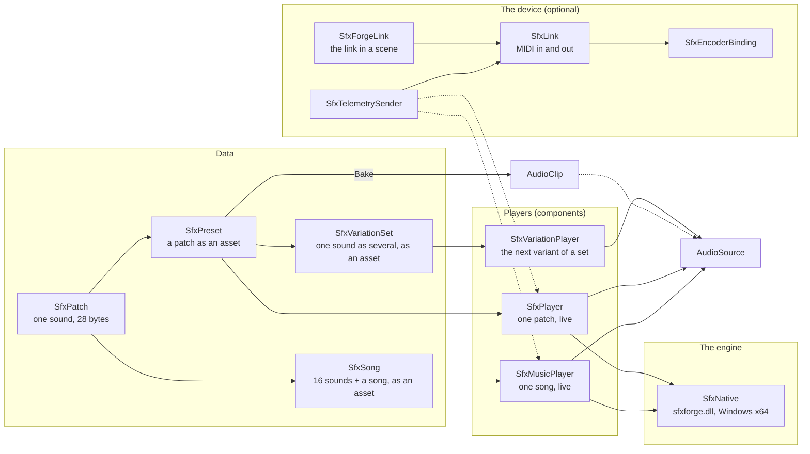

| Piece | Kind | What it is |
|---|---|---|
| `SfxPatch` | struct | one sound: an engine and 25 values, each 0 – 127. The same 28 bytes the device keeps |
| `SfxPreset` | asset | a patch you can click, hear and tune in the Inspector. `Bake` turns it into an `AudioClip` |
| `SfxSong` | asset | a piece of music: 16 sounds and the packed song (patterns, each with its own grid, arrangement, layers, mix, automation) |
| `SfxVariationSet` | asset | one sound as several: a preset and a seed give a fixed row of variants, and BAKE writes them as clips ([section 11](#variation-sets)) |
| `SfxPlayer` | component | synthesizes a patch as it plays. Its four live values bend the sound while it sounds |
| `SfxMusicPlayer` | component | plays an `SfxSong`. The game sets its intensity, cues patterns, moves its mix |
| `SfxVariationPlayer` | component | plays the next variant of an `SfxVariationSet` through an `AudioSource`, a little higher or lower, a little quieter |
| `SfxNative` | static class | the engine: a native library, `Runtime/Plugins/x86_64/sfxforge.dll`. Also `Bake` to raw samples |
| `SfxWav` | static class | writes samples as a 16-bit WAV file |
| `SfxGenerator` · `SfxMutate` · `SfxRandom` · `SfxShuffle` | static classes, a struct, a class | a new sound of a kind from a seed; variants of a sound that can be made again; the device's own random numbers; an order that does not repeat ([section 11](#11-tools-for-designing-sounds)) |
| `SfxBake` · `SfxLevels` | static classes | a patch as samples, with options (rate, mono, note, trim, normalise); peak and RMS, and what LEVEL does to them |
| `SfxPatchText` | static class | a sound as 62 characters of text, and as a `.syx` file |
| `SfxLink` | class | the MIDI connection to the device: `SfxLink.Shared`. Windows only |
| `SfxForgeLink` | component | opens the link in a scene, polls it, hands out pad and encoder events |
| `SfxTelemetrySender` | component | one game value → the device, and to local players |
| `SfxEncoderBinding` | component | one of the device's encoders → an AudioMixer parameter or an event |
| `SfxProtocol` | static class | the MIDI messages, byte by byte. You rarely call it yourself |
| `SfxPackedSong` · `SfxSongTransfer` | a static class, a class | reads a packed song of any format step by step; collects a song that arrives in pieces ([section 6](#the-song-formats-the-package-reads)) |
| **Editor** | | `Window > SFX Forge` and the Inspectors of `SfxPreset` and `SfxSong`, all three drawn like the device's display ([below](#the-inspectors-look-like-the-device)); `SfxForgeEditorLink` (preview, bake a WAV, make assets). For designing sounds ([section 11](#11-tools-for-designing-sounds)): the tools in a sound's Inspector, the Inspector of `SfxVariationSet`, `Window > SFX Forge Bake`, `SfxBatchBake`, `SfxVariationBaker` |

Everything is in the namespace `CatSplat.SfxForge`; the editor code in `CatSplat.SfxForge.Editor`.

**No device is needed.** Patches, presets, the players, baking and the tools of section 11 work on their own. The link
is for tuning live.

### The inspectors look like the device

The Inspector of a sound, the Inspector of a song and **Window > SFX Forge** are built with UI Toolkit and drawn as
the device draws its display: the firmware's colours (one for each engine), its pages of up to four values, its names
and its units. What you learned on the device you find again in Unity, and the other way round.

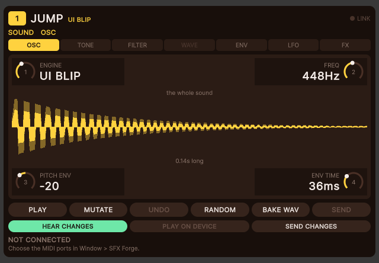

*The Inspector of an `SfxPreset` at 640 pixels, page OSC: the showcase's Jump. This picture and the others in this
section are the panel's element tree and stylesheet rendered in a panel to a texture by the inspectors' tests. They
are not photographs of the Inspector window.*

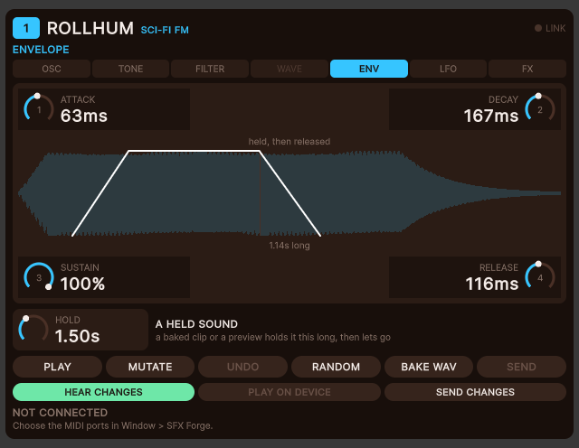

*Page ENV of a held sound, the showcase's RollHum, rendered the same way. The white line is the envelope the four
values make. HOLD appears because the sound is held.*

| | |
|---|---|
| **The pages** | a sound has seven: OSC, TONE, FILTER, WAVE, ENV, LFO, FX. Each has up to four values, as the device has four encoders (WAVE has two, and its tiles 3 and 4 are empty); together they hold the engine and all 25 values, each once ([section 3](#the-patch-as-an-asset-sfxpreset) has the table). A song has four: STEPS, MIX, MASTER, AUTO |
| **The knobs** | a value is a tile: a ring that stands where the value stands, the encoder's number in it, a dim name, and the value in large letters. The ring is a picture; the whole tile is the control (below) |
| **The units** | the value is written as the device writes it: `448Hz`, `3.6kHz`, `36ms`, `1.4s`, `-20`, `100%`, `OFF`, `SAW-SQ`. The texts are worked out with the firmware's own arithmetic, and the tests compare them with values read off the device's own pictures |
| **The waveform** | the sound as the device draws it: one dry voice, without chorus, delay or reverb, mono, 1.5 seconds at most, a held sound let go after 0.8 seconds. Under it, how long it is. It is not what PLAY and BAKE WAV render: those have the effects. On most pages a white line shows what the page's four values shape |
| **The soft keys** | the rows of keys at the bottom, as F1 – F6 on the device. A green key is a switch that is on. A dark key has nothing to do and takes no click: SEND while no device is connected, UNDO while there is nothing of this sound to take back |
| **The level line** | in a sound's Inspector, under the picture: the peak and the RMS of the sound as PLAY and BAKE WAV render it, with its effects, and how long that is. Orange, with CLIPS, when it is over full scale ([section 11](#level)) |
| **The tools** | in a sound's Inspector, at the foot: four tabs, NEW, VARY, LEVEL and SHARE, one shown at a time. Every Inspector shows the same tab ([section 11](#11-tools-for-designing-sounds)) |
| **The link dot** | top right. In the two Inspectors: green while a MIDI output to the device is open. In the window: green while either port is open, so with the input alone it is green while SEND and the pads stay dark |

**Turning a knob.** What a value tile does with the mouse and the keys (`Editor/UI/ValueTile.cs`):

| You | The value |
|---|---|
| drag the tile up or down | goes up or down, one step for every 2 pixels (ENGINE and TABLE: a name for every 16 or 14 pixels; HOLD: 0.05 s for every 3). With SHIFT held it takes four times as far: finer. A whole drag is one step for Undo |
| turn the wheel over the ring | one step a notch; up is more. Only over the ring, so the Inspector still scrolls everywhere else |
| press an arrow key while the tile has the focus | up or right: one step more; down or left: one less. With SHIFT: eight |
| double-click the value | it becomes a field to type in; ENTER takes what you typed. Type it as the display writes it: `200Hz`, `1.2s`, `40%`, `+12`, `OFF`. The nearest value the knob can have is taken |
| double-click the ring | not back to what it was: to the value of a plain patch of that engine ([section 3](#every-value)). HOLD: 1.50 s. ENGINE has no plain value: nothing happens. In a song: TEMPO 120, SWING 0 %, LAYER 0 %, VOLUME 100, PAN C |
| click the value of ENGINE or TABLE | a menu of the names. Dragging and the wheel go through them too, round and round |

A tile that only shows, such as STEPS in a song, is an outline with a dim ring, and takes neither the mouse nor the
focus.

Every change goes through Unity's `SerializedObject`: the asset is marked changed, **Edit > Undo** takes it back, and
with several presets selected each of them is changed. A value in which they differ reads `-`.

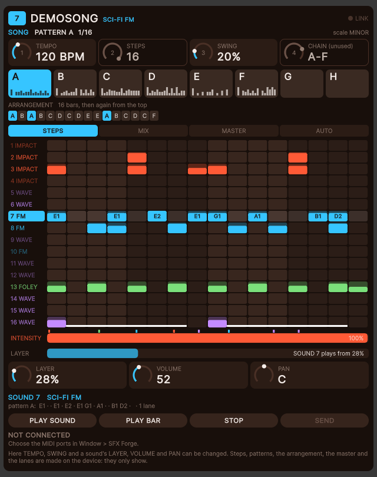

*The Inspector of an `SfxSong`, the demo song, page STEPS, pattern A, sound 7 chosen. The title says the pattern and
its grid: `PATTERN A  1/16`. Rendered by the tests, as above.*

**A song is shown, not edited.** The song's Inspector is a viewer of what was made on the device, with five numbers
you can change ([section 5](#the-song-in-the-inspector) goes through it):

| Editable here | Only shown: made on the device |
|---|---|
| **TEMPO** (40 – 240 BPM) and **SWING** (0 – 100 %) | STEPS (the bar's length, in sixteenths) and CHAIN |
| the chosen sound's **LAYER** (0 – 100 %), **VOLUME** (0 – 127, 100 = as designed) and **PAN** (L64 … C … R63) | the steps with their notes, velocities and lengths; the patterns A – H, each with its grid of 1/16, 1/32 or 1/64; the arrangement |
| | which sounds are muted; the master effects (DELAY TIME, FEEDBACK, ROOM SIZE, DAMPING, DRIVE); the automation lanes |

The INTENSITY bar on the STEPS page can be dragged, but it is not part of the song: it is the intensity you look at
the song with, and PLAY BAR plays with. In the game, the game sets it. The same goes for the pattern and the sound
you chose.

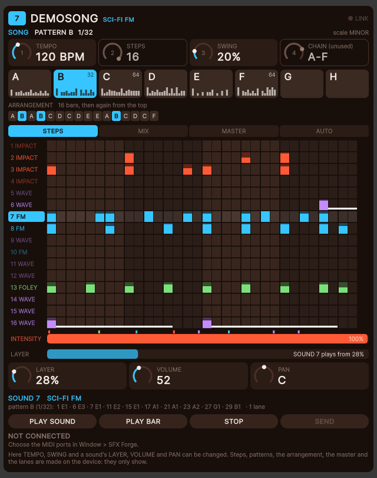

*From firmware 1.6.0 on a pattern has its own grid: 16, 32 or 64 steps a bar. This is the tests' own song, the demo
song with pattern B made 1/32 and C and F 1/64, with B looked at. The title says `PATTERN B  1/32`, each row has 32
cells, and the tiles of B, C and F carry `32` or `64` in their corner. Rendered by the tests, as above.
[Section 5](#a-finer-grid) explains the grid.*

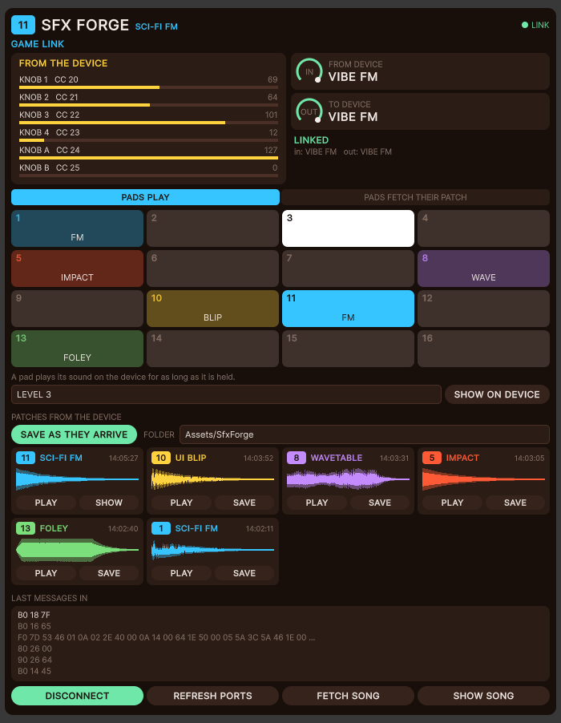

*Window > SFX Forge at 700 pixels, rendered by the tests from a model they filled in: the port names, the knob
values, the patches and the messages in it are the test's, and no device was connected.
[Section 6](#the-sfx-forge-window) describes its parts.*

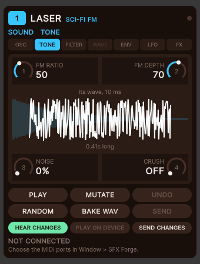

*At 340 pixels the soft keys wrap into rows of three and the picture is lower: below 400 pixels a panel uses its
narrow layout. The tests render every page at 340 and 640 pixels, some also at 300 and 700, and the two windows at 340, 420 and 700.*

> **What was tried, and what was not.** The tests build these panels, call what the knobs and keys call, send
> mouse and wheel events to them in a test panel, and check the asset and Undo afterwards
> ([section 9](#the-inspectors-are-tested-in-a-project-of-their-own)). Not tried: the real Inspector and the real
> window, which nobody has opened; the menus (ENGINE, TABLE, the pad, the MIDI ports), which were never opened;
> typing into a value's field with a keyboard; any key: the arrow keys on a tile, ENTER in the window's text
> field and the double-click that opens a value's field were never sent as events, and what they call was called
> directly; and anything sent to a device from these panels: SEND, PLAY ON
> DEVICE, SEND CHANGES, the pads, the text. Only Unity 6000.3.8f1 on Windows x64 was used, and nobody has
> listened to what PLAY plays.

The kit these panels are built from (`Knob`, `ValueTile`, `WaveformView`, `PadGrid`, `SoftKeyRow`, `SfxUnits`
and the stylesheet `SfxForge.uss`) is in the package's `Editor/UI` folder, with a `README.md` that says how to use
it for an inspector of your own.

---

## 3. A sound: SfxPatch

A patch is the whole sound. It follows the same path as on the device ([MANUAL section 6](MANUAL.md#6-how-a-sound-is-built)):

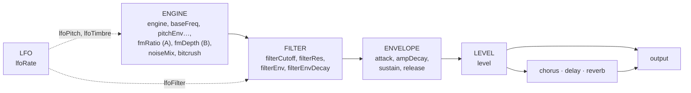

### Make one

```csharp
// FREQ, PITCH ENV, ENV TIME, A, B, NOISE, CUTOFF, RESO, DECAY, CRUSH, then ATTACK, SUSTAIN, RELEASE …
SfxPatch coin = SfxPatch.Create(SfxEngine.UiBlip, 86, 64, 0, 26, 60, 0, 127, 0, 62, 0);
SfxPatch hum = SfxPatch.Create(SfxEngine.SciFiFm, 22, 64, 0, 21, 55, 8, 78, 45, 60, 0, 0, 127);   // sustain 127: held
coin.reverb = 25;                                    // every value is also a field
coin[SfxParam.FilterCutoff] = 110;                   // … and reachable by index
```

`SfxPatch.Create(engine, values…)` takes the values in the order of the table below. You give as many as you want;
the rest come from a plain patch: a short one-shot, nothing modulated, no effects, level 100.

> **A bare `new SfxPatch()` is silent.** All its values are 0, and that includes `level`. Always start from
> `SfxPatch.Create` or `SfxPatch.Default`.

### Every value

Every value is a `byte`, 0 – 127. Setting more than 127 through the indexer clamps it. The column "Plain" is what
`Create` uses for a value you leave out. The ranges are the device's ([MANUAL, "Every value"](MANUAL.md#every-value)).

| # | Field | `SfxParam` | On the device | What it does | Range | Plain |
|---|---|---|---|---|---|---|
| | `engine` | | ENGINE | which of the five engines makes the sound | `SfxEngine` | |
| 0 | `baseFreq` | `BaseFreq` | FREQ | the pitch. Ignored when you play the sound as a MIDI note | 20 Hz – 14.5 kHz | 60 |
| 1 | `pitchEnvAmount` | `PitchEnvAmount` | PITCH ENV | above 64 the pitch starts higher and falls back; below 64 it starts lower and rises | ±4 octaves; **64 = none** | 64 |
| 2 | `pitchEnvDecay` | `PitchEnvDecay` | ENV TIME | how long that takes | 5 ms – 2.6 s | 40 |
| 3 | `fmRatio` | `FmRatio` | **A** | the engine's first own control (below) | | 40 |
| 4 | `fmDepth` | `FmDepth` | **B** | the engine's second own control (below) | | 40 |
| 5 | `noiseMix` | `NoiseMix` | NOISE | how much of it is noise | 0 – 100 % | 0 |
| 6 | `filterCutoff` | `FilterCutoff` | CUTOFF | where the filter closes. FOLEY: the band the noise sits in | 40 Hz – 15.5 kHz | 110 |
| 7 | `filterRes` | `FilterRes` | RESO | a peak at the cutoff | 0 – 100 % | 10 |
| 8 | `ampDecay` | `AmpDecay` | DECAY | how fast it falls after the attack | 10 ms – 3.9 s | 60 |
| 9 | `bitcrush` | `Bitcrush` | CRUSH | fewer bits and samples: grit | off – 100 % | 0 |
| 10 | `attack` | `Attack` | ATTACK | time to reach full level | 1.5 ms – 4 s | 0 |
| 11 | `sustain` | `Sustain` | SUSTAIN | the level it holds at. **0 = a one-shot** | off, or up to 100 % | 0 |
| 12 | `release` | `Release` | RELEASE | how long it rings after it is let go | 5 ms – 3.9 s | 34 |
| 13 | `filterEnv` | `FilterEnv` | FILTER ENV | how far the cutoff starts above or below and returns | ±5 octaves; **64 = none** | 64 |
| 14 | `filterEnvDecay` | `FilterEnvDecay` | F.ENV TIME | how long that takes | 5 ms – 2.6 s | 40 |
| 15 | `lfoRate` | `LfoRate` | LFO RATE | the slow wave's speed | 0.1 – 29 Hz | 50 |
| 16 | `lfoPitch` | `LfoPitch` | > PITCH | vibrato | up to an octave | 0 |
| 17 | `lfoFilter` | `LfoFilter` | > FILTER | wah | up to 3 octaves | 0 |
| 18 | `lfoTimbre` | `LfoTimbre` | > TIMBRE | moves FM depth or wavetable position | | 0 |
| 19 | `spread` | `Spread` | SPREAD | wavetable only: two detuned copies, for width | up to 30 cents | 0 |
| 20 | `chorus` | `Chorus` | CHORUS | send to the chorus | 0 – 100 % | 0 |
| 21 | `delay` | `Delay` | DELAY | send to the delay | 0 – 100 % | 0 |
| 22 | `reverb` | `Reverb` | REVERB | send to the reverb | 0 – 100 % | 0 |
| 23 | `level` | `Level` | LEVEL | the sound's own loudness | **100 = as designed** | 100 |
| 24 | `table` | `Table` | TABLE | wavetable only: which table, 0 – 5 | `SfxPatch.TableNames` | 0 |

A few landmarks, from the showcase's sound library: ENV TIME 25 ≈ 17 ms, 45 ≈ 45 ms, 60 ≈ 95 ms, 75 ≈ 200 ms,
90 ≈ 420 ms. CUTOFF 62 ≈ 0.7 kHz, 90 ≈ 2.7 kHz, 110 ≈ 7 kHz. DECAY 22 is a tick, 50 is medium, 105 rings for seconds.
LFO RATE 50 ≈ 1 Hz, 105 ≈ 11 Hz.

### The five engines, and what A and B mean

`fmRatio` and `fmDepth` are named after their job in the FM engines. In the other engines they do something else.
`SfxPatch.Label(param, engine)` gives the name in the table below. The Inspector writes the device's own, shorter
words (FM RATIO, ARP STEP, GRAIN AMT, POSITION …).

| `SfxEngine` | On the device | What it is | A = `fmRatio` | B = `fmDepth` | Good for |
|---|---|---|---|---|---|
| `Impact` | IMPACT | a sine whose pitch falls, with FM and noise, driven hard | FM Ratio | FM Depth | hits, kicks, explosions |
| `UiBlip` | UI BLIP | a square wave that can step upwards | Arp Step | Arp Speed | coins, menus, chiptune |
| `SciFiFm` | SCI-FI FM | two sines, one bending the other | FM Ratio | FM Depth | lasers, engines, FM bass and keys |
| `Foley` | FOLEY | noise through a band, in grains | Grain Rate | Grain Amount | steps, wind, fire, hi-hats |
| `Wavetable` | WAVETABLE | a wave that morphs through a table | Position | Warp | pads, strings, brass, organs |

| Engine | Useful numbers |
|---|---|
| `Impact`, `SciFiFm` | FM Ratio 21 = 1:2 (a growl), 42 = 1:1 (round), 64 = 2:1; higher is bells and metal |
| `UiBlip` | Arp Step 0 is a plain square wave, 37 = a fifth, 64 = an octave. The arpeggio takes three steps and stays on the last |
| `Foley` | set `noiseMix` to 127. `filterCutoff` is the band. `pitchEnvAmount` sweeps the band: a whoosh |
| `Wavetable` | `table` picks one of `SfxPatch.TableNames`: Saw to Square, Pulse, Peak, Vowel, Organ, Glass |

### One-shot or held: `sustain` decides

| `sustain` | The sound is | `IsSustained` | You must |
|---|---|---|---|
| **0** | a **one-shot**: it plays to its end | `false` | nothing. It ends by itself |
| **above 0** | **held**: it sounds until it is let go, then rings out over `release` | `true` | call `Release()`, or it never stops |

### Variations

`patch.Mutate(rng)` moves every value except LEVEL and TABLE by up to 15 % of its range, as MUTATE does on the device. It keeps what
kind of sound it is: the engine, the table, the level, and whether it is a one-shot.

```csharp
var rng = new System.Random(7);
SfxPatch variation = SfxPatch.Default;       // a struct: this is a copy
variation.Mutate(rng);
```

A second form takes an amount and locks, and draws from `SfxRandom`, the device's own generator. It is whole-number
arithmetic, so a seed is written to give the same variation wherever it runs; it was run on one machine only.

```csharp
var seeded = new SfxRandom(7);
SfxPatch wider = SfxPatch.Default;
wider.Mutate(ref seeded, SfxPatch.StepOf(30), SfxMutate.Bit(SfxParam.BaseFreq));     // up to 30 %, and FREQ stays

SfxPatch third = SfxMutate.Variant(SfxPatch.Default, 0xCF56CEED, 3, 15);             // variant 3 of a base, for a seed, at 15 %
```

`SfxPatch.StepOf(percent)` turns an amount in per cent into the step `Mutate` takes (15 gives 19 of 127, the device's
own). `SfxMutate.Variant(base, seed, n, percent, locked)` is variant `n` of a base: 0 is the base itself, and a
variant depends on the base, the seed, its number, the amount and the locks, not on the others. The VARY tool and the
variation sets of [section 11](#11-tools-for-designing-sounds) are built on it.

### The patch as an asset: SfxPreset

**Assets > Create > SFX Forge > Preset** makes an `SfxPreset`. Its Inspector is the device's sound page
([the pictures, and how a knob is turned](#the-inspectors-look-like-the-device)). From the top:

| Part | What it is |
|---|---|
| **The top line** | a pad's number, the asset's name, the engine, the link dot. The number is the pad of the device that SEND goes to: a click on it opens a menu of the 16 pads. It is one choice for all presets, and it is not saved |
| **The page tabs** | OSC · TONE · FILTER · WAVE · ENV · LFO · FX. WAVE is dim, and cannot be opened, unless the engine is WAVETABLE |
| **Four value tiles** | the page's values, two above the picture and two below, numbered 1 – 4 as the device's encoders |
| **The picture** | the sound's waveform as the device draws it, and how long it is (`0.14s long`) |
| **The level line** | under the picture: `PEAK -9.8dB   RMS -19.5dB`, and under it how long the sound is as PLAY and BAKE WAV render it, with its effects' tail. That is longer than the picture's dry voice ([section 11](#level)) |
| **HOLD** | shown for a held sound only: how long a baked clip or a preview holds it (`holdSeconds`; 0.05 to 12 seconds, default 1.50 s) |
| **The soft keys** | two rows, below |
| **TOOLS** | four tabs under the keys and the link note: NEW, VARY, LEVEL, SHARE ([section 11](#11-tools-for-designing-sounds)) |

What is on each page. Knob 1 is top left, 2 top right, 3 bottom left, 4 bottom right:

| Page | 1 | 2 | 3 | 4 | The white line over the picture |
|---|---|---|---|---|---|
| **OSC** | ENGINE | FREQ | PITCH ENV | ENV TIME | none: "the whole sound" |
| **TONE** | **A** | **B** | NOISE | CRUSH | 10 ms of the wave itself, taken where the sound is loud |
| **FILTER** | CUTOFF | RESO | FILTER ENV | F.ENV TIME | the filter's curve; with FOLEY, the noise's band |
| **WAVE** | TABLE | SPREAD | | | 10 ms of the wave itself |
| **ENV** | ATTACK | DECAY | SUSTAIN | RELEASE | the envelope: "a one-shot", or "held, then released" with a thin upright line where it is let go |
| **LFO** | LFO RATE | > PITCH | > FILTER | > TIMBRE | the slow wave; dim, "LFO: off", while none of the three depths is set |
| **FX** | CHORUS | DELAY | REVERB | LEVEL | none |

A and B carry the engine's own names: FM RATIO and FM DEPTH, ARP STEP and ARP SPEED (UI BLIP), GRAIN RATE and
GRAIN AMT (FOLEY), POSITION and WARP (WAVETABLE). With FOLEY, CUTOFF reads BAND. The values are written in the
units of the table above: FREQ, CUTOFF and LFO RATE in Hz or kHz, the times in ms or s, PITCH ENV and FILTER ENV as −64 … +63
around 0, A, B and LEVEL as the bare number, SUSTAIN and CRUSH as `OFF` at 0, TABLE and ENGINE as a name, the rest in per cent.

| Soft key | What it does |
|---|---|
| **PLAY** | plays the sound through the editor's speakers, with the engine and its effects. A held sound is held for HOLD |
| **MUTATE** | a variation: every value except LEVEL and TABLE moves by up to the AMOUNT of the VARY tool, 15 % at first; a one-shot stays a one-shot, the engine stays (`SfxPatch.Mutate`). Values locked in VARY stay too ([section 11](#vary-mutates-amount-locks-and-more-like-this)) |
| **UNDO** | Unity's own Undo, lit only while Unity's next undo step is a change made to this sound here. Ctrl+Z does the same |
| **RANDOM** | a new one-shot from nothing, inside ranges that stay audible. The engine changes too |
| **BAKE WAV** | writes a stereo 16-bit `.wav` next to the asset, at 48 kHz, as designed. For another rate, mono, a note, a trimmed end or a normalised level, and for many sounds at once: [the Bake window](#the-bake-window) |
| **SEND** | sends the patch to the chosen pad of the device. Dark while no device is connected ([section 6](#6-from-the-device-to-the-game)) |
| **HEAR CHANGES** | a switch, on at first: the sound plays a moment after a value changed. Not in Play mode |
| **PLAY ON DEVICE** | sends the patch to the chosen pad and plays it there. Dark while no device is connected |
| **SEND CHANGES** | a switch, off at first: the patch is sent to that pad a moment after every change |

Under the keys the panel says LINKED, with the port SEND goes to, or NOT CONNECTED. Without the native library
(anything but Windows x64) PLAY and BAKE WAV are dark and the picture's place says NATIVE LIBRARY NOT FOUND; the
values can still be edited and sent.

A preset edited in Play mode is heard at once on an `SfxPlayer` that is sounding it. A baked clip does not change.

---

## 4. Playing sounds: three routes

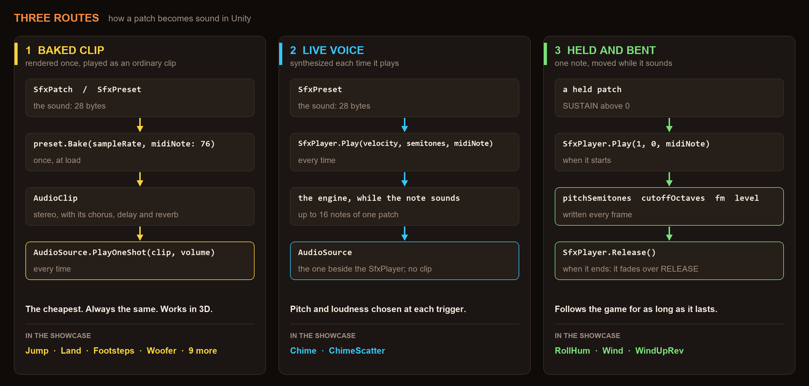

*The three routes. Read each column from the top: what you start with, what you call, what plays. In every picture
of this manual that shows routes, yellow is baked, blue is a live voice, green is held and bent, purple is music.
(The pictures of layers and of patterns use colours for other things, and say so.)*

| Route | You call | Cost | Use it for |
|---|---|---|---|
| **Baked clip** | `preset.Bake(…)` once, then `AudioSource.PlayOneShot(clip)` | the cheapest: an ordinary clip after the bake | short sounds that fire often and are always the same: jump, footstep, UI click |
| **Live voice** | `SfxPlayer.Play(velocity, semitones, midiNote)` | synthesized while it sounds | a sound decided at the moment it plays: a pickup that climbs a scale, a hit that varies |
| **Held and bent** | `SfxPlayer.Play(…)` on a held patch, then write `pitchSemitones`, `cutoffOctaves`, `fm`, `level` every frame, then `Release()` | one player per sound, running while held | a sound that follows the game while it plays: an engine, wind, a charge |

### Which one?

| Question | Baked | Live voice | Held and bent |
|---|---|---|---|
| Can each trigger have its own pitch? | only by the AudioSource's pitch (it changes the length too) | **yes**, by semitones or MIDI note | yes, and while it sounds |
| Can it change while it sounds? | no | the four live values, for all notes of that player | **yes** |
| Does it work in 3D? | **yes**: it is a clip on any AudioSource | no: a player is not spatialized | no |
| Can it sustain as long as the game wants? | no: it holds for `holdSeconds`, then lets go | yes | **yes** |
| Does it need the native library at play time? | no, only for the bake | yes | yes |
| Can many overlap? | yes (`PlayOneShot`) | up to 16 notes of **one** patch per player | one sound per player |

A sound that fires often and should not be the same twice, such as a footstep, is a row of baked clips played in a
shuffled order: a variation set ([section 11](#variation-sets), [recipe 1](#1-footsteps-that-are-never-the-same)).

### Route 1: baked

```csharp
AudioClip clip = preset.Bake(AudioSettings.outputSampleRate, midiNote: 76);   // once; null without the native library
source.PlayOneShot(clip, 0.7f);                                              // every time
```

`SfxPreset.Bake(sampleRate = 48000, semitones = 0, velocity = 1, midiNote = 0)` renders the whole sound with its
chorus, delay and reverb into a stereo clip. `midiNote` above 0 plays it as that note (69 = A 440 Hz) and overrides
the patch's FREQ. That is how you tune an effect to the music.

Without a preset asset, bake the patch itself:

```csharp
float[] samples = SfxNative.BakeInterleaved(coin, 48000);       // L R L R …; null without the native library
SfxNative.Bake(coin, out float[] left, out float[] right);      // or the two channels apart; false if it failed
```

| Good to know | |
|---|---|
| A held patch | is held for `holdSeconds` (1.5 by default), then let go |
| The longest clip | 12 seconds (`maxSeconds` of `SfxNative.Bake`) |
| Baking is synchronous | it happens on the calling thread. Bake at load time, not in the middle of play |
| Volume still follows the game | pass it to `PlayOneShot`. The showcase's landing is louder the harder it hits |

### Route 2: a live voice

```csharp
player.preset = preset;
player.Play(1f, 7f);               // full velocity, 7 semitones up
player.Play(0.6f, 0f, 76);         // softer, as the MIDI note E5
player.Play(coin, 1f, 3f);         // or a patch directly: no preset needed
```

An `SfxPlayer` needs an `AudioSource` beside it (the component adds one). It keeps that source running itself: leave
its AudioClip empty.

> **One `SfxPlayer` holds one patch.** It overlaps up to 16 notes of it. Giving it a different patch reshapes what is
> still sounding. For several different live sounds, use several players. The showcase's `LiveVoicePool` picks the
> player already playing that preset, else a silent one, else the oldest.

### Route 3: held, and bent while it plays

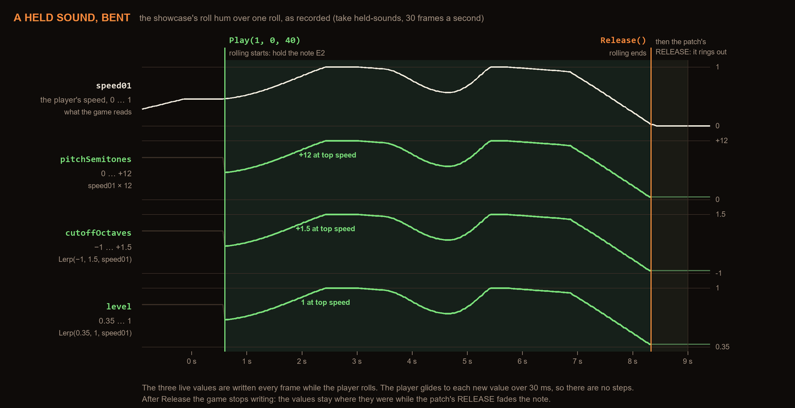

*The showcase's roll hum over one roll, as recorded. The white curve is the player's speed. The three green curves
are the live values the game writes from it, every frame, between `Play` and `Release`.*

```csharp
player.Play(1f, 0f, 40);                                   // hold it, as the MIDI note E2
player.pitchSemitones = speed01 * 12f;                     // 0 … 24
player.cutoffOctaves = Mathf.Lerp(-1f, 1.5f, speed01);     // -4 … 4, from the patch's cutoff
player.fm = speed01 * 0.5f;                                // 0 … 1: FM depth, or a wavetable's position
player.level = Mathf.Lerp(0.35f, 1f, speed01);             // 0 … 1
player.Release();                                          // let go: it fades over the patch's RELEASE
```

| Live value | Range | What it moves |
|---|---|---|
| `pitchSemitones` | 0 … 24 | the pitch, upwards |
| `cutoffOctaves` | −4 … 4 | the filter, in octaves from the patch's cutoff |
| `fm` | 0 … 1 | the timbre: FM depth, or a wavetable's position |
| `level` | 0 … 1 | the loudness. 1 = as designed |

The player glides to each value over 30 ms, as the device does. You can write them every frame without clicks.

`volume` (0 … 1, default 0.8) is the player's place in your mix. It is **not** smoothed: fade with `level`, not
with `volume`.

**Start a pitched held sound with its MIDI note.** A bare `Play()` sounds at the patch's own FREQ, which is rarely in
tune with anything. Noise, such as wind, has no note: start it with 0.

**Without code:** an `SfxTelemetrySender` does the same from a Rigidbody's speed, an Animator float or your own
value. Put the `SfxPlayer` into its `localPlayers`. The demo's hovercraft engine is built this way
([recipe 4](#4-the-same-without-code-sfxtelemetrysender)).

---

## 5. Music

An `SfxMusicPlayer` plays an `SfxSong`: 16 instruments and a sequenced song, made on the device
([MANUAL sections 9 – 13](MANUAL.md#9-tutorial-a-beat)). The package cannot write a song: steps, patterns and the
arrangement are made on the device. It plays one, shows it, and lets the game shape it as it runs. Five numbers of
a song can be changed in its Inspector ([below](#the-song-in-the-inspector)).

### A first song

You need a song asset. The package has one ready, in its sample: `Song/DemoSong.asset` of the showcase, the firmware's own
demo song. Every example in this section, recipes 6 to 10 and the showcase use it.

| | Do this | What happens |
|---|---|---|
| **1** | Import the sample "Showcase" (Package Manager > SFX Forge > Samples) and find `Song/DemoSong.asset` in the imported folder | an `SfxSong` named DemoSong appears. Its Inspector shows TEMPO 120 BPM, the patterns A – H and a row of steps for each of the 16 sounds; a click on a sound's name plays it |
| **2** | Make an empty GameObject and add the component **SfxMusicPlayer** | Unity adds an `AudioSource` with it |
| **3** | Drag DemoSong onto the player's **Song** field. Leave `playOnEnable` on and `intensity` at 1 | |
| **4** | Press Play | the whole band plays: drums, FM bass, FM keys, strings, then brass, bells and choir as the song goes on |
| **5** | Drag `intensity` down in the Inspector while it plays | instruments drop out one by one. At 0 only the kick is left |

These five steps were not tried as written, in a project of their own; the asset is the one the showcase itself plays. To get
a song of your own into Unity, see [section 6](#a-song-without-midi).

Three words from the device, used below:

| Word | What it is |
|---|---|
| **pattern** | one bar for all 16 sounds. A song has eight, A to H (`CuePattern(0)` to `CuePattern(7)`) |
| **grid** | how fine a pattern's steps are: 1/16, 1/32 or 1/64, which is 16, 32 or 64 steps for a full bar. Each pattern has its own (firmware 1.6.0 on); before that every pattern had 16 ([below](#a-finer-grid)) |
| **chain** | how many patterns, counted from A, play in turn when the song has no arrangement. A chain of 1 loops pattern A |
| **arrangement** | a list of up to 32 bars, each naming a pattern. If a song has one, it plays the list instead of the chain |

| The game wants to … | It uses |
|---|---|
| start and stop | `Play()` · `Stop()` · `playOnEnable` (on by default) · `startPattern` |
| bring the band in and out | `intensity`, 0 … 1 |
| change the music on the next bar | `CuePattern(0 … 7)` |
| stay on one pattern | `loopPattern` |
| play one of the song's instruments by hand | `PlaySound(sound, velocity, midiNote)` · `ReleaseSound(sound, midiNote)` |
| move the mix | `SetTrackVolume` · `SetTrackPan` · `SetTrackMute` · `SetMaster` · `volume` |
| know where the song is | `IsPlaying` · `Step` (the sixteenth, 0 … 15) · `GridStep` (the step in the pattern's own grid) · `Pattern` (0 = A) · `Bar` (bars since `Play`) |
| take a changed song asset | `Reload()`. It also puts the song's own mix back |

```csharp
music.intensity = danger01;            // every frame
music.CuePattern(2);                   // pattern C, from the next bar line
music.PlaySound(13, 0.9f, 76);         // the song's sound 14, as the note E5, on top of the music
```

### The song in the Inspector

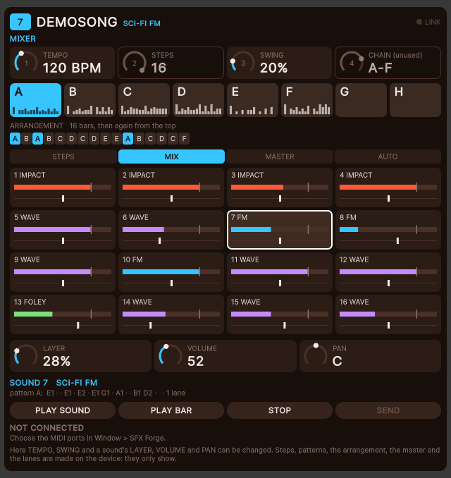

*The Inspector of the demo song, page MIX: a tile for each sound with its fader (the mark is 100, as designed) and
its pan. Like every picture of the editor UI in this manual, it is the panel's elements rendered to a texture by
the tests, not a photograph of the Inspector.*

Select an `SfxSong`. From the top ([the STEPS page is pictured in section 2](#the-inspectors-look-like-the-device)):

| Part | What it shows | Editable |
|---|---|---|
| **The top line** | the chosen sound's number, the asset's name, that sound's engine, the link dot | |
| **The title** | the page, and on STEPS and AUTO the pattern looked at with its grid: `PATTERN B  1/32`. On STEPS also the scale | |
| **TEMPO · STEPS · SWING · CHAIN** | the song's four numbers. STEPS is the bar in sixteenths, 1 – 16, whatever the grids are. CHAIN reads "(unused)" while the song has an arrangement | **TEMPO**, **SWING** |
| **Patterns A – H** | a tile each; along its foot 16 columns, one for each sixteenth: how many sounds play in it. A pattern with a finer grid has a small `32` or `64` in its corner. A click looks at that pattern | |
| **ARRANGEMENT** | the bars as a row of letters, or what the song does without one. A click on a bar looks at its pattern | |
| **STEPS** | a row for each sound over the pattern looked at, in the pattern's own grid: 16, 32 or 64 cells, and at 32 and 64 a little more room between two sixteenths. A step is as high as it is hard, and a line says how long it holds. The chosen sound's notes are written in its cells at 16 steps only; a finer cell has no room. A row is dim while its sound's layer is silent at the INTENSITY below, or the sound is muted. A click on a name chooses the sound and plays it. Under the rows: INTENSITY, with a mark for the LAYER of every sound that plays in the song, and the chosen sound's LAYER as a bar | INTENSITY can be dragged, but it is not in the song |
| **MIX** | a tile for each sound: fader, pan, muted or not. A click chooses the sound and plays it | |
| **MASTER** | two drawings, the delay's echoes and the reverb's fading, and DELAY TIME, FEEDBACK, ROOM SIZE, DAMPING, DRIVE | |
| **AUTO** | a block for every automation lane: the sound, the knob it moves, its points over the pattern looked at, in that pattern's grid, and their range, or in which patterns it moves | |
| **LAYER · VOLUME · PAN** | the chosen sound's layer mark and its place in the song's mix | all three |
| **The line under them** | the chosen sound's steps in words. At 16 steps: a note, `x` for a step as designed, `·` for a rest. At 32 and 64 only the steps that are set, each with its number: `pattern B (1/32):  1 E1 · 6 E3 · 7 E1`, the first 16 of them and then `+n more` | |

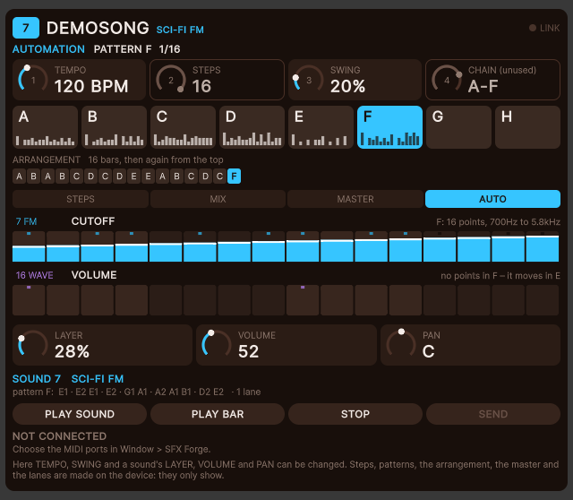

*Page AUTO with pattern F looked at, rendered by the tests in the same way: the FM bass's cutoff rises over the bar;
the second lane has no points in F.*

| Soft key | What it does |
|---|---|
| **PLAY SOUND** | plays the chosen sound through the editor's speakers |
| **PLAY BAR** | plays the pattern looked at, once, as the game would at the INTENSITY set on the STEPS page, with the song's mix and effects (`SfxSongPanel.RenderBar`) |
| **STOP** | silence |
| **SEND** | replaces the 16 sounds and the song on the device. Dark while no device is connected, and for a song the connected device cannot take (below) |

The five numbers are written into the packed song (`SfxSong.data`) through Unity's `SerializedObject`, so Undo
takes them back. An `SfxMusicPlayer` that is already playing keeps the song it took until its next `Reload()` or
start. VOLUME and PAN only show in a song from before the mixer (`HasMix` false). Everything else in this
Inspector is read through `SfxSong`'s accessors ([section 10](#sfxsong-scriptableobject)) and cannot be changed
here: for that, send the song to the device, change it there, and fetch it back. With several songs selected, or
an empty one, the Inspector only says so.

**The line under the keys** says what SEND would do. It has four states:

| It says | When | SEND |
|---|---|---|
| **LINKED** | a MIDI output is open and nothing stands against this song: "SEND replaces the 16 sounds and the song on" the port | lit |
| **NOT CONNECTED** | no MIDI output is open | dark |
| **ANOTHER FORMAT** | the device cannot take this song: it said it speaks another format, or it did not say that it takes this one. A firmware before 1.6.0 and a format-6 song is the usual case. Under it: "SEND is off:" and the reason | dark |
| **A DAMAGED SONG** | the packed song has the right layout, but a value in it is out of range (`SfxPackedSong.IsPlayable` is false). The device would answer BAD SONG. Under it: "SEND is off:" and the reason | dark |

The reasons are the texts of `SfxLink.Refusal` ([section 6](#when-a-song-is-not-sent)).

### A finer grid

From firmware 1.6.0 on every pattern has its own grid: **1/16, 1/32 or 1/64**. That is 16, 32 or 64 steps for a full
bar: a sixteenth is cut in 1, 2 or 4 steps. The grid is chosen on the device (SHIFT+F5 and SHIFT+F6 on its SEQ and
AUTO pages, [the device's manual](MANUAL.md)). The package plays it, shows it and reads it; it does not set it.

Three things stay as they were:

- **The bar is counted in sixteenths.** `SfxSong.StepsPerPattern` is 1 … 16 for the whole song. A pattern plays that
  many sixteenths, each in 1, 2 or 4 steps: `GridSteps(pattern)`.
- **`SfxMusicPlayer.Step` is the sixteenth**, 0 … 15, whatever the grid of the pattern that plays. Code that waits
  for `Step` to change, or counts sixteenths, works as before.
- **`SfxSong`'s old step accessors mean "sixteenth".** `StepOn`, `StepNote`, `StepVelocity` and `LanePoint` take a
  sixteenth 0 … 15 and read the **first** step of it. `StepLength` is in sixteenths, rounded up. In a pattern of 32
  or 64 steps they do not see what stands between: use the `Grid…` members for that.

What is new:

| You want | You use |
|---|---|
| the step that plays, in the pattern's own grid | `SfxMusicPlayer.GridStep`: 0 … 15, 0 … 31 or 0 … 63; −1 before the first step |
| how many steps a sixteenth has right now | `SfxMusicPlayer.StepsPerSixteenth`: 1, 2 or 4 |
| a pattern's grid | `SfxSong.Grid(pattern)`: 16, 32 or 64 · `StepsPerSixteenth(pattern)`: 1, 2 or 4 · `GridSteps(pattern)`: the steps the bar plays of it |
| whether a song uses a finer grid at all | `SfxSong.HasFinerGrid` |
| every step of a pattern | `GridStepOn`, `GridStepNote`, `GridStepVelocity`, `GridStepLength` (in steps of that grid), `GridLanePoint` |
| the same from bare bytes, without an asset | `SfxPackedSong` ([section 10](#sfxpackedsong-and-sfxsongtransfer)) |

```csharp
// every step of pattern B for sound 7, whatever its grid
SfxSong song = music.song;
for (int step = 0, n = song.GridSteps(1); step < n; step++)
    if (song.GridStepOn(1, 6, step)) Debug.Log($"step {step + 1} of {song.Grid(1)}: note {song.GridStepNote(1, 6, step)}");

// a light that blinks on every step of the pattern that plays, also at 1/64
if (music.GridStep != lastGridStep) { lastGridStep = music.GridStep; Blink(); }
```

`GridStep`, like `Step`, is read from the audio thread's state a moment after the step began: it is good for a
light, not for timing a sound to the sample.

> **What is tested, and what is not.** `tests/dotnet` plays a 64-step pattern through the native library and reads
> the player's state: 1.024 s into it at 120 BPM it is on the 9th sixteenth and the 33rd grid step (`Step` 8, `GridStep` 32 or 33), at 4 steps a sixteenth. It
> also checks that a format-5 song renders bit for bit as it did before the finer grid, and that the songs of formats
> 1 to 5, converted to format 6, play the same samples. In the inspectors' test project, eight tests are about a song
> with patterns of 32 and 64 steps: its grids, the old accessors, the rows, the tiles, the notes, the lanes, the five
> numbers and SEND. **Not done:** `GridStep` and `StepsPerSixteenth` were not read from a running `SfxMusicPlayer`
> in a Unity test, only from the engine underneath; the demo song and the showcase use sixteenths only; the two
> snippets above were not compiled; and nobody has listened to a finer pattern in Unity.

### Intensity and layers

> **Every sound of the song has a LAYER mark. A sound plays only while `intensity` is at or above its mark.**

So one song is many. `SfxSong.Layer(sound)` reads a mark (0 … 1; 0 = always plays, if the pattern has notes for it). The marks are set on the device.


*Each bar starts at its sound's LAYER mark: the sound plays while the intensity is to the right of that point. The
dashed lines carry the marks down. Below them, one line for each floor of the showcase's sections: the dot is the
intensity while the player stands still there, the white tick the intensity at a run (10 m/s), the right end top
speed. Standing still, the kick, hi-hat, FM bass and snare play in every section; in Full Cycle, Woofer Steps,
Static Field and Split Signal the strings too; in Overdrive the FM keys as well.*

The demo song's marks, read from the asset (the showcase's `Song/DemoSong.asset`):

| `intensity` at or above | joins |
|---|---|
| 0 | kick |
| 0.16 | hi-hat |
| 0.28 | FM bass |
| 0.39 | snare |
| 0.47 | strings, choir |
| 0.57 | FM keys |
| 0.71 | brass |
| 0.79 | bells |

The other seven sounds of the kit (timpani, cowbell, pizzicato, harp, celesta, organ, sweep) also have mark 0, but
no pattern of the song has a note for them. So at intensity 0 you hear the kick alone. The showcase plays the
timpani by hand, in its fanfare. Not every pattern uses every sound either: brass is in B, C, D and F, bells are in
C, D and E, the choir is only in E.

`intensity` is not smoothed by the player and does not need to be: it only decides which notes start. Smooth it
yourself so the band does not flicker in and out. The showcase aims it at a point between the section's floor
(standing still) and 1 (top speed), and lets it rise in 0.6 s and fall in 2.5 s:

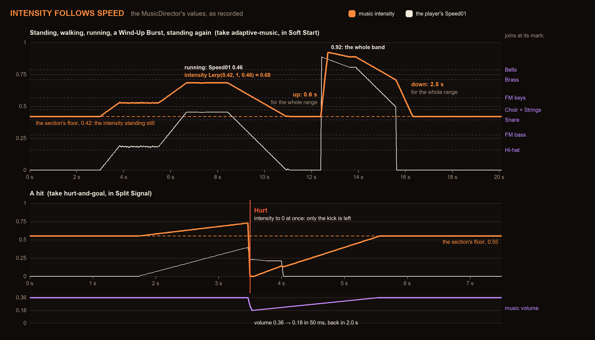

*Two recordings. Above: the intensity (orange) against the player's speed (white). Standing still it rests on the
section's floor; speed lifts it from there towards 1, quickly up and slowly down. The names on the right show which
sound joins at which height. Below: a hit drops the intensity to 0 at once, under the floor, and dips the music's
volume; both come back by themselves.*

### Cueing patterns

`CuePattern(n)` changes to pattern `n` on the next bar line (at once while the song is stopped). With
[`loopPattern`](#holding-a-pattern-looppattern) on, that pattern then repeats until the next cue, whatever the song
is. With it off, as it is at first, what happens after that bar depends on the song. This is what the engine does
(`core/sfx_song.h`):

| The song has … | and the cued pattern is … | After the cue |
|---|---|---|
| an arrangement | **in** it | the song jumps to the arrangement's next bar with that pattern, **then walks on** through the arrangement. One cue lasts until the arrangement moves to another pattern: often one bar |
| an arrangement | **not in** it (kept aside for a boss, a menu) | that pattern loops until the next cue |
| no arrangement, a chain of 1 | any | that pattern loops until the next cue |
| no arrangement, a chain of 2 or more | any | one bar of that pattern, then the chain walks on from it |

`SfxSong.ArrangementBars` (0 = none), `ArrangementPattern(bar)` and `Chain` tell you which case you have.

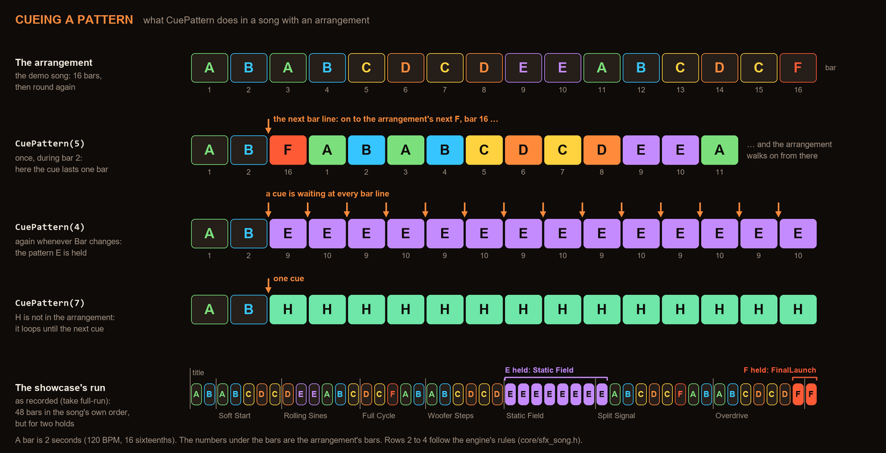

*From the top: the demo song's arrangement; one cue of F, which lasts one bar because the arrangement goes on to A;
a cue on every bar, which holds the pattern; a pattern outside the arrangement, which stays by itself. The last row
is a whole run of the showcase as recorded: the arrangement walks by itself, bar after bar, except in Static Field,
where E is held, and from the last launch to the goal, where F is.*

### Holding a pattern: loopPattern

The demo song has a 16-bar arrangement, A B A B C D C D E E A B C D C F, which contains every one of its patterns. A
cue into such a song lasts only as long as the arrangement stays on that pattern from there: one bar for most of
them, two for E, which the arrangement has twice in a row.

To stay on a pattern, switch `loopPattern` on. It is a field of the player, so it can also be ticked in the
Inspector.

```csharp
music.loopPattern = true;          // the pattern that plays repeats, bar after bar
music.CuePattern(4);               // E takes over on the next bar line, and E is what repeats
// later
music.loopPattern = false;         // the song's own order again
```

| `loopPattern` | What plays |
|---|---|
| **on** | the pattern that plays repeats until `CuePattern` chooses another; that one takes over on the bar line and repeats in its turn. The arrangement and the chain are not followed. Intensity, layers, the mix and notes by hand work as always, and `Bar` goes on counting |
| **off** (as it is at first) | the song's arrangement, or its chain: the table above |
| **switched off while it plays** | a song with an arrangement goes on from the first bar of the arrangement that has the pattern that plays: the bar after it comes next. If no bar has that pattern, the arrangement starts from its top. A song without an arrangement goes on in its chain from the pattern that plays; from a pattern beyond the chain it lands where the count wraps (from H with a chain of 6: C) |

With `playOnEnable` and `loopPattern` both on, the song starts on `startPattern` and stays there. `Play()`, `Stop()`
and `Reload()` leave the switch as it is.

The device has the same switch since its firmware 1.5: LOOP or SONG, F1 on its SEQ, SONG and AUTO pages
([the device's manual](MANUAL.md)). The two are separate: `loopPattern` is this player's, and is not sent to a device.

> **What is tested, and what is not.** The switch is the engine's (`sfx_player_set_loop` in `core/sfx_song.h`, the
> same code the firmware plays its LOOP mode with). `tests/dotnet` drives it through the native library, without
> Unity: with it on, the demo song is still on A in its second bar; a cue changes the pattern on the bar line and
> that pattern is still there three bars later; switched off, the arrangement goes on from that pattern's bar.
>
> Inside Unity, one Play mode test of the showcase runs it
> (`LoopPatternKeepsTheSongOnOnePatternAndLetsItGoAgain` in `Tests/ShowcaseAudioTests.cs`): a second
> `SfxMusicPlayer` with the demo song and `loopPattern` on stays on its pattern for more than three bars, and with
> it off the arrangement goes on. That run was headless and muted. **Not done:** nobody has listened to it, and it
> was not run in a built game.
>
> **With a library from before the switch, `loopPattern` does nothing, and says nothing**: the song plays in its own
> order (`SfxNative.PlayerSetLoop` returns false there). The package's `sfxforge.dll` has the switch. An editor that
> was open while the package was updated may still hold the older library, because Unity keeps a native library
> loaded until it is closed: restart it.

### The older way: cue it again on every bar

The showcase was written before the switch and holds its patterns by hand. That still works, with any library.

The showcase lets the song play in its own order for most of the level: the game does not choose the bars, only how
much of the band plays them. It holds a pattern in two places: E, the breakdown, for as long as the player is in
Static Field, and F, the turnaround, from the last launch to the goal. To hold one, its `MusicDirector` cues the
pattern again whenever `Bar` changes:

```csharp
int heldPattern = -1, lastBar = -1;    // below 0: nothing is held (the director's own value is SectionCue.SongOrder)

void HoldPattern()                     // called from Update
{
    int bar = music.Bar;
    if (bar == lastBar) return;
    lastBar = bar;
    if (heldPattern >= 0) music.CuePattern(heldPattern);
}
```

A cue is then always waiting at the next bar line, and the pattern stays. This works for every row of the table
above.

Ending a hold needs no call: stop cueing. Each section of the showcase has a `SectionCue` whose `Pattern` says what
happens on entering it:

| `Pattern` | On entering the section |
|---|---|
| 0 … 7 | that pattern is cued, and held from then on |
| `SectionCue.SongOrder` (−2) | a hold ends: `heldPattern` is set to it, and nothing is cued any more |
| `SectionCue.KeepPattern` (−1) | nothing changes: a pattern that is held stays held |

When a hold ends, the song is on a bar of its arrangement with the held pattern, and the arrangement walks on from
there. A cue that was already waiting still takes its bar. In the recorded run Static Field gives eight bars
of E; then the arrangement goes on with what follows its E bars: A B C D C F, and round again.

### Notes by hand: PlaySound

`PlaySound(sound, velocity, midiNote)` plays one of the song's 16 sounds beside the music. `sound` is 0 … 15, the
pad on the device minus one. `midiNote` 0 plays it as designed (a drum, an effect), above 0 at that pitch.

| Rule | |
|---|---|
| **It is not quantised** | the note sounds at once. To land on the beat, wait until `Step` or `Bar` changes, then play ([recipe 7](#7-a-stinger-on-the-bar-line)) |
| **A held instrument must be released** | brass, strings, organ, choir: call `ReleaseSound(sound, midiNote)` with the same two numbers, or it never stops |
| **Layers do not apply** | a note by hand sounds whatever the intensity is |
| **Same note, two instruments** | a note by hand is named by its MIDI note alone. If a **held** instrument is sounding a note and you play the same `midiNote` on another instrument, the held one is let go; `ReleaseSound` for that note releases every instrument holding it |

### The mix

| Call | Range | |
|---|---|---|
| `volume` | 0 … 1, default 0.6 | the whole music. **Not smoothed**: a jump is a click. Ramp it yourself ([recipe 9](#9-ducking-the-music)) |
| `SetTrackVolume(sound, v)` | 0 … 1.27 | a sound's fader. 1 = as designed |
| `SetTrackPan(sound, p)` | −1 … 1 | left … right |
| `SetTrackMute(sound, mute)` | | |
| `SetMaster(SfxMaster.DelayTime, v)` | 0 … 5 | 1, 2, 3, 4, 6 or 8 sixteenths |
| `SetMaster(…, v)` for `DelayFeedback`, `ReverbSize`, `ReverbDamping`, `Drive` | 0 … 127 | |

The song carries its own mix (`SfxSong.HasMix`, `Volume(sound)`, `Pan(sound)`). Your changes last until `Reload()`.

---

## 6. From the device to the game

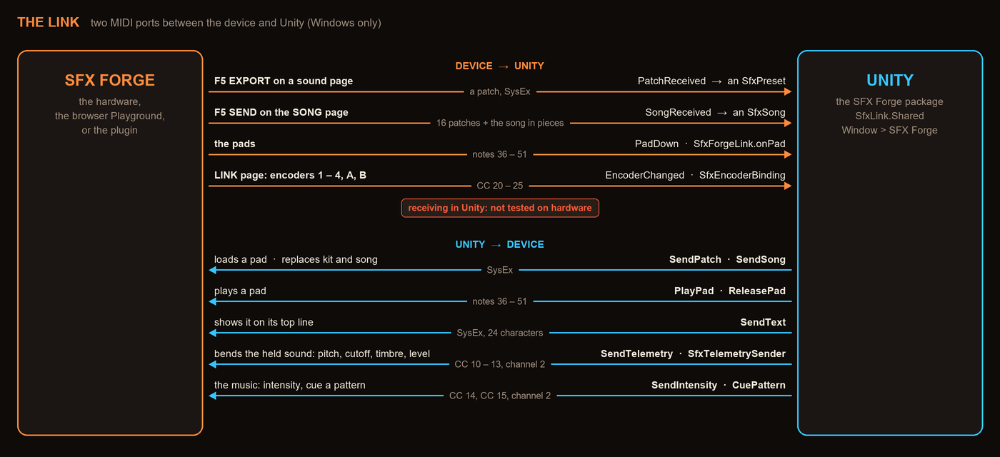

*Everything that travels between the device and Unity. On each line: what the device does, the MIDI message, and the
call or event in Unity.*

"The device" is SFX FORGE on the hardware, in the browser Playground, or in the plugin. Unity talks to it over two
MIDI ports. Without the hardware you need a virtual MIDI cable with two ports, one each way (for example loopMIDI).

> **What is tested, and what is not.** MIDI is implemented for Windows only (winmm).
>
> **The firmware is 1.6.0 now; the link was last run against 1.4.0.** Firmware 1.6.0 gives every pattern its own
> grid ([section 5](#a-finer-grid)), and with it three things on the wire changed: the song is in format 6 and has
> no fixed length, the song message has a new shape, and the identity says song format 6 and 64 steps. None of this
> has travelled over a MIDI port yet. What was done instead:
> - The firmware's own checks (`sh build.sh` in the source repository) hand the built 1.6.0 the identity request
>   and read its answer, and read the song it sends: 16 sounds, then the factory song in 11 pieces, 27 messages and
>   2487 bytes of format 6. They also send it songs in both shapes of the message, doubled, out of order and one
>   straight after another, and read back what it took.
> - `tests/dotnet` gives the messages that firmware sent to the package's own receiver (`SfxSongTransfer`), and the
>   song arrives whole. It also runs both shapes of the message through that receiver, and checks what `SendSong`
>   would send to a device that said 1.6, to one that said 1.5 and to one that said nothing.
>
> Everything below that names the emulator was done with 1.4.0 or 1.3.1 and was not repeated since. Firmware 1.6.0
> was not run on hardware or in the plugin either, and no firmware older than 1.6.0 was run against this package:
> what is said below about an older firmware is reasoned from its code.
>
> **Tested end to end against the emulator**, over two loopMIDI ports, with Unity 6000.3 on Windows 11
> (`Tests/LinkTakes.cs` in the showcase, run against `tests/emulator-link.mjs`; firmware 1.4.0, and 1.3.1 before it):
> - Unity asks for a pad's patch and for the song, and both arrive. The song that arrived was the demo project's
>   song, byte for byte, and an `SfxMusicPlayer` played it. Twenty transfers in a row all arrived.
> - A song sent *to* the device comes back the same when asked for: sent piece by piece, last piece first, after a
>   transfer that broke off, and with `SendSong`, whose 16 sounds arrive in the MUSIC kit while the selected kit
>   stays as it was. The songs sent differ from the device's in every one of the 39 pieces.
> - SEND and EXPORT pressed on the device arrive in a running game (`Tests/LinkSession.cs`, the link video).
> - The game's intensity reaches the device: the INTENSITY on its SONG page followed the game's value. Text was
>   sent in the same session, but the page that was open does not show it, so nobody saw it arrive.
>
> **Not tested:** the hardware and the plugin; pads and encoders coming *from* the device (`onPad`, `onEncoder`,
> `SfxEncoderBinding`); `SendPatch`; the SFX Forge window and the two Inspectors, whose keys nobody has pressed
> against a device. The window has only been shown a model filled in by its own tests.
>
> **The identity** ([below](#what-the-device-is-the-identity), firmware 1.4.0) is tested on the Unity side without
> a device: its bytes, what is and is not one, and what the link does with one that arrives in the middle of a
> song (`tests/dotnet`). Against the emulator with firmware 1.4.0, `TheDeviceSaysWhatItIs` in `Tests/LinkTakes.cs`
> asked for it and got: VIBE FM, firmware 1.4.0, profile 1, all four flags.
>
> **The takes above were repeated with firmware 1.4.0** and this package, whose `Open` sends the identity request
> before anything else: the six link tests and the recorded session all passed. That a pad's patch asked for right
> after the request still arrives (the host sends one SysEx a block, so the dump waits for the identity) is also
> checked on the built firmware by `tests/check-identity.mjs` in the source repository, which hands it the
> messages directly.
>
> **Found by these tests**, all three in how the emulator moves MIDI, none of them in the hardware's path:
> - Its MIDI output sometimes delivers two neighbouring SysEx messages in the wrong order: 3 of the first 60 song
>   transfers had two pieces swapped, and the package dropped such a song.
> - Its page handed every incoming message to the firmware twice. The firmware took a repeated piece for a new
>   transfer, so before 1.3.1 it never took a song from the game there.
> - It listens on its own output port (a virtual cable's port is both), so the firmware hears what it sends. Its
>   own sound dumps came back and were loaded into the selected kit.
>
> Since then both ends put every piece of a song where it belongs and take the song when all its pieces are
> there: in any order, and a piece that is there already, byte for byte, is ignored. A piece that is there already
> with other bytes begins a new transfer, and a transfer that broke off is forgotten after two seconds. The firmware
> ignores a dump or a piece that is exactly what it just sent. With that, 100 of 100 transfers to Unity arrived, and
> the round trip to the device passed with every message doubled (firmware 1.4.0, the message of then).
>
> **New with 1.6.0, in the firmware and in `SfxSongTransfer` alike:** after a song is whole its pieces stay, and
> pieces that come then are counted again. Once every piece has come again and at least one had other bytes, that
> is the next song, and it is taken. So a second song sent straight after the first arrives even when it differs
> in its last piece only; before, it was dropped without a word. The same song sent again gives nothing new: no
> second `SongReceived`. (`RequestSong()` forgets what was collected, so a song you ask for again does arrive.) A
> first piece whose bytes do not begin with the format it names is no piece.
>
> **Limits that remain.** No piece says which song it belongs to. If a transfer breaks off and a *different* song
> of as many pieces follows within two seconds, and that one loses pieces too, pieces of the two can add up to a
> whole song, and that mixture is taken. Wait two seconds after a transfer that failed, or send the same song
> again. And a host that doubles only some of the pieces can leave the count above waiting for a piece: then no
> song arrives until one is sent again after two seconds.
>
> The song in the demo project came in as a file, not over MIDI ([below](#a-song-without-midi)).

### The SFX Forge window

**Window > SFX Forge.** It is drawn as the device's LINK page ([pictured in section 2](#the-inspectors-look-like-the-device)).
From the top:

| Part | What it does |
|---|---|
| **The top line** | the pad touched last, here or on the device, the engine of the patch that came from it, and the link dot |
| **FROM THE DEVICE** | six bars: what the device's knobs 1 – 4, A and B sent last on its LINK page (CC 20 – 25). `-` until one has sent |
| **FROM DEVICE** · **TO DEVICE** | the two MIDI ports, as tiles. A click on one opens a menu of the ports there are (not while connected). The choice is remembered, and the editor reconnects after scripts reload. Under them the state: LINKED with the two port names, NOT CONNECTED, NO MIDI PORTS (and what to install), or NO MIDI HERE (not Windows). While linked, one more line says what the device is, as it answered: `VIBE FM, firmware 1.6.0, profile 1`. If nothing answered within a second it reads `no identity: firmware before 1.4, or nothing answers` ([below](#what-the-device-is-the-identity)) |
| **PADS PLAY** · **PADS FETCH THEIR PATCH** | two tabs over 16 pad tiles. On the first, a pad plays on the device for as long as the mouse holds it. On the second, a click asks the device for that pad's patch. A pad whose patch has come carries its engine's short name and colour. The pads need the port TO DEVICE |
| **The text field** · **SHOW ON DEVICE** | writes up to 24 characters on the device's top line. ENTER in the field does the same |
| **PATCHES FROM THE DEVICE** | what arrived, newest first (the last 32), each a tile: pad number, engine, time, the sound's waveform, **PLAY** and **SAVE** (**SHOW** once it is an asset). With **SAVE AS THEY ARRIVE** on (green; it is on at first), a patch is saved as soon as it arrives, into **FOLDER** (default `Assets/SfxForge`), named like `Pad03_SciFiFm` |
| **LAST MESSAGES IN** | the last six MIDI messages, as hex |
| **CONNECT** / **DISCONNECT** | opens or closes the two ports |
| **REFRESH PORTS** | reads the list of ports again |
| **FETCH SONG** | asks for the 16 sounds and the song; they arrive as an `SfxSong` asset named `Song` in the folder |
| **SHOW SONG** | points at the song fetched last, while the window is open |

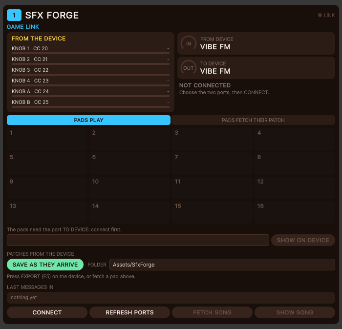

*The window before CONNECT, rendered by its tests from a model in which two ports named VIBE FM exist. It is not a
photograph of the window. What needs the device is dark.*

The window was tested only in that way: shown a model, with a test standing in for the link. Its menus were not
opened, and none of its keys was pressed against a device or the emulator.

### What the device is: the identity

From firmware 1.4.0 on, a game can ask the device what it is before it sends anything. `SfxLink.Open` asks by
itself as soon as an output is open; `RequestIdentity()` asks again. Asking again forgets the earlier answer:
`Device` is `null` until the new one arrives, because another firmware may sit behind the same ports by then.

| Message | Bytes | |
|---|---|---|
| request, game → device | `F0 7D 56 42 07 F7` | `SfxProtocol.BuildRequestIdentity()` |
| identity, device → game | `F0 7D 56 42 08 <18 bytes> F7` | `SfxProtocol.TryParseIdentity(message, out SfxDeviceInfo device)` |

The 18 bytes, each 0 … 127, become an `SfxDeviceInfo`:

| Byte | `SfxDeviceInfo` | Today |
|---|---|---|
| 0 | `hardware`: 0 unknown, 1 VIBE FM. That is the SDK's host – the emulator, the plugin or the hardware; the firmware cannot tell them apart | 1 |
| 1 2 3 | `major`, `minor`, `patch`: the firmware's version. `IsAtLeast(1, 4, 0)` compares | 1 6 0 (over the link it was read from 1.4.0 only: 1 4 0) |
| 4 … 16 | `profile`, an `SfxProfile`: its `id`, the patch format and the song format it speaks, and how much it holds: sounds in a kit, kits, patterns, the most steps a pattern holds, automation lanes, bars in an arrangement, voices, engines, wavetables, values in a patch | 1 · 2, 6 · 16, 2, 8, 64, 24, 32, 16, 5, 6, 25. Firmware 1.4 and 1.5 said song format 5 and 16 steps; the `id` was 1 then too |
| 17 | `flags`: `HasPads`, `HasEncoders` (CC 20 – 25 from its LINK page), `TakesSongSounds` (what `SendSong` sends before the song), `TakesTelemetry` (CC 10 – 17 on channel 2) | all four |

```csharp
SfxLink.Shared.IdentityReceived += said => Debug.Log(said);         // "VIBE FM, firmware 1.6.0, profile 1"
SfxLink.Shared.RequestIdentity();                                   // Open has asked already
// later, any time:
SfxDeviceInfo? device = SfxLink.Shared.Device;                      // null: it has not answered
if (device.HasValue && !device.Value.TakesSongSounds) Debug.Log("this device takes a song, but not its sounds");
```

Three rules hold for every later version:

- **Fields are only added at the end.** This package reads the first 18 bytes and ignores what follows. Fewer than
  18, or a byte above 127: not an identity.
- **No answer has a meaning.** A firmware before 1.4.0 ignores the request. `Device` stays `null`, and after a
  second `IdentityUnanswered` is true. That device is taken for SFX FORGE on VIBE FM with a firmware before 1.4 and
  profile 1 as it was then: song format 5, 16 steps a pattern (`SfxDeviceInfo.AssumedBefore14`, whose profile is
  `SfxProfile.VibeFm15`). Patches, pads, text and telemetry work with it as before. A song goes to it only in
  format 5 ([below](#when-a-song-is-not-sent)). The same is seen when nothing listens on the port at all, or when
  no input is open for the answer to come in on: the link cannot tell these apart.
- **An identity is never anything else.** It is not taken for a patch or for a piece of a song, whatever its
  length, and one that arrives while a song is coming in leaves that transfer alone. The emulator delivers every
  message twice; the second identity says what the first said.

**When the device speaks another patch format.** Once a device has said that its patch format is not this package's
(2), `SendPatch` and `SendSong` send nothing and return `false`, and `LastRefusal` says why
(`SfxLink.Refusal(device, false)` gives the same text for any `SfxDeviceInfo`). The sound's Inspector then shows the
reason under its keys and SEND stays dark. A device that has not answered is refused no patch. Every firmware so
far speaks patch format 2, so this never happens today.

### When a song is not sent

A song is another matter since firmware 1.6.0, because two song formats and two shapes of the song message are in
use. `SfxLink.Refusal(device, packedSong)` says why a song would not be sent to a device, or `null` when nothing
stands against it. `SendSong` asks it first, sends nothing when it answers, returns `false` and keeps the text in
`LastRefusal`. The song's Inspector shows it under its keys
([section 5](#the-song-in-the-inspector)). It asks in this order:

| | The question | The text |
|---|---|---|
| **1** | Are the bytes a packed song this version reads? | "this is not a packed song", or for a newer one "the song is in format 7, this SFX Forge knows up to 6: update the package" |
| **2** | Is every value in it in range (`SfxPackedSong.IsPlayable`)? | "the song holds a value that is out of range (the device would answer BAD SONG): fetch it again from the device" |
| **3** | The device said nothing, and the song is not in format 5? | "the device did not say that it takes song format 6 (firmware 1.6 on says so): connect it, or update its firmware" |
| **4** | Did the device say a patch format other than 2, a song format above 6, or one below 5? | "the device (…) speaks patch format 3, this SFX Forge speaks 2: update the package", and the like |
| **5** | Did the device say song format 5, and the song is in another? | "the device (VIBE FM, firmware 1.5.0, profile 1) speaks song format 5, the song is in format 6: update the device's firmware". For an older song: "… the song is in format 4: fetch the song again from the device" |

What that comes to:

| The device | A format-6 song | A format-5 song | A song in format 1 to 4 |
|---|---|---|---|
| said song format 6 (firmware 1.6.0 on) | sent, in the new message | sent, in the new message | sent, in the new message |
| said song format 5 (firmware 1.4, 1.5) | refused: update the device's firmware | sent, in the message of before | refused: fetch it again |
| said nothing (before 1.4, or nothing answers) | refused: it did not say that it takes it | sent, in the message of before | refused |

> **Why the package refuses in words.** Firmware 1.5.0 and every one before it does not know the new song message
> and drops each piece of it without a word: no toast on the device, no answer on the wire. A SEND that looks as if
> it worked and changes nothing is worse than one that is refused, so the package does not send. This is reasoned
> from the older firmware's code and from what the identity says; no older firmware was run against this package.
>
> **Right after `Open`** the device has not answered yet: `Device` is `null`, and until the identity arrives a
> format-6 song is refused with text 3. Wait for `IdentityReceived` before the first `SendSong`.
>
> **`SfxNative.SongRegrid` and `SongConvert` do not make a song an older device takes.** They return format 6. A
> format-5 song for an older device is one that came from that device, or an asset from before the change.

### Receiving a patch or a song

| On the device | In Unity |
|---|---|
| **F5 EXPORT** on a sound page | `SfxLink.PatchReceived(slot, patch)`. The window, while it is open, saves it as an `SfxPreset` (with SAVE AS THEY ARRIVE on, as it is at first; otherwise SAVE on its tile) |
| **F5 SEND** on the SONG page | 16 patches, then the song in pieces of up to 240 bytes (11 for the factory song): `SfxLink.SongReceived(song, sounds)`. The window saves an `SfxSong`. A firmware up to 1.5.0 sends 39 pieces of 200 bytes, a format-5 song; both are taken |

In your own code:

```csharp
SfxLink.Shared.PatchReceived += (slot, patch) => Debug.Log($"pad {slot + 1}: {patch.engine}");
SfxLink.Shared.SongReceived += (packedSong, sounds) => { /* sounds is null if not all 16 came with it */ };
SfxLink.Shared.RequestPatch(0);        // ask for pad 1
SfxLink.Shared.RequestSong();          // ask for the 16 sounds and the song
```

Events fire from `SfxLink.Poll()`, on the thread that calls it. In the editor `SfxForgeEditorLink` polls every editor
update. In a scene, `SfxForgeLink` polls every frame.

### Sending

| You call on `SfxLink.Shared` | The device |
|---|---|
| `SendPatch(slot, patch)` | loads the patch into that pad and selects it |
| `SendSong(sounds, song.data)` | replaces its song and the 16 sounds of its MUSIC kit, which the song plays. The kit that is shown is left alone. To a device that said song format 6 the song goes in the message of firmware 1.6.0, whatever its format; to any other in the message of before, which carries a format-5 song only ([above](#when-a-song-is-not-sent)). Needs firmware 1.3.1: an older one takes the song and ignores the sounds |
| `PlayPad(slot, velocity)` · `ReleasePad(slot)` | plays a pad |
| `SendText("LEVEL 2")` | shows up to 24 ASCII characters on its top line |
| `SendTelemetry(channel, value01)` | moves the held sound, or the music (below) |
| `SendIntensity(value01)` · `CuePattern(0 … 7)` | the same as the music player's two, on the device |

Every call returns `false` when no output is open. `SendTelemetry` only sends when the 7-bit value changes, so
calling it every frame is fine. `SendPatch` and `SendSong` also return `false`, and send nothing, to a device that
cannot take what is sent; `LastRefusal` says why ([above](#when-a-song-is-not-sent)).

The device answers a song on its display: `SONG LOADED`, `BAD SONG` for one with a value out of range, or
`NEWER SONG: UPDATE` for a format above its own. None of these comes back over MIDI.

### Telemetry: the game drives the device while you listen

Linked, the game plays through the device. You hold a pad there, drive the game, and tune the sound with the knobs
while it follows. `SfxTelemetrySender` sends one value; add one component per value.

| `SfxTelemetry` | CC (channel 2) | 0 … 1 becomes |
|---|---|---|
| `Pitch` | 10 | 0 … +24 semitones |
| `Cutoff` | 11 | −4 … +4 octaves. **0.5 = none** |
| `FmDepth` | 12 | the timbre, 0 … 1 |
| `Level` | 13 | the level, 0 … 1 |
| `Intensity` | 14 | the music's intensity |
| `Pattern` | 15 | pattern A … H from the next bar line |
| `Aux3`, `Aux4` | 16, 17 | shown on the device's LINK page, not mapped |

| `SfxTelemetrySender` field | |
|---|---|
| `channel` | what the value moves |
| `source` | `RigidbodySpeed`, `Rigidbody2DSpeed`, `AnimatorFloat` or `Manual` (it looks for the body or Animator on this object or a parent) |
| `min`, `max` | the source value that becomes 0, and 1 (defaults 0 and 20) |
| `curve` | shapes the 0 … 1 value |
| `value` | for `Manual`: set it from your code |
| `localPlayers`, `musicPlayers` | players in the game that follow the same value – so the game sounds the same without the device |

### Encoders and pads: the device drives the game

On the device's LINK page, encoders 1 – 4, A and B send CC 20 – 25. The pads send notes 36 – 51.

| Component | Use |
|---|---|
| `SfxForgeLink` | put one in the scene. It opens the ports chosen in the window (or named in `inputPort` / `outputPort`), polls, and raises `onPad(pad, velocity)` and `onEncoder(encoder, value01)`. `textOnStart` is shown on the device |
| `SfxEncoderBinding` | one encoder → an exposed AudioMixer parameter (`mixer`, `exposedParameter`) and/or `onValue`. The value runs from `min` to `max` (defaults −80 and 0: a volume in dB). Needs an `SfxForgeLink` in the scene |

The ports chosen in the window are stored in PlayerPrefs. In a built player, name them in `inputPort` and
`outputPort`.

### The song formats the package reads

| Format | Bytes | From |
|---|---|---|
| 6 (current) | 211 to 38 355 | firmware 1.6.0: a grid of 16, 32 or 64 steps for each pattern. Only the rows that are used are kept, so the length varies. The factory song is 2487 bytes |
| 5 | 7699 | 24 automation lanes, an arrangement, the mix |
| 4 | 6643 | one automation lane for each sound |
| 3 | 4546 | before automation and the arrangement |
| 2 | 2498 | before velocity and length |
| 1 | 2455 | before the mixer |

`SfxSong.IsValid` accepts all six and `SfxMusicPlayer` plays them; `SfxSong.PackedFormat` says which one an asset
holds. Formats 1 to 5 have 16 steps in every pattern. Nothing writes them any more: the firmware saves and sends
format 6, and `SfxNative.SongConvert(bytes)` gives any of them as format 6, which plays the same samples.

**Format 6, byte by byte.** Byte 0 is 6. Bytes 1 … 146 are the head, as format 5 has it: the song's own numbers,
the layers, the mix, the lanes and the arrangement (`SfxProtocol.SongHead` is 147). Then a block for each of the
eight patterns: a grid byte (0, 1, 2 for 16, 32, 64 steps), a mask of the sounds that have a row, a mask of the
lanes that have one, and those rows. A sound's row is 51, 101 or 202 bytes; a lane's row is one byte a step. Every
byte is 0 … 127. An empty song is 211 bytes (`SongBytesMin`), the fullest 38 355 (`SongBytesMax`).

**Valid is not playable.** `IsValid` looks at the layout only: the first byte, a length that format can have, and
in format 6 eight blocks that end exactly where the bytes end. `SfxPackedSong.IsPlayable(bytes)` also asks what the
player and the device ask: a bar of 1 … 16 sixteenths, a tempo of 40 … 240, velocities up to 7, lengths below the
grid, no step past the grid, and so on. A song that is valid and not playable was damaged on its way. The device
answers it with BAD SONG, `SfxMusicPlayer` writes "is not a valid song" to the Console and stays silent, and the
Inspector shows it with A DAMAGED SONG under its keys while a device is connected.

**Over MIDI** a song travels in pieces. Firmware 1.6.0 sends and takes
`F0 7D 56 42 05 <piece lo> <piece hi> <format> <pieces lo> <pieces hi> <1 … 240 bytes> F7`: at most 251 bytes a
message and 160 pieces (`SfxProtocol.SongPieceBytes`, `SongPiecesMax`, `BuildSongPieces`). The factory song is 11
pieces; with its 16 sounds a SEND is 27 messages. The message of before, `F0 7D 56 42 05 <piece> 39 <200 bytes> F7`,
carries a format-5 song in 39 pieces (`BuildSong`); firmware 1.6.0 still takes it and no longer sends it.
`SfxSongTransfer` collects either shape: give every message to `Take`, and `Song` has the bytes once they are whole.
`SfxLink` does this for you.

A packed song that begins with a number above 6 and is at least as long as the shortest song there is (211 bytes) was
written by a newer SFX FORGE. It is **newer, not broken**: `SfxSong.IsNewer` is true
(`SfxProtocol.IsNewerSong(bytes)` for any array), `IsValid` is false, it does not play, and its Inspector says
A NEWER SONG instead of NO SONG YET. An `SfxMusicPlayer` given such a song stays silent and writes one warning
to the Console that says why. The same for a patch: `SfxPatch.IsNewer(bytes, offset)` is true when at least 28
bytes follow the offset and the first is above 2, and `TryUnpack` still refuses them, because this version does
not know what they mean. Fewer bytes than a song or a patch has are a cut-off one, whatever they begin with.

**Over the link** a patch or a song in a higher format is not taken: no `PatchReceived`, no `SongReceived`.
`SfxLink.NewerReceived` fires instead, once for what arrives within two seconds, with a text such as "the device
sent a patch in format 3, this SFX Forge knows up to 2: it was not taken. Update the package to use it." The SFX
Forge window writes that text to the Console and into its list of messages.

> **An older package and a song from this one.** A package from before firmware 1.6.0 does not read format 6, and
> it cannot tell that such a song is newer: to it a newer song is one of at least 7699 bytes, and most format-6
> songs are shorter. What it does with an `SfxSong` asset that holds one:
> - Its Inspector shows the banner FROM A NEWER SFX FORGE and the Console warns once, because the asset says asset
>   format 2 ([below](#made-for-more-than-one-device)). That part works.
> - Under the banner it says NO SONG YET, not A NEWER SONG, and an `SfxMusicPlayer` given the asset stays silent
>   without a line of its own in the Console.
> - Over the link it takes none of the new song messages and says nothing: `FETCH SONG` from a firmware 1.6.0 never
>   brings a song.
>
> Nothing can be done about this in a package that is already out. Update the package. This was not run: no older
> package was opened with such an asset; it is read from the older package's code.

### A song without MIDI

The showcase's song was not fetched over MIDI. A script in the source repository (`tests/make-demo-song.mjs`) wrote
what the firmware sends on SEND into a file – 16 patches of 28 bytes, then the song, 2487 bytes of format 6. That file is in the
sample, `Song/DemoSong.bytes`, and the sample's builder (`Editor/ShowcaseAudio.cs`) turns it into the asset
`Song/DemoSong.asset`. This is the path that is proven to work:

```csharp
// in an editor script: a .bytes file (16 x 28 patch bytes, then the packed song) -> an SfxSong asset
byte[] raw = AssetDatabase.LoadAssetAtPath<TextAsset>("Assets/MySong.bytes").bytes;
var sounds = new SfxPatch[SfxProtocol.Slots];
for (int i = 0; i < sounds.Length; i++) SfxPatch.TryUnpack(raw, i * SfxPatch.Bytes, out sounds[i]);
var packed = new byte[raw.Length - sounds.Length * SfxPatch.Bytes];      // the rest of the file: a song has no fixed size
System.Array.Copy(raw, sounds.Length * SfxPatch.Bytes, packed, 0, packed.Length);
var song = ScriptableObject.CreateInstance<SfxSong>();
song.Set(sounds, packed);
AssetDatabase.CreateAsset(song, "Assets/MySong.asset");
```

`SfxProtocol.SongBytes` (7699) is still there for code written before, marked obsolete: a song has no fixed size
from format 6 on. Use the file's own length as above, or `SongBytesV5`, `SongBytesMin` and `SongBytesMax`.

The Inspector of an `SfxSong` shows the whole song ([section 5](#the-song-in-the-inspector)). An `SfxSong` made with
**Assets > Create > SFX Forge > Song** is empty until a song is put into it; its Inspector then says NO SONG YET.

### Made for more than one device

Today there is one device: SFX FORGE 1.x on VIBE FM. With firmware 1.6.0 the Unity side and the device hold exactly
the same things, and every sound and song made on one works on the other. A firmware up to 1.5.0 already holds
less: no finer grid and no format-6 song. It will go further. The Unity side can grow past what
a device holds, and a firmware for other hardware may hold less. Version 1.0 does not do either. It reserves what
both need, so that a project made with 1.0 does not break when they come.

**What exists now:**

| | |
|---|---|
| **The identity** | a device says what it is and what it holds ([above](#what-the-device-is-the-identity)). `SfxLink.Device` has it; the window shows it |
| **Format numbers on the wire** | a patch and a packed song begin with their format (2 and 6). A higher number is reported as newer, not as broken: `SfxPatch.IsNewer`, `SfxSong.IsNewer`, and `SfxLink.NewerReceived` for one that arrives over the link |
| **A format number in the assets** | `SfxPreset` and `SfxSong` keep a serialized `format`, read as `Format`. An asset file without the line – every asset made before the number was kept – is format 1. A file with a number above the type's `CurrentFormat` was made by a newer SFX Forge: `IsFromNewerVersion` is true, its Inspector shows a banner, and the Console warns once for that asset: in the editor once a session for each asset file, in a built game once for each type and name. What this version reads of it plays. Both also keep `savedBy`, the asset format that wrote the file last; this version always writes its own `CurrentFormat` there |
| **A song asset counts its own format** | `SfxPreset.CurrentFormat` is 1. `SfxSong.CurrentFormat` is 2 since firmware 1.6.0, and the number follows the packed song: an asset that holds a format-6 song says `format: 2`, one that holds an older song still says 1. `Set` writes it, and so does saving. That is how an older package knows a format-6 song asset at all ([above](#the-song-formats-the-package-reads)) |
| **The profile type** | `SfxProfile` is a description of limits: the numbers of the identity. `SfxProfile.VibeFm1` is what firmware 1.6.0 offers, built from this package's own constants: song format 6, 64 steps a pattern. `SfxProfile.VibeFm15` is what firmware 1.4 and 1.5 said of themselves: song format 5, 16 steps. Both have `id` 1. `Fits(SfxPatch)` and `Fits(byte[] packedSong)` say whether a sound or a packed song is within a profile's limits |

**Saving a newer asset here loses data.** Unity writes only the fields this version's classes have. If you change
and save an asset that a newer SFX Forge made, what the newer version kept in it and this one does not know is
gone from the file. The `format` number in the file stays as it was, and `savedBy` becomes this version's number
(1 for a sound, 2 for a song): a newer SFX Forge that finds its own format with a lower `savedBy` can tell that the
file went through this version and was cut down.
Nothing in this version reads `savedBy`. The banner says that saving loses data; nothing stops you.

**What does not exist:**

- **No target switch.** There is nothing to set that says "this project is for device X". A profile cannot be
  chosen anywhere, and nothing is checked against one when you edit, bake or play.
- **No Unity-only features.** Everything the package plays, the device with firmware 1.6.0 plays. No sound or song
  of this version can fail to fit `SfxProfile.VibeFm1`: `Fits` only says false for bytes that are not of this
  version or out of range. `VibeFm15` is the first profile that holds less: `VibeFm15.Fits(song)` is false for a
  format-6 song, and so for every pattern of 32 or 64 steps. `Fits` checks limits only. It does not say what a
  device is sent (`SfxLink.Refusal`), nor whether the values inside are in range (`SfxPackedSong.IsPlayable`).
- **No second device.** No firmware for other hardware exists, and no other profile `id` than 1. The identity's
  `hardware` byte has only ever been 1.
- **Nothing converts downwards.** An older song becomes format 6 (`SfxNative.SongConvert`), and a pattern can be
  put into another grid (`SfxNative.SongRegrid`, with `SongRegridLoss` saying what a coarser grid would drop).
  Nothing turns a format-6 song into format 5 for an older device. A newer patch, song or asset is recognised and
  named, not read: to use it, update the package.

---

## 7. The showcase, a worked example

*Brio: First Harmonic* is an original one-level 2D momentum platformer, the package's sample (`Samples~/Showcase`). Every sound in
it is SFX FORGE at runtime: 19 sound effects written as patches in code, and the demo song with its layers following
the player's speed. There is no audio file in the folder.


*Four moments of the level.*

Import the sample from the Package Manager (SFX Forge > Samples), open `Showcase.unity` in the imported folder, press
Play. The keys, the checks and the whole folder map are in [the showcase's README](../Samples~/Showcase/README.md).

### What uses which route


Two frames of a recorded run. The marks are coloured by route. The line under each frame gives the game's values at
that moment.

| | What you see | What you hear | Route |
|---|---|---|---|
| **1** | Brio, rolling | RollHum: its pitch, filter and level follow the speed | held and bent |
| **2** | the trail: Brio is fast | Wind: it comes in above 60 % of top speed | held and bent |
| **3** | the thin outline a collected Chime leaves | Chime: one step up the scale for each Chime of a combo | live voice |
| **4** | the next Chimes | the next steps of that scale | live voice |
| **5** | the speed meter | the music's intensity rises with it, from the section's floor: the faster, the more of the band | music |
| **6** | the section's name | entering the section set the floor under the intensity. The song plays on in its own order; the pattern of the moment is in the line under the frame | music |
| **7** | a Tuning Fork, just passed | TuningFork | baked clip |
| **8** | the same Tuning Fork | the song's bells answer it, played by hand with `PlaySound` | music |
| **9** | a Woofer | Woofer, when Brio lands on it | baked clip |
| **10** | Brio, rolling slower | the same RollHum, lower and quieter | held and bent |

Not in these two frames: the jump, the landing and the footsteps. They are baked clips too.

| Route | Sounds |
|---|---|
| **Baked** (14) | Jump, Land, FootstepLeft, FootstepRight, TuckStart, Burst, Woofer, Hurt, ClipperPop, TuningFork, Goal, Skid, Respawn, UiConfirm |
| **Live voice** (2; `SoundRoute.LiveOneShot` in the code) | Chime, ChimeScatter |
| **Held and bent** (3) | RollHum, Wind, WindUpRev |
| **Music** | the demo song on one `SfxMusicPlayer`, driven by `MusicDirector` |

### The event seam

> **Audio only listens to events and reads player state. Gameplay never calls SFX FORGE.**

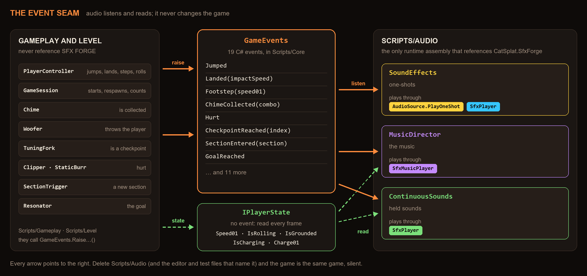

*Gameplay raises events and shows its state. The three audio scripts listen and read. Nothing points back.*

`Scripts/Core/GameEvents.cs` is a static class of 19 C# events with a `Raise…` method each: `Jumped`,
`Landed(impactSpeed)`, `ChimeCollected(combo)`, `SectionEntered(section)` … Gameplay and level code raise them. The
audio subscribes in `OnEnable` and unsubscribes in `OnDisable`.

Things that sound continuously have no event. The audio reads the player's state every frame instead: `Speed01`,
`IsRolling`, `IsGrounded`, `IsCharging`, `Charge01`.

`Scripts/Audio` is the only runtime assembly that references `CatSplat.SfxForge`. Outside it, the sound is named
only in editor and test code: `Editor/ShowcaseAudio.cs`, the two lines of `Editor/ShowcaseBuilder.cs` that call it
(`ShowcaseAudio.Install` and `ShowcaseAudio.Check`), and five files in `Tests` (`ShowcaseAudioTests.cs`;
`CaptureTakes.cs` and `CaptureTelemetry.cs` of the capture rig; `LinkTakes.cs` and `LinkSession.cs` of the link
takes). The assembly definitions of `Editor` and `Tests` reference `CatSplat.SfxForge` as well. Delete the folder,
those six files, those two lines and the two references, and the game is the same game, silent. (That is true by
construction. It has not been tried by deleting them.)

### The sound table: SoundLibrary

`Scripts/Audio/SoundLibrary.cs` is the whole sound set on one screen. Each effect is one patch, written with named
values through a small wrapper around `SfxPatch.Create`:

```csharp
public static readonly SfxPatch Jump = Make(SfxEngine.UiBlip,
    pitchEnv: 44, pitchEnvTime: 40, engineA: 0, engineB: 0, cutoff: 104, resonance: 10, decay: 30, level: 90);
```

and one table at the end gives each sound its route, the MIDI note it is tuned to, and its volume:

| Sound | Route | Note | Volume | Varies with the game |
|---|---|---|---|---|
| Jump | Baked | E5 | 0.70 | |
| Land | Baked | – | 0.80 | silent below 4 m/s; louder up to 25 m/s |
| FootstepLeft / Right | Baked | – | 0.35 | alternate; the source's pitch 1.0 … 1.3 with speed |
| TuckStart | Baked | B4 | 0.45 | |
| RollHum | Held | E2 | 0.27 | pitch 0 … +12, cutoff −1 … +1.5 octaves, level 0.35 … 1 with speed |
| WindUpRev | Held | E3 | 0.35 | retriggered on each tap; pitch 0 … +12, `fm` 0 … 0.6, cutoff 0 … +1 with charge |
| Burst | Baked | – | 0.60 | volume 50 … 100 % with charge |
| Chime | Live | E5 | 0.55 | one step up E minor pentatonic for each Chime of a combo, up to 10 steps |
| ChimeScatter | Live | E5 | 0.50 | a run of 5 … 8 pings, 55 ms apart, falling and fading |
| Woofer | Baked | E3 | 0.80 | |
| Hurt | Baked | D3 | 0.80 | |
| ClipperPop | Baked | B4 | 0.75 | |
| TuningFork | Baked | E5 | 0.70 | |
| Goal | Baked | E4 | 0.80 | |
| Wind | Held | – | 0.30 | from 60 % of top speed: level 0 … 1, band −1.5 … +1.5 octaves |
| Skid | Baked | – | 0.60 | |
| Respawn | Baked | E4 | 0.70 | |
| UiConfirm | Baked | B5 | 0.70 | |

The song is in E minor. Every pitched effect is played as a note of E minor pentatonic, so the effects sound like
part of the band. Noise (footsteps, wind, the Burst) has no note.

The volumes, and the music's volume of 0.36 (`MusicDirector.musicVolume`), were set by measurement: recorded takes
of the game must peak under 0.95 of full scale ([section 9](#the-mix-is-measured-not-heard)). Before that the
loudest moments went over full scale: rows of Chimes and the Land thump on top of the band, and a full-charge Burst
with the tuck, the rev, the hum and the wind at once. Nobody has listened to the result. The numbers say that the
mix does not clip in the takes. They do not say that it is balanced.

### The three routes, file by file

| File | Route | Read it for |
|---|---|---|
| `SoundEffects.cs` | baked clips and live voices | `BakeClips` (every baked sound rendered once in `Awake`), `PlayBaked`, `OnChimeCollected` |
| `LiveVoicePool.cs` | live voices | three `SfxPlayer`s shared by the Chime and the scatter |
| `ContinuousSounds.cs` | held and bent | `UpdateRollHum`, `UpdateWind`, `OnWindUpCharged` |
| `HeldSound.cs` | held and bent | hold / let go / retrigger, in ten lines |
| `MusicDirector.cs` | music | everything below |

### The MusicDirector

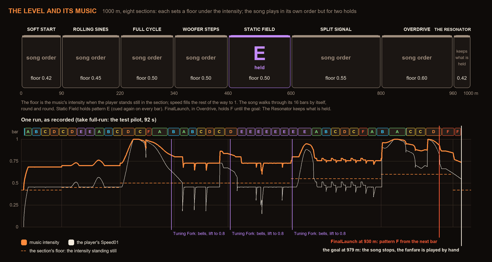

*Above: the level to scale, with the floor each section puts under the intensity and the pattern it holds, if any.
Below: one run as recorded, against the distance. Each section's floor (dashed) is the intensity when the player
stands still; the intensity (orange) rises from it towards 1 with the player's speed (white), smoothed.*

| The game | The music | The call |
|---|---|---|
| all the time | the demo song in its own order: 16 bars, A B A B C D C D E E A B C D C F, round and round | none: the player walks the song's arrangement |
| every frame | intensity towards `Mathf.Lerp(floor, 1, Speed01)`: the section's floor standing still, 1 at top speed (22 m/s), a straight line between; up in 0.6 s, down in 2.5 s | `intensity` |
| on the title card | intensity fixed at 0.42: kick, hi-hat, FM bass, snare. The whole arrangement plays | |
| `SectionEntered` | the section's floor. In Static Field also pattern E from the next bar line, held there. A section without a pattern ends a hold | `CuePattern`, again whenever `Bar` changes |
| `FinalLaunch` | the song's turnaround, pattern F, held until the goal | `CuePattern(5)`, again whenever `Bar` changes |
| `Respawned` | as on entering that section, and the intensity starts from its floor | |
| `Hurt` | intensity to 0 at once; volume to 50 % over 50 ms; both back over 2 s | `intensity`, `volume` |
| `CheckpointReached` | bells play E5, B5, E6 a sixteenth apart, starting on the song's next sixteenth; intensity at least 0.8 for a bar, which is above every layer mark of the song | `PlaySound(13, velocity, note)` |
| `GoalReached` | the song stops. Strings hold E3, brass plays E4 G4 B4 E5, bells and timpani on the last note, in a bigger room | `Stop`, `SetTrackVolume`, `SetMaster(SfxMaster.ReverbSize, 110)`, `PlaySound`, `ReleaseSound` |
| `GameStarted` after a goal | the fanfare is cut, the song's own mix comes back, the song starts at pattern A | `Reload`, `Play` |

| Section | From – to | Holds | Intensity floor | The floor lets through |
|---|---|---|---|---|
| Soft Start | 0 – 90 m | – | 0.42 | kick, hi-hat, FM bass, snare |
| Rolling Sines | 90 – 220 m | – | 0.45 | the same |
| Full Cycle | 220 – 340 m | – | 0.50 | and strings, choir |
| Woofer Steps | 340 – 460 m | – | 0.50 | the same |
| Static Field | 460 – 600 m | E, the breakdown | 0.50 | the same. E is the one pattern with notes for the choir |
| Split Signal | 600 – 800 m | – | 0.55 | the same |
| Overdrive | 800 – 960 m | – (F from the last launch) | 0.60 | and FM keys |
| The Resonator | 960 – 1000 m | what is held: F | 0.42 | kick, hi-hat, FM bass, snare |

"–" is `SectionCue.SongOrder`: the song plays in its own order. The Resonator's cue is `SectionCue.KeepPattern`. The
last column is what plays while the player stands still, where the pattern of the moment has notes for it. Moving
adds the rest: with the floor at 0.42, the FM keys come in at about 25 % of top speed, brass at 50 %, bells at 63 %; with
the floor at 0.60, brass at about 27 % and bells at 47 %. Flat running tops out at 10 m/s, 45 % of top speed.

The music's volume is 0.36 (`musicVolume`), halved for a moment after a hit.

### Copy this into your game


*What to take from the showcase, and where it goes in your game.*

| | Do this | Read |
|---|---|---|
| **0** | Add the package to your project. Reference `CatSplat.SfxForge` from the assembly your audio code lives in | `Scripts/Audio/SfxShowcase.Audio.asmdef` |
| **1** | Give your game a seam: a static class of events. Gameplay raises, audio listens. Continuous things are read, not raised | `Scripts/Core/GameEvents.cs` |
| **2** | Write your sounds as patches, in one file, with a table of route, note and volume | `SoundLibrary.cs` |
| **3** | One-shots: bake what is always the same; play live what the game decides | `SoundEffects.cs`, `LiveVoicePool.cs` |
| **4** | Held sounds: one `SfxPlayer` each, started with its note, bent every frame, released | `ContinuousSounds.cs`, `HeldSound.cs` |
| **5** | Music: one `SfxMusicPlayer` with a song, and a script that sets `intensity` from a floor and the game's speed, holds a pattern where the level wants one, and plays notes by hand | `MusicDirector.cs`, and [a first song](#a-first-song) |
| **6** | Put it in the scene: follow the installer top to bottom, in code or by hand in the Inspector | `AudioInstaller.cs` |
| **7** | Or take the folder: copy `Scripts/Audio` (17 scripts and its `.asmdef`), ten files of `Scripts/Core`, and the song `Song/DemoSong.asset` | below |

**The scene objects**, as `AudioInstaller.Install(player, session, song, presetFactory)` builds them. `player` is a
`PlayerBase` and `session` a `GameSessionBase`: `Install` throws without either. `song` is the `SfxSong`; without one
there is no music. `presetFactory` may be null.

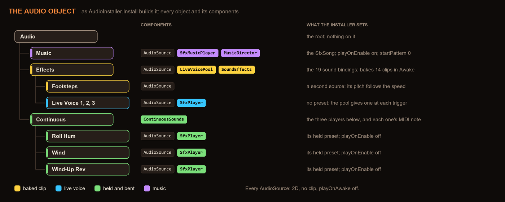

*The Audio object, with the components on each child. The table says the same in words.*

| Object | Components | Set |
|---|---|---|
| `Audio/Music` | `AudioSource`, `SfxMusicPlayer`, `MusicDirector` | the `SfxSong`; `playOnEnable` on; `startPattern` 0 |
| `Audio/Effects` | `AudioSource`, `LiveVoicePool`, `SoundEffects` | the 19 sound bindings |
| `Audio/Effects/Footsteps` | `AudioSource` | nothing: a second source, because its pitch follows speed |
| `Audio/Effects/Live Voice 1 … 3` | `AudioSource`, `SfxPlayer` | no preset (the pool assigns one per trigger); `volume` 0.8 |
| `Audio/Continuous` | `ContinuousSounds` | the three players below, and the MIDI note of each |
| `Audio/Continuous/Roll Hum`, `Wind`, `Wind-Up Rev` | `AudioSource`, `SfxPlayer` | the held sound's preset; `playOnEnable` off |

Every `AudioSource` is 2D, has no clip and has `playOnAwake` off.

**Taking the folder.** From `Scripts/Core` the audio needs exactly these ten files: `GameEvents`, `PlayerBase` with
`IPlayerState`, `IPlayerActor`, `IPlayerInput` and `TerrainPlane`, `GameSessionBase` with `IGameSession`, `GamePhase`
and `SectionId`. The audio's `.asmdef` references the assembly `SfxShowcase.Core` by name: point it at the assembly
you copied them into. Then raise the events from your game. Or replace the subscriptions in each `OnEnable` with your
own events, and the reads of speed, rolling, grounded and charge with your own values, and take nothing from Core.

**The song belongs to the folder.** `MusicKit.cs` names the demo song's instruments by index (bells 13, brass 5,
strings 15, timpani 0). `MusicDirector` names its patterns E and F for the two holds, and its section floors are
placed between the song's layer marks. Copy the showcase's `Song/DemoSong.asset` with its `.meta` and pass it
to `Install`. With a song of your own, change `MusicKit.cs`, the section cues (floors and holds),
`finalLaunchPattern` and the two phrases (`checkpointAnswer`, `fanfare`) to fit it. The volumes were measured with
this song and these effects: measure again.

---

## 8. Recipes

Each is a complete script. They use only the package. The patches are taken from the demo and the showcase; change
the numbers to taste. Every script here, and every code fragment in this manual, was compiled against the package:
the older ones in the demo project, those that use `loopPattern` or the tools of section 11 in the inspectors' test
project. None was played or listened to.

### 1. Footsteps that are never the same

A variation set ([section 11](#variation-sets)): six variants of one footstep, played in a shuffled order that never
takes one of the last two again, each play up to 50 cents higher or lower and up to 2 dB quieter. The clips are
baked, so it also works in 3D and on every platform.

| | Do this |
|---|---|
| **1** | Make the footstep as an `SfxPreset`: **Assets > Create > SFX Forge > Preset**, then shape it, or start from **TOOLS > NEW > THUD**. From an editor script: `SfxForgeEditorLink.CreatePreset(SfxPatch.Create(SfxEngine.Foley, 30, 80, 18, 90, 30, 127, 68, 15, 22), "Assets/Audio", "Footstep")` |
| **2** | In its Inspector: **TOOLS > VARY > MAKE SET**. A variation set appears next to the preset |
| **3** | In the set's Inspector, listen with **PLAY NEXT**, then press **BAKE** |
| **4** | On the character: add **SFX Variation Player** (it adds the `AudioSource`), and drag the set onto its **Set** field |
| **5** | Call `PlayNext()` from an animation event, or `Play()` from code |

Without a script of your own that is all. With the loudness following the speed:

```csharp
using CatSplat.SfxForge;
using UnityEngine;

[RequireComponent(typeof(SfxVariationPlayer))]
public class Footsteps : MonoBehaviour
{
    SfxVariationPlayer steps;                    // its Set field holds the variation set

    void Awake() => steps = GetComponent<SfxVariationPlayer>();

    /// <summary>Call it from your animation or movement code. speed01: 0 walking … 1 flat out.</summary>
    public void Step(float speed01) => steps.Play(Mathf.Lerp(0.2f, 0.35f, speed01));
}
```

The player sets its `AudioSource`'s pitch on every play. To move the pitch with the speed as well, take the next
variant yourself and play it on an `AudioSource` of your own:

```csharp
using CatSplat.SfxForge;
using UnityEngine;

[RequireComponent(typeof(AudioSource))]
public class FootstepsWithPitch : MonoBehaviour
{
    public SfxVariationSet set;
    AudioSource source;
    SfxShuffle order;

    void Awake()
    {
        source = GetComponent<AudioSource>();
        if (set != null) { set.Prepare(); order = set.NewOrder(); }      // Prepare: only an unbaked set has anything to make
    }

    public void Step(float speed01)
    {
        if (order == null) return;
        AudioClip clip = set.Next(order, out float pitch, out float volume);
        if (clip == null) return;                                        // not baked, and no native library here
        source.pitch = pitch * Mathf.Lerp(1f, 1.3f, speed01);
        source.PlayOneShot(clip, volume * 0.35f);
    }
}
```

The five steps were not gone through by hand in the editor: the tests call what the keys call
([section 11](#variation-sets) says what was tried).

### 2. A pickup that rises with the combo

Live, because each one has its own pitch. One step up a minor pentatonic scale for each pickup of a combo.

```csharp
using CatSplat.SfxForge;
using UnityEngine;

[RequireComponent(typeof(SfxPlayer))]
public class ComboPickupSound : MonoBehaviour
{
    public float comboWindow = 1.2f;         // seconds between two pickups of one combo
    public int rootNote = 76;                // E5
    static readonly int[] Scale = { 0, 3, 5, 7, 10 };
    readonly SfxPatch coin = SfxPatch.Create(SfxEngine.UiBlip, 86, 64, 0, 37, 70, 0, 127, 0, 45);
    SfxPlayer player;
    int combo;
    float lastTime = float.NegativeInfinity;

    void Awake() => player = GetComponent<SfxPlayer>();

    public void Collected()
    {
        combo = Time.time - lastTime < comboWindow ? Mathf.Min(combo + 1, 10) : 0;
        lastTime = Time.time;
        int semitones = combo / Scale.Length * 12 + Scale[combo % Scale.Length];
        player.Play(coin, 1f, semitones, rootNote);
    }
}
```

### 3. An engine hum that follows speed

Held and bent. The speed is measured from the object's own movement, so it needs no Rigidbody.

```csharp
using CatSplat.SfxForge;
using UnityEngine;

[RequireComponent(typeof(SfxPlayer))]
public class EngineHum : MonoBehaviour
{
    public float topSpeed = 20f;
    readonly SfxPatch hum = SfxPatch.Create(SfxEngine.SciFiFm, 22, 64, 0, 21, 55, 8, 78, 45, 60, 0, 60, 127, 60);
    SfxPlayer player;
    Vector3 lastPosition;

    void Start()
    {
        player = GetComponent<SfxPlayer>();
        lastPosition = transform.position;
        player.Play(hum, 1f, 0f, 40);            // held (sustain 127), as the note E2
    }

    void Update()
    {
        if (Time.deltaTime <= 0f) return;
        float speed = (transform.position - lastPosition).magnitude / Time.deltaTime;
        lastPosition = transform.position;
        float speed01 = Mathf.Clamp01(speed / topSpeed);
        player.pitchSemitones = speed01 * 12f;
        player.cutoffOctaves = Mathf.Lerp(-1f, 1.5f, speed01);
        player.fm = speed01 * 0.5f;
        player.level = Mathf.Lerp(0.35f, 1f, speed01);
    }

    void OnDisable()
    {
        if (player != null) player.Release();
    }
}
```

### 4. The same without code: SfxTelemetrySender

This is how the demo's hovercraft is wired. In the Inspector it is the same list: one `SfxPlayer` with a held preset
and `playOnEnable`, and one `SfxTelemetrySender` for each value. If a device is linked, it follows too.

```csharp
using CatSplat.SfxForge;
using UnityEngine;

[RequireComponent(typeof(Rigidbody))]
public class EngineHumWiring : MonoBehaviour
{
    public SfxPreset humPreset;              // a held preset: sustain above 0

    void Awake()
    {
        var player = gameObject.AddComponent<SfxPlayer>();
        player.preset = humPreset;
        player.volume = 0.5f;
        player.Play();

        var pitch = gameObject.AddComponent<SfxTelemetrySender>();
        pitch.channel = SfxTelemetry.Pitch;                               // 0 … 1 becomes 0 … +24 semitones
        pitch.source = SfxTelemetrySender.Source.RigidbodySpeed;
        pitch.max = 40f;                                                  // 20 m/s is one octave up
        pitch.localPlayers = new[] { player };

        var timbre = gameObject.AddComponent<SfxTelemetrySender>();
        timbre.channel = SfxTelemetry.FmDepth;
        timbre.source = SfxTelemetrySender.Source.RigidbodySpeed;
        timbre.max = 45f;
        timbre.localPlayers = new[] { player };
    }
}
```

### 5. UI clicks, baked at load

```csharp
using System.Collections.Generic;
using CatSplat.SfxForge;
using UnityEngine;

[RequireComponent(typeof(AudioSource))]
public class UiSounds : MonoBehaviour
{
    public enum Ui { Move, Confirm, Back, Error }

    readonly Dictionary<Ui, AudioClip> clips = new Dictionary<Ui, AudioClip>();
    AudioSource source;

    void Awake()
    {
        source = GetComponent<AudioSource>();
        SfxPatch blip = SfxPatch.Create(SfxEngine.UiBlip, 60, 64, 40, 0, 0, 0, 120, 0, 35);
        SfxPatch error = SfxPatch.Create(SfxEngine.UiBlip, 60, 84, 55, 0, 0, 0, 85, 25, 50, 60);
        Bake(Ui.Move, blip, 71);             // B4
        Bake(Ui.Confirm, blip, 83);          // B5
        Bake(Ui.Back, blip, 64);             // E4
        Bake(Ui.Error, error, 50);           // D3
    }

    void Bake(Ui sound, SfxPatch patch, int midiNote)
    {
        int rate = AudioSettings.outputSampleRate;
        float[] samples = SfxNative.BakeInterleaved(patch, rate, 1f, midiNote);
        if (samples == null || samples.Length == 0) return;
        var clip = AudioClip.Create(sound.ToString(), samples.Length / 2, 2, rate, false);
        clip.SetData(samples, 0);
        clips[sound] = clip;
    }

    public void Play(Ui sound)
    {
        if (clips.TryGetValue(sound, out AudioClip clip)) source.PlayOneShot(clip, 0.7f);
    }
}
```

### 6. Music that follows danger

Fast in, slow out, so the band arrives with the danger and lingers after it.

```csharp
using CatSplat.SfxForge;
using UnityEngine;

public class DangerMusic : MonoBehaviour
{
    public SfxMusicPlayer music;                 // one that has a song, for example DemoSong.asset (section 5, "A first song")
    [Range(0f, 1f)] public float danger;         // set it from your game: 0 calm … 1 the enemy is on you
    public float floor = 0.15f;                  // the least the band ever plays
    public float riseSeconds = 0.6f, fallSeconds = 2.5f;
    float intensity;

    void Update()
    {
        float target = Mathf.Max(floor, danger);
        float seconds = target > intensity ? riseSeconds : fallSeconds;
        intensity = Mathf.MoveTowards(intensity, target, Time.deltaTime / seconds);
        music.intensity = intensity;
    }
}
```

### 7. A stinger on the bar line

`PlaySound` is not quantised. Wait for the song to reach its next bar, then play. The indices are the demo song's:
13 is its bells.

```csharp
using System.Collections;
using CatSplat.SfxForge;
using UnityEngine;

public class Stinger : MonoBehaviour
{
    public SfxMusicPlayer music;                 // one that has a song, for example DemoSong.asset (section 5, "A first song")
    public int instrument = 13;                  // 0 … 15: the song's sound, pad number minus one
    public int[] notes = { 76, 83, 88 };         // E5 B5 E6

    public void Play() => StartCoroutine(OnTheNextBar());

    IEnumerator OnTheNextBar()
    {
        int bar = music.Bar;
        float giveUp = Time.time + 4f;
        while (music.IsPlaying && music.Bar == bar && Time.time < giveUp) yield return null;

        float sixteenth = 60f / (music.song != null && music.song.Bpm > 0 ? music.song.Bpm : 120) / 4f;
        foreach (int note in notes)
        {
            music.PlaySound(instrument, 0.9f, note);
            yield return new WaitForSeconds(sixteenth);
        }
    }
}
```

For a held instrument (brass, strings) call `music.ReleaseSound(instrument, note)` after the note's length.

### 8. A pattern per area, held

Switch `loopPattern` on and cue the area's pattern: it stays whatever the song's arrangement does
([section 5](#holding-a-pattern-looppattern)). `loopPattern` is run by one Play mode test, headless and muted;
this script itself was compiled, not run. The same section has the older way, which the showcase uses.

```csharp
using CatSplat.SfxForge;
using UnityEngine;

public class AreaMusic : MonoBehaviour
{
    public SfxMusicPlayer music;                 // one that has a song, for example DemoSong.asset (section 5, "A first song")

    /// <summary>0 = A … 7 = H, from the next bar line, and it stays. -1: let the song run by itself again.</summary>
    public void EnterArea(int pattern)
    {
        music.loopPattern = pattern >= 0;
        if (pattern >= 0) music.CuePattern(pattern);
    }
}
```

### 9. Ducking the music

`SfxMusicPlayer.volume` is applied as it is, without a ramp. Move it over a few frames.

```csharp
using CatSplat.SfxForge;
using UnityEngine;

public class MusicDuck : MonoBehaviour
{
    public SfxMusicPlayer music;                 // one that has a song, for example DemoSong.asset (section 5, "A first song")
    public float normalVolume = 0.6f;
    [Range(0f, 1f)] public float duckedPart = 0.5f;      // the volume while ducked, as a part of normal
    public float dipSeconds = 0.05f, recoverSeconds = 2f;
    float duck, target;                                  // 0 = normal … 1 = fully ducked

    /// <summary>A hit, a line of dialogue: the music steps back and comes forward again by itself.</summary>
    public void Duck() => target = 1f;

    void Update()
    {
        duck = Mathf.MoveTowards(duck, target, Time.deltaTime / (target > duck ? dipSeconds : recoverSeconds));
        if (duck >= target) target = 0f;
        music.volume = normalVolume * Mathf.Lerp(1f, duckedPart, duck);
    }
}
```

### 10. A boss theme

On the device, write the theme in pattern H and leave H out of the arrangement. A pattern outside the arrangement
stays until the next cue, so two calls are enough, without `loopPattern`. (The demo song's patterns G and H are empty: with it, this recipe
cues silence. It needs a song with a theme in H.)

```csharp
using CatSplat.SfxForge;
using UnityEngine;

public class BossMusic : MonoBehaviour
{
    public SfxMusicPlayer music;                 // one that has a song, for example DemoSong.asset (section 5, "A first song")

    public void BossAppears()
    {
        music.CuePattern(7);                             // H, from the next bar line
        music.SetMaster(SfxMaster.Drive, 60);            // and a rougher mix
    }

    public void BossDefeated()
    {
        music.CuePattern(0);                             // back to A; the arrangement walks on from there
        music.Reload();                                  // the song's own mix again
    }
}
```

### 11. A 3D one-shot

A player is not spatialized. A baked clip is an ordinary clip: play it anywhere.

```csharp
using CatSplat.SfxForge;
using UnityEngine;

public class ImpactSound : MonoBehaviour
{
    public SfxPreset preset;
    AudioClip clip;

    void Awake() => clip = preset != null ? preset.Bake(AudioSettings.outputSampleRate) : null;

    void OnCollisionEnter(Collision collision)
    {
        float hit = collision.relativeVelocity.magnitude;
        if (clip == null || hit < 1.5f) return;
        AudioSource.PlayClipAtPoint(clip, collision.GetContact(0).point, Mathf.Clamp01(hit / 18f));
    }
}
```

### 12. Exporting a WAV in the editor

Put this in an `Editor` folder. Select one or more presets, then **Assets > SFX Forge > Export Selected Presets as
WAV**. The **BAKE WAV** key of a preset's Inspector does the same for the presets selected, and
[the Bake window](#the-bake-window) does it with options: the note, the rate, mono, trim, normalise. This recipe is
for a rule of your own.

```csharp
using CatSplat.SfxForge;
using UnityEditor;
using UnityEngine;

public static class ExportPresetWavs
{
    const int SampleRate = 48000;
    const int MidiNote = 0;                  // 0: as designed. 69: as the note A 440 Hz

    [MenuItem("Assets/SFX Forge/Export Selected Presets as WAV")]
    static void Export()
    {
        foreach (Object selected in Selection.objects)
        {
            var preset = selected as SfxPreset;
            if (preset == null) continue;
            float[] samples = SfxNative.BakeInterleaved(preset.patch, SampleRate, 1f, MidiNote, 0f, preset.holdSeconds);
            if (samples == null || samples.Length == 0) { Debug.LogWarning("SFX Forge: nothing to bake for " + preset.name); continue; }
            string path = System.IO.Path.ChangeExtension(AssetDatabase.GetAssetPath(preset), ".wav");
            SfxWav.Write(path, samples, SampleRate, 2);
            AssetDatabase.ImportAsset(path);
        }
    }
}
```

### 13. A knob on the device tunes a game value

For tuning sessions. It needs an `SfxForgeLink` in the scene and a connected device. Receiving from a device has not
been tested on hardware ([section 6](#6-from-the-device-to-the-game)).

```csharp
using CatSplat.SfxForge;
using UnityEngine;

public class TuneFromDevice : MonoBehaviour
{
    public SfxPlayer engine;
    public float minTopPitch = 4f, maxTopPitch = 24f;
    public float topPitch = 12f;                         // read this where you set engine.pitchSemitones

    void OnEnable()
    {
        SfxLink.Shared.EncoderChanged += OnEncoder;
        SfxLink.Shared.PadDown += OnPad;
    }

    void OnDisable()
    {
        SfxLink.Shared.EncoderChanged -= OnEncoder;
        SfxLink.Shared.PadDown -= OnPad;
    }

    void OnEncoder(int encoder, float value01)           // 0 … 5: encoders 1 – 4, then A, B
    {
        if (encoder != 0) return;
        topPitch = Mathf.Lerp(minTopPitch, maxTopPitch, value01);
        SfxLink.Shared.SendText("TOP PITCH " + topPitch.ToString("0"));
    }

    void OnPad(int pad, float velocity)                  // 0 … 15
    {
        if (pad == 0 && engine != null) engine.Play(velocity);
    }
}
```

---

## 9. Testing, limits, troubleshooting

### Testing sound without ears

Sound can be asserted. The demo's and the showcase's Play mode tests do it in these ways. The demo project has 41
of them: run headless on a copy of the project, 26 passed and 15 were skipped, which are the takes that need a
device or the emulator or that record, and only run when asked for by name.

| What to check | How | Where |
|---|---|---|
| a patch makes sound at all | bake it and look for a sample above a threshold | `ShowcaseAudio.Check` → `IsAudible` (peak above 0.01) |
| a player started, and stopped | poll `SfxPlayer.IsPlaying` | `SfxDemoTests.FiringPlaysTheLaserAndSpawnsABolt` (the older demo, in the source repository) |
| a baked clip really comes out | `AudioSource.GetOutputData`, largest sample | `ShowcaseAudioTests.AJumpIsHeardThroughSfxForge` |
| the game bends a held sound | read `pitchSemitones`, `fm`, `level` after the game moved | `ShowcaseAudioTests.TheWindUpRevAndTheRollHumFollowThePlayer` |
| the music runs and moves on | `IsPlaying`, `Step`, `Bar` | `SfxDemoTests.TheMusicPlaysAndFollowsTheSpeed` (the older demo, in the source repository) |
| a cue took, and held | wait for `Pattern`, then watch it for three bars | `ShowcaseAudioTests.EnteringASectionCuesItsPatternAndTheMusicStaysOnIt` (Static Field, pattern E) |
| the mix does not clip | record a take at half volume; assert that its largest sample ÷ 0.5 is under 0.95 | `CaptureTakes`, every take ([below](#the-mix-is-measured-not-heard)) |
| intensity follows the game | read `intensity` (or your director's own value) | `ShowcaseAudioTests.TheMusicsIntensityFollowsSpeedAndDropsOnAHit` |

Four rules that make such tests reliable:

| | |
|---|---|
| **The audio thread is late** | `Play` only queues a command. `IsPlaying`, `Step`, `Pattern` and `Bar` change a moment later. Wait for a condition with a time limit; never assert on the next line |
| **Use real time for sound** | the showcase's tests run on a fixed clock (`Time.captureDeltaTime`), faster than real time. A test that listens switches back with `UseRealTime()` and waits on `Time.realtimeSinceStartup` |
| **Drive the game through its own seam** | the tests script the same input interface the keyboard uses (`PlayerBase.InputOverride`), and count the same `GameEvents` the audio hears (`GameEventLog`) |
| **Skip where there is no engine** | `if (!SfxNative.Available) Assert.Ignore(…)` |

The commands, headless, are in [the showcase's README](../Samples~/Showcase/README.md#check-it-test-it-rebuild-it).
Only one Unity process can have the project open.

### The core is tested without Unity

`tests/dotnet` in the source repository compiles the package's `Runtime/Core` folder with plain .NET, without Unity,
and runs it against the native library: 204 checks. All 204 pass with the library built from this source, which is
the one in the package.

| What is checked | |
|---|---|
| patches, songs and the link's messages | packing and unpacking, the older song formats, the identity, what is newer and what is broken |
| the finer grid and song format 6 | each pattern's grid; a format-5 song renders bit for bit as before; formats 1 to 5 as format 6 play the same samples; a pattern made finer and coarser again; where the player is in a 64-step pattern |
| a song on the wire | both shapes of the song message through `SfxSongTransfer`: out of order, doubled, one song straight after another, the longest song in 160 pieces, a first piece that names another format than its bytes |
| what is playable, and what is sent | `IsPlayable` and the native player agree on 28 000 songs with one to three bytes changed; `SfxLink.Refusal` for a device that said 1.6, one that said 1.5 and one that said nothing |
| the engine through the native library | bakes that sound and end in silence, notes in tune, the mix, velocity, length, automation, the arrangement and cues |
| the loop flag | on: the pattern stays; a cue changes it on the bar line and that one stays; off: the arrangement goes on ([section 5](#holding-a-pattern-looppattern)) |
| the tools' arithmetic ([section 11](#11-tools-for-designing-sounds)) | generators, variants, the shuffle, levels and matching, the text and `.syx` forms, bake options and the resampler |

They are numbers read from rendered samples. Nobody listened.

### The inspectors are tested in a project of their own

The editor UI has its own tests: 169 EditMode tests in a small Unity project in the source repository,
`tests/unity-inspectors`, which uses the package's folder directly. They are not in the package. All 169 passed
with Unity 6000.3.8f1 on Windows x64. 45 of them are about the tools of
[section 11](#11-tools-for-designing-sounds), which lists what they cover tool by tool.

| What is checked | How |
|---|---|
| every value's text is the device's | `SfxUnits` against values read off the device's own pictures, and against a table of the firmware's arithmetic worked out in 32-bit floats for every curved value |
| the pages hold the engine and all 25 values, once | counted |
| a knob changes the asset, marks it changed, and Undo takes it back | the panel's own calls on an `SfxPreset` asset, then Unity's Undo |
| the UNDO key takes back only what was done in that panel | another change is made in between |
| the mouse on a tile, on the song, on the tools and on the two windows | pointer and wheel events sent to the panel the elements stand in |
| typed values | the texts `SfxUnits.TryParse` understands, and the panel's own call for a typed text. No key was pressed in a field |
| the picture is the device's dry voice, and as long as the device says | compared with the lengths written on two of the device's own pictures |
| the song panel shows what the song's bytes say | the demo song, and the same song in its older formats |
| a song with finer patterns | 8 tests, with the next row, on the demo song with pattern B at 32 steps and C and F at 64: every pattern's grid, the old accessors count sixteenths, the rows show 16, 32 or 64 cells, a tile says its grid, notes are written at 16 steps only, a lane has its points on the finer steps, the five numbers still change it |
| SEND is off for a song the device cannot take | the line under the keys for a device that said 1.6, one that said 1.5, one that said nothing, and a song with a value out of range: ANOTHER FORMAT, A DAMAGED SONG. The test asks `SfxSongPanel.LinkState` directly; no port was open and nothing was sent |
| the five numbers of a song change the asset, and Undo takes them back | on the demo song's asset |
| one bar sounds, and less intensity is less | `SfxSongPanel.RenderBar`, by what it renders |
| the window shows its model | not connected, without ports, without MIDI, linked with patches and messages; and without the native library |
| the window says what the device is | a model with an identity, one that says none answered, and none at all |
| an asset file without a format line is format 1; a sound's file that says 2, and a song's that says 3, is from a newer version | copies of this project's own asset files, as they are and with a `format:` line put in, imported by Unity; then one of them is saved, and the file is read back |
| a song asset's number follows its packed song | the demo song's file says `format: 2` and holds format 6; a song made from a format-5 song says 1; `Set` and saving write the number |
| the banner of a newer asset, and A NEWER SONG | a sound, several sounds, a song, several songs, and a packed song that begins with a number above this version's; a cut-off one that begins with a higher number is not a newer song |
| the warning is said once | counted, for an asset loaded twice and asked again; two newer files of the same name in two folders give two |
| a newer asset saved here says who saved it | a file with a higher `format` and `savedBy` is changed and saved; it is read back with the same `format` and this version's `savedBy` |
| the tools of a sound: NEW, VARY, LEVEL, SHARE | 21 tests: what each key does to the asset, its note, and Undo ([section 11](#11-tools-for-designing-sounds)) |
| a variation set, its BAKE and its player | 16 tests, on asset files the tests make and delete again |
| the batch bake and its window | 8 tests: the files a run writes, their names, the same bytes twice, and the window over a model |

**The pictures.** The same run writes 90 pictures to `out/inspector-shots` in the source repository: the sound
inspector on every page and with each of its four tools open, the song inspector on every page and with patterns
of 32 and 64 steps, a variation set in three states, the two windows in their states and a sheet of the kit, each
at several widths. A picture is the element tree and stylesheet the Inspector hosts, put into a panel that renders
into a texture. The fifteen pictures of the editor UI in this manual are copies of fifteen of them.

**What these tests do not show.**

| | |
|---|---|
| **Not the Inspector itself** | the panels were never hosted by a real Inspector or by a real window. How Unity's own Inspector lays them out, scrolls them and themes what is around them has not been seen by anyone |
| **No menus** | the menus of ENGINE, TABLE, the pad and the MIDI ports were never opened |
| **No typing** | nobody typed into a value's field; the code behind it was called directly |
| **No file dialogs, no progress bar** | the dialogs of EXPORT .SYX and IMPORT .SYX were never opened: what they call was called with a path. The bake's progress bar was never shown; a cancelled run was made by the test's own callback |
| **No keys** | the arrow keys on a tile, ENTER in the window's text field and the double-click that opens a value's field were never sent; what they call was called directly |
| **No device** | SEND, PLAY ON DEVICE, SEND CHANGES, the window's pads, its text and FETCH SONG were not tried against a device or the emulator. The link tests of [section 6](#6-from-the-device-to-the-game) call `SfxLink` directly, not these keys |
| **No ears** | PLAY, PLAY SOUND, PLAY BAR, PLAY NEXT and the PLAY of a variant were not listened to; no generated sound, no variant and no baked file was heard |
| **One Unity** | 6000.3.8f1 only, on Windows x64 |

### The mix is measured, not heard

Unity limits its output to full scale before a script can read it. A recording made at listener volume 1 can
therefore never show that the mix went over: its largest sample reads exactly 1. So the showcase's capture rig
records every take with `AudioListener.volume` at 0.5 (`CaptureRecorder.ListenerVolume`). The largest sample of the
take, divided by 0.5, is then what the game reaches at full volume, and every take asserts that this is under
`CaptureRecorder.MixCeiling`, 0.95 of full scale:

```csharp
Assert.Less(summary.Peak / CaptureRecorder.ListenerVolume, CaptureRecorder.MixCeiling);
```

Measured this way, the full run used to peak at 1.38 of full scale. With the volumes of
[section 7](#the-sound-table-soundlibrary) the takes peak at:

| Take | Peak at full volume |
|---|---|
| `full-run` | 0.90 |
| `adaptive-music` | 0.88 |
| `held-sounds` | 0.87 |
| `sections-and-cues` | 0.67 |
| `hurt-and-goal` | 0.63 |
| `one-shots` | 0.63 |

Each is `audio.peak` in the take's `telemetry.json`, divided by `audio.listenerVolume`. A take does not peak at
the same value every time it is recorded: an earlier recording of the same code gave 0.81 for the full run and
0.82 to 0.83 for the next two. So the room under the ceiling is about a tenth of full scale at best, and a take
could fail this assertion on an unlucky recording.

What this does not tell you:

| | |
|---|---|
| **Nobody has listened** | every level in the showcase comes from these measurements. A peak says that nothing clips. It says nothing about whether the effects and the music are balanced |
| **Only what was recorded** | the takes are scripted runs. A player can stack sounds in a way no take does; the ceiling leaves 0.05 of full scale for that and no more |
| **Only when recorded** | the takes are `[Explicit]` tests: they run when asked for, not with the ordinary Play mode run. A changed volume is not checked until the takes are recorded again |

### Limits

| | |
|---|---|
| **Platforms** | the native library is built for Windows x64 only. Elsewhere `SfxNative.Available` is false, `Bake` returns null and the players stay silent, each kind with one warning |
| **MIDI** | Windows only (winmm). Tested against the emulator over a virtual cable, not against the hardware or the plugin ([section 6](#6-from-the-device-to-the-game)) |
| **No spatialization** | `SfxPlayer` and `SfxMusicPlayer` add their sound to a 2D mix. For 3D, bake a clip |
| **One patch per player** | up to 16 overlapping notes of it. A different patch reshapes what still sounds |
| **Memory** | each `SfxPlayer` and `SfxMusicPlayer` holds its own engine with its effects: about 0.6 MB |
| **Baking blocks** | it renders on the calling thread; a clip is at most 12 seconds |
| **A variation set must be baked to play everywhere** | not baked, it plays only where the native library is, and makes its clips when first played. Nothing checks at build time that a set is baked or up to date; an out-of-date set warns in the editor only |
| **The tools are for single sounds** | NEW, VARY, LEVEL, SHARE and the Bake window work on patches. None of them makes, varies or exports a song |
| **Levels are measured, not judged** | the level line and MATCH read peak and plain RMS of a baked sound. That is not loudness as an ear hears it, and it is not the level of the game's mix |
| **`volume` is not smoothed** | on either player. Fade a sound with `level`; ramp the music's `volume` yourself |
| **No song editor** | a song is made on the device. In Unity you play it, look at it and shape it; its Inspector changes TEMPO, SWING and a sound's LAYER, VOLUME and PAN, nothing else |
| **The grid is read, not set** | a pattern's grid is chosen on the device. In Unity `SfxNative.SongRegrid` gives the bytes of a song with a pattern in another grid; no Inspector key calls it |
| **An older device takes no format-6 song** | firmware 1.5.0 and before drops the new song message without a word, so the package refuses in words before it sends ([section 6](#when-a-song-is-not-sent)). An older package does not read a format-6 song either ([section 6](#the-song-formats-the-package-reads)) |
| **What the engine itself cannot do** | [MANUAL section 18](MANUAL.md#18-what-it-does-not-do): no samples, at most 64 steps a bar, 8 patterns, 16 voices |

### The silence checklist

| Check | Why |
|---|---|
| **Are you on Windows x64?** Is there a warning "the native library (sfxforge) is not available"? | without `sfxforge.dll` nothing is synthesized. The warning is logged once per kind of component |
| **Did the patch start from `SfxPatch.Create`?** | `new SfxPatch()` has level 0 |
| **Is `Play` called too early?** | a player ignores `Play` until its own `OnEnable` has run, and while it is disabled. Call from `Start` or later, not from another object's `Awake` |
| **Does the `SfxPlayer` have a preset?** | `Play()` without a preset does nothing. `Play(patch)` needs none |
| **Is there an AudioListener? Is the Game view muted?** | the players go through Unity's audio like everything else |
| **Is `level` at 0, or `volume`, or the velocity?** | `level` defaults to 1, `volume` to 0.8 |
| **Music: is `intensity` 0?** | then only the sounds with layer 0 play. In the demo song eight sounds have layer 0, and of those only the kick has notes: you hear the kick alone |
| **Music: is the song valid?** | an empty `SfxSong` plays nothing. A warning "is not a valid song" means its data is damaged: a value in it is out of range (`SfxPackedSong.IsPlayable` is false) |
| **Music: is the package older than the song?** | a package from before firmware 1.6.0 does not read a format-6 song: silence, and FROM A NEWER SFX FORGE in the asset's Inspector. Update the package |
| **Music: is `playOnEnable` off?** | then call `Play()` |
| **A baked clip is null** | no native library, or the patch was not valid |

### Other trouble

| What you see | What it is |
|---|---|
| a sound never stops | it is a held patch (`sustain` above 0): call `Release()`, or `ReleaseSound(sound, midiNote)` for a note by hand |
| a click when the music dips | `volume` jumped. Ramp it over 50 ms |
| live sounds change each other | two patches on one `SfxPlayer`. Use a player per patch, or a pool |
| a pitched sound is out of tune with the song | play it as a MIDI note (`midiNote`), not at the patch's FREQ |
| transposing a noise does nothing | pure noise has no pitch. Change its band (`filterCutoff`), or the AudioSource's pitch for a baked clip |
| a cued pattern lasts only a bar or two | the song has an arrangement that contains it, and walks on. Switch `loopPattern` on, or cue it again on every bar |
| `loopPattern` is on and the song still walks on | the library that is loaded is one from before the switch; it ignores it without a word. Close and reopen the editor after updating the package |
| a variation set is silent in a build, or on another platform | it is not baked: without clips it needs the native library. Press BAKE in its Inspector. The Console says so once |
| a variation set's Inspector says OUT OF DATE | the preset or the set changed since BAKE. It still plays the old clips. BAKE again |
| the level line is orange and says CLIPS | the sound goes over full scale as rendered; a 16-bit file of it is clamped. Lower LEVEL (FX page) |
| PASTE says NOT PASTED | the note under the keys says why: no `SFXF1:` in the text, cut off, a damaged character, a checksum that does not fit, or a text from a newer version |
| MORE LIKE THIS, AGAIN, BACK TO BASE and MAKE SET are dark | several sounds are selected. They work on one |
| AGAIN and BACK TO BASE are dark with one sound | no variants are shown yet. Press MORE LIKE THIS first |
| COPY is dark | several sounds are selected and they are not the same sound: there is no one text for them |
| a note by hand is off the beat | `PlaySound` is not quantised. Wait for `Step` or `Bar` to change |
| "could not open every MIDI port" | another program holds the port, or its name changed. Choose it again in **Window > SFX Forge**: a click on the FROM DEVICE or TO DEVICE tile, while not connected |
| a port tile says NOT FOUND | the port chosen earlier is not there now. Start the device or the virtual cable, then **REFRESH PORTS** |
| the window says NO MIDI PORTS | no MIDI device and no virtual cable. The window says what to install |
| SEND, PLAY ON DEVICE or the window's pads are dark | no MIDI output is open: **CONNECT** in the window first |
| the window says `no identity: firmware before 1.4, or nothing answers` | the device did not say what it is within a second. A firmware before 1.4.0 never does: sounds, pads, text and telemetry work with it all the same, and a song goes to it in format 5 only. Otherwise nothing listens on the port TO DEVICE, or the port FROM DEVICE is not the one the device sends on |
| under a sound's keys it says ANOTHER PATCH FORMAT and SEND is dark | the device said it speaks another patch format than this package. The line says which side to update |
| under a song's keys it says ANOTHER FORMAT and SEND is dark | the device cannot take this song. Most often: the song is in format 6 and the device is a firmware before 1.6.0, or has not said what it is. The line says what to do: update the device's firmware, connect it, or fetch the song again |
| under a song's keys it says A DAMAGED SONG and SEND is dark | a value in the packed song is out of range; the device would answer BAD SONG. Fetch the song again from the device |
| SEND was pressed and the device's song did not change | it was the same song as a moment before: sent again within two seconds, it loads nothing. Or the device shows BAD SONG or NEWER SONG: UPDATE on its top line. This package refuses before it sends where it can tell |
| an Inspector shows FROM A NEWER SFX FORGE, and the Console warned once | the asset file says a higher asset format than this package writes. It plays as far as this version reads it. Saving it here loses the rest: update the package first |
| a song's Inspector says A NEWER SONG | its packed song is in a format above 6. It does not play here. Update the package |
| a song's Inspector says NO SONG YET under FROM A NEWER SFX FORGE | this package is from before firmware 1.6.0 and the asset holds a format-6 song. Update the package |
| a step is missing in the song's Inspector, or in what `StepOn` says | the pattern has a grid of 32 or 64 steps and the step is not the first of its sixteenth. Notes are written in the cells at 16 steps only; in code use `GridStepOn` and its siblings |
| PLAY and BAKE WAV are dark, and the picture says NATIVE LIBRARY NOT FOUND | not Windows x64: the engine is not there. The values can still be edited |
| the UNDO key is dark | Unity's next undo step is not a change made to this sound here. Ctrl+Z undoes whatever it is |
| a value in the song's Inspector does not turn | it is one of those that only show (an outline, a dim ring): it is made on the device |
| the WAVE page cannot be opened | it is for the WAVETABLE engine only |
| the emulator in the browser sends nothing | its tab is hidden or minimized: the browser throttles it and the firmware stops sending. Keep the tab visible. Also check that **MIDI** is on in its top bar and **MIDI out** names the port Unity listens on |
| the browser never offers MIDI | Web MIDI needs Chrome or Edge, and the page must be allowed to use MIDI devices (with SysEx) |
| a song never arrives, though messages come in | an old package or a firmware before 1.3.1: they wanted a song's pieces once each and in order, and the emulator's MIDI swaps and repeats messages. Update both |
| after SEND the device shows PATCH LOADED and another pad is selected | a firmware before 1.3.1 on a virtual cable: it heard its own dumps come back |
| editing a preset in Play mode changes nothing | the sound was baked. Live players follow an edit; baked clips are rendered at start |

---

## 10. API at a glance

Namespace `CatSplat.SfxForge`. Only what a game needs; the source has the rest.

### SfxPatch (struct)

| Member | |
|---|---|
| `static SfxPatch Create(SfxEngine engine, params byte[] first)` | a plain patch with the first values set, in wire order |
| `static SfxPatch Default` | a laser |
| `engine`, and the 25 `byte` fields of [section 3](#every-value) | |
| `this[SfxParam p]` | a value by index; clamps to 127 |
| `bool IsSustained` | held (`sustain` above 0) |
| `void Mutate(System.Random rng)` | a variation, up to 15 % a value; LEVEL and TABLE stay |
| `void Mutate(ref SfxRandom rng, int step, uint locked = 0)` · `static int StepOf(int percent)` | the same with the device's generator, a step of 0 … 127 either way and a bit for each value that stays (`SfxMutate.Bit`) · a per cent as that step: 15 gives 19 |
| `static string Label(SfxParam p, SfxEngine engine)` | a value's name for an engine |
| `static readonly string[] EngineNames`, `TableNames` | |
| `byte[] Pack()` · `static bool TryUnpack(byte[] src, int offset, out SfxPatch patch)` | the 28 bytes |
| `static bool IsNewer(byte[] src, int offset)` | at least 28 bytes from the offset, beginning with a version above `Version` (2): a newer patch, not a broken one. `TryUnpack` refuses it all the same |
| `const int Bytes = 28`, `ParamCount = 25`, `EngineCount = 5`, `TableCount = 6` | |

### SfxPreset (ScriptableObject)

| Member | |
|---|---|
| `SfxPatch patch` | the sound. A new preset holds `SfxPatch.Default` |
| `float holdSeconds = 1.5f` | how long a baked clip holds a held sound |
| `int Format` · `const int CurrentFormat = 1` · `bool IsFromNewerVersion` | the asset format the file was written in (a file without the number: 1), and whether it is above this version's |
| `AudioClip Bake(int sampleRate = 48000, float semitones = 0f, float velocity = 1f, int midiNote = 0)` | a stereo clip with its effects; null without the native library |

### SfxPlayer (component, needs an AudioSource)

| Member | |
|---|---|
| `SfxPreset preset` | what `Play()` plays |
| `float volume = 0.8f` | 0 … 1; not smoothed |
| `bool playOnEnable` | start when enabled: for a held sound |
| `float pitchSemitones` (0 … 24), `cutoffOctaves` (−4 … 4), `fm` (0 … 1), `level` (0 … 1, default 1) | the live values; they glide over 30 ms |
| `void Play(float velocity = 1f, float semitones = 0f, int midiNote = 0)` | plays the preset |
| `void Play(SfxPatch patch, float velocity = 1f, float semitones = 0f, int midiNote = 0)` | plays a patch |
| `void Release()` | lets go of every held note |
| `bool IsPlaying` | it sounds, its echoes included |
| `void ApplyTelemetry(SfxTelemetry channel, float value01)` | sets a live value as the device would |

### SfxMusicPlayer (component, needs an AudioSource)

| Member | |
|---|---|
| `SfxSong song` | |
| `float volume = 0.6f` | 0 … 1; not smoothed |
| `bool playOnEnable = true` · `int startPattern` (0 … 7) | |
| `float intensity = 1f` | 0 … 1: which layers play |
| `bool loopPattern` | on: the pattern that plays repeats until `CuePattern` chooses another. Off, as at first: the arrangement or the chain |
| `void Play()` · `void Stop()` | |
| `void CuePattern(int index)` | 0 … 7, from the next bar line |
| `void PlaySound(int sound, float velocity = 1f, int midiNote = 0)` | a sound of the song, by hand |
| `void ReleaseSound(int sound, int midiNote = 0)` | lets a held one go |
| `void SetTrackVolume(int sound, float volume)` | 0 … 1.27; 1 = as designed |
| `void SetTrackPan(int sound, float pan)` | −1 … 1 |
| `void SetTrackMute(int sound, bool mute)` | |
| `void SetMaster(SfxMaster what, int value)` | `DelayTime` 0 … 5; `DelayFeedback`, `ReverbSize`, `ReverbDamping`, `Drive` 0 … 127 |
| `void Reload()` | takes the song asset again, with its own mix, without stopping |
| `bool IsPlaying` · `int Step` · `int Pattern` · `int Bar` | where the song is. `Step` is the sixteenth of the bar, 0 … 15, whatever the pattern's grid. `Step` and `Bar` are −1 before the first step |
| `int GridStep` · `int StepsPerSixteenth` | the step in the grid of the pattern that plays: 0 … 15, 0 … 31 or 0 … 63, −1 before the first · the steps a sixteenth has in that grid: 1, 2 or 4 |
| `void ApplyTelemetry(SfxTelemetry channel, float value01)` | `Intensity` and `Pattern`, as the device would |

### SfxSong (ScriptableObject)

| Member | |
|---|---|
| `SfxPatch[] sounds` | the 16 sounds |
| `byte[] data` | the packed song |
| `bool IsValid` | |
| `bool IsNewer` | the packed song begins with a format above 6 and has at least 211 bytes: a newer song, not a broken one. It is not valid here |
| `int PackedFormat` | the format of the packed song: 1 … 6, 0 when it is not a song this version reads |
| `int Format` · `const int CurrentFormat = 2` · `bool IsFromNewerVersion` | the asset format the file was written in: 1, or 2 with a packed song of format 6 (a file without the number: 1), and whether it is above this version's |
| `int Bpm` · `int StepsPerPattern` · `int Chain` | `StepsPerPattern` is the bar in sixteenths, 1 … 16 |
| `int ArrangementBars` · `int ArrangementPattern(int bar)` | 0 bars: no arrangement |
| `float Layer(int sound)` | from which intensity a sound plays; 0 = always |
| `bool HasMix` · `float Volume(int sound)` · `float Pan(int sound)` | the song's own mix |
| `int AutomationLanes(int sound)` | |
| `void Set(SfxPatch[] newSounds, byte[] packedSong)` | fill the asset |

Reading the packed song, as the Inspector does. None of these changes it. `pattern` is 0 … 7, `sound` 0 … 15,
`lane` 0 … 23. In the old accessors `step` is a **sixteenth**, 0 … 15; in the `Grid…` ones it is a step of the
pattern's own grid, 0 … `Grid(pattern)` − 1:

| Member | |
|---|---|
| `const int MaxSteps = 16`, `Lanes = 24`, `MaxBars = 32` | the most sixteenths of a bar, the automation lanes of a song, the most bars of an arrangement |
| `const int MaxGridSteps = 64` | the most steps a pattern holds: 16 sixteenths, each cut in up to 4 |
| `int Grid(int pattern)` · `int StepsPerSixteenth(int pattern)` | the steps a full bar of the pattern has: 16, 32 or 64 · the steps a sixteenth has: 1, 2 or 4. 0: not a song, no such pattern |
| `int GridSteps(int pattern)` · `bool HasFinerGrid` | the steps the pattern plays: `StepsPerPattern` × `StepsPerSixteenth` · a pattern of the song has a grid finer than sixteenths |
| `bool GridStepOn(int pattern, int sound, int step)` · `int GridStepNote(…)` · `int GridStepVelocity(…)` | the same as the three below, for a step of the pattern's grid |
| `int GridStepLength(int pattern, int sound, int step)` | how many steps of the pattern's grid it holds; 0 = by itself |
| `int GridLanePoint(int pattern, int lane, int step)` | a lane's point on a step of the pattern's grid: −1 none, else 0 … 126 |
| `int Swing` | 0 … 100 |
| `int Scale` | the scale notes were entered in on the device: 0 chromatic, 1 major, 2 minor, 3 pentatonic |
| `int LayerRaw(int sound)` · `int VolumeRaw(int sound)` · `int PanRaw(int sound)` | as the song keeps them, 0 … 127: layer 0 = always, volume 100 = as designed, pan 64 = the middle |
| `bool Muted(int sound)` | muted in the song's mix |
| `int Master(SfxMaster what)` | `DelayTime` 0 … 5, the others 0 … 127. For a song from before the mixer: the values it plays with |
| `bool StepOn(int pattern, int sound, int step)` | the sound plays on that sixteenth: on its first step, in a pattern with a finer grid |
| `int StepNote(int pattern, int sound, int step)` | 0 = the sound as designed, else a MIDI note |
| `int StepVelocity(int pattern, int sound, int step)` | 0 … 7, soft … full; 5 in a song from before velocity |
| `int StepLength(int pattern, int sound, int step)` | how many sixteenths it holds, rounded up in a pattern with a finer grid; 0 = by itself |
| `int LaneSound(int lane)` | the sound a lane moves a knob of; −1: the lane is free |
| `int LaneTarget(int lane)` | which knob: 0 none, 1 … 25 the sound's own values (`SfxParam` + 1), then its fader, its pan and the master's five |
| `int LanePoint(int pattern, int lane, int step)` | a lane's point on a sixteenth, on its first step in a pattern with a finer grid. −1: no point there (the one before holds), else 0 … 126 |

### SfxPackedSong and SfxSongTransfer

`SfxPackedSong` (static, in `Runtime/Core`, no Unity in it) reads a packed song of any format this version knows.
It changes nothing and keeps nothing. Arguments out of range give `false`, 0, 5 (the velocity) or −1 (no point).

| Member | |
|---|---|
| `int Format(byte[] song)` · `bool IsValid(byte[] song)` | 1 … 6, or 0 for bytes that are not a song this version reads · `Format` is not 0. They look at the layout only |
| `bool IsPlayable(byte[] song)` | valid, and every value in it in range: what the player and the device ask. A song that is valid and not playable was damaged |
| `int Div(byte[] song, int pattern)` · `int Grid(byte[] song, int pattern)` | the steps a sixteenth of the pattern has: 1, 2, 4 · the steps of a full bar: 16, 32, 64. Formats 1 to 5: 1 and 16 |
| `bool StepOn(byte[] song, int pattern, int sound, int step)` · `int StepNote(…)` · `int StepVelocity(…)` · `int StepLength(…)` | a step of the pattern's own grid, 0 … `Grid` − 1. The length is in steps of that grid |
| `int LanePoint(byte[] song, int pattern, int lane, int step)` | −1: no point there, else 0 … 126 |

`SfxSongTransfer` (a class) collects a song that arrives piece by piece, in either shape of the song message.
`SfxLink` has one; you need your own only when you read MIDI yourself.

| Member | |
|---|---|
| `bool Take(byte[] message)` | one message. True: it was a piece, and it made the song whole |
| `byte[] Song` | the whole song, its own length. `null` until all its pieces are here, and again once a piece of another song came |
| `void Reset()` | forgets what was collected: before asking for a song again, or after a transfer broke off |
| `static bool IsPiece(byte[] message)` | the message is a piece of a song this class collects: either shape, a count and a length that can be, a format up to 6 |

The song's numbers in `SfxProtocol` (a static class):

| Member | |
|---|---|
| `const int SongVersion = 6` | the first byte of a packed song this version writes |
| `const int Steps = 16` · `GridSteps = 64` | the most sixteenths of a bar · the most steps a pattern holds |
| `const int SongHead = 147` · `SongBytesMin = 211` · `SongBytesMax = 38355` | a format-6 song: its head, an empty song, the fullest one |
| `const int SongBytesV5 = 7699` (and `V4` 6643, `V3` 4546, `V2` 2498, `V1` 2455) | the fixed lengths of the older formats |
| `const int SongPieceBytes = 240` · `SongPiecesMax = 160` | the song message of firmware 1.6.0 on: the most bytes of a piece, the most pieces |
| `const int OldSongPieceBytes = 200` · `OldSongPieces = 39` | the song message up to firmware 1.5.0 |
| `byte[][] BuildSongPieces(byte[] song)` | a packed song of any format this version reads as messages in the shape of firmware 1.6.0. A firmware before it ignores them |
| `byte[][] BuildSong(byte[] song)` | a format-5 song (7699 bytes) as the 39 messages every firmware up to 1.5.0 takes |
| `SongBytes` · `SongChunkBytes` · `SongChunks` · `TryTakeSongChunk(…)` | obsolete, kept for code written before: the numbers and the reader of the old message only |

### SfxNative (static)

| Member | |
|---|---|
| `bool Available` | false where the library is missing |
| `bool Bake(SfxPatch patch, out float[] left, out float[] right, int sampleRate = 48000, float velocity = 1f, int midiNote = 0, float semitones = 0f, float holdSeconds = 1.5f, float maxSeconds = 12f)` | the sound with its effects, as two channels |
| `float[] BakeInterleaved(SfxPatch patch, int sampleRate = 48000, float velocity = 1f, int midiNote = 0, float semitones = 0f, float holdSeconds = 1.5f)` | the same, L R L R …; null if it failed |

Tools for a packed song, new with the library's ABI 5. They allocate and are not for an audio thread:

| Member | |
|---|---|
| `byte[] SongConvert(byte[] song)` | a packed song of any format this version reads, as format 6. `null`: not a song, or no library |
| `byte[] SongRegrid(byte[] song, int pattern, int grid)` | the song with one pattern (0 … 7) in another grid: 0, 1, 2 = 16, 32, 64 steps a bar. Finer changes no sample; coarser drops what stands between the steps that stay. Format 6 comes back. `null`: not a song, no such pattern or grid |
| `int SongRegridLoss(byte[] song, int pattern, int grid)` | the steps and points `SongRegrid` would drop; 0 when it only makes the grid finer. −1: not a song, no such pattern or grid |
| `void PlayerGrid(IntPtr player, int[] out2)` | for a player you run yourself: the step in the grid of the pattern that plays (−1: none yet), and that grid's steps a sixteenth |

The `Player…` and voice functions under them are what the two components call. Use the components.

The package's `sfxforge.dll` is ABI 5, and this version's C# asks for exactly that. An editor that was open while
the package was updated may still hold the older library: `SfxNative.Available` is then false until it is
restarted. Nobody has called `SongRegrid` from a Unity script; `tests/dotnet` calls all three through the same C#.

### SfxVariationSet (ScriptableObject) and SfxVariationPlayer (component)

| Member | |
|---|---|
| `SfxPreset preset` · `int seed = 1` · `int count = 6` (1 … 16) · `int amount = 10` (0 … 100) · `int locked` | what the variants are made from. Variant 1 is the preset itself |
| `float pitchCents = 50f` (0 … 1200) · `float volumeDb = 2f` (0 … 24) · `int noRepeat = 2` · `bool mono` | what a play adds: up to that many cents up or down, up to that many dB quieter, never one of the last N |
| `int Count` · `int Amount` · `SfxPatch VariantPatch(int index)` | the count and the amount inside their ranges · a variant as a patch; 0 is the preset's own |
| `bool IsBaked` · `int BakedCount` · `int PlayCount` · `bool IsStale` | BAKE wrote clips and none is missing · how many · how many a play chooses from · baked, and changed since |
| `AudioClip Clip(int index)` · `bool Prepare()` · `void ReleaseMadeClips()` | a variant's clip, the baked one or one made now · every clip now · destroys the made ones |
| `SfxShuffle NewOrder(uint seed = 0)` | an order for the plays. 0: another one every time |
| `AudioClip Next(SfxShuffle order, out float pitch, out float volume)` · `int NextIndex(…)` | the next play: its clip, and what to play it with · the same without the clip |
| `int Format` · `const int CurrentFormat = 1` · `bool IsFromNewerVersion` · `const int MaxCount = 16` | as for a preset |
| `SfxVariationPlayer`: `SfxVariationSet set` · `float volume = 1f` · `bool prepareOnEnable = true` · `int orderSeed` | the component's fields. `orderSeed` 0: another order every run |
| `int Play(float volumeScale = 1f)` · `void PlayNext()` · `int Last` | plays the next variant and returns which, −1 for none · the same for an event · the one played last |
| `static int PlayOn(AudioSource source, SfxVariationSet set, SfxShuffle order, float volumeScale = 1f)` | the next variant of an order on any AudioSource |

### The tools' core (static, no Unity in it)

| Member | |
|---|---|
| `enum SfxCategory { Click, Chime, Leap, Rise, Zap, Thud, Blast, Door, Alarm, Hum }` | the kinds of sound a generator makes |
| `SfxGenerator.Make(SfxCategory category, uint seed)` · `Make(category, ref SfxRandom rng)` | the sound of a kind and a seed, always the same one · the next of a generator |
| `SfxGenerator.Names` · `Count = 10` · `IsSustained(category)` · `Fits(category, patch)` | the names in capitals · ALARM and HUM are held · a patch is one this kind can give |
| `SfxRandom(uint seed)`: `Next()` · `Range(low, high)` · `Unit()` · `static Mix(seed, index)` | the device's generator (a struct) |
| `SfxMutate.Variant(SfxPatch basePatch, uint seed, int index, int percent, uint locked = 0)` | variant `index` of a base; 0 is the base |
| `SfxMutate.Bit(SfxParam p)` · `SfxMutate.All` | the bit of a value in a set of locks · every value |
| `SfxShuffle(int count, int noRepeat, uint seed)`: `Next()` · `NextUnit()` · `Last` · `Count` · `NoRepeat` | an order that never takes one of the last `noRepeat` again (a class) |
| `SfxBakeOptions`: `sampleRate = 48000` (8000 … 48000) · `mono` · `semitones` (−48 … 48) · `midiNote` (0 = as designed) · `velocity = 1` · `trimDb` (0 = off, −90 … −20) · `normaliseDb` (NaN = off, −60 … 0) · `Problem()` · `Clone()` | how a sound is rendered |
| `SfxBake.Render(SfxPatch patch, float holdSeconds, SfxBakeOptions options = null)` | an `SfxBaked`: `samples`, `channels`, `sampleRate`, `frames`, `Seconds`, `level`, `gainDb`, `cutAtLimit`. Null without the native library, with options out of range, or when the engine gave no sound |
| `SfxBake.Resample(float[] samples, int frames, int fromRate, int toRate)` · `TrimEnd(…)` · `MaxSeconds = 12f` · `EngineRate = 48000` | one channel at another rate · cuts a quiet end |
| `SfxLevels.Measure(float[] left, float[] right, int frames = -1)` | an `SfxLevelReading`: `peak`, `rms`, `PeakDb`, `RmsDb`, `Clips`, `Silent` |
| `SfxLevels.LevelDb(int level)` · `LevelFor(int level, float changeDb)` | what a LEVEL does in dB: 40 · log10(level / 100) · the LEVEL that is that much louder |
| `SfxLevels.Match(int[] levels, SfxLevelReading[] readings, SfxLevelMeasure by, int[] newLevels, float wantedDb = NaN)` | a LEVEL for each sound so that all read the same; returns that reading in dB |
| `SfxPatchText.ToText(SfxPatch patch)` · `Parse(string text, out SfxPatch patch)` · `TryParse(…)` · `Message(SfxTextResult)` | a sound as `SFXF1:` and 56 hex digits · back, with the reason when it is refused |
| `SfxPatchText.ToSyx(SfxPatch patch, int pad = 0)` · `ParseSyx(byte[] file, out SfxPatch patch, out int pad)` | the 35 bytes of a `.syx` file · the first patch in one |

### SfxWav (static)

| Member | |
|---|---|
| `void Write(string path, float[] samples, int sampleRate, int channels = 1)` | a 16-bit WAV. For baked samples pass `channels: 2` |

### SfxLink (`SfxLink.Shared`)

| Member | |
|---|---|
| `bool Open(string inputContains, string outputContains)` · `void Close()` | ports by a part of their name |
| `bool IsOpen` · `HasInput` · `HasOutput` · `string InputName` · `OutputName` | |
| `void Poll()` | hands out what came in; the events fire here |
| `event Action<int, SfxPatch> PatchReceived` | slot 0 … 15 |
| `event Action<byte[], SfxPatch[]> SongReceived` | the packed song and its 16 sounds (or null) |
| `event Action<int, float> PadDown` · `event Action<int> PadUp` | pad 0 … 15, velocity 0 … 1 |
| `event Action<int, float> EncoderChanged` | 0 … 5 (encoders 1 – 4, A, B), value 0 … 1 |
| `event Action<byte[]> MessageReceived` | everything, as it is |
| `bool RequestIdentity()` · `event Action<SfxDeviceInfo> IdentityReceived` | asks the device what it is (`Open` does it too) · its answer. Firmware 1.4.0 on |
| `SfxDeviceInfo? Device` | what it answered; `null` until it did, and again after `Close` and after each `RequestIdentity` until its answer |
| `event Action<string> NewerReceived` | a patch or a song in a format above this version's arrived and was not taken; the text says which |
| `bool IdentityUnanswered` · `const double IdentityAnswerSeconds = 1.0` | asked, and that long without an answer: a firmware before 1.4, or nothing listens |
| `bool SendPatch(int slot, SfxPatch patch)` · `bool RequestPatch(int slot)` | |
| `bool SendSong(SfxPatch[] patches, byte[] song)` · `bool RequestSong()` | |
| `string LastRefusal` | why the last `SendPatch` or `SendSong` sent nothing; `null` when it was not refused |
| `static string Refusal(SfxDeviceInfo? device, byte[] packedSong)` | why this song is not sent to that device, `null` when nothing stands against it: not a song or a newer one, a value out of range, a device that did not say it takes the format, a device that speaks another ([section 6](#when-a-song-is-not-sent)) |
| `static string Refusal(SfxDeviceInfo? device, bool song)` | the same without a song: another patch format, a song format above 6 or below 5. A device that said song format 5 is not refused here |
| `bool SendTelemetry(SfxTelemetry channel, float value01)` | |
| `bool SendIntensity(float value01)` · `bool CuePattern(int pattern)` | the device's music |
| `bool SendText(string text)` | 24 ASCII characters |
| `bool PlayPad(int slot, float velocity = 0.8f)` · `bool ReleasePad(int slot)` | |
| `MidiPorts.Inputs()` · `MidiPorts.Outputs()` · `MidiPorts.Supported` | the port names (a separate static class) |

### SfxDeviceInfo and SfxProfile (structs)

| Member | |
|---|---|
| `SfxDeviceInfo`: `int hardware` · `major`, `minor`, `patch` · `SfxProfile profile` · `int flags` | what an identity says. `hardware`: `HardwareUnknown` (0) or `HardwareVibeFm` (1) |
| `bool HasPads` · `HasEncoders` · `TakesSongSounds` · `TakesTelemetry` | the flags, one by one |
| `bool IsAtLeast(int major, int minor, int patch)` | the firmware is that version or later. False for an assumed device |
| `static SfxDeviceInfo AssumedBefore14` · `bool assumed` | what a device that does not answer is taken for: VIBE FM, profile 1 as it was then (`SfxProfile.VibeFm15`), pads, encoders, telemetry, no version. Whether it takes a song's sounds is not known (1.3.1 does), so that flag is off |
| `string ToString()` | `"VIBE FM, firmware 1.6.0, profile 1"` |
| `SfxProfile`: `int id` · `patchFormat`, `songFormat` · `sounds`, `kits`, `patterns`, `steps`, `lanes`, `bars` · `voices`, `engines`, `wavetables`, `patchValues` | the formats a device speaks and how much it holds |
| `static SfxProfile VibeFm1` | SFX FORGE 1.6 on, on VIBE FM: 1 · 2, 6 · 16, 2, 8, 64, 24, 32 · 16, 5, 6, 25. `steps` is the most a pattern holds |
| `static SfxProfile VibeFm15` | what firmware 1.4 and 1.5 said of themselves, and what one before them is taken for: the same with song format 5 and 16 steps |
| `bool Fits(SfxPatch patch)` · `bool Fits(byte[] packedSong)` | within the profile's limits: a format up to its own, a length that format can have, every byte 0 … 127, a bar of 1 … 16 sixteenths, no pattern with more steps and no more bars than it holds. Every sound and song of this version fits `VibeFm1`; a format-6 song does not fit `VibeFm15`. Limits only: not what a device is sent (`SfxLink.Refusal`), not whether it plays (`SfxPackedSong.IsPlayable`) |
| `SfxProtocol.BuildRequestIdentity()` · `BuildIdentity(SfxDeviceInfo)` · `TryParseIdentity(byte[], out SfxDeviceInfo)` | the two messages (`SfxProtocol` is a static class) |
| `SfxProtocol.IsNewerSong(byte[] song)` · `SfxProtocol.NewerIn(byte[] message)` | a packed song of a higher format and at least as long as the shortest song there is (211 bytes) · what a message carries in a higher format ("a patch in format 3"), `null` for any other message |

### SfxForgeLink (component)

| Member | |
|---|---|
| `string inputPort`, `outputPort` | a part of each port's name. Empty: the ports chosen in the window |
| `string textOnStart` | shown on the device when the game starts |
| `PadEvent onPad` | `UnityEvent<int, float>`: pad 0 … 15, velocity |
| `EncoderEvent onEncoder` | `UnityEvent<int, float>`: encoder 0 … 5, value 0 … 1 |
| `void SendText(string text)` | |
| `static SfxLink Link` | `SfxLink.Shared` |

### SfxTelemetrySender (component)

| Member | |
|---|---|
| `SfxTelemetry channel = Pitch` | `Pitch`, `Cutoff`, `FmDepth`, `Level`, `Intensity`, `Pattern`, `Aux3`, `Aux4` |
| `Source source = RigidbodySpeed` | `RigidbodySpeed`, `Rigidbody2DSpeed`, `AnimatorFloat`, `Manual` |
| `string animatorParameter = "Speed"` · `float value` | for `AnimatorFloat` · for `Manual` |
| `float min = 0f`, `max = 20f` · `AnimationCurve curve` | the source value → 0 … 1 |
| `SfxPlayer[] localPlayers` · `SfxMusicPlayer[] musicPlayers` | follow the same value in the game |
| `float Normalized` | what was sent last |

### SfxEncoderBinding (component)

| Member | |
|---|---|
| `Encoder encoder = Encoder1` | `Encoder1` … `Encoder4`, `A`, `B` |
| `AudioMixer mixer` · `string exposedParameter` | optional |
| `float min = -80f`, `max = 0f` | the value at 0 and at 127 |
| `ValueEvent onValue` | `UnityEvent<float>` |

### Editor (`CatSplat.SfxForge.Editor`)

| Member | |
|---|---|
| **Window > SFX Forge** | `SfxForgeWindow`. `SfxForgeWindow.Build(SfxForgeModel model)` gives the whole window as one `VisualElement` (an `SfxForgeView`) over a model you fill: it touches no MIDI port |
| `SfxPresetEditor.Build(SerializedObject)` · `SfxSongEditor.Build(SerializedObject)` | a sound's or a song's Inspector as one `VisualElement` (`SfxPresetPanel`, `SfxSongPanel`): what `CreateInspectorGUI` returns, and what a window or a test of yours can host |
| `SfxPresetPanel`: `Page`, `Nudge(tile, steps)`, `Typed(tile, text)`, `ResetValue(tile)`, `SetHold(…)`, `Mutate()`, `Randomize()`, `UndoOwn()`, `static RandomPatch(System.Random)` | what the tiles and keys of a sound call |
| `SfxPresetPanel`, the tools: `Generate(SfxCategory)`, `LastSeed` · `static MutateAmount`, `static Locked`, `SetAmount(percent)`, `ToggleLock(tile)`, `TogglePageLock()`, `UnlockAll()`, `MoreLikeThis()`, `Again()`, `Keep(1 … 8)`, `BackToBase()`, `GridVariant(n)`, `MakeSet()` · `Level`, `LevelText`, `MeasureNow()`, `MatchLevels(SfxLevelMeasure)` · `PatchText`, `CopyText()`, `PasteText(text)`, `ImportSyx(path)` | what the keys of NEW, VARY, LEVEL and SHARE call |
| `SfxVariationSetEditor.Build(SerializedObject)` | a variation set's Inspector as one `VisualElement` (an `SfxVariationSetPanel`: `Nudge`, `Typed`, `TogglePage(page)`, `NewSeed()`, `ToggleMono()`, `PlayNext()`, `Bake()`) |
| `SfxVariationBaker.Bake(SfxVariationSet set)` · `FolderOf(set)` · `BakedBytes(set)` | writes a set's clips and returns an `SfxBakeReport` · where they go · their size on disk |
| **Window > SFX Forge Bake** | `SfxBakeWindow`. `SfxBakeWindow.Build(SfxBakeModel model)` gives the whole window as one `VisualElement` (an `SfxBakeView`) over a model you fill: it touches no asset |
| `SfxBatchBake.Collect(Object[] selection)` · `FileCount(assets, out presets, out sets)` | the presets and variation sets among objects and inside folders · how many files a run writes |
| `SfxBatchBake.Run(IList<Object> assets, SfxBakeOptions options, SfxBakeTo to, string folder = null, Func<string, float, bool> progress = null)` · `BakeSets(assets)` | bakes them to `.wav` files; `SfxBakeTo.NextToEachAsset` or `OneFolder` · the own BAKE of every set among them |
| `SfxBakeReport`: `lines`, `remarks`, `Written`, `Failed`, `Warns`, `Cancelled`, `Planned`, `LastFile`, `Summary`, `Text`, `ToConsole()` | what a bake did, file by file |
| `SfxPresetPanel.NewerBanner` · `SfxSongPanel.NewerBanner` (an `SfxBanner`: `Shown`, `Bold`, `Small`) · `SfxSongPanel.MessageText` | the notice of an asset from a newer version · what a song's Inspector says in place of a song |
| `SfxForgeModel.identity`, `identityKnown` · `SfxForgeView.IdentityText` | the window's line that says what the device is |
| `SfxSongPanel`: `Page`, `Pattern`, `Sound`, `Intensity`, `SetTempo(bpm)`, `SetSwing(swing)`, `SetLayer(sound, value)`, `SetVolume(sound, value)`, `SetPan(sound, value)` | what is looked at, and the five numbers that can be changed (the last three 0 … 127) |
| `SfxSongPanel.PatternTitle` · `RowCount(sound)` · `static GridName(steps)` · `static LinkState(linked, port, device, song, out bold, out small, out colour)` | "PATTERN B  1/32" · the cells a row shows: 16, 32 or 64 · "1/16", "1/32", "1/64" · what the line under the keys says, and whether SEND is off |
| `static float[] SfxSongPanel.RenderBar(SfxSong song, int pattern, float intensity01, int sampleRate = 48000)` | one bar as the game would play it, with what rings after it: stereo, L R L R …; null without the native library |
| `SfxUnits.ParamText(SfxParam, int value)` · `ParamName(SfxParam, SfxEngine)` · `TryParse(SfxParam, string typed, out int value)` | a value as the device writes it, its name there, and a typed text back to a value |
| `SfxPicture.Render(SfxPatch patch, float[] into)` | the samples the device draws a sound from (one dry voice, 24 kHz, `SfxPicture.Max` samples at most); returns how many |
| the kit: `SfxUI`, `SfxColors`, `Knob`, `ValueTile`, `WaveformView`, `PadGrid`, `SoftKey`, `SoftKeyRow`, `PageTabs` … | the pieces the panels are built from; `Editor/UI/README.md` in the package describes each |
| `SfxForgeEditorLink.Preview(SfxPatch patch, float holdSeconds = 0.8f)` | plays a patch in the editor |
| `SfxForgeEditorLink.PreviewSamples(float[] interleaved, int sampleRate, float pitch = 1f, float volume = 1f)` · `StopPreview()` | plays stereo samples in the preview's place · silence |
| `SfxForgeEditorLink.BakeWav(SfxPreset preset)` · `BakeWav(preset, SfxBakeOptions options, string path = null)` | a `.wav` next to the asset; returns the imported clip · the same with options, to a path |
| `SfxForgeEditorLink.ExportSyx(SfxPatch patch, int pad, string path)` · `ImportSyx(string path, out SfxPatch patch, out int pad)` | a patch as a `.syx` file for a pad · back from one |
| `SfxForgeEditorLink.CreatePreset(SfxPatch patch, string folder, string name)` | a preset asset |
| `SfxForgeEditorLink.CreateSong(SfxPatch[] sounds, byte[] packedSong, string folder, string name)` | a song asset |
| `SfxForgeEditorLink.Connect(bool complain = true)` · `Disconnect()` · `InputPort` · `OutputPort` | the editor's connection |

### Menus

| Menu | |
|---|---|
| **Window > SFX Forge** | the window |
| **Window > SFX Forge Bake** · **Assets > SFX Forge > Bake to WAV...** | the Bake window |
| **Assets > Create > SFX Forge > Preset** · **Song** · **Variation Set** | new assets |
| **Component > SFX Forge >** SFX Player · SFX Music Player · SFX Variation Player · SFX Forge Link · SFX Telemetry Sender · SFX Encoder Binding | the components |
| **SFX Forge > Rebuild Showcase Scene** · **SFX Forge > Showcase > Build for Windows** | only with the showcase sample imported. The first rewrites the sample's generated files |

---

## 11. Tools for designing sounds

Six tools for making sounds in the editor, without the device. Four are tabs in a sound's Inspector, under the word
TOOLS. One is an asset with a component. One is a window.

| Tool | Where | What it does |
|---|---|---|
| [**NEW**](#new-a-sound-of-a-kind) | a preset's Inspector, TOOLS > NEW | a new sound of a kind, from nothing. Ten kinds |
| [**VARY**](#vary-mutates-amount-locks-and-more-like-this) | TOOLS > VARY | how far MUTATE goes and what it leaves alone; MORE LIKE THIS shows eight variants to choose from |
| [**Variation sets**](#variation-sets) | an asset, `SfxVariationSet`, and a component, `SfxVariationPlayer` | one sound as several, played in a shuffled order |
| [**The Bake window**](#the-bake-window) | **Window > SFX Forge Bake** | many sounds to `.wav` files at once, with options |
| [**LEVEL**](#level) | the line under the picture, and TOOLS > LEVEL | how loud a sound is; several sounds brought to the same loudness |
| [**SHARE**](#share-a-sound-as-text-and-as-a-syx-file) | TOOLS > SHARE | a sound as 62 characters of text, or as a `.syx` file |

The keys are in the editor. What they are built on is in the runtime assembly, in `Runtime/Core`, and uses nothing
of Unity: `SfxGenerator`, `SfxMutate`, `SfxRandom`, `SfxShuffle`, `SfxBake`, `SfxLevels` and `SfxPatchText` can be
called from a game as well ([section 10](#the-tools-core-static-no-unity-in-it)).

Every tool that changes a sound does it as one step of Unity's Undo, named after what it did, and the UNDO key
lights for it. A tool's note, under its keys, says what the tool did last or why it did nothing. The note goes when
the sound is edited or undone afterwards: it is about the sound as the key left it.

> **What was tried, and what was not.** The arithmetic of all six is checked without Unity (`tests/dotnet`), and
> their panels by 45 EditMode tests that build them as elements, call what the keys call and send them mouse events
> ([section 9](#the-inspectors-are-tested-in-a-project-of-their-own)). Each tool below says what its tests cover.
>
> Not tried, for all of them: the real Inspector and the real Bake window, which nobody has opened; the file dialogs
> and the bake's progress bar; a variation set in Play mode, in a built game or on another platform; any Unity but
> 6000.3.8f1 on Windows x64. **Nobody has listened to anything these tools make.** A generated ZAP is a patch
> inside the ranges written for a zap, and its bake is audible and does not clip. Whether it sounds like a zap is
> not known.

The pictures of this section are made as the others are: the panel's elements rendered to a texture by the tests,
not photographs of the editor.

### NEW: a sound of a kind

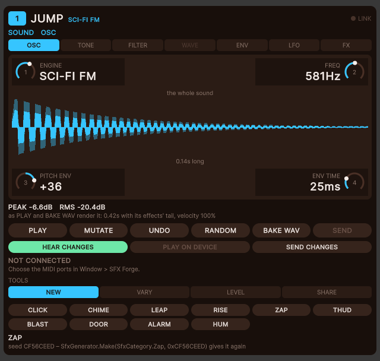

*The tool drawer of a sound's Inspector, tab NEW, after a click on ZAP. The note names the seed.*

**Where.** A preset's Inspector, TOOLS > NEW. Ten keys:

| Key | The recipes are written for | Key | The recipes are written for |
|---|---|---|---|
| **CLICK** | the shortest sound | **THUD** | short and low |
| **CHIME** | a bright step up, or a small bell | **BLAST** | low noise that takes its time |
| **LEAP** | a short rise, one note | **DOOR** | a creak, or it shuts |
| **RISE** | a long rise | **ALARM** | held, and its pitch swings |
| **ZAP** | a fast fall | **HUM** | held, low, slowly alive |

Those words are what the recipes aim at. Nobody has listened to check them.

**What it does.** A click replaces the sound with a new one of that kind. Every click gives another one. With
several presets selected, each gets its own. UNDO takes it back. The note then reads, for example:

`ZAP` · `seed CF56CEED – SfxGenerator.Make(SfxCategory.Zap, 0xCF56CEED) gives it again`

Each kind has two recipes. A recipe is an engine, a range for each value it names, and a few values that are 0
half the time. What a recipe does not name is the plain patch's ([section 3](#every-value)); LEVEL is always 100.
ALARM and HUM are held sounds, the other eight are one-shots. HOLD is not changed.

RANDOM, on the soft keys, is still there: it makes a one-shot of no particular kind.

**In code.**

```csharp
SfxPatch zap = SfxGenerator.Make(SfxCategory.Zap, 0xCF56CEED);        // this kind, this seed: always the same patch

var rng = new SfxRandom(1234);                                       // or a row of them from one generator
for (int i = 0; i < 8; i++)
{
    SfxPatch coin = SfxGenerator.Make(SfxCategory.Chime, ref rng);
    Debug.Log(SfxPatchText.ToText(coin));
}
```

| | |
|---|---|
| `SfxGenerator.Make(category, seed)` | the sound of a kind and a seed |
| `SfxGenerator.Make(category, ref rng)` | the next sound of an `SfxRandom` |
| `SfxGenerator.Names`, `Count` | `"CLICK"` … `"HUM"`, 10 |
| `SfxGenerator.IsSustained(category)` | true for `Alarm` and `Hum` |
| `SfxGenerator.Fits(category, patch)` | the patch is one a recipe of that kind can give |
| `SfxPresetPanel.Generate(category)`, `LastSeed` | what a key calls, and the seed it used (the first sound's, with several selected) |

**Limits.** Ten kinds, two recipes each, and no way to add one without changing the source. A seed gives the same
patch only as long as the recipes stay as they are: a later version that changes a recipe changes what its seeds
give. Keep a sound you like as a preset or as its text, not as a seed.

**Tested.** Without Unity: for every kind, 300 seeds give a valid patch inside the recipe's ranges, both recipes
come up, and 100 seeds bake to a sound that is audible and does not clip (peaks from 0.07 to 0.70 of full scale, the
longest 4.9 seconds). In the test project: a key replaces the sound and Undo takes it back; several selected sounds
each get their own; the note goes when the sound is edited. Not tested: what any of them sounds like.

### VARY: MUTATE's amount, locks, and MORE LIKE THIS

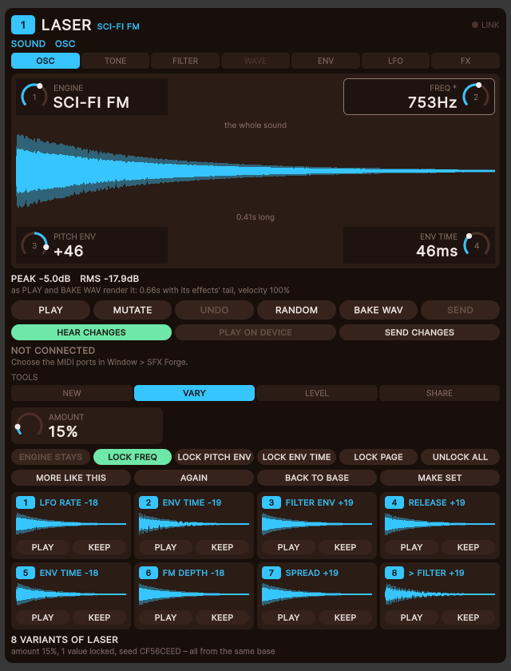

*Tab VARY after MORE LIKE THIS, with FREQ locked: its tile has an outline and a star. Each variant's caption names
the value that moved most from the base.*

**Where.** A preset's Inspector, TOOLS > VARY.

| Part | What it does |
|---|---|
| **AMOUNT** | how far a value may move, 1 to 100 %. 15 % at first, which is the device's MUTATE. Type `20` or `20%`; a double-click on the ring puts 15 back |
| **LOCK** *value* | four keys, one for each value of the page shown. A lit key is a locked value: MUTATE and the variants leave it as it is. Its tile gets a thin outline and ` *` behind its name. On the OSC page the first place reads ENGINE STAYS and is dim: nothing here ever changes the engine |
| **LOCK PAGE** · **UNLOCK ALL** | locks the page's four values, or unlocks them if all four are locked · unlocks every value |
| **MORE LIKE THIS** | takes the sound as it is now as the base and shows eight variants of it. One sound only |
| **AGAIN** | eight other variants of the same base |
| **PLAY** on a tile | plays that variant. It changes nothing |
| **KEEP** on a tile | the sound becomes that variant. The tiles stay, so you can try another: all eight are variants of the base, not of each other |
| **BACK TO BASE** | the sound becomes the base again |
| **MAKE SET** | makes a [variation set](#variation-sets) next to the preset, named `<preset> Variations`: with the tiles shown, nine: the sound as it is now and eight variants of it from the tiles' seed. Those are the eight tiles as long as the sound is still the base; after KEEP they are variants of the kept sound, not the tiles you see. Without tiles, six from a new seed. It carries the amount and the locks. It is a new file, not an undo step, and it is not baked |

Two columns of tiles under 560 pixels, four from there. The tiles follow AMOUNT and the locks while they are
shown: turn AMOUNT and the eight change with it.

**AMOUNT and the locks steer the MUTATE key too.** They are the editor session's, not the asset's: they hold for
every preset until the editor is closed, and are then 15 % and nothing locked again.

What never moves, whatever is locked: the engine, LEVEL, TABLE, and a SUSTAIN of 0. A one-shot stays a one-shot and
a held sound stays held.

**In code.** Tile *n* of the grid is `SfxMutate.Variant` of the base:

```csharp
SfxPatch laser = SfxPatch.Default;
uint keep = SfxMutate.Bit(SfxParam.BaseFreq) | SfxMutate.Bit(SfxParam.AmpDecay);       // FREQ and DECAY stay
for (int n = 1; n <= 8; n++)
{
    SfxPatch variant = SfxMutate.Variant(laser, 0xCF56CEED, n, 15, keep);              // base, seed, number, per cent, locks
    Debug.Log(n + ": " + SfxPatchText.ToText(variant));
}
```

| | |
|---|---|
| `SfxMutate.Variant(basePatch, seed, index, percent, locked = 0)` | variant `index`; 0 is the base itself |
| `SfxMutate.Bit(param)`, `SfxMutate.All` | a value's bit in a set of locks; every value |
| `patch.Mutate(ref rng, SfxPatch.StepOf(percent), locked)` | one mutation in place |
| `SfxPresetPanel.MutateAmount`, `Locked` (static) | the session's amount and locks |
| `SfxPresetPanel`: `MoreLikeThis()`, `Again()`, `Keep(1 … 8)`, `BackToBase()`, `GridVariant(n)`, `MakeSet()` | what the keys call |

**Limits.** MORE LIKE THIS, AGAIN, BACK TO BASE and MAKE SET work on one sound; with several selected only MUTATE
does, on all of them. The grid is not kept: it is gone when the Inspector is rebuilt. MAKE SET needs the preset to
be an asset inside `Assets`. A lock is per value, for all presets alike; there is no lock kept with a preset.

**Tested.** Without Unity: a mutation with an amount stays inside it and keeps the kind of sound; with every value
locked the variant is the base; variant 0 is the base, and variant *n* depends on the seed and *n* only. In the
test project: MUTATE uses the amount and the locks; LOCK PAGE locks four values and shows it; the grid branches
from one base and follows the amount; several sounds give no grid; MAKE SET carries the grid, and Undo after it
leaves the set whole; a tile says which value moved. Not tested: by ear, whether 15 % is a useful distance.

### Variation sets

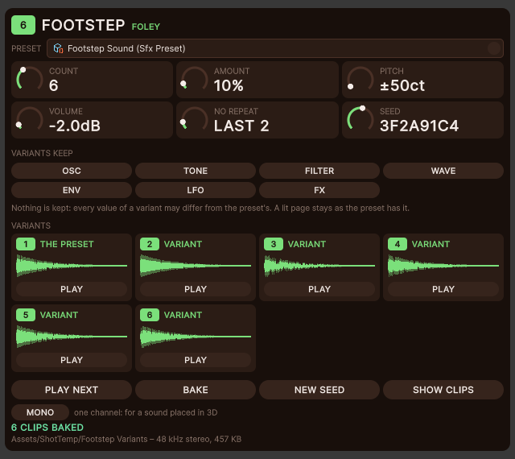

*The Inspector of an `SfxVariationSet` with six baked clips. Tile 1 is the preset itself.*

**What it is.** One sound as several. A preset and a seed give a fixed row of variants; the first is the preset
itself. A play takes one of them at random, never one of the last few played, a little higher or lower and a little quieter. Footsteps,
hits and coins that do not sound the same twice.

**Where.** **Assets > Create > SFX Forge > Variation Set**, or MAKE SET in a sound's VARY tool. Play it with the
component **SFX Variation Player** (Component > SFX Forge), or from code.

| In the Inspector | |
|---|---|
| **PRESET** | the sound the set varies |
| **COUNT** | how many variants, the preset included: 1 to 16. 6 at first |
| **AMOUNT** | how far a variant's values move from the preset's, 0 to 100 %. 10 at first. At 0 every variant is the preset, and only pitch and volume vary |
| **PITCH** | a play is tuned up or down by up to this much: `±50ct` at first, 0 to 1200 cents |
| **VOLUME** | a play is quieter by up to this much: `-2.0dB` at first, down to −24 dB, or OFF. Never louder |
| **NO REPEAT** | the last N variants played are not chosen again: `LAST 2` at first, or OFF |
| **SEED** | which variants these are, as eight hex digits. The same preset, seed, amount and locks give the same variants again |
| **VARIANTS KEEP** | a key for each page of a sound. A lit page stays as the preset has it. Single values locked by MAKE SET are named in the line under the keys |
| **VARIANTS** | a tile for each variant, with its picture and PLAY |
| **PLAY NEXT** | plays as the game would: the next of the order, with its pitch and volume. The footer says which, and with what |
| **BAKE** | writes the variants as clips (below) |
| **NEW SEED** · **SHOW CLIPS** · **MONO** | other variants · points at the baked files · the clips as one channel, for a sound placed in 3D |

**Baked or not.** This decides where the set plays.

| The set is | It plays | The Inspector says |
|---|---|---|
| **baked** | everywhere: its clips are ordinary `AudioClip`s, and no native library is needed | `6 CLIPS BAKED`, with the folder and the size |
| **baked, and changed since** | the clips it has: the old sound. If COUNT was changed, as many variants as there are clips | `OUT OF DATE`, and in the editor one warning in the Console when it plays |
| **not baked** | only where the native library is (Windows x64). The clips are made when first played, at 48 kHz, the same samples BAKE writes | `NOT BAKED` |
| **not baked, no library** | nothing, and the Console says so once | `NATIVE LIBRARY NOT FOUND` |

**BAKE** writes `<the set's folder>/<name> Variants/<name>_01.wav` and so on: 16 bit, 48 kHz, stereo or mono.

- The set is all or nothing. Every variant is rendered first; if one does not render, or a file that is already
  there cannot be written over (it is read-only, say), nothing is written and the set stays as it was. A failure
  that shows only while writing – a full disk, a new file that cannot be made – also leaves the set as it was, but
  the files written before it stay. That case is not tested.
- A file that is there is overwritten in place, so its GUID and its import settings stay.
- Its own files with a number above the new COUNT are deleted. No other file ever is.
- A set that was renamed, moved or copied leaves the clips it had in their old folder, and the report says so.
- It is not an undo step, and it clears the set's undo history: an undo could otherwise put the set back without
  its clips. Edits made to the set before a BAKE can no longer be undone.

**In code.** With the component:

```csharp
using CatSplat.SfxForge;
using UnityEngine;

public class Coins : MonoBehaviour
{
    public SfxVariationSet coin;                 // baked in its Inspector
    SfxVariationPlayer player;

    void Awake()
    {
        player = gameObject.AddComponent<SfxVariationPlayer>();          // adds the AudioSource it needs
        player.set = coin;
    }

    public void Collected() => player.Play();                            // returns the variant played, -1 for none
}
```

On an `AudioSource` of your own, for example one that is placed in 3D:

```csharp
SfxShuffle order = coin.NewOrder();                                      // once; keep it
AudioClip clip = coin.Next(order, out float pitch, out float volume);    // every play
if (clip != null) { source.pitch = pitch; source.PlayOneShot(clip, volume); }
```

`SfxVariationPlayer.PlayOn(source, set, order)` does those two lines.

| | |
|---|---|
| `SfxVariationPlayer`: `set`, `volume`, `prepareOnEnable`, `orderSeed` | the component. `orderSeed` 0 is another order every run; anything else is the same order, pitches and volumes every run |
| `int Play(float volumeScale = 1f)` · `PlayNext()` · `Last` | plays the next variant · the same, for a UnityEvent or an animation event · the variant played last |
| `SfxVariationSet`: `IsBaked`, `IsStale`, `BakedCount`, `PlayCount` | the state of its clips |
| `Clip(index)`, `Prepare()` | a variant's clip; every clip now, so that no play has to make one |
| `NewOrder(seed = 0)`, `Next(order, out pitch, out volume)`, `NextIndex(…)` | an order, and the next play of it |
| `VariantPatch(index)` | a variant as a patch |
| `SfxVariationBaker.Bake(set)` (editor) | what the BAKE key calls; returns an `SfxBakeReport` |

**Limits.**

- **Bake a set before you ship it.** Not baked, it is silent wherever the native library is not. Nothing checks
  this when the game is built, and an out-of-date set warns in the editor only.
- Not baked, the first play of each variant renders it on the calling thread. `Prepare()` does them all at once;
  the component calls it when it is enabled (`prepareOnEnable`).
- The player sets its `AudioSource`'s pitch on every play, and does not put back what it was. One-shots still
  ringing on that source take the pitch of the next play. For plays that overlap and must stay apart, use several
  players.
- A play is never louder than the clip: VOLUME only takes away.
- 16 variants at most. The clips are 48 kHz and 16 bit; compression and load type are Unity's import settings of
  the files.
- The variants are fixed by the preset, the seed, the amount and the locks. They change when one of those does,
  and the set is then out of date until it is baked again.

**Tested.** Without Unity: the shuffle never takes one of the last N, every variant comes up, each allowed one as
often as the others, and the same seed gives the same order; raising COUNT keeps the earlier variants; the number
that says whether a bake is out of date changes with every input and with nothing else. In the test project, 16
tests on asset files they make and delete again: BAKE writes its clips next to the asset; editing the preset makes
the set out of date and BAKE cures it; lowering COUNT deletes only its own files; a set whose COUNT changed after
BAKE still plays its clips; an undo after BAKE leaves the clips in the set; a renamed set leaves its old clips and
says so; a clip that cannot be written stops the bake before any file changes; pitch and volume stay inside their
ranges; without clips and without the library nothing plays and it says so once; two orders made together differ,
and the player follows a changed NO REPEAT.

Not tested: a set in Play mode, in a built game, or on a platform without the native library. That a baked set
plays there follows from what it is, a row of ordinary clips; it was not tried. The player was called from EditMode
tests only, and nobody listened to it.

### The Bake window

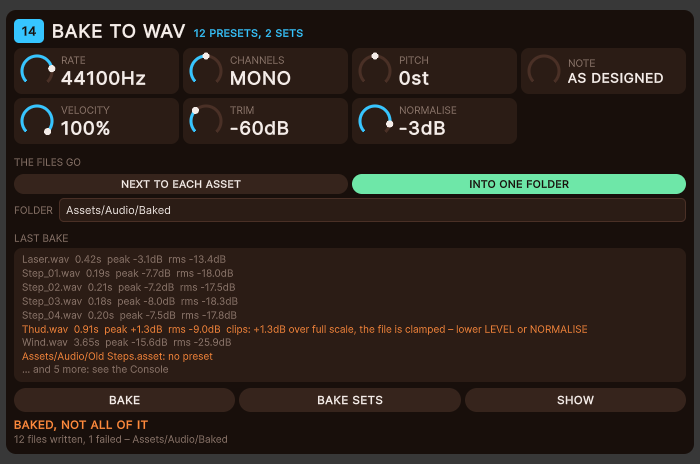

*Window > SFX Forge Bake at 700 pixels, rendered by its tests from a model they filled in: the files, levels and
paths in it are the test's, and no such run was made. The figures do not belong together: a real run with NORMALISE
at −3 dB puts every peak at −3.0 dB and has no line that clips. A line in orange failed or has a note.*

**Where.** **Window > SFX Forge Bake**, or **Assets > SFX Forge > Bake to WAV...**. It works on what is selected in
the Project window: presets, variation sets, and folders, which are searched with their subfolders.

**What it does.** Writes each selected sound as a 16-bit `.wav` file, with options. A preset gives `<name>.wav`,
the file BAKE WAV writes. A variation set gives `<name>_01.wav` and so on, one for each variant.

| Tile | Values | |
|---|---|---|
| **RATE** | 22050, 24000, 32000, 44100, 48000 Hz | 48000 at first. A lower rate is the same sound, as long, with nothing above half the rate: every sound is rendered at 48 kHz and resampled |
| **CHANNELS** | STEREO, MONO | mono is the mean of left and right |
| **PITCH** | −24 … +24 semitones | transposes every sound |
| **NOTE** | AS DESIGNED, or C1 … C7 | every sound played as that note |
| **VELOCITY** | 1 … 100 % | |
| **TRIM** | OFF, −60, −48, −36 dB | cuts the end after the last sample above that level, with a short fade |
| **NORMALISE** | OFF, or 0 … −24 dB | brings every file's peak to that level. OFF: the sounds keep their levels against each other |

| Part | |
|---|---|
| **THE FILES GO** | NEXT TO EACH ASSET, or INTO ONE FOLDER; the lit key is where. FOLDER is `Assets/SfxForge/Baked` at first; it must be inside `Assets`, and is made if it is not there |
| **LAST BAKE** | the newest eight lines of the last run: `Laser.wav  0.42s  peak -3.1dB  rms -13.4dB`. The whole report goes to the Console |
| **BAKE** | bakes the selection with the options |
| **BAKE SETS** | the own BAKE of every variation set in the selection: its clips, in its own folder, without these options |
| **SHOW** | points at the file written last |

The options and the folder are remembered between sessions. From nine files on, a bake shows its progress and can
be cancelled.

A line can carry a note: `cut at 12 s (the longest a bake renders)`; `clips: +1.3dB over full scale, the file is
clamped – lower LEVEL or NORMALISE`; `silent`; or why there is no file, such as `no preset`, `not inside Assets –
choose ONE FOLDER`, `could not write`.

**In code.** In an editor script:

```csharp
using System.Collections.Generic;
using CatSplat.SfxForge;
using CatSplat.SfxForge.Editor;
using UnityEditor;
using UnityEngine;

public static class BakeForMobile
{
    [MenuItem("Assets/SFX Forge/Bake Selection for Mobile")]
    static void Bake()
    {
        var options = new SfxBakeOptions { sampleRate = 22050, mono = true, trimDb = -60f, normaliseDb = -3f };
        List<Object> assets = SfxBatchBake.Collect(Selection.objects);
        SfxBakeReport report = SfxBatchBake.Run(assets, options, SfxBakeTo.OneFolder, "Assets/Audio/Baked");
        report.ToConsole();
    }
}
```

In a game or anywhere else, one sound to samples with the same options:

```csharp
SfxBaked baked = SfxBake.Render(SfxPatch.Default, 1.5f, new SfxBakeOptions { sampleRate = 24000, mono = true });
if (baked != null) Debug.Log(baked.Seconds + " s, peak " + baked.level.PeakDb + " dB");     // null without the native library
```

| | |
|---|---|
| `SfxBakeOptions` | `sampleRate` (8000 … 48000), `mono`, `semitones` (−48 … 48), `midiNote` (0 = as designed), `velocity` (0.01 … 1), `trimDb` (0 = off, −90 … −20), `normaliseDb` (NaN = off, −60 … 0). `Problem()` says which is out of range |
| `SfxBake.Render(patch, holdSeconds, options = null)` | an `SfxBaked`: the samples, their rate and channels, the level, what normalise applied, and whether it was cut at 12 s |
| `SfxBatchBake.Collect(selection)` · `FileCount(…)` | the presets and sets of a selection, each once, by path · how many files they give |
| `SfxBatchBake.Run(assets, options, to, folder = null, progress = null)` | the run. `progress(file, 0 … 1)` is called before each file; returning true stops the run there |
| `SfxBatchBake.BakeSets(assets)` | BAKE SETS |
| `SfxForgeEditorLink.BakeWav(preset, options, path = null)` | one preset, with options |

**Limits.**

- **Existing files are overwritten without a question**, in place: their GUIDs and import settings stay. A `.wav`
  of the same name that did not come from a bake is overwritten too. Nothing is deleted, no asset is changed, and
  a run is not an undo step.
- No two assets of a run write the same file. Where two would, the later one by path is numbered: `Step 2.wav`,
  `Step 2_01.wav`.
- A sound is at most 12 seconds; one that still rings there is cut, and its line says so.
- A file whose sound goes over full scale is clamped, and its line says by how much. NORMALISE or a lower LEVEL
  avoids it.
- The window's RATE has five values; the code takes any rate from 8000 to 48000. 16 bit only.
- A run renders on the editor's main thread. It needs the native library: Windows x64 only.
- The same assets and options write the same bytes again.

**Tested.** Without Unity: mono is the mean of the two channels; a lower rate is the same sound, as long and at
the same note, with half the frames at 24000; a 1 kHz tone is as loud after resampling to 24000 and a 15 kHz tone
is gone; a hold below 0 or above 12 seconds is brought inside; two bakes give the same samples. In the test
project, 8 tests: folders are searched and each asset is found once; a run writes one file for a preset and one for
each variant; INTO ONE FOLDER numbers equal names, and no two assets write the same file; the same run twice writes
the same bytes and keeps the GUIDs; a folder outside `Assets` is refused and nothing is written; the BAKE WAV key
writes what a run with the defaults writes; the window shows the selection and the report.

Not tested: the window itself, which was shown a model only; the progress bar and its cancel button (a cancelled
run was made by a test's own callback); the menu items; a resampled file by ear. The resampler was measured with
those two tones only.

### LEVEL

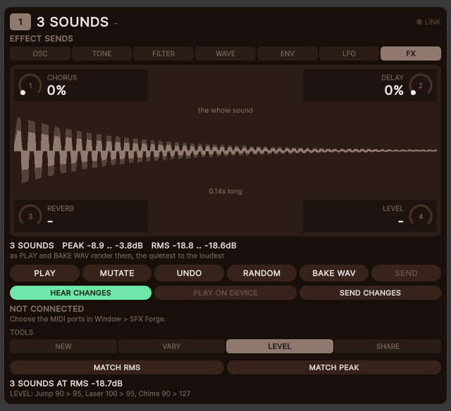

*Three sounds selected, after MATCH RMS. The level line gives the range of the three; the note says which LEVEL
each got.*

**The level line** is under the picture of every sound:

| It reads | |
|---|---|
| `PEAK -5.0dB   RMS -17.9dB` | the largest sample, and the RMS of the sound's body, in dB below full scale. Under it: `as PLAY and BAKE WAV render it: 0.66s with its effects' tail, velocity 100%` |
| `CLIPS   PEAK +1.3dB …`, in orange | the sound goes over full scale. A 16-bit file of it is clamped |
| `SILENT` | nothing comes out |
| `3 SOUNDS   PEAK -8.9 .. -3.8dB   RMS …` | several sounds selected: the quietest to the loudest |
| `40 SOUNDS` · `select 32 or fewer to measure them` | more than 32 are not measured |
| `NO LEVEL` | no native library here |

It measures the sound as PLAY and BAKE WAV render it, with chorus, delay and reverb, at full velocity. The picture
above it is the dry voice, so the two lengths differ. It is measured a moment after a change, a few sounds at a
time, so a large selection does not hold the Inspector up.

RMS here is plain RMS over the body of the sound: from the first to the last moment it is within 40 dB of its peak,
both channels together. A silence in front and a long quiet tail do not lower it. A full-scale sine reads −3.0 dB.

**MATCH RMS** and **MATCH PEAK**, on the tab TOOLS > LEVEL, bring several selected sounds to the same reading.
They write each sound's LEVEL (FX page) and nothing else. One undo step takes it back. The note then reads, for
example:

`3 SOUNDS AT RMS -18.7dB` · `LEVEL: Jump 90 > 95, Laser 100 > 95, Chime 90 > 127`

The reading they aim at is the loudest there is now, lowered until every sound can reach it with a LEVEL of 127 at
most and no peak passes full scale. A silent sound, and one whose LEVEL is 0, is left as it is and named.

This works by arithmetic, not by trying: the engine applies LEVEL after everything that distorts, as
(LEVEL / 100)², so a baked sound changes by 40 · log10(LEVEL / 100) dB. From 100 to 80 is −3.9 dB; 127 is +4.2 dB.

**In code.**

```csharp
SfxPatch jump = SfxPatch.Create(SfxEngine.UiBlip, 86, 44, 40);
SfxPatch laser = SfxPatch.Default;

SfxBaked a = SfxBake.Render(jump, 1.5f), b = SfxBake.Render(laser, 1.5f);           // null without the native library
if (a != null && b != null)
{
    int[] levels = { jump.level, laser.level }, matched = new int[2];
    float reached = SfxLevels.Match(levels, new[] { a.level, b.level }, SfxLevelMeasure.Rms, matched);
    jump.level = (byte)matched[0];
    laser.level = (byte)matched[1];
    Debug.Log("both at RMS " + reached.ToString("0.0") + " dB");
}
```

| | |
|---|---|
| `SfxLevels.Measure(left, right, frames = -1)` | an `SfxLevelReading`: `peak`, `rms`, `PeakDb`, `RmsDb`, `Clips`, `Silent`. `right` may be null |
| `SfxBaked.level` | the reading of a baked sound |
| `SfxLevels.LevelDb(level)` · `LevelFor(level, changeDb)` | what a LEVEL does, in dB · the LEVEL that is that much louder, 1 … 127 |
| `SfxLevels.Match(levels, readings, by, newLevels, wantedDb = NaN)` | new LEVELs so that all read the same; returns the reading they get. With `wantedDb`, that reading is aimed at, as far as it can be reached |
| `SfxPresetPanel.MatchLevels(SfxLevelMeasure.Rms)`, `Level`, `LevelText`, `MeasureNow()` | what the keys and the line call |

**Limits.**

- **It measures; it does not hear.** Peak and plain RMS are not loudness as an ear takes it: a bright sound and a
  dull one at the same RMS do not seem equally loud. Use MATCH to get close, then listen.
- It is the level of one baked sound, as designed, at full velocity. It says nothing about the game's mix, where
  sounds add up ([section 9](#the-mix-is-measured-not-heard)).
- LEVEL is a whole number. Near 100 a step is 0.17 dB; at 20 it is 0.85 dB; at 5 it is 3.2 dB. Quiet sounds agree
  less closely, and the note then gives a range instead of one figure.
- The law is exact for the peak. For RMS it drifts when a sound is very quiet: a bake ends where the sound falls
  under a fixed small level, so a sound whose peak is under about −26 dB loses the end of its body and reads up to
  a few dB higher than the law says.
- MATCH needs 2 to 32 sounds that are not silent, and the native library.

**Tested.** Without Unity: a full-scale sine reads peak 0 dB and RMS −3.01 dB, silence reads silent, 1.01 clips;
LEVEL from 100 to 80 changes a baked sound by 3.876 dB in peak and in RMS, as the law says; after a match three
sounds read the same RMS within 0.03 dB, and the same peak within 0.13 dB; nobody passes LEVEL 127 or full scale. In
the test project: the line reads peak and RMS; MATCH writes only LEVEL and one undo takes it back; it needs two
sounds. Not tested: the chunked measuring of a large selection (no test), and whether matched sounds seem equally
loud.

### SHARE: a sound as text, and as a .syx file

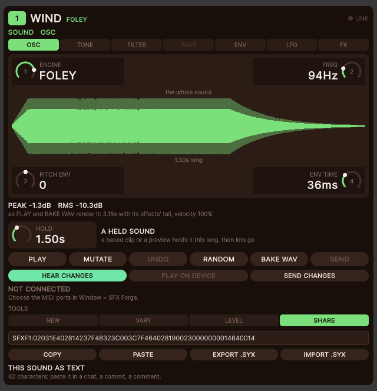

*Tab SHARE: the sound's text, and the four keys.*

**The text.** A sound is 28 bytes. As text it is `SFXF1:` and those bytes as 56 hex digits, 62 characters in all.
The default laser is:

```
SFXF1:0202466E2D32460078143A0000002240283200000000000000640043
```

Paste it into a chat, a commit message, a comment in the code. The 1 is the number of this text form; the patch's
own format is its first byte, and its last byte is its checksum.

**Where.** A preset's Inspector, TOOLS > SHARE.

| Key | |
|---|---|
| **the field** | the sound's text, always whole: its letters shrink in a narrow Inspector. A text put into the field is pasted |
| **COPY** | the text to the clipboard |
| **PASTE** | the sound becomes the one whose text is on the clipboard. With several sounds selected, all of them do. UNDO takes it back |
| **EXPORT .SYX** | writes the sound as a `.syx` file: the message that loads it into a pad of the device. The pad is the one at the top left of the Inspector. One sound only |
| **IMPORT .SYX** | the sound becomes the first patch found in a `.syx` file |

PASTE reads a patch out of what surrounds it: text in front of it, spaces and line breaks inside it, quotes
and brackets of any kind, `*`, `_` and backticks, lower case, characters that cannot be seen, a full stop after it.
Text behind it is passed over when a space or a line break stands between (`… 640043 for the laser`); a hex digit
right behind the last one, with nothing between, makes the text too long.
A text that is refused changes nothing and adds no undo step, and the note says why:

| The note says | |
|---|---|
| `nothing to paste` | the clipboard is empty |
| `not an SFX Forge patch: there is no SFXF1: in it` | |
| `cut off or too long: a patch is 56 hex digits after SFXF1:` | |
| `damaged: a character that is no hex digit` | |
| `damaged: the checksum does not fit` | a digit was changed. Also said of a damaged `.syx` |
| `a patch text from a newer SFX Forge: update the package to read it` | the number after `SFXF` is above 1 |
| `a patch in a newer format than this version reads: update the package` | the patch inside is of a higher format |
| `no SFX Forge patch in this file` · `too large to be a patch file` | for a `.syx`: nothing of ours in it · more than 64 KB |

**The .syx file** is 35 bytes: the same load message the link sends with `SendPatch`. A SysEx tool that sends the
file to the device loads that pad. IMPORT reads a file with one or several messages and takes the first that is a
patch: the device's own dump (EXPORT there), a load, or the load of a song's sound.

**In code.**

```csharp
string text = SfxPatchText.ToText(SfxPatch.Default);                 // "SFXF1:0202466E…640043"

SfxTextResult result = SfxPatchText.Parse("try this: " + text + ".", out SfxPatch patch);
if (result != SfxTextResult.Ok) Debug.Log(SfxPatchText.Message(result));

byte[] syx = SfxPatchText.ToSyx(patch, 3);                           // 35 bytes: the load message for pad 4
SfxTextResult read = SfxPatchText.ParseSyx(syx, out SfxPatch back, out int pad);
```

| | |
|---|---|
| `SfxPatchText.ToText(patch)` | the 62 characters |
| `Parse(text, out patch)` · `TryParse(text, out patch)` | an `SfxTextResult` · true for `Ok` |
| `Message(result)` | why it was refused, in words; null for `Ok` |
| `ToSyx(patch, pad = 0)` · `ParseSyx(file, out patch, out pad)` | the file's bytes · the first patch in a file |
| `Prefix`, `Length` (62), `MaxFile` (65536) | |
| `SfxForgeEditorLink.ExportSyx(patch, pad, path)` · `ImportSyx(path, out patch, out pad)` (editor) | the same through a file |
| `SfxPresetPanel`: `PatchText`, `CopyText()`, `PasteText(text)`, `ImportSyx(path)` | what the keys call |

**Limits.** The text is the patch and nothing else: not the asset's name, not HOLD, not a song. PASTE and IMPORT
leave HOLD as it is. There is no text form of a song or of a variation set. A text from a newer SFX Forge is named
as newer and not read.

**Tested.** Without Unity: 2000 random patches survive patch to text to patch, and the text is 62 characters; the
default laser's text is the one written above; a text is read through spaces, line breaks, lower case, quotes and
invisible characters, and out of a sentence; `ToSyx` is the load message the link sends; a `.syx` of one patch
comes back with its pad; a dump, a load and a song-sound load are read; a file with a wrong checksum is damaged; a
foreign SysEx and an empty file hold no patch. In the test project: PASTE replaces the sound and Undo takes it
back; a refused text changes nothing and says why; PASTE goes to every selected sound; the field shows the text
and takes one; EXPORT then IMPORT through a file gives the sound back.

Not tested: the two file dialogs, which were never opened; a `.syx` file sent to a device or to the emulator by a
SysEx tool. That it loads the pad follows from its bytes being the link's own load message, and `SendPatch` itself
was not tried against a device either ([section 6](#6-from-the-device-to-the-game)).
