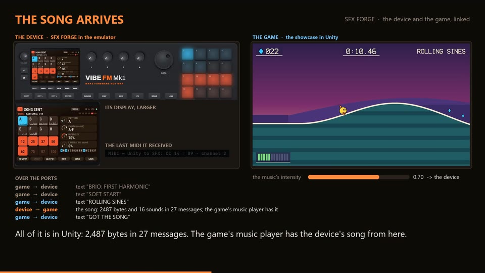
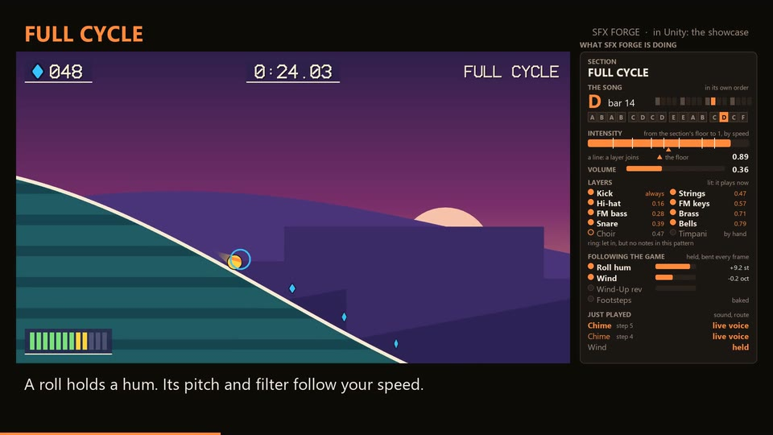
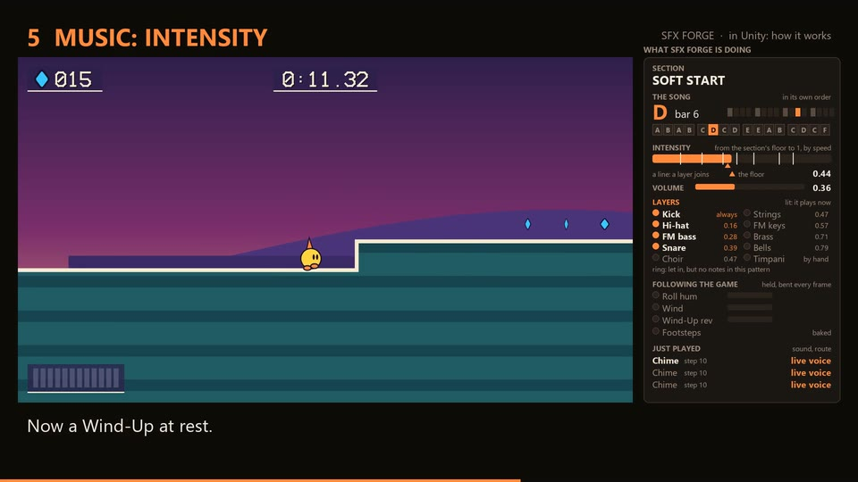
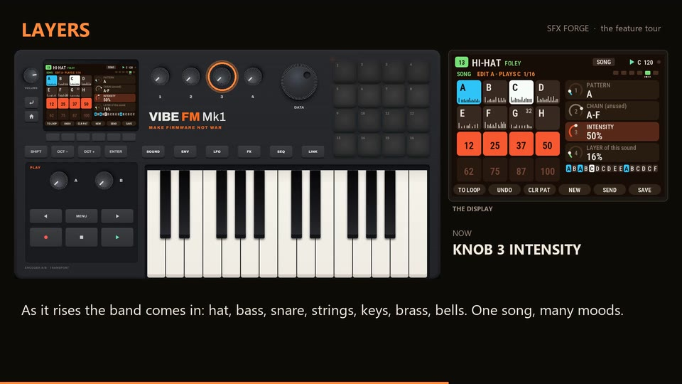
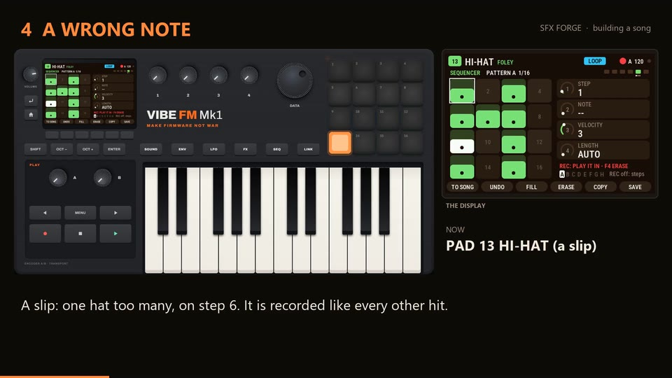

# The videos

Five videos, made by scripts from the firmware and the game themselves: nobody held a controller or a camera.
The sound in them is what SFX FORGE produced, on the device or in Unity; there is no voice-over, the captions
say what happens. Nobody has listened to them: their levels were measured, not judged.

The two device videos and the two Unity videos end with the words "Open source, GPL-3.0-or-later":
SFX FORGE is under the GNU General Public License, version 3 or any later version
([LICENSE.md](../../LICENSE.md)).

The device in the two device videos and in the link video is drawn by the VIBE FM SDK's emulator
(see [Third Party Notices](../../Third%20Party%20Notices.md)).

**The videos were recorded in the repository this package is generated from, and their pages name things there.**
Where a video shows the package id `com.catsplat.sfxforge`, read `com.catsplatstudios.sfxforge`, and install it as
[the package's README](../../README.md#install) says, not with the manifest line on the video's "INSTALL" page. Where it shows `unity/Demo` or
`unity/Demo/Assets/Showcase`, read the imported sample ([`Samples~/Showcase`](../../Samples~/Showcase/README.md)); where it shows `docs/UNITY.md` or "the
manual in the repository", read [`Documentation~/UNITY.md`](../UNITY.md).

## The link: device and game, joined over MIDI

[`sfx-forge-unity-link.mp4`](sfx-forge-unity-link.mp4) · 0:31 · 1920×1080, 30 frames a second, with sound.

SFX FORGE in the emulator beside the game in Unity. SEND is pressed on the device and the song arrives in the running game; a sound is mutated, EXPORT is pressed, and the game plays the patch.

## The showcase game, start to goal

[`sfx-forge-unity-showcase.mp4`](sfx-forge-unity-showcase.mp4) · 1:55 · 1920×1080, 30 frames a second, with sound.

*Brio: First Harmonic* played through, with a panel naming what SFX FORGE is doing at each moment: the song's bar, the intensity, the layers, every sound and its route.

## How it works in Unity

[`sfx-forge-unity-how-it-works.mp4`](sfx-forge-unity-how-it-works.mp4) · 4:06 · 1920×1080, 30 frames a second, with sound.

The three ways to play a sound and the adaptive music, one at a time: a page of the showcase's code, then the game doing it.

## The device: a tour

[`sfx-forge-tour.mp4`](sfx-forge-tour.mp4) · 2:23 · 1920×1080, 30 frames a second, with sound.

The instrument itself: sound effects, MUTATE, the five engines, the sequencer and its finer grid, layers that follow INTENSITY, automation, the mixer, the link page.

## The device: building the song

[`sfx-forge-build-a-song.mp4`](sfx-forge-build-a-song.mp4) · 3:44 · 1920×1080, 30 frames a second, with sound.

A song played in from nothing with pads and keys over a looping pattern, with ERASE and UNDO, a second pattern with a hi-hat roll on a grid of 1/32, then arranged, layered, automated, played on the PERFORM page, mixed and sent to the game.
