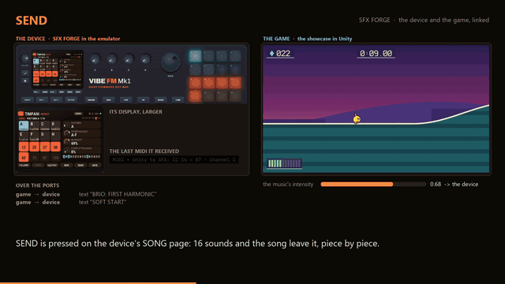
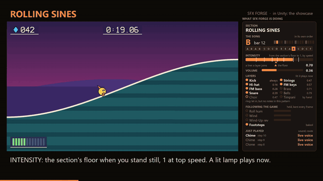
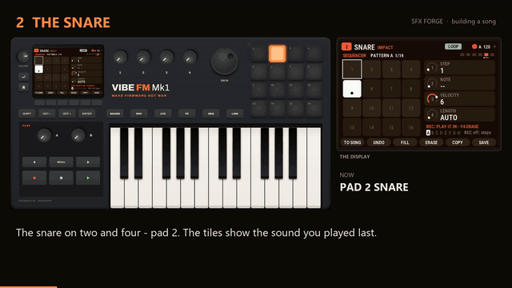

# SFX Forge for Unity

SFX FORGE is a synthesizer for game audio that runs on VIBE FM: sound effects, instruments and a sequenced song with
layers, made on the device (or its emulator) with pads, keys and knobs. This package puts the same engine into a Unity
game. A sound is a patch of 28 bytes and a song is a few kilobytes; you make them on the device, send them over MIDI,
they arrive in Unity as assets, and the game synthesizes them while it runs. There are no audio files anywhere in it.

The documentation and the videos are the main thing here. Start with the videos, then
[the Unity manual](Documentation~/UNITY.md).

## Watch

Each picture is a silent preview of ten to twelve seconds; click it for the whole video (an mp4 in
[`Documentation~/video`](Documentation~/video/README.md), with sound). If your browser shows a file page instead of
a player, download the file.

[](Documentation~/video/sfx-forge-unity-link.mp4)

**[The link: device and game, joined over MIDI](Documentation~/video/sfx-forge-unity-link.mp4)** (0:31). SFX FORGE in the emulator beside the game in Unity. SEND is pressed on the device and the song arrives in the running game; a sound is mutated, EXPORT is pressed, and the game plays the patch.

| | |
|---|---|
| [](Documentation~/video/sfx-forge-unity-showcase.mp4) | [](Documentation~/video/sfx-forge-unity-how-it-works.mp4) |
| **[The showcase game, start to goal](Documentation~/video/sfx-forge-unity-showcase.mp4)** (1:55). *Brio: First Harmonic* played through, with a panel naming what SFX FORGE is doing at each moment: the song's bar, the intensity, the layers, every sound and its route. | **[How it works in Unity](Documentation~/video/sfx-forge-unity-how-it-works.mp4)** (4:06). The three ways to play a sound and the adaptive music, one at a time: a page of the showcase's code, then the game doing it. |
| [](Documentation~/video/sfx-forge-tour.mp4) | [](Documentation~/video/sfx-forge-build-a-song.mp4) |
| **[The device: a tour](Documentation~/video/sfx-forge-tour.mp4)** (2:05). The instrument itself: sound effects, MUTATE, the five engines, the sequencer, layers that follow INTENSITY, automation, the mixer, the link page. | **[The device: building the song](Documentation~/video/sfx-forge-build-a-song.mp4)** (2:16). The demo song played in from nothing with pads and keys, then arranged, layered, automated, mixed and sent to the game. It is the song the showcase plays. |

The videos were made by scripts from the firmware and the game themselves. Their sound is SFX FORGE's own, on the
device and in Unity; nobody has listened to it (see [What is tested](#what-is-tested-and-what-is-not)).

## From the device to the game in five steps


**1. Make a sound on the device.** The instrument is in [`Firmware~/sfx-forge.zip`](Firmware~/README.md): drop the zip
onto the VIBE FM plugin, or the `sfx-forge.wasm` inside it onto the [Playground](https://play.thefirmwarehub.com/) in
the browser. Hit a pad, turn the knobs, press **F2 MUTATE** for variations; write a song on the sequencer pages.
[The device's manual](Documentation~/MANUAL.md) teaches it, with two tutorials:
[a sound effect](Documentation~/MANUAL.md#5-tutorial-a-sound-effect) and [a beat](Documentation~/MANUAL.md#9-tutorial-a-beat).

**2. Connect it over MIDI.** Unity talks to the device over two MIDI ports, one each way. Without the hardware, the
device is the emulator or the plugin, and the two ports are a virtual MIDI cable (for example loopMIDI). In Unity:
**Window > SFX Forge**, choose **From device** and **To device**, press **Connect**.

**3. EXPORT a sound, SEND the song.** On a sound page, **F5 EXPORT** sends the selected sound: one patch. On the SONG
page, **F5 SEND** sends the 16 instruments and the song with its arrangement, layers, mix and automation, in 39
pieces. Unity can also ask: **Fetch the song** in the window, or from code:

```csharp
SfxLink.Shared.PatchReceived += (slot, patch) => Debug.Log($"pad {slot + 1}: {patch.engine}");
SfxLink.Shared.SongReceived += (packedSong, sounds) => { /* sounds is null if not all 16 came with it */ };
SfxLink.Shared.RequestPatch(0);        // ask for pad 1
SfxLink.Shared.RequestSong();          // ask for the 16 sounds and the song
```

**4. It arrives in Unity as an asset.** The window saves a patch as an `SfxPreset` (into `Assets/SfxForge`, named like
`Pad03_SciFiFm`) and a song as an `SfxSong` named `Song`. A preset's Inspector has a slider for every value, **Play**,
**Mutate** and **Bake WAV**. A sound can also be written in code, as an engine and up to 25 numbers:

```csharp
SfxPatch coin = SfxPatch.Create(SfxEngine.UiBlip, 86, 64, 0, 26, 60, 0, 127, 0, 62, 0);
```

**5. Play it in the game.** No device and no MIDI are needed from here on: the game carries the engine
(`sfxforge.dll`) and synthesizes the sound when it is asked for.

```csharp
using CatSplat.SfxForge;
using UnityEngine;

public class FromTheDevice : MonoBehaviour
{
    public SfxPreset sound;          // the preset that EXPORT made
    public SfxMusicPlayer music;     // an SfxMusicPlayer on another object; the SfxSong that SEND made is in its Song field
    SfxPlayer player;
    AudioClip baked;

    void Start()
    {
        player = gameObject.AddComponent<SfxPlayer>();              // adds the AudioSource it needs
        player.preset = sound;
        baked = sound.Bake(AudioSettings.outputSampleRate);         // or render it once into an ordinary clip
    }

    void Update()
    {
        if (Input.GetKeyDown(KeyCode.Space)) player.Play(1f, 7f);   // live: full velocity, 7 semitones up
        if (Input.GetKeyDown(KeyCode.Return) && baked != null) GetComponent<AudioSource>().PlayOneShot(baked, 0.7f);
        music.intensity = Mathf.PingPong(Time.time * 0.1f, 1f);     // the song's layers come in and go out
        if (Input.GetKeyDown(KeyCode.Tab)) music.CuePattern(2);     // pattern C, from the next bar line
    }
}
```

That is the whole path. The manual's sections [4](Documentation~/UNITY.md#4-playing-sounds-three-routes),
[5](Documentation~/UNITY.md#5-music) and [6](Documentation~/UNITY.md#6-from-the-device-to-the-game) are the long
version; the showcase sample is a whole game built this way. While the two are linked the game can also drive the
device (`SfxTelemetrySender`, `SfxLink.Shared.SendIntensity`), so you tune a sound on the device's knobs while the
game plays it.

## Install

The package needs Unity 6000.3 on Windows x64.

- **From disk** (works now): clone or download this repository, then **Window > Package Manager > + > Add package
  from disk...** and pick its `package.json`. Or add `"com.catsplatstudios.sfxforge": "file:<path to this folder>"` to the
  `dependencies` in your project's `Packages/manifest.json`.
- **From a git URL**: **Window > Package Manager > + > Add package from git URL...** with this repository's URL. That
  URL exists once the repository is published; at the time of writing it is not, so no URL is printed here.

Then **Window > SFX Forge** exists, and `using CatSplat.SfxForge;` compiles in scripts under `Assets`. Code with its
own assembly definition references `CatSplat.SfxForge` (and `CatSplat.SfxForge.Editor` for editor helpers).
[Section 1 of the manual](Documentation~/UNITY.md#1-five-minutes) is the first sound in five minutes.

## The showcase sample


*Brio: First Harmonic* is a one-level 2D platformer in which every sound is SFX FORGE at runtime: 19 sound effects
written as patches in code, and the device's demo song with its layers following the player's speed. Its art is
generated meshes; the folder holds no audio file, texture or model. It is written to be read and copied:
`Scripts/Audio` is the example, and [its README](Samples~/Showcase/README.md) is the guide.

- **Import**: Package Manager > SFX Forge > Samples > **Showcase** > Import. Unity copies it under
  `Assets/Samples/SFX Forge/1.0.0/Showcase`. It needs the built-in render pipeline, and **Active Input Handling**
  set to the legacy Input Manager or Both (Project Settings > Player). An empty project made by Unity 6000.3.8f1
  without a template has both already. A project made from a template with another render pipeline or with the
  Input System alone does not, and the sample was not tried there. Its tests are compiled only if the Test
  Framework package (`com.unity.test-framework`) is in the project; an empty project does not have it (Package
  Manager > Unity Registry > Test Framework).
- **Play**: open `Showcase.unity` in the imported folder, press Play. Arrows or A/D run, Space jumps, Down tucks
  into a roll. A gamepad works too.
- **Build**: **SFX Forge > Showcase > Build for Windows** writes `Builds/Brio/Brio.exe` beside `Assets`. The build
  settings are left as they are.
- **The build checks itself**: started with `-sfxforge-probe <path>\probe.json` the game plays by itself for 14
  seconds, measures what comes out of its AudioListener, writes a report and quits with exit code 0 or 1. `"ok": true`
  means the native library was found, the title card was left, the song ran through at least two bar lines, every baked sound has its clip, a
  jump happened and the output was not silent. It does not say how it sounds.
- **Check and rebuild**: **SFX Forge > Rebuild Showcase Scene** writes the scene and the generated assets again,
  adds the scene to the build settings and runs the sample's 32 editor checks. Straight after the import one of
  the 32 fails: the scene is not in the project's build settings yet. Playing and the build command above do not
  need it there; the rebuild, or adding the scene by hand, settles it. The headless commands are in the sample's
  README.

## The manual

**[SFX FORGE in Unity](Documentation~/UNITY.md)**, the game's side:

- [1. Five minutes](Documentation~/UNITY.md#1-five-minutes)
- [2. What is in the package](Documentation~/UNITY.md#2-what-is-in-the-package)
- [3. A sound: SfxPatch](Documentation~/UNITY.md#3-a-sound-sfxpatch)
- [4. Playing sounds: three routes](Documentation~/UNITY.md#4-playing-sounds-three-routes)
- [5. Music](Documentation~/UNITY.md#5-music)
- [6. From the device to the game](Documentation~/UNITY.md#6-from-the-device-to-the-game)
- [7. The showcase, a worked example](Documentation~/UNITY.md#7-the-showcase-a-worked-example)
- [8. Recipes](Documentation~/UNITY.md#8-recipes)
- [9. Testing, limits, troubleshooting](Documentation~/UNITY.md#9-testing-limits-troubleshooting)
- [10. API at a glance](Documentation~/UNITY.md#10-api-at-a-glance)

**[SFX FORGE, the device](Documentation~/MANUAL.md)**, the instrument's side: [1. Five minutes](Documentation~/MANUAL.md#1-five-minutes) · [2. The device](Documentation~/MANUAL.md#2-the-device) · [3. The display](Documentation~/MANUAL.md#3-the-display) · [4. Two kits](Documentation~/MANUAL.md#4-two-kits) · [5. Tutorial: a sound effect](Documentation~/MANUAL.md#5-tutorial-a-sound-effect) · [6. How a sound is built](Documentation~/MANUAL.md#6-how-a-sound-is-built) · [7. The five engines](Documentation~/MANUAL.md#7-the-five-engines) · [8. Instruments](Documentation~/MANUAL.md#8-instruments) · [9. Tutorial: a beat](Documentation~/MANUAL.md#9-tutorial-a-beat) · [10. The song](Documentation~/MANUAL.md#10-the-song) · [11. Layers: music that follows the game](Documentation~/MANUAL.md#11-layers-music-that-follows-the-game) · [12. Automation](Documentation~/MANUAL.md#12-automation) · [13. The mixer and the master effects](Documentation~/MANUAL.md#13-the-mixer-and-the-master-effects) · [14. The stage](Documentation~/MANUAL.md#14-the-stage) · [15. Into the game](Documentation~/MANUAL.md#15-into-the-game) · [16. Saving and resetting](Documentation~/MANUAL.md#16-saving-and-resetting) · [17. Recipes](Documentation~/MANUAL.md#17-recipes) · [18. What it does not do](Documentation~/MANUAL.md#18-what-it-does-not-do) · [19. Every control, page by page](Documentation~/MANUAL.md#19-every-control-page-by-page). Everything on one
picture: [the cheat sheet](Documentation~/img/cheatsheet.png).

Also: [the link's protocol, byte by byte](Documentation~/LINK-PROTOCOL.md) · [the videos](Documentation~/video/README.md) ·
[the showcase's README](Samples~/Showcase/README.md) and its [design](Samples~/Showcase/Docs/DESIGN.md),
[architecture](Samples~/Showcase/Docs/ARCHITECTURE.md) and [audio notes](Samples~/Showcase/Docs/AUDIO-NOTES.md) ·
[the firmware](Firmware~/README.md) · [the changelog](CHANGELOG.md).

## What is tested, and what is not

Tested, on one machine (Windows 11, Unity 6000.3.8f1), in the repository this package is generated from:

- The showcase: its editor checks, its Play mode tests, and a standalone Windows build that passed its own probe. The
  same was done with the showcase's folder copied to another place in an otherwise empty project.
- The link, end to end against the VIBE FM SDK's emulator over a virtual MIDI cable (loopMIDI): patches and the song
  from the device to Unity, a song and its sounds from Unity to the device, the game's intensity driving the device,
  SEND and EXPORT pressed on the device arriving in a running game.
- The code in the manual was compiled against the package.

Tested on this package as generated, on the same machine, with the editor run headless:

- **The package alone.** An empty project made by Unity (`-createProject`: Input Manager, built-in render pipeline,
  no Test Framework) with the package added by a `file:` line in `Packages/manifest.json`: it compiles, and the
  first script of the manual ([section 1](Documentation~/UNITY.md#1-five-minutes)) and the code on this page
  compile in `Assets`. They were compiled, not run.
- **The sample.** In a second such project the sample was imported with the Package Manager's own import call
  (`UnityEditor.PackageManager.UI.Sample.Import`, what the Import button calls) and landed in
  `Assets/Samples/SFX Forge/1.0.0/Showcase`. Without the Test Framework it compiles and the test assembly is left
  out. As imported, 31 of the 32 editor checks pass and the one about the build settings fails, as said above. With
  the scene in the build settings all 32 pass, on the scene as shipped and on a scene rebuilt in that project.
  With the Test Framework (1.6.0) added: 20 Play mode tests passed, none failed, and 14 were skipped, which are the
  capture and link takes that only run when asked for by name. The Windows build made from there passed its probe:
  native library found, 7 bars of the song, 14 of 14 baked clips, output peak 0.55 of full scale, not silent.

Not tested:

- **Nobody has listened to any of it.** The levels and every "it sounds" in these pages come from measurements: peak
  and RMS of recorded takes, the build's probe, tests that read the output buffer. They say that sound comes out and
  does not clip. They do not say that it sounds good or is balanced.
- Hardware, and the VIBE FM plugin. The link was only run against the emulator. Pads and encoders coming from the
  device (`onPad`, `onEncoder`, `SfxEncoderBinding`), `SendPatch`, and the buttons of the SFX Forge window were not
  tried against a device.
- Any Unity version other than 6000.3.8f1, any platform other than Windows x64, any render pipeline other than
  the built-in one.
- The Package Manager's window itself: nobody clicked **Add package from disk**, **Import** or the menu items; the
  calls behind them were run from the command line. Installing from a git URL (there is no published repository
  yet). A project made from a template that has another render pipeline or the Input System alone.
- The 14 capture and link takes of the sample outside the source repository. They need that repository's scripts
  and the emulator.

## Requirements and limits

- **Windows x64 only.** The engine is a native library (`Runtime/Plugins/x86_64/sfxforge.dll`). Elsewhere the package
  compiles, `SfxNative.Available` is false and the players stay silent with a warning.
- **MIDI on Windows only** (winmm), and only needed for the link. Playing sounds and songs needs no device.
- **Unity 6000.3**: developed and tested with 6000.3.8f1, nothing older.
- Live players are not spatialized (for 3D, bake a clip); one patch per `SfxPlayer`; a song is made on the device and
  only played and shaped in Unity. [The manual's list of limits](Documentation~/UNITY.md#limits).

## License

MIT, see [LICENSE.md](LICENSE.md). The device shown in the videos is drawn by the VIBE FM SDK's emulator
(Apache-2.0), and the firmware was built with that SDK: [Third Party Notices](Third%20Party%20Notices.md). "VIBE FM"
is its owner's trademark; this package is not affiliated with it.
