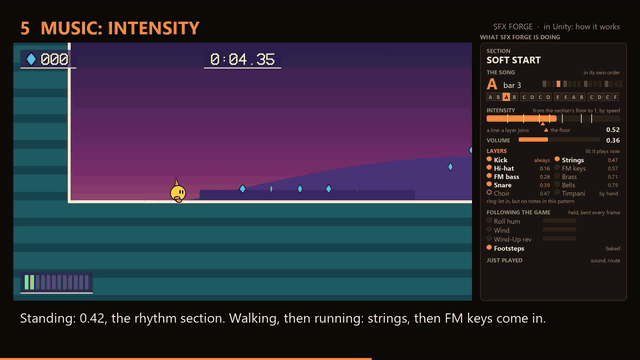
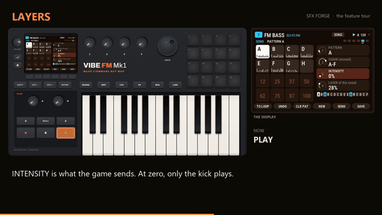
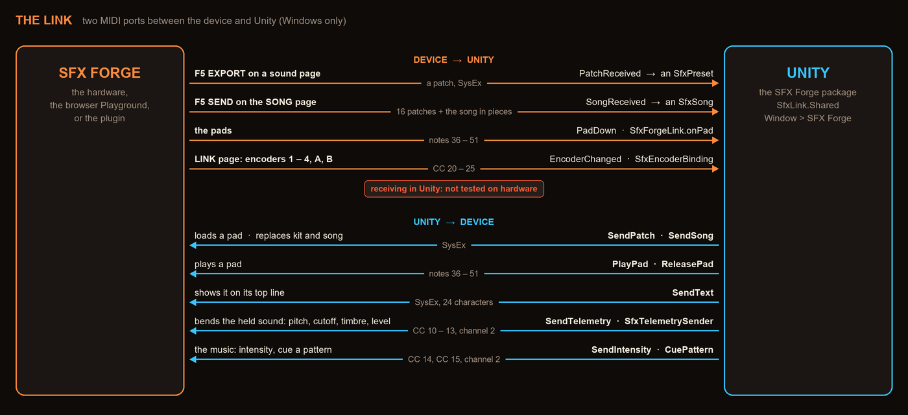

# SFX Forge for Unity

SFX FORGE is a synthesizer for game audio that runs on VIBE FM: sound effects, instruments and a sequenced song with
layers, made on the device (or its emulator) with pads, keys and knobs. This package puts the same engine into a Unity
game. A sound is a patch of 28 bytes and a song is a few kilobytes; you make them on the device, send them over MIDI,
they arrive in Unity as assets, and the game synthesizes them while it runs. There are no audio files anywhere in it.

The documentation and the videos are the main thing here. Start with the videos, then
[the Unity manual](Documentation~/UNITY.md).

## Watch

Each picture is a silent excerpt of ten to fourteen seconds, at a third of the video's size; the text under it says
what the whole video shows. Click it for the video (an mp4 in [`Documentation~/video`](Documentation~/video/README.md),
1920×1080, with sound), where the small print of the panels is readable. If your browser shows a file page instead
of a player, download the file.

[](Documentation~/video/sfx-forge-unity-link.mp4)

**[The link: device and game, joined over MIDI](Documentation~/video/sfx-forge-unity-link.mp4)** (0:31). SFX FORGE in the emulator beside the game in Unity. SEND is pressed on the device and the song arrives in the running game; a sound is mutated, EXPORT is pressed, and the game plays the patch.

[](Documentation~/video/sfx-forge-unity-showcase.mp4)

**[The showcase game, start to goal](Documentation~/video/sfx-forge-unity-showcase.mp4)** (1:55). *Brio: First Harmonic* played through, with a panel naming what SFX FORGE is doing at each moment: the song's bar, the intensity, the layers, every sound and its route.

[](Documentation~/video/sfx-forge-unity-how-it-works.mp4)

**[How it works in Unity](Documentation~/video/sfx-forge-unity-how-it-works.mp4)** (4:06). The three ways to play a sound and the adaptive music, one at a time: a page of the showcase's code, then the game doing it.

[](Documentation~/video/sfx-forge-tour.mp4)

**[The device: a tour](Documentation~/video/sfx-forge-tour.mp4)** (2:23). The instrument itself: sound effects, MUTATE, the five engines, the sequencer and its finer grid, layers that follow INTENSITY, automation, the mixer, the link page.

[](Documentation~/video/sfx-forge-build-a-song.mp4)

**[The device: building the song](Documentation~/video/sfx-forge-build-a-song.mp4)** (3:21). A song played in from nothing with pads and keys over a looping pattern, with ERASE and UNDO, a second pattern with a hi-hat roll on a grid of 1/32, then arranged, layered, automated, mixed and sent to the game.

The videos were made by scripts from the firmware and the game themselves. Their sound is SFX FORGE's own, on the
device and in Unity; nobody has listened to it (see [What is tested](#what-is-tested-and-what-is-not)).

**The videos were recorded in the repository this package is generated from, and their pages name things there.**
Where a video shows the package id `com.catsplat.sfxforge`, read `com.catsplatstudios.sfxforge`, and install it as
[Install](#install) says, not with the manifest line on the video's "INSTALL" page. Where it shows `unity/Demo` or
`unity/Demo/Assets/Showcase`, read the imported sample ([The showcase sample](#the-showcase-sample)); where it shows `docs/UNITY.md` or "the
manual in the repository", read [`Documentation~/UNITY.md`](Documentation~/UNITY.md).

## In the editor: the device's own look

The Inspector of a sound, the Inspector of a song and the window **Window > SFX Forge** are drawn as the device
draws its display: the firmware's colours, its pages of up to four values, a knob for each value, every value in the
device's units, the sound's waveform, and rows of soft keys.


**A sound** (`SfxPreset`). Seven pages, OSC TONE FILTER WAVE ENV LFO FX, hold the engine and all 25 values. Drag a
value up or down to turn it, or turn the wheel over its ring; double-click the value to type one, double-click the
ring for the plain patch's value. PLAY, MUTATE, UNDO, RANDOM and BAKE WAV work on the asset; SEND and PLAY ON DEVICE need the
link. The picture is the sound as the device draws it: one voice, without its effects. The line under it is the
sound's peak and RMS as PLAY and BAKE WAV render it.


**A song** (`SfxSong`). Tempo, steps, swing and chain; the patterns A – H; the arrangement; and four pages: STEPS
(the steps of the pattern looked at, with INTENSITY and a mark for the LAYER of every sound that plays in the song under it), MIX, MASTER and AUTO. It is a viewer: here
you can change TEMPO, SWING and a sound's LAYER, VOLUME and PAN. Everything else only shows, and is made on the
device. From firmware 1.6.0 on a pattern has its own grid of 1/16, 1/32 or 1/64: the title says it (`PATTERN A  1/16`),
the rows draw 16, 32 or 64 steps, and a finer pattern's tile carries `32` or `64` in its corner
([the manual, "A finer grid"](Documentation~/UNITY.md#a-finer-grid)).


**The window.** The link's state and the two MIDI ports, what the device's knobs send, its 16 pads as tiles that
play or fetch, a text for the device's top line, the patches that arrived as tiles with their waveform, the last
messages, and CONNECT, REFRESH PORTS, FETCH SONG.

**Tools for designing sounds**, without the device ([section 11 of the manual](Documentation~/UNITY.md#11-tools-for-designing-sounds)
has each of them with its keys, its API, its limits and what was tested):


- **NEW**, a tab of a sound's Inspector: a new sound of a kind from nothing. Ten kinds: CLICK, CHIME, LEAP, RISE,
  ZAP, THUD, BLAST, DOOR, ALARM, HUM. In code: `SfxGenerator.Make(SfxCategory.Zap, seed)`.
- **VARY**: how far MUTATE goes (AMOUNT) and which values it leaves alone (the LOCK keys), and **MORE LIKE THIS**:
  eight variants of the sound to play and to keep. In code: `SfxMutate.Variant(base, seed, n, percent, locked)`.
- **Variation sets** (`SfxVariationSet`, played by `SfxVariationPlayer`): one sound as several, in a shuffled
  order that does not repeat, each play a little higher or lower and a little quieter. BAKE writes the variants as
  clips, which play on every platform; a set that is not baked plays only where the native library is.
- **Window > SFX Forge Bake**: the selected presets, variation sets and folders to `.wav` files at once, with a
  sample rate, mono, a pitch or a note, a velocity, a trimmed end and a normalised level.
- **LEVEL**: MATCH RMS and MATCH PEAK bring several selected sounds to the same reading by writing their LEVEL.
- **SHARE**: a sound as 62 characters of text to paste anywhere (`SFXF1:` and 56 hex digits), and as a `.syx` file.

```csharp
SfxPatch zap = SfxGenerator.Make(SfxCategory.Zap, 0xCF56CEED);       // this kind and seed: always the same patch
string text = SfxPatchText.ToText(zap);                              // 62 characters; SfxPatchText.Parse reads them back
```

**These pictures are not photographs of the Unity editor.** They are the same element tree and stylesheet
the Inspector hosts, rendered in a panel to a texture by the editor UI's tests (169 EditMode tests, in the source
repository). Nobody has opened the real Inspector or either of the two windows yet, and nobody has listened to a
sound the tools made. The window's picture shows a model the
test filled in: its ports, patches and messages are the test's, and no device was connected. Also not tried: the
menus (ENGINE, TABLE, the pad, the MIDI ports), typing into a value, any key (the arrow keys on a tile, ENTER in
the window's text field), and anything sent to a device from these panels. [The manual has more pictures, and what each control does](Documentation~/UNITY.md#the-inspectors-look-like-the-device).

## From the device to the game in five steps



**1. Make a sound on the device.** The instrument is in [`Firmware~/sfx-forge.zip`](Firmware~/README.md): drop the zip
onto the VIBE FM plugin, or the `sfx-forge.wasm` inside it onto the [Playground](https://play.thefirmwarehub.com/) in
the browser. Hit a pad, turn the knobs, press **F2 MUTATE** for variations; write a song on the sequencer pages.
[The device's manual](Documentation~/MANUAL.md) teaches it, with two tutorials:
[a sound effect](Documentation~/MANUAL.md#5-tutorial-a-sound-effect) and [a beat](Documentation~/MANUAL.md#9-tutorial-a-beat).

**2. Connect it over MIDI.** Unity talks to the device over two MIDI ports, one each way. Without the hardware, the
device is the emulator or the plugin, and the two ports are a virtual MIDI cable (for example loopMIDI). In Unity:
**Window > SFX Forge**, click the **FROM DEVICE** and **TO DEVICE** tiles to choose the ports, press **CONNECT**.

**3. EXPORT a sound, SEND the song.** On a sound page, **F5 EXPORT** sends the selected sound: one patch. On the SONG
page, **F5 SEND** sends everything: the 16 patches, then the song with its arrangement, layers, mix and automation
in pieces of up to 240 bytes (the factory song: 11 pieces, 27 messages in all). Unity can also ask: **FETCH SONG** in
the window, or from code:

```csharp
SfxLink.Shared.PatchReceived += (slot, patch) => Debug.Log($"pad {slot + 1}: {patch.engine}");
SfxLink.Shared.SongReceived += (packedSong, sounds) => { /* sounds is null if not all 16 came with it */ };
SfxLink.Shared.RequestPatch(0);        // ask for pad 1
SfxLink.Shared.RequestSong();          // ask for the 16 sounds and the song
```

Both requests return false while the ports are not open, and the events fire from `SfxLink.Shared.Poll()`. In the
editor the SFX Forge window opens the ports and the editor polls for you once it is connected. In a running scene or a
built game, put an `SfxForgeLink` component in the scene: it opens the ports (in a built game, name them in its
`inputPort` and `outputPort`) and polls every frame.

**4. It arrives in Unity as an asset.** The window saves a patch as an `SfxPreset` (into `Assets/SfxForge`, named like
`Pad03_SciFiFm`; with SAVE AS THEY ARRIVE on, as it is at first, otherwise SAVE on its tile) and a song as an `SfxSong` named `Song`. A preset's Inspector has the device's pages with a knob for
every value, and **PLAY**, **MUTATE** and **BAKE WAV**. A sound can also be written in code, as an engine and up to 25
numbers:

```csharp
SfxPatch coin = SfxPatch.Create(SfxEngine.UiBlip, 86, 64, 0, 26, 60, 0, 127, 0, 62, 0);
```

**5. Play it in the game.** No device and no MIDI are needed from here on: the game carries the engine
(`sfxforge.dll`) and synthesizes the sound when it is asked for.

```csharp
using CatSplat.SfxForge;
using UnityEngine;

public class FromTheDevice : MonoBehaviour
{
    public SfxPreset sound;          // the preset that EXPORT made
    public SfxMusicPlayer music;     // an SfxMusicPlayer on another object; the SfxSong that SEND made is in its Song field
    SfxPlayer player;
    AudioClip baked;

    void Start()
    {
        player = gameObject.AddComponent<SfxPlayer>();              // adds the AudioSource it needs
        player.preset = sound;
        baked = sound.Bake(AudioSettings.outputSampleRate);         // or render it once into an ordinary clip
    }

    void Update()
    {
        if (Input.GetKeyDown(KeyCode.Space)) player.Play(1f, 7f);   // live: full velocity, 7 semitones up
        if (Input.GetKeyDown(KeyCode.Return) && baked != null) GetComponent<AudioSource>().PlayOneShot(baked, 0.7f);
        music.intensity = Mathf.PingPong(Time.time * 0.1f, 1f);     // the song's layers come in and go out
        if (Input.GetKeyDown(KeyCode.Tab)) music.CuePattern(2);     // pattern C from the next bar line; see below
    }
}
```

A cue does not hold by itself in a song that has an arrangement, and the song SEND delivers has one: the cued
pattern plays, then the song walks on in its own order after a bar or two. To stay on a pattern, switch
`music.loopPattern` on: the pattern that plays then repeats until the next cue
([the manual, "Holding a pattern"](Documentation~/UNITY.md#holding-a-pattern-looppattern)). The switch is tested in
the engine, through the native library, and in Unity by one Play mode test of the showcase sample, run headless
and muted. Nobody has listened to it.

That is the whole path. The manual's sections [4](Documentation~/UNITY.md#4-playing-sounds-three-routes),
[5](Documentation~/UNITY.md#5-music) and [6](Documentation~/UNITY.md#6-from-the-device-to-the-game) are the long
version. The showcase sample is a whole game that plays its sounds and a device-made song with these calls. It was
not itself made over the link: its 19 sounds are patches written in code, and its song asset was built from a file
of the bytes the device sends on SEND ([the manual, "A song without MIDI"](Documentation~/UNITY.md#a-song-without-midi)).
The MIDI path was tested separately, against the emulator. While the two are linked the game can also drive the
device (`SfxTelemetrySender`, `SfxLink.Shared.SendIntensity`), so you tune a sound on the device's knobs while the
game plays it.

## Install

The package needs Unity 6000.3 on Windows x64.

- **From disk** (works now): clone or download this repository, then **Window > Package Manager > + > Add package
  from disk...** and pick its `package.json`. Or add `"com.catsplatstudios.sfxforge": "file:<path to this folder>"` to the
  `dependencies` in your project's `Packages/manifest.json`.
- **From a git URL**: **Window > Package Manager > + > Add package from git URL...** with this repository's URL. That
  URL exists once the repository is published; at the time of writing it is not, so no URL is printed here.

Then **Window > SFX Forge** exists, and `using CatSplat.SfxForge;` compiles in scripts under `Assets`. Code with its
own assembly definition references `CatSplat.SfxForge` (and `CatSplat.SfxForge.Editor` for editor helpers).
[Section 1 of the manual](Documentation~/UNITY.md#1-five-minutes) is the first sound in five minutes.

## The showcase sample


*Brio: First Harmonic* is a one-level 2D platformer in which every sound is SFX FORGE at runtime: 19 sound effects
written as patches in code, and the device's demo song with its layers following the player's speed. Its art is
generated meshes; the folder holds no audio file, texture or model. It is written to be read and copied:
`Scripts/Audio` is the example, and [its README](Samples~/Showcase/README.md) is the guide.

- **Import**: Package Manager > SFX Forge > Samples > **Showcase** > Import. Unity copies it under
  `Assets/Samples/SFX Forge/1.0.0/Showcase`. It needs the built-in render pipeline, and **Active Input Handling**
  set to the legacy Input Manager or Both (Project Settings > Player). An empty project made by Unity 6000.3.8f1
  without a template has both already. A project made from a template with another render pipeline or with the
  Input System alone does not, and the sample was not tried there. Its tests are compiled only if the Test
  Framework package (`com.unity.test-framework`) is in the project; an empty project does not have it (Package
  Manager > Unity Registry > Test Framework).
- **Play**: open `Showcase.unity` in the imported folder, press Play. Arrows or A/D run, Space jumps, Down tucks
  into a roll. A gamepad is read through the Input Manager's default axes and buttons (left stick, a face button);
  that was not tried with a real pad.
- **Build**: **SFX Forge > Showcase > Build for Windows** writes `Builds/Brio/Brio.exe` beside `Assets`. The build
  settings are left as they are.
- **The build checks itself**: started with `-sfxforge-probe <path>\probe.json` the game plays by itself for 14
  seconds, measures what comes out of its AudioListener, writes a report and quits with exit code 0 or 1. `"ok": true`
  means the native library was found, the title card was left, the song ran through at least two bar lines, every baked sound has its clip, a
  jump happened and the output was not silent. It does not say how it sounds.
- **Check and rebuild**: **SFX Forge > Rebuild Showcase Scene** writes the scene and the generated assets again,
  adds the scene to the build settings and runs the sample's 32 editor checks. Straight after the import one of
  the 32 fails: the scene is not in the project's build settings yet. Playing and the build command above do not
  need it there; the rebuild, or adding the scene by hand, settles it. The headless commands are in the sample's
  README.

## The manual

**[SFX FORGE in Unity](Documentation~/UNITY.md)**, the game's side:

- [1. Five minutes](Documentation~/UNITY.md#1-five-minutes)
- [2. What is in the package](Documentation~/UNITY.md#2-what-is-in-the-package)
- [3. A sound: SfxPatch](Documentation~/UNITY.md#3-a-sound-sfxpatch)
- [4. Playing sounds: three routes](Documentation~/UNITY.md#4-playing-sounds-three-routes)
- [5. Music](Documentation~/UNITY.md#5-music)
- [6. From the device to the game](Documentation~/UNITY.md#6-from-the-device-to-the-game)
- [7. The showcase, a worked example](Documentation~/UNITY.md#7-the-showcase-a-worked-example)
- [8. Recipes](Documentation~/UNITY.md#8-recipes)
- [9. Testing, limits, troubleshooting](Documentation~/UNITY.md#9-testing-limits-troubleshooting)
- [10. API at a glance](Documentation~/UNITY.md#10-api-at-a-glance)
- [11. Tools for designing sounds](Documentation~/UNITY.md#11-tools-for-designing-sounds)

**[SFX FORGE, the device](Documentation~/MANUAL.md)**, the instrument's side: [1. Five minutes](Documentation~/MANUAL.md#1-five-minutes) · [2. The device](Documentation~/MANUAL.md#2-the-device) · [3. The display](Documentation~/MANUAL.md#3-the-display) · [4. Two kits](Documentation~/MANUAL.md#4-two-kits) · [5. Tutorial: a sound effect](Documentation~/MANUAL.md#5-tutorial-a-sound-effect) · [6. How a sound is built](Documentation~/MANUAL.md#6-how-a-sound-is-built) · [7. The five engines](Documentation~/MANUAL.md#7-the-five-engines) · [8. Instruments](Documentation~/MANUAL.md#8-instruments) · [9. Tutorial: a beat](Documentation~/MANUAL.md#9-tutorial-a-beat) · [10. The song](Documentation~/MANUAL.md#10-the-song) · [11. Layers: music that follows the game](Documentation~/MANUAL.md#11-layers-music-that-follows-the-game) · [12. Automation](Documentation~/MANUAL.md#12-automation) · [13. The mixer and the master effects](Documentation~/MANUAL.md#13-the-mixer-and-the-master-effects) · [14. The stage](Documentation~/MANUAL.md#14-the-stage) · [15. Into the game](Documentation~/MANUAL.md#15-into-the-game) · [16. Saving and resetting](Documentation~/MANUAL.md#16-saving-and-resetting) · [17. Recipes](Documentation~/MANUAL.md#17-recipes) · [18. What it does not do](Documentation~/MANUAL.md#18-what-it-does-not-do) · [19. Every control, page by page](Documentation~/MANUAL.md#19-every-control-page-by-page). Everything on one
picture: [the cheat sheet](Documentation~/img/cheatsheet.png).

Also: [the link's protocol, byte by byte](Documentation~/LINK-PROTOCOL.md) · [the videos](Documentation~/video/README.md) ·
[the showcase's README](Samples~/Showcase/README.md) and its [design](Samples~/Showcase/Docs/DESIGN.md),
[architecture](Samples~/Showcase/Docs/ARCHITECTURE.md) and [audio notes](Samples~/Showcase/Docs/AUDIO-NOTES.md) ·
[the firmware](Firmware~/README.md) · [the changelog](CHANGELOG.md).

## What is tested, and what is not

Tested, on one machine (Windows 11, Unity 6000.3.8f1), in the repository this package is generated from:

- The showcase: its 32 editor checks pass, and of the demo project's 41 Play mode tests 26 passed and 15 were
  skipped, which are the capture and link takes that only run when asked for by name. That run was headless, on a
  copy of the project. A standalone Windows build passed its own probe, and the same was done with the showcase's
  folder copied to another place in an otherwise empty project; those two were last done before the tools for
  designing sounds, `loopPattern` and the firmwares 1.5 and 1.6 were added, and were not repeated with them.
- `SfxMusicPlayer.loopPattern` in Play mode: one of those 26 tests
  (`LoopPatternKeepsTheSongOnOnePatternAndLetsItGoAgain` in the sample's `Tests/ShowcaseAudioTests.cs`) starts a
  second `SfxMusicPlayer` with the demo song. With `loopPattern` on it stays on its pattern for more than three
  bars; with it off the arrangement goes on. The run was headless and muted: nobody heard it.
- The link, end to end against the VIBE FM SDK's emulator over a virtual MIDI cable (loopMIDI): patches and the song
  from the device to Unity, a song and its sounds from Unity to the device, the game's messages leaving for the
  device, and the device saying what it is. That was done with firmware 1.6.0, the one in this package, on
  22 Nov 2026: six tests, all passed, with songs of sixteenths only. SEND and EXPORT pressed on the device arriving
  in a running game, and the device's INTENSITY following the game, were last seen with firmware 1.4.0 (below).
- The firmware in this package (1.6.0): all 20 of its own checks pass. They run the built `.wasm` in the SDK's
  command-line tools and in a small host of the source repository's own (for SysEx and stored files), without the
  emulator's page and without Unity, and read its sound, its MIDI, what it stores
  and the song it sends: 27 messages, the 16 sounds and then 2487 bytes of format 6 in 11 pieces. They also hand it
  songs in both shapes of the song message, out of order, doubled and one straight after another.
- The finer grid and song format 6 on the Unity side, without Unity and without a device (the checks of the
  engine-independent code, below): a format-5 song renders bit for bit as it did before; the songs of formats 1 to
  5, converted to format 6, play the same samples; a pattern made finer and coarser again; where the player is in a
  64-step pattern; both shapes of the song message through the package's receiver; `SfxPackedSong.IsPlayable`
  against the native player on 28 000 damaged songs; and what `SfxLink.Refusal` says to a device that said 1.6, one
  that said 1.5 and one that said nothing. In the editor UI's project, 8 of the tests below are about a song with
  patterns of 32 and 64 steps.
- The code in the manual was compiled against the package, except what firmware 1.6.0 added to it: the two
  snippets of "A finer grid" and the changed lines of "A song without MIDI" were not compiled.
- The editor UI: 169 EditMode tests in a project of their own build the Inspectors and the two windows as elements,
  call what their knobs and keys call, send them mouse and wheel events, check the asset and Undo afterwards, and
  compare the value texts with 46 values read off the device's own pictures and with a table of the firmware's
  arithmetic in 32-bit floats. They also render the pictures of the editor UI on this page and
  in the manual; those are not photographs of the editor.
- The engine-independent code, with plain .NET and without Unity: 204 checks, all passing with the native library
  that is in this package. Among them the loop switch of the music player's engine (`loopPattern`): on, the
  pattern stays; a cue changes it on the bar line and that one stays; off, the arrangement goes on.
- The tools for designing sounds. Without Unity: every kind of generated sound over 300 seeds is a valid patch
  inside its ranges, and 100 of each bake audible and unclipped; variants, locks and the shuffle; levels, the LEVEL
  law and matching; the text and `.syx` forms, both ways; bake options and the resampler. In the editor UI's
  project, 45 of the 169 tests: what each key of NEW, VARY, LEVEL and SHARE does to the asset, with Undo; a
  variation set's BAKE on real asset files (written next to the asset, out of date after an edit, nothing written
  when a file that is there cannot be written over); a batch bake's files, names and bytes; the Bake window over a model.
- The identity and the format numbers, on the Unity side and without a device: the bytes of the two messages,
  what is an identity and what is not, an identity arriving in the middle of a song, and when a patch or a song is
  not sent, a patch and a song of a higher format arriving and being said to be newer (the checks of the
  engine-independent code, run with plain .NET); asset files without a format line and with a higher one,
  imported by Unity, and the banner the Inspectors show for them (11 of the 169 tests above). A song asset counts
  its own format since firmware 1.6.0: 2 when it holds a format-6 song, 1 with an older one.
- The firmware's side of the identity, on the built `.wasm` without the emulator: a check of the source
  repository hands it the request and reads the answer, and a pad's patch asked for right after the request
  still arrives.

Tested on this package as generated, on the same machine, with the editor run headless. Most of it was done
before the tools for designing sounds, `loopPattern` and firmware 1.5.0 were added. One run was repeated with
them in the package: the sample's editor checks and Play mode tests, at the end of "The sample" below. The rest
was not. **None of it was repeated with firmware 1.6.0 and song format 6 in the package**: everything in this list
was run on a generated package from before them, whose sample held the demo song in format 5:

- **The package alone.** An empty project made by Unity (`-createProject`: Input Manager, built-in render pipeline,
  no Test Framework) with the package added by a `file:` line in `Packages/manifest.json`: it compiles, and the
  first script of the manual ([section 1](Documentation~/UNITY.md#1-five-minutes)) and the code on this page
  compile in `Assets`. They were compiled, not run.
- **The sample.** In a second such project the sample was imported with the Package Manager's own import call
  (`UnityEditor.PackageManager.UI.Sample.Import`, what the Import button calls) and landed in
  `Assets/Samples/SFX Forge/1.0.0/Showcase`. Without the Test Framework it compiles and the test assembly is left
  out. As imported, 31 of the 32 editor checks pass and the one about the build settings fails, as said above. With
  the scene in the build settings all 32 pass, on the scene as shipped and on a scene rebuilt in that project.
  With the Test Framework (1.6.0) added: 20 Play mode tests passed, none failed, and 14 were skipped, which are the
  capture and link takes that only run when asked for by name. The Windows build made from there passed its probe:
  native library found, 7 bars of the song, 14 of 14 baked clips, not silent; the output peak was 0.55 of full scale
  in one build and 0.62 in a second one, made after the plugin's import settings were written down. With the new
  editor UI in the package the sample's files were copied over the imported ones and these were run again: it
  compiles, all 32 checks pass, 20 Play mode tests pass and 14 are skipped, the Windows build passes its probe
  (peak 0.58) and holds no `CatSplat.SfxForge.Editor.dll`. The import call, the project without the Test
  Framework, the state as imported and the rebuilt scene were not repeated.
  With the tools for designing sounds, `loopPattern` and firmware 1.5.0 in the package, in a fresh project with
  the sample imported: the 32 editor checks pass, and of 36 Play mode tests 21 passed and 15 were skipped, the
  capture and link takes again. One of the 21 is the test of `loopPattern` named above. The Windows build and its
  probe were not repeated with them.
- **The editor UI.** The source repository's test project of the editor UI was copied and pointed at this package
  by a `file:` line under the id `com.catsplatstudios.sfxforge`: 88 of 88 EditMode tests passed, the stylesheet was found (it is
  looked up by its GUID, not by a path), and the 51 pictures the tests rendered are byte for byte the ones rendered
  from the source. That is still a test panel: the Inspector and the window themselves were not opened. This was
  done before the identity, the format numbers, the tools for designing sounds and the finer grid were added (the
  project has 169 tests and renders 90 pictures since) and was not repeated with them: the 169 were run against the
  package's folder in the source repository only, where all 169 pass.

Not tested:

- **Nobody has listened to any of it.** The levels and every "it sounds" in these pages come from measurements: peak
  and RMS of recorded takes, the build's probe, tests that read the output buffer. They say that sound comes out and
  does not clip. They do not say that it sounds good or is balanced.
- A device that speaks another format. Refusing to send to one was only tried with identities made up by the
  tests, also for the one case that exists now: a firmware up to 1.5.0, which speaks song format 5.
- **Firmware 1.6.0 against Unity, beyond the six link tests.** They passed with 1.6.0 in the emulator, but every
  pattern of the songs that crossed has 16 steps: a song with a pattern at 1/32 or 1/64 has not travelled through a
  MIDI port, only through the firmware's checks and the package's checks, which each read the other's bytes. SEND
  and EXPORT pressed on the device were last tried with 1.4.0. Not in the plugin, not on hardware.
- **An older firmware or an older package with this one.** That a firmware up to 1.5.0 drops the new song message
  without a word, and what a package from before firmware 1.6.0 does with a format-6 song asset (the banner of a newer
  asset, then NO SONG YET and silence), is read from their code. Neither was run.
- **A finer pattern in Unity, by ear or in a game.** The demo song and the sample use sixteenths only.
  `SfxMusicPlayer.GridStep` was not read in a Play mode test, and nobody has listened to a pattern of 32 or 64
  steps played by the package.
- **The standalone build with what is new.** The Windows build and its probe were last run before the tools for
  designing sounds, `loopPattern` and the firmwares 1.5 and 1.6 were added.
- **`SfxMusicPlayer.loopPattern` by ear, or in a built game.** It was run by one Play mode test, headless and
  muted. Nobody has listened to a looped pattern, and nobody has listened to the videos that were made again.
- **The tools in use.** The NEW, VARY, LEVEL and SHARE tabs, a variation set's Inspector and the Bake window were
  built and driven by tests in a test panel; nobody has opened them. The file dialogs of EXPORT .SYX and IMPORT
  .SYX and the bake's progress bar were never shown. A variation set was not played in Play mode, in a built game
  or on a platform without the native library. A `.syx` file was not sent to a device.
- Hardware, and the VIBE FM plugin. The link was only run against the emulator. Pads and encoders coming from the
  device (`onPad`, `onEncoder`, `SfxEncoderBinding`), `SendPatch`, and the keys of the SFX Forge window and of the
  two Inspectors (SEND, PLAY ON DEVICE, the pads, FETCH SONG) were not tried against a device.
- **The Inspectors and the window in the editor itself.** Nobody has opened them: their tests host the same
  elements in a test panel. Their menus were never opened, and nobody typed into a value. No keys: the arrow keys on a tile, ENTER in the window's text field and the double-click that opens a value's field were never sent; what they call was called directly.
- Any Unity version other than 6000.3.8f1, any platform other than Windows x64, any render pipeline other than
  the built-in one. A gamepad.
- The Package Manager's window itself: nobody clicked **Add package from disk**, **Import** or the menu items; the
  calls behind them were run from the command line. Installing from a git URL (there is no published repository
  yet). A project made from a template that has another render pipeline or the Input System alone.
- A project without Unity's built-in modules. Every project the package ran in lists all of them in its own
  manifest, so the list of modules in this package's `package.json` was never what brought one in: nothing shows
  that it is enough.
- The 15 capture and link takes of the sample outside the source repository. They need that repository's scripts
  and the emulator.

## Requirements and limits

- **Windows x64 only.** The engine is a native library (`Runtime/Plugins/x86_64/sfxforge.dll`), and its import
  settings name the editor and Windows x64 only. Elsewhere the code is written to compile and stay silent with a
  warning (`SfxNative.Available` is false); that was not tried.
- **MIDI on Windows only** (winmm), and only needed for the link. Playing sounds and songs needs no device.
- **Unity 6000.3**: developed and tested with 6000.3.8f1, nothing older.
- **Firmware 1.6.0 for songs.** A song of this version is in format 6. A firmware up to 1.5.0 does not take it; the
  package says so before it sends. A package from before firmware 1.6.0 does not read it.
- Live players are not spatialized (for 3D, bake a clip); one patch per `SfxPlayer`; a song is made on the device and
  only played and shaped in Unity: a pattern's grid too is chosen on the device. A variation set must be baked to play where the native library is not, and
  nothing checks that at build time. [The manual's list of limits](Documentation~/UNITY.md#limits).

## License

MIT, see [LICENSE.md](LICENSE.md). Two binaries in the package hold other people's code in compiled form: the
firmware holds the VIBE FM SDK's runtime and display fonts (Apache-2.0, SIL OFL 1.1), and `sfxforge.dll` holds
start-up code of the mingw-w64 runtime. The device shown in the videos is drawn by the SDK's emulator. All of it is
in [Third Party Notices](Third%20Party%20Notices.md), with the licence texts in
[`Documentation~/licenses`](Documentation~/licenses). "VIBE FM" is its owner's trademark; this package is not
affiliated with it.
